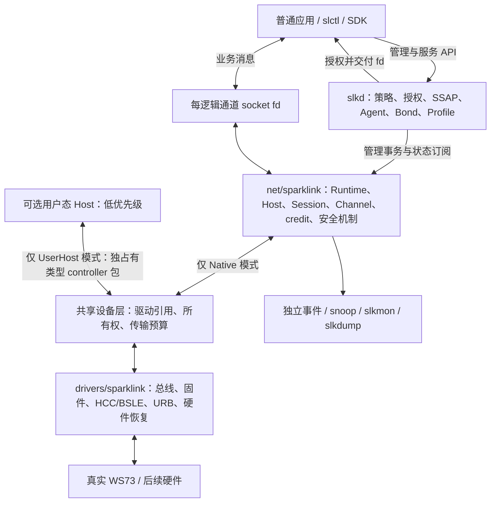

# SparkLink 架构

Canonical：本文件定义目标所有权与分层；[ADR0001](decisions/0001-management-channel-service-boundaries.md)
、[ADR0002](decisions/0002-session-socket-lifetime-and-proof-contract.md)与
[ADR0003](decisions/0003-optional-exclusive-user-host.md)定义决策和接口契约；
[IMPLEMENTATION_PLAN](IMPLEMENTATION_PLAN.md)是唯一执行/依赖/门禁入口，
[CURRENT_CAPABILITIES](CURRENT_CAPABILITIES.md)是唯一当前资格入口。
2026-10-13采用用户完整提案（hash f6f8e16d856072914cb30989595343e308c7535015cf47e5fcca2ea7cee19133）。
目标描述不表示代码已接通；最新事实与调整见[采用记录](ARCHITECTURE_ADOPTION_20261013.json)。

实现状态、逐轮门禁和历史失败不在本页维护，参阅唯一资格与实施计划。
[拆分前的历史原文](https://github.com/OpenSparklink/sparklink/blob/670674736ac90ec0f89ca0330849e22b1bc8f81b/docs/ARCHITECTURE.md)保留原始源码身份及全部限定范围。目标职责及以下架构决策保持不变。

## 目标分层及架构决策

### 总体结构



### 唯一职责

| 层 | 唯一所有者 | 禁止跨越 |
|---|---|---|
| drivers | 总线匹配、端点、固件、板配置、传输 framing、设备 I/O、电源和硬件恢复 | 应用策略、SSAP 数据库、Profile callback |
| net（Native模式） | NativeHostRuntime、DLI方言、命令事务、连接/DTAP、协议credit、安全机制、可信状态 | 用户服务数据库和厂商私有库 |
| 共享设备层（目标，待分离） | 驱动/硬件generation、互斥所有权、传输资源/提交gate、权限与故障 | UserHost时继续处理原生协议credit或伪造Ready |
| slkd | Managed 策略、授权、SSAP Engine、Agent、trust、Bond store、Profile | USB/HCC 直接操作、伪造内核安全状态 |
| 应用 | 业务协议和 UI；使用授权 fd 或服务 API | raw DLI、隐式全局 adapter、私有 transport |
| UserHost（未来可选） | 用户态独占DLI/credit/连接/DTAP/SSAP/协议安全；厂商Host适配另核对 | 伪装Native Backend、把自报状态变为原生可信状态或默认承诺SDK兼容 |
| 观察工具 | 独立订阅和诊断 | 抢占协议 RX、隐式修改硬件 |

### 采用的关键决策

| ID | 决策 | 原因／影响 |
|---|---|---|
| AD-01 | drivers / net / slkd 三层保持 | 机制、传输、策略分离，厂商差异不侵入普通应用 |
| AD-02 | ConnectionSession 独立于 fd | 关闭应用不应重建物理连接或 CMTC |
| AD-03 | Session 唯一 RX 分流，Channel 独立对象 | 防止多个 socket 抢信令和数据 |
| AD-04 | 基础不可靠消息目标使用连接式 DGRAM | socket 类型不制造可靠递送；可靠模式才开放 SEQPACKET |
| AD-05 | 内核可撤销 Grant + epoch | fd 委托不应永远绕过 owner 撤销和安全降级 |
| AD-06 | TxTicket 与明确提交线性化点 | 消除只在入口检查身份／授权的窗口 |
| AD-07 | command、controller data、peer 流控分别记账 | 不从 USB 成功或命令 credit 发明数据容量 |
| AD-08 | 不确定结果保留物理义务 | 不伪取消、不退款、不静默重试有副作用动作 |
| AD-09 | SSAP 唯一生产 Engine 在用户态 | 删除内核重复数据库／协议路径，易于服务和 Profile 演进 |
| AD-10 | 证明、开发测试、实机资格独立 | 明确假设，避免模型替代硬件 |
| AD-11 | core 不依赖 USB=y，driver 可注册 | Native/Virtual driver共同注册；UserHost独占包接口另行分离 |
| AD-12 | 未发布 UAPI 同步替换 | 不引入长期双实现和无意义兼容负担 |

| AD-13 | 可选UserHost与Native互斥；停用后接管，真实状态屏障后返Native | WP14低优先级规划替代固定vendord代理；本轮不实现 |

AD-01–AD-13已采用并映射ADR0001/0002/0003；不新建重复决定，目标实现状态以能力入口为准。


### 可选UserHost：当前只规划（AD-13 / WP14，P4）

Native主线保持：内核Host拥有DLI/协议credit/connection/DTAP/security机制，slkd用户态SSAP/Profile/策略，
应用用每逻辑通道socket。UserHost拥有完整协议Host，内核仅保留共享设备/固件/USB/HCC/BSLE、
传输预算和访问强制；两模式互斥，其他controller不中断，不复用Native Backend来代理用户Host。
当前未实现DeviceRuntime分离/UserHost UAPI/slk-vendord/厂商Host adapter；代码中的D-Bus Proxy不算它们。
首版先停用，拒绝连接/在途/未结清发送；socket对象与租约/epoch持权、dup/fork/SCM及最后引用分别处理，
撤权/join/实际控制器状态屏障后才返Native新身份并重初始化，不继承credit/link/key，也不把自报状态当Ready。
[唯一契约及未来门禁](decisions/0003-optional-exclusive-user-host.md)记录细节和未决ABI评审项；
[源码审计](evidence/userhost-planning-audit-20261013.json)区分存在代码与未来任务。WP14不成为当前主线前置。

## 对象、身份与引用

### 对象树

```text
ControllerSlot（接入定位、跨重枚举恢复预算）
  └─ 共享DeviceRuntime（目标：驱动引用、hardware generation、owner/epoch、传输限额）
       ├─ UserHostBinding（未来、与Native互斥：socket引用/接管租约）
       └─ NativeHostRuntime(generation)（当前仍与设备层结合，未来分离）
            ├─ BackendRef / Descriptor / Host / CommandQueue / CreditLedger
            ├─ StateSubscriptions / SnoopSubscriptions
            └─ ConnectionSession(lifetime, handle)
                 ├─ CMTC / 能力 / SecurityContext / 唯一 RX 分流
                 └─ Channel(local_tcid, remote_tcid, mode, incarnation)
                      └─ SocketBinding(grant, authorization_epoch)
                           └─ VFS file 引用：原 fd、dup、传递后的 fd
```

| 对象 | 资源及失效规则 |
|---|---|
| ControllerSlot | 定位同端口，记录当前 USB incarnation、恢复次数、阶段和期限；不是密码学身份 |
| Runtime | 一次注册 generation；Host、credit、worker、事件、连接表；退休后旧回调不得修改新实例 |
| PeerObservation | 某 Runtime 的发现缓存；同地址也分 controller；不是认证或连接事实 |
| ConnectionSession | 一次物理连接 lifetime；信令、协商、通道表、安全和 RX 分流；独立于 Binding |
| Channel | TCID、PI、模式、MTU/MPS、协议队列及关闭事务；重建产生新的本地 incarnation |
| SocketBinding | 一个授权应用绑定；拥有软件准入、等待和文件清理；新 lease 不复活旧 Binding |
| KernelGrant | 权限范围和撤销代次；与 Managed lease 和连接安全关联 |
| Operation | 请求者、request id、参数、原 deadline、唯一终态、结果保留期限 |
| TxTicket | 不可变提交归属、授权、credit reservation、编码结果和提交阶段 |

### 身份规则

- Registry 编号仅定位，不承载完整生命周期身份。
- 使用 controller id + generation，连接增加 lifetime；内核引用还关联实际对象。
- Wire handle、local TCID、remote TCID、PI 分开类型和转换，禁止散落魔数。
- USB 地址、handle、TCID 可复用；重枚举不继承旧 Runtime。
- generation/lifetime 不得静默回绕；跨内核重启的持久化增加 boot 作用域或稳定身份，不能只用计数。
- 地址相同不等于可信 peer，controller 与 peer 组合不丢失作用域。
- 软件 incarnation、epoch、request id 不被自动带入 wire，不能用于假关联。
- 稳定设备配置使用管理员别名／已确认设备身份；端口用于定位，不用于密码学认证。

### 引用和销毁

file、worker、timer、URB callback、Backend module 各持明确引用。注销顺序为禁止新准入、逻辑失效、通知等待者、锁外 stop/drain、撤销注册、最后释放。注销返回后是否仍允许清理回调必须由接口契约明确；不得回调已释放对象。


## 正交生命周期与权威状态

### 状态分离

| 维度 | 状态示例 |
|---|---|
| Backend | Absent / Booting / Reenumerating / Online / Quiescing / Failed |
| Host | Uninitialized / Initializing / Setup / Ready / Fault |
| Managed | Free / Owned / Revoking |
| Radio | Unknown / Configured / Off / On，广播和扫描独立 |
| Connection | Connecting / Connected / Disconnecting / Dead |
| Channel | Negotiating / Open / Closing / Failed / Closed |
| Security | Unauthenticated / Authenticating / CredentialReady / Installing / EncryptedConfirmed |

Ready、Enabled、Available、Powered 不互相替代。Controller 元数据有效不自动表示 Host Ready，更不表示 Radio 已 Off。

### requested / pending / confirmed

所有有副作用操作分开请求、在途和设备确认值。真实匹配 Complete／领域事件更新 confirmed。拒绝、短写、超时、错误 opcode／generation 不提前提交状态或成功统计。

### 部分初始化清理

记录每一步成功来源、资源创建和无线事实；清理只针对已创建／已确认资源。未知广播实例不能盲目 disable。未确认 Off 不发布 Off。未知或清理失败进入隔离／恢复，不能因为本地释放 lease 就 Free。

Managed release、最后 fd、dup、在途回复、设备移除和 daemon crash 与这份初始化事实日志组合验收，保持活动 Ready 同行不变。


## Backend、固件与协议差异

### 注册接口目标

接口语义包括 register、start、submit、stop、recover、RX 和 fault。使用可引用 Backend handle，接口明确进程／原子上下文、错误、取消、回调次数、模块 pinning 和 drain 屏障。语言实现可采用小型版本化 C seam；不承诺稳定 Rust ABI。

### Descriptor

分别记录 bus、identity、dialect、capability、limit、quirk、firmware/board provenance、PM/recovery capability。支持三态 Supported / Unsupported / Unknown，每项附来源和 generation。

软件预算不是硬件限制；0 不自动表示无限或已知不支持。缺少可信发送上限／完成机制时不开放发送。

### WS73启动

```text
端点校验 → 镜像/板配置校验 → 下载 → 同端口新枚举确认
→ BSP_READY → customize → CUSTOMIZE_RECEIVED
→ SLE_OPEN → BOOT_FINISH → DLI真实查询
→ 按初始化事实确认Radio状态 → Ready
```

每阶段共享原始总期限，另有阶段预算、有限重试、完整长度和回复校验。启动通知应由正确接收窗口捕获，不能丢失后本地合成成功。

SDK111 qualification 绑定实际上传的镜像和配置 hash。暖态 version tuple 不证明刚刚上传111。combined 拼接、各段、校准、运行配置分别留来源。SHA 校验只证明内容完整性，不证明厂商签名、来源可信或板级校准。

### 标准、SDK、参考库及 OHOS

为每条事实维护标准版本/表格、SDK 调用约定、libws73-usb/OHOS 行为、本项目 bytes 和验证状态。0x0401 等冲突在 dialect 处理；标准路径保留独立测试。

私有 SDK 和逆向仅用于用户本地分析与独立实现，不公开固件、校准、私有库或不获许可的反汇编。参考代码复制／链接单独审查许可证；不把“协议参考”当作可直接搬运实现的许可。


## 数据与文件契约

Runtime→Session→Channel→Binding是目标TX/RX路径；Session唯一消费并分流CMTC及业务数据。
command credit、controller ACB credit、peer流控和软件包/字节预算分别记账。
软件准入、USB提交、NOCP及对端应用校验四阶段分开。

DLI PB、DTAP SAR、SSAP分片是不同层：每层记录长度/片数/字节预算/原期限，
按实际模式开放。当前实机上限为application249/DTAP254；仅应用250/253/254/255拒绝
已验证，其他分层边界和长包仍缺。EAGAIN保留游标，不确定已提交不从头重放。

完整Ticket/Grant、NOCP假设、socket语义、dup/关闭和同lifetime重开决策以
[ADR0002](decisions/0002-session-socket-lifetime-and-proof-contract.md)为准；验证与实机门禁
以IMPLEMENTATION_PLAN为准，避免在本文件维护另一套执行清单。
## 管理、事件与用户态

### 权威接口

管理API、数据socket、观察订阅、Diagnostic、未来UserHost接管分离。
当前Native Host／ConnectionSession／Channel承担连接和数据权威；旧ConnManager/AdvScanInner/
全局角色、模型AFH/sync/PDU和第二RX分流不再编入默认内核。未支持能力不能通过本地模型报告成功。
PM决策按controller归slkd；驱动保留真实电源/板级机制。默认内核不保存PowerInner估计模型，
未接通硬件PM必须拒绝，不能用configfs全局模式限制其他controller或发布可信PM状态。genl/ioctl等若保留多个前端，仅转发到同一内部权威状态和事务，不各自写状态。

UAPI采用固定宽度、对齐、version/length/flags/reserved和可验证上限。修改同步C、Rust、Python绑定、CLI、D-Bus和CI pin。ioctl结构大小影响编号；size字段不能修复旧编号静默变化。

configfs只承载明确配置，debugfs不当稳定生产API。raw Diagnostic需权限和冲突隔离；只读接口也不能公开密钥或敏感payload。

### 事件和快照

OperationResult归原请求者；StateEvent每订阅者独立游标；Snapshot以水位重同步；Snoop独立有界队列。sequence缺口可见，慢reader不阻塞Host。

复制失败不提交消费游标，短buffer不交付半记录。快照与后续sequence一致，避免 resync窗口漏事件。移除唤醒，终态结果保留与淘汰有明确预算。

### slkd运行模型

每Runtime/Session独立actor或串行协议执行上下文；D-Bus信号和耗时操作在锁外。同步fd避免阻塞Tokio工作线程，异步等待可取消。不存在active adapter全局协议状态交换。

重启时枚举、快照、确认旧owner撤销、新lease、订阅水位、重新应用策略。不能盲目重放连接／写属性等未知副作用；旧fd有效性由Grant决定。

### API和SDK

管理和服务经授权D-Bus/高层SDK，数据经授权fd。C/Rust/Python映射同一契约，不各自实现wire状态机。CLI显示请求、等待和实际状态；UNKNOWN/UNSUPPORTED/Fault明确呈现。


## SSAP、服务与Profile

唯一生产SSAP Engine归slkd；内核提供完整通道PDU、归属、安全上下文和实际模式能力，不保留双数据库。

Engine负责ExchangeInfo、MTU、扩展码、协商事务、SSAP分片、request-response、indication-ack、服务数据库、remote cache、handle分配、Profile路由。

没有协商事务号时按标准限定在途；不自行增加wire ID。原始事务deadline、标准规定的失败时限和分片timer分别遵守。notify/command不被无关等待无限阻塞。

ProfileRequest包含controller/generation/lifetime、attribute/op/offset/payload、security、request id、deadline。真正调用应用callback并经真实PDU返回，不用本地echo代替。

分别校验read、两种write、notify、indicate、认证、加密和授权。属性累积与offset使用checked计算和每事务/连接/全局预算，失败无假提交。

服务顺序：最小真实发现/读写 → notify → indication/ack → Battery和DeviceInfo → HID及其他Profile。必要可靠模式按所用标准接通；没有模式能力时只开放适用操作或明确不支持。Profile注册不等于服务互通。


## 安全、Bond、PHY和PM

### 安全职责

内核：协议时序、密码学、active credential、加密安装及强制安全。slkd：Agent、方法选择、用户确认、trust、持久化和撤销策略。

每连接安全状态只由真实协议与安装结果提交。无owner、拒绝、proof缺失/错误、超时、非法key、FFI失败或崩溃均fail closed。失败不提交密钥、计数或Encrypted。禁止测试密钥降级和固定nonce。

算法基于匹配标准与实际固件支持，不猜测；算法向量、协议证明和实机安装独立。

### Bond

保存可恢复的受保护凭据，fingerprint不是凭据。版本化、原子更新、0600或等价严格权限、密钥保护和敏感缓冲清理；明确KEK/保护机制的威胁边界，不把普通文件编码称为加密保护。

恢复核对controller身份、peer和安全上下文。撤销覆盖持久化、active credential、相关Grant及可选控制器token；opaque token仅在真实能力支持时使用。覆盖损坏store、重复记录、升级/回滚及撤销后重连。

### PHY

net校验真实capability、允许参数及适用约束，报告confirmed实际值。slkd执行Fixed/Balanced/Throughput/LowPower策略、hysteresis、minimum dwell、backoff和公平性。未知不自动切换，不能把requested当actual。

### PM

PM需覆盖system/runtime suspend、resume/reset-resume、未完成命令/数据/安全事务和热拔出。区分保留原Runtime可继续与必须新generation重建。不得resume后重新授予旧已撤销fd。仅在匹配控制器和固件资格成立后声明支持。


## 故障根因与每设备有限恢复

### 故障分类

| 类别 | 需要区分 |
|---|---|
| 初始化 | 镜像/板配置、ACK、通知窗口、方言、参数顺序 |
| 传输 | short、stall、timeout、URB取消、QEMU owner失效 |
| 枚举 | 同端口新地址、节点不存在、host地址分配失败 |
| 硬件 | 芯片状态、供电、电气、xHCI历史warning |
| 协议 | Host状态、迟到回复、credit不确定、连接复用 |
| 多设备 | 同时启动、RF参数、共享hub、同行错误传播 |

发现某一软件原因不代表所有自然故障同根因。保留冷/暖、单/双/四设备、QEMU与宿主诊断的对照；原生实验内核测试标为未授权/未执行。

### 恢复状态和预算

```text
Fault → CloseAdmission → Revoke/Quiesce → Stop/Drain
      → Backoff → VerifiedRecovery → FullInitialization → NewGenerationReady
      → BudgetExhausted/Absent/Failed
```

恢复Coordinator按ControllerSlot保留预算，跨boot/runtime probe不清零。每动作有最大次数、总deadline、适用条件和升级理由；稳定期归零依据明确。

### 恢复层级

依次考虑协议恢复、单endpoint/transport、已核验芯片reset、同端口重新枚举和完整固件启动。读失败、短读写和结果不确定不得盲目重写复位。未知寄存器访问不进入公共UAPI。

USB总线reset、芯片reset、hub断电分别记录。缺失设备没有handle时记Absent；不能复位另一只。ganged hub动作影响全部设备，不能授予单设备恢复资格。hub off/on不证明实际冷断电。

### 成功条件

新实例完成真实初始化/查询/必要无线状态确认，并由业务测试验证恢复后可用。同行的generation、lease、队列、credit及业务连续性保持；slkd PID/连接不变。

人工注入、QMP detach、人工拔插、冷断电、协议恢复分别保留标签。自然RCA与不依赖人工拔插恢复未闭合时不关闭K10/K14/K15/K19和相关跟踪。


## 开发、部署、观测与性能

### VM环境

宿主编译+单层headless QEMU即可；不需要以嵌套虚拟化作为开发前提。实验VM拥有私有内核、模块、固件、D-Bus、slkd、普通测试用户和工具；Bond测试用guest专属持久盘。

设备测试有独占锁，固定物理端口→guest端口→Runtime。不要默认共享宿主系统盘和全部USB控制器。udev仅对目标设备配置必要权限。

uhubctl权限可用于明确的实验对照；执行前停止相关VM owner、记录范围和前后inventory。共享hub切电不属于无扰单设备恢复，也不默认进入生产恢复策略。

### 包与服务

内核core/driver、用户态daemon/SDK/工具、实验功能、固件本地准备分别打包。显式配置错误不能静默回默认；未接通策略拒绝或明确实验状态。

slkd采用最小能力、受限文件路径及服务sandbox。privileged机制复杂度增长时再评估小型broker进程；不为当前纵向闭环无条件引入额外daemon。应用运行无需sudo，宿主安装/设备权限一次性管理员配置不等于应用需要root。

### 日志和指标

日志包含port/incarnation/controller/generation/lifetime/TCID/request/ticket、状态前后、阶段、原deadline、errno/raw status和恢复预算。秘密、长期key、未授权业务payload不默认进入journal。

指标分别计admitted/submitted/transport-completed/controller-completed/app-validated、队列字节、credit/debt、RX丢弃原因、reassembly失败、stale/duplicate、event loss和recover动作。

### 性能

测试软件准入、排队、transport、controller完成、应用RTT、吞吐、CPU/内存及延迟分位。容量和radio参数相同时再比较方案；无同条件Bluetooth基线不宣称领先。

先使用有界复制接口，测量后再决定零拷贝/mmap ring。优化不得删掉身份、预算和完成校验。


## 旧实现清理与14项整改

### 三类处理

| 类别 | 内容 | 删除／保留门禁 |
|---|---|---|
| 立即删除 | 固定nonce、test-key fallback、伪Complete、错误吞掉、提前成功状态 | 调用审计、失败无副作用、相关基线保持 |
| 移入测试 | codec/golden、故障注入、模型、callback actor生命周期 | 专用后端/selftests，不进入默认生产 |
| 等待替代 | 旧event ring、local SSAP staging、旧UAPI、总线enum/全局parser | 调用者迁移、同契约回归后删除 |

新旧生产状态不能长期双写或双消费。无调用者模块接通、隔离或删除，不用全局allow(dead_code)隐藏。原失败证据和有价值回归保留。

### 原14项对应工作

下表是历史发现→实施归属，不表示每项仍存在。先用新源码确认已修范围。

| 发现 | 内容 | 归入工作包/验收 |
|---|---|---|
| R01 | nonce、proof、测试密钥降级 | WP00/WP09；错误proof/旧连接/算法失败不可信 |
| R02 | crypto FFI错误吞掉 | WP00/WP09；实际包装错误传播，密钥/状态/计数不提交 |
| R03 | 重复TX与影子队列 | WP02/WP03/WP18；唯一TX、真实credit及完成阶段 |
| R04 | SSAP长度、累积与期限 | WP08；checked offset、总预算、断链和超时 |
| R05 | UART/SPI假Complete | WP00/WP13；明确unsupported，模拟移测试 |
| R06 | 配置静默降级 | WP00/WP16；显式缺失/权限/未知策略拒绝 |
| R07 | 权限位语义错误 | WP08/WP10；C/Rust/Python语义一致 |
| R08 | 通知出队/credit/归属 | WP08；保留未提交、实际确认、通知与指示分开 |
| R09 | PHY和加密提前状态 | WP09/WP15；requested/pending/confirmed |
| R10 | handle映射错误 | WP02/WP03；归属统一，无默认0偷换 |
| R11 | serdev全局parser | WP13；每设备ctx、晚回调/移除隔离 |
| R12 | event copy消费错误 | WP12/WP18；完整copy后commit，独立订阅 |
| R13 | core/USB/Virtual耦合 | WP13/WP14；可注册Backend、真实Virtual、构建矩阵 |
| R14 | dead code、严格CI与错误完成声明 | WP00/WP16/WP17/WP18；真实verdict与能力入口 |


## 风险、假设与开放问题

| 风险 | 应对 | 关闭条件 |
|---|---|---|
| NOCP缺完整身份/重复 | 保留debt、复用屏障、模型反例、显式硬件假设 | SDK111实际语义和可执行防护验证；不能只靠账本证明 |
| 同lifetime重开残留包 | Session持续状态、旧RX排空、拒绝未支持reopen | 可信屏障与双端实际旧包隔离 |
| 撤销到submit窗口 | Ticket/Grant/driver门禁同一线性化契约 | 模型+VM交错+源码映射 |
| 长包/PB能力未知 | 分层实验，保持短包基线，失败明确 | 全payload往返和真实credit段数 |
| 标准SAR/方言歧义 | 版面、参考和独立capture核对 | 差异矩阵与对应golden/实机 |
| 自然启动/消失/xHCI | 时间线、冷暖/设备数量对照、有限恢复 | 可复现根因与非人工隔离恢复 |
| shared hub供电 | 不把ganged动作算单设备恢复 | 拓扑与电源能力确证；单设备恢复资格 |
| native对照不可执行 | 保持VM-only，宿主只读诊断 | 用户未来授权后另行资格；当前不宣称 |
| 私有SDK/固件许可 | 本地使用、事实独立实现、无未经授权分发 | 来源与许可审查 |
| 模型与代码漂移 | 同批hash、映射、CI变更触发 | 准确源码报告和回归 |
| 地址族/ABI未发布 | 实验明确、协调、同步迁移 | 类型语义及正式分配/发布决定 |

当前整改实现切片：K464d4d8a9de7以opaque Runtime/Backend保留票据，在驱动准备URB后
重新验证lifetime/撤销/credit并原子提交；非阻塞提交是明确的Host-lock临界区例外，
等待/cancel/join在锁外。完整Session/Channel/Grant refs、NOCP屏障和Backend组合仍按
ADR0002/IMPLEMENTATION_PLAN推进。无消费者RustNetlink副本已移除；K7c6d530ffe2e的C前端仅保留registry数量／软件版本。
旧默认controller控制、状态与简化通知已删除，未来保留的多个前端仍必须共享同一权威事务。

Runtime Session迁移切片K3c8da4fac302/Ud1f9dde：Runtime table持session kref，Session唯一
接收/CMTC，Channel有界独立队列，fd仅Binding。close撤销先赢则不能新USB提交，
同life无协议前明确拒绝重开；Runtime退休在native_lifecycle之前join Session。
准确40/249业务与dup/last-close子门禁通过，不授予动态通道、完整Grant/NOCP/恢复资格。

Managed lease epoch切片K3ee1a60bf06f/U2a97786：Host持pure authority；Session保留不可变
lease token。Managed发布/撤销、软件TX准入和实际USB提交同Host锁排序；已提交债务不退款。
socket v2同步broker，未支持方向/安全组合明确拒绝。新真实正常业务保持资格通过；完整
KernelGrant scope/security/blocked RX/VFS与受控撤销矩阵继续按WP05，不宣称整体架构完成。

RX切片Kf1034577ecc1/Ud570819：取包/PEEK引用在Host授权及Session/RX锁下线性化，
每次唤醒重新验证；copy/wait在锁外，已准入copy可完成。新40/249路径保持验收通过，
受控阻塞recv/release/last-management-fd/dup/owner-death及完整Grant仍按WP05继续。

Binding Grant切片Kbf8663/Udfb8636：Scope/方向/安全要求唯一存fd Binding，Channel借用其
持有socket的同一Grant；真正发布在Host门禁下，所有Binding锁IRQ-save。新40/249及
六撤销/两个方向资格通过；S5信任与降级、SCM_RIGHTS/daemon死亡/在途/Backend事件迁移
保持完整原计划，不能宣布全架构完成。
