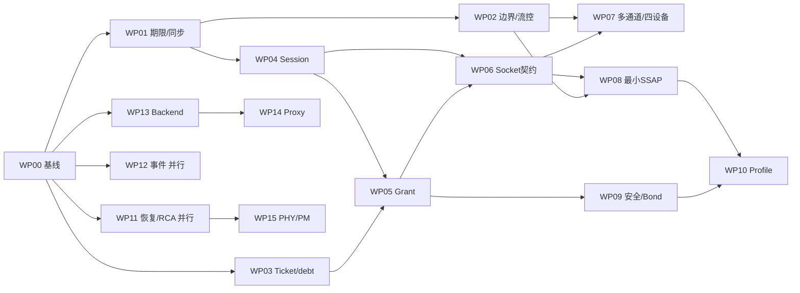

# SparkLink / Linux 联合实施方案

**唯一执行计划。** 完整S0–S6及原28项issues验收范围保持；工作包不是新issue或缩小scope。
采用2026-10-13用户提案并核对最新源码/证据/在线issues，调整记录见
[ARCHITECTURE_ADOPTION](ARCHITECTURE_ADOPTION_20261013.json)。
原长期追加日志已完整移入[历史归档](IMPLEMENTATION_HISTORY_PRE_20261013.md)，不再并列维护“当前计划”。
目标分层见[ARCHITECTURE](ARCHITECTURE.md)，接口决策见ADR0001/0002；
当前五维资格只在[CURRENT_CAPABILITIES](CURRENT_CAPABILITIES.md)维护，
goal的剩余工作/依赖持久记录见[GOAL_EXECUTION_STATE](GOAL_EXECUTION_STATE.json)。

## 采用后的准确基线与优先级

最新执行阶段：**先完整整改到采用的目标架构，再继续扩展功能。** 旧SSAP业务剥离已取得本批退出资格；
当前统一Session/Ticket/Grant与socket文件契约，接着整改Backend注册及事件权威来源/重复路径。
长度与真实credit的必要现有路径回归/证明并行；新长包、多通道、SSAP/Profile等扩展随后推进。
不要求所有旧控制面竞争组合先穷尽，保持当前WS73能力。
[当前SSAP调用审计/三类清单](SSAP_PRODUCTION_SEPARATION_20261013.md)。


采用的近期次序：WP18-SSAP实际调用审计、旧内核业务剥离、调用者拒绝/迁移及三类清单
作为WP08新用户态Engine的前置门禁；本批剥离门禁已通过，整个WP18未完成。保留DTAP/CMTC/TCID/credit/socket/Grant/安全机制；
不恢复不可靠旧wire Engine，不把全部旧控制面整改当作数据开发前置。


当前整改实现K770364dcc152/U7d8857b已签名，旧SSAP生产依赖与18 ioctl退出，离线通过；
精确K770364dcc152/U96ac968新VM：40短消息、249八轮/16超限、RF22与建链断链
均通过，历史18命令root/ordinary全部ENOTTY。WP18-SSAP本批退出条件通过；
整个目标架构、WP18和相关原issues仍开放。此前Kd3/afb证据完整保留。
WP01协商原期限/锁快照已实现，FV01/FV03限定通过，新镜像DG01每角色20/共40轮通过。
application249/DTAP254八轮、application250/253/254/255十六次EMSGSIZE且捕获零载荷
已独立封存；不是其他分层边界、长包或credit耗尽资格。DG02同Binding恢复短包仍补测。
Kani unsupported/超时仍NOT_PROVEN；NOCP四步风险反例和生产ledger回归保留。

采用提案时的纵向依赖仍有效；最新架构整改阶段优先序如上。必要数据门禁依赖为：
收尾WP01必要worker/期限负向映射（不以控制面竞争全集阻挡数据）→
WP02同Binding尺寸/各层边界、真实credit/背压/有限队列→WP03提交票据/复用屏障→
WP04 Session唯一RX→WP05内核可撤销Grant→WP06 socket类型及文件契约→
所需长包模式、多通道/四设备两组与真实SSAP。WP11自然RCA/有限恢复、WP12事件及
WP18旧代码清理持续并行。缺可信能力/屏障时明确拒绝；保留真实短包路径。

VM-only：实验驱动/真实WS73 I/O只在VM；宿主仅编译、纯模型和只读诊断。
原生实验内核对照未授权/未执行。人工拔插、hub切电、QMP或注入不代替自然恢复。
所有原issue及goal维持开放/active；部分证明或门禁不得关闭整项。

## 连续目标与不变约束


### 连续交付目标

| 目标 | 普通用户能够完成 | 必须获得的证据 |
|---|---|---|
| NS1：发现 | 选择两只真实 WS73，一只广播，一只发现；交换角色和重插仍成功 | 独立 Ready；随机标识、数据、地址、RSSI；10 秒内匹配；20 轮；物理隔离；同 slkd；非人工故障恢复单列验收 |
| NS2：业务数据 | 每逻辑通道 socket 上双向业务往返 | 随机序号／载荷；对端应用校验并回复；交换方向；两端 USB/HCC/数据证据 |
| NS3：并行数据 | 四只设备组成两组并行 | 队列、身份、credit、断链和恢复不串扰 |
| NS4：服务 | 真实 SSAP 发现、读写、通知、指示 | 服务端真实 callback／数据库；客户端结果；指示确认和负向语义 |
| NS5：安全 | 配对、加密、保存 Bond 并重连 | 双角色、拒绝／超时／错误凭据、真实安装、重启恢复与撤销 |
| NS6：运行 | 热插拔、进程崩溃、有限恢复、PM 后继续使用 | 同行不受影响、旧对象不复活、明确失败、无人工恢复要求逐项通过 |

NS2 的短消息切片及旧SSAP剥离后回归已封存。近期先整改目标架构，并保持NS2纵向路径；后续扩展NS2。必要的身份、安全边界和状态同步必须完善；控制面竞争全集不作为启动数据开发的前置条件。

### 不变约束

1. 实验内核和真实 WS73 I/O 只运行在 VM；宿主可编译、运行纯软件验证和读取诊断。
2. 不在宿主安装／启动实验内核；原生实验内核对照未授权、未执行。
3. 保留已验证广播扫描、连接与短消息路径；每批有影响的变更取得准确新提交的回归。
4. 不伪造 Complete、密钥、nonce、加密状态、能力和硬件回复。
5. UAPI 尚未发布；调用者迁移后直接删除旧接口，没有旧 ABI 兼容期限。
6. 自然故障根因和无人工自动恢复未闭合时，相关 issue 继续开放。
7. 小提交可 review，按既有签名和 trailer 要求提交推送；文档与 issues 同步范围和证据。
8. 部分成果不关闭完整 issue，不把普通 CI 或注入替代实机。
9. 本期首先交付 SLE；其他星闪能力逐项进入能力和标准矩阵。


## 标准基线与章节映射

用户提供的本地标准归档已定位为相邻目录 `../sparklink-standards`；其 `00_标准清单.csv` 记录版本和 hash。本方案使用该归档的版本，不宣称它们是联盟当前最新版本。标准正文、测试规范、故事图解分开；故事图解只作辅助。源码现有注释与常量必须重新和正文/表格核对。

| 归档标准 | 重点章节 | 实现与验收归属 |
|---|---|---|
| T/XS 00001-2025 V2.0.0 架构 | §6–§9 | 分层/传输通道与功能归属；K#1/#6，U#3 |
| T/XS 10003-2025 V1.1.0 数据连接接口 | §6–§9；§10 测试；附录 B/C/D | 标准 transport/packet/opcode/event/错误码；K#2/#11/#13/#16/#19 |
| T/XS 10002-2025 V2.1.1 SLE | §7、§9、§11/§13；加解密示例附录 F | 链路机制与安全/测试向量；K#7/#18/#19，U#5 |
| T/XS 20001-2025 V1.2.0 设备发现与服务管理 | §6、§7.2–§7.4、UUID 附录 B | 广播/SSAP Engine、权限、协商、事务、Profile；K#2/#6，U#3 |
| T/XS 20002-2025 V1.1.2 传输与控制规范 | §6–§8 | TCID、传输模式/帧/分片、连接能力与测量；K#6/#17，U#3/#4 |
| T/XS 40001-2022 V1.0.0 网络安全通用要求 | §6–§9 | 安全/授权/凭据/日志；K#5/#7，U#5/#7 |
| T/XS 30011-2025 V1.1.0 电量信息管理 | §7、附录 A | 正确 Battery service/attribute/权限；U#3 |
| T/XS 30004-2025 V1.1.0 HID 数据交互；30013-2025 V1.1.0 HID 应用配置 | 30004 §7–§10/附录 A；30013 §6–§9 | HID+DeviceInfo 服务、描述符/权限、数据路径；U#3 |
| T/XS 30012-2025 V1.1.0 设备信息管理 | 正文/UUID 表，实施前逐项核对 | HID 的必选服务依赖；U#3 |
| T/XS 50003-2025 V1.2.0 SLE 设备测试 | §4 的 mandatory/conditional 特性矩阵 | 按实际角色/能力选择测试；K#19 |
| T/XS 50004-2025 V1.2.0 基础服务层测试 | §6–§11；数据集附录 | discovery/connection/SSAP/data 与异常；K#6/#17/#19，U#3 |
| T/XS 50005-2025 V1.0.0 电量信息服务测试 | §6–§9；数据集附录 | Battery discovery/read/descriptor/notify/indicate；U#3 |

已核对的设计约束：标准 TCID 是按 peer 独立的一字节标识，local/remote TCID 可不同；WS73 envelope 的 LE16 表示只属于方言适配。默认 SMTC 使用基础模式，可靠 SSAP 需分别协商连接与 SSAP 能力后建立可靠通道。SSAP、底层流/可靠 SDU、USB/HCC/ACB 三层分片独立；默认基础模式不能借任意底层切分替代 SSAP 分片。

SSAP Engine 先 ExchangeInfo，再使用协商 MTU/扩展码/分片/事务号/可靠能力；未协商事务号时，每 peer/channel 的 request-response 与 indication-ack 各自单在途，双向交互按标准 30s 失败门禁；command/notify 不受该等待阻塞。分片 timer、丢片/断链、属性修改的不确定状态按正文错误语义测试。

实验 Battery 已改为星闪 `0x060A/0x1034` 和正确命名权限；描述符/通知/用户态 Engine/真实互通仍须验收。DeviceInfo 的旧 `0x180A` 须重新核对 30012。HID 不能仅靠 callback unit test 宣告符合，需完成应用配置及必选 DeviceInfo 依赖。标准没有规定 SSAP 必须在哪个 OS 层，迁入 slkd 是本项目的明确架构选择。

每条验收增加 `标准号/版本/hash → 章/表/规范用例 id → 角色与 mandatory/conditional 判定 → 实现 → golden/负向测试 → 实机证据`。标准内部疑似勘误单列（例如 DLI §7.2 表 7 的范围与分组规则），结合具体命令表/实际 wire 核对，不盲抄；固件不支持或偏离标准的能力显式报告，不能由 Host 伪造符合性。完整正文 PDF 保持本地归档，不附到公共 issues。


## 完整S0–S6原退出条件

阶段表保留原范围，阶段不是要求近期数据先等待整项前序issue关闭。

| 阶段 | 主要工作与 issue | 退出条件 |
|---|---|---|
| **S0：可信基线** | K#1/#5/#13/#19、U#1：修 selftest verdict / ABI 漂移 / 同步 fd 的 Tokio 依赖；清理 fmt/clippy 与严格 CI 基线；冻结源码、toolchain、config；Host/Backend/owner ADR 和 WS73 证据矩阵 | 故意失败不能 PASS；C/Rust/Python conformance 通过；30s 静默事件期间并发 D-Bus 响应和 shutdown 正常；严格质量检查及现有基线失败明确 |
| **S1：每设备骨架** | K#4/#9/#10/#11/#12：可注册 runtime、descriptor、引用/模块所有权、generation；先实现真实 VirtualBackend，再迁标准 USB | 两 controller 交错同 opcode、inactive RX、不串状态；register 不冒充 Ready；失败/注销无 UAF/睡眠原子上下文；无 USB 的 core+Virtual 可构建 |
| **S2：公共 Host 与控制面** | K#2/#3/#5；U#2/#6：typed transaction、统一事件/snoop、Managed owner、动态 adapter 对象和枚举快照 | Virtual 和标准 QEMU USB 同一事务通过；迟到/重复/丢失事件与多 reader 负向通过；无锁内 I/O；独立 Enabled/Available/Powered 可观察 |
| **S3：优先完成 WS73 RF** | K#13/#14/#15/#16：USB/HCC/BSLE、固件/取消、Host dialect、真实版本/buffer、广播扫描建链断链 | G0 boot → G1 SLE/真实 DLI → G2 RF；标准 codec 不受影响；四设备独立 Ready，失败阶段明确；TX/RX capture 可复现 |
| **S4：真实数据与用户态 SSAP** | K#6/#17；U#3：TCID/ACB/credit、PDU owner、用户态 Engine/Profile、工具/绑定迁移 | G3 两组双向数据、长 PDU/253–255B 边界、真实远端 Profile callback/read/write/notify/indication；daemon crash、满队列、断链有确定结果 |
| **S5：安全、策略与 Proxy** | K#7/#18 与 U#5；U#4；K#1/#5 与 U#7 独立分支 | G4 实机配对/加密、Bond 重启重连与 revoke；PHY policy replay/实际能力门禁；fake vendor 全生命周期/权限/crash 端到端。真实闭源库未提供时明确未验证 |
| **S6：收敛与发布** | K#8/#19 及所有剩余 checklist：PM、hotplug/mixed backend、诊断构建、构建/模块组合、迁移删除、文档/包 | G5/G6、所有原验收项对应证据；关闭已满足 issue；支持矩阵区分模拟、实验、硬件验证；总跟踪最后关闭 |


## 并发、内存与形式化验证

### 执行和锁

原子回调只有界复制/排队/调度。协议和可睡眠工作每设备执行；Session唯一RX。状态、队列准入和关闭明确锁保护，避免分散atomic形成不一致快照。

registry只索引可引用对象。锁序、worker/timer引用和cancel路径进入设计审查；不锁内USB等待、用户copy或同步drain。逐步以事件唤醒替代10/50ms补偿poll。

### 资源预算

每Binding/Channel/Session/Runtime/全局有包数和字节预算，重组另有片数和deadline。OOM/满队列/恶意持续分片必须有确定错误或计数；不出现无限grow、timer续命或silent drop假可靠。

### 工具现状

| 工具 | 用途 | 已安装状态 |
|---|---|---|
| TLC/TLA+ | 生命周期、交错、有限恢复与反例 | `tlc` |
| Kani 0.68.0 | Rust生产纯转换 | 普通用户Cargo安装，`cargo kani` |
| CBMC 6.11.0 | C生产状态和codec | `cbmc` |
| herdtools7 7.58 | LKMM共享发布和锁 | `herd7` |
| Tamarin / ProVerif | 安全协议性质 | `tamarin-prover` / `proverif` |
| Maude | Tamarin依赖 | `maude` |
| Ghidra | SDK/固件参考分析 | `ghidra` / `ghidra-headless`；不是证明工具 |

全局入口在`/usr/local/bin`；Kani在普通账户`~/.cargo/bin`。系统安装记录：`/opt/opensparklink-verification-tools-20261013/system-smoke-tests.json`。13项安装检查只证明工具可运行。

### 证明工作包

| FV | 生产对象 | 工具 | 性质 | 必须声明的边界 |
|---|---|---|---|---|
| FV01 | channel纯转换 | CBMC | 构造与归纳不变量、原期限、关闭终态 | 不证明VFS/worker映射 |
| FV02 | CreditLedger | Kani | 精确软件守恒、无溢出、不确定不退款、controller隔离 | 不证明NOCP真实/唯一 |
| FV03 | 状态发布/准入关闭 | LKMM | 禁止半初始化/关闭后准入的指定观察 | 锁/内存序及源码映射 |
| FV04 | Managed/部分初始化 | TLC | 唯一owner、唯一终态、未清理不Free | cleanup事实、timer公平性 |
| FV05 | TxTicket/Down/Revoke | TLC | 提交线性化、无新准入、保留物理义务 | driver commit契约及回调 |
| FV06 | Session/Binding/reopen | TLC | fd独立、引用清理、旧数据不误投 | wire身份不足及屏障假设 |
| FV07 | NOCP复用 | TLC | 显式展示危险反例，验证屏障模型 | 同/跨lifetime重复语义 |
| FV08 | wire/PB/SAR | CBMC/Kani | checked长度/偏移、归属、预算、失败无提交 | input/unwind/模式范围 |
| FV09 | 配对/Bond | Tamarin/ProVerif | 认证、保密、重放、peer/lifetime绑定 | primitives和endpoint假设 |
| FV10 | 恢复/PM/Proxy | TLC | 有限收敛、旧gen不复活、崩溃隔离 | 无法要求永久故障必Ready |

### 证明方法

直接编译生产纯转换，避免复制更简单的实现。符号初态用表示不变量建立归纳域，构造器另证；不assume硬件永远正确。TLC动作与生产状态/锁/调用逐项对应。

控制器永久无回复时允许最终TimedOut/Failed；活性声明timer和调度公平性。不能通过weak fairness自动获得硬件回复。

Proof结果分PROVED_SCOPED、MODEL_CHECKED_SCOPED、BOUNDED_PASS、COUNTEREXAMPLE和NOT_PROVEN。超时、unsupported、漏property、未完整unwind均非PASS。期望反例是风险发现成功，不是能力验收成功。

### 当前接入点

当前已签名推送`formal/channel`、`formal/credit`、`formal/lifecycle`、`formal/lkmm`和`tools/run_formal.py`。报告绑定K d3abbdc/U40c7fba；FV01/FV03限定通过，FV04抽象模型784状态，FV07反例，FV02未证明。详见formal/README及能力入口；完整实现refinement和VM KCSAN/lockdep尚缺。


## 可复现测试与真实设备资格

### 证据层级

| 层级 | 证明范围 |
|---|---|
| 生产纯函数测试 | codec及局部状态转换 |
| 形式化 | 指定性质、假设和边界 |
| VirtualBackend | Host和生命周期契约 |
| QEMU注入 | 受控交错和传输故障 |
| 真实WS73双端USB/HCC/DLI | 控制器协议和业务端到端 |
| 物理拔插 | 真实移除/重接及同行隔离 |
| 独立RF嗅探 | PHY/空口更强协议证据 |

USB/HCC抓包不称独立PHY嗅探。真正对端应用收包是业务空口行为证据，但也不能扩展成标准认证。

### 当前数据门禁

| Gate | 用例 | 合格条件 |
|---|---|---|
| DG01 | 短PDU，两角色 | 每角色至少20轮；随机完整校验、真正回复；UID/caps；准确image/source |
| DG02 | 应用249/250 | 249实际完整往返；250按当前能力EMSGSIZE且零wire/debt；随后短包可用 |
| DG03 | 分层253/254/255 | 每条标明层；成功或明确拒绝与真实limit一致 |
| DG04 | 长包/PB/SAR | 仅支持模式；全载荷hash、片序、真实完成段数；错片/超时不交付 |
| DG05 | credit耗尽 | 真正无预算停止提交，恢复后继续；USB成功不refund |
| DG06 | 满队列/内存 | 包/字节限制、EAGAIN、poll变化、无无限grow；同行正常 |
| DG07 | 文件生命周期 | release/最后fd/dup/linger/shutdown/在途/排队各阶段有明确结果 |
| DG08 | 断链与旧身份 | 旧fd拒绝、新lifetime不收旧片/旧数据；handle复用屏障 |
| DG09 | Grant撤销 | 无新准入/commit、等待唤醒、旧fd不因新lease复活 |
| DG10 | reopen/多通道 | Session唯一分流、信令无竞争、残留数据隔离 |
| DG11 | 四设备两组 | 独立随机流、同地址作用域、一个故障同行仍往返 |
| DG12 | 真实SSAP | 客户端与服务端实际操作、notify/indicate及确认 |

随机run_id、sequence、payload及hash避免旧缓存误匹配。两端应用实际收到、检查和回复，不能用daemon模拟。

### 基线回归

影响共享Runtime/Host/driver的批次，运行已封存发现、连接和短数据门禁；局部文档或纯工具变更不机械重复全部硬件矩阵。必要负向用例随风险选择。新失败保留，不能覆盖旧证据。

### 诊断构建

按实际支持分别配置lockdep/DEBUG_ATOMIC_SLEEP、KASAN、KCSAN、UBSAN、故障注入。不要假定所有Rust和sanitizer组合可同时运行。使用独立VM镜像并绑定config/hash。


## 原全生态硬件G0–G6范围（继续保留）

DG01–12细化S4；不能取代原G0–G6、NS1或自然恢复条件。

| Gate | 实机退出条件 |
|---|---|
| **G0 Boot** | 四设备 cold 下载、runtime 枚举；warm/缺固件/损坏/拔出分开记录。已有旧 run 仅提供正向 boot 证据 |
| **G1 Ready / DLI** | 各自 BSLE/SLE、真实 version/buffer/features；可用能力来自各自查询，失败不标 Ready |
| **G2 RF** | A 广播、B 扫描建链，C/D 同时 discovery；交换角色；断链原因来自真实事件 |
| **G3 Data / SSAP** | 两组同时连接，用 controller/connection/seq 标记不同 payload；双向无串包、credit/253–255B/长 PDU；远端 PDU 触发 Profile、读写/通知/确认 |
| **G4 Security** | 双角色授权配对、实际加密数据、拒绝/timeout/错 key；daemon 与 guest restart 后 Bond 重连、不重新配对；revoke 后不能恢复 |
| **G5 Isolation / PM** | 保留 C↔D 业务时 reset/拔出 A 或 B，其他对象/订阅/调用持续；suspend/resume/reset-resume 与重复循环 |
| **G6 Mixed / 性能** | 标准 QEMU controller 与 WS73 同 guest；可选双 guest 各两设备。记录吞吐、RTT、掉包、credit stall/队列、payload/时长；先测基线再设目标 |

CI 每 PR 跑 fmt/check/clippy/unit/golden/ABI/Python/私有 D-Bus；有适用模型的集成 runner 跑 Virtual/标准 USB/Proxy fake；真实硬件 runner 串行执行 lab。任何 required test 未执行、timeout、FAIL、kernel BUG/WARNING 或缺预期用例均不能成为 PASS；不适用项使用明确 SKIP 及原因。先验证测试工具自身的失败判定。


## 工作包：落到实现、依赖与退出条件

优先级P0=禁止错误生产行为；P1=当前数据/生命周期安全与正确性；P2=扩展能力；P3=发布扩展。优先级是安排顺序，不改变原issue严重程度。每包拆为reviewable小提交，至少产出代码或明确unsupported、测试/证明、能力与证据更新。

代码范围是候选落点，实施前审计调用者；不为匹配文件名而重写已验证路径。

### WP00：基线和错误能力封锁（P0，S0，持续）

- 范围：现有review/cleanup清单、`sle_security.rs`/crypto/transport、slkd config、CI和capabilities。
- 动作：复核14项最新状态，确认生产不存在test nonce/key/Complete；显式错误不默认成功；配置不静默弱化。
- 依赖：无整项依赖；执行前读取主线程dirty改动。
- 交付：逐项已修/未修表、生产调用链、失败传播用例、当前支持矩阵。
- 退出：对应不可靠能力拒绝，已验证WS73路径保持；不是整个S0/S6关闭。

### WP01：协商原期限和共享状态（P1，S4）

- 范围：`sle_channel_socket.c`、`sle_channel_state.h`、实际selftest、`formal/channel`/`formal/lkmm`。
- 动作：Negotiating/Open/Failed/Closed转换，原deadline限制所有必要步骤；同锁快照，send准入与close排序，worker引用可靠。
- 依赖：WP00的当前基线；不等待Session整体迁移。
- 证明：FV01/FV03，弱同步负对照必须展示允许的错误观察。
- 实机：新镜像DG01；协商回复暂留/credit阻塞/关闭不永久挂起；同行继续收发。
- 退出：报告范围和未证映射明确；新短数据资格，不宣称reopen已解决。

### WP02：尺寸、分片和有界数据预算（P1，S4）

- 范围：`sle_native_data.rs`、`sle_data_credit.rs`、A3/ACB及channel wire、slctl channel测试。
- 动作：先DG02/DG03，再明确SDK111 DLI TX PB和NOCP计段；分片游标、重组总期限、包/字节预算。
- 依赖：WP01最低稳定门禁；codec/边界harness可并行。
- 证明：FV02/FV08；输入边界、unsupported和unwind报告。
- 实机：249/250、各层253/254/255、credit耗尽、队列满、长包完整hash与恢复短包。
- 退出：只开放实际支持长度和模式；长包未知不增加默认上限。

### WP03：提交票据、旧debt和复用屏障（P1，S1/S4）

- 范围：Runtime/native TX、driver submit、credit ledger、连接Down和owner撤销调用链。
- 动作：定义commit点；Ticket绑定身份和Grant；保留旧物理义务；handle复用门禁；无可信屏障明确拒绝。
- 依赖：可与WP02并行；对Grant先固定接口，WP05接通撤销。
- 证明：FV05/FV07；重复/迟到允许，保留NOCP信息不足反例。
- 实机：在途Down、暂留NOCP、复用、short/uncertain发送；同行snapshot与业务保持。
- 退出：软件性质与硬件假设分开，不能把全部数据安全归于数值守恒。

### WP04：Session唯一RX与Channel对象（P1，S4）

- 范围：`sle_native.rs`连接表/ACB入口、socket registry/worker、slkd Connection对象。
- 动作：Session拥有CMTC和协商；RX一次消费后分流；Binding独立；保留单消费者限制直到迁移；支持通道身份和关闭事务。
- 依赖：WP01；WP03的接口契约；不等待完整控制面竞争。
- 证明：FV06；fd/worker/session引用和旧信令隔离。
- 实机：DG07/DG08，close/dup不重建CMTC；重新绑定/旧残留按已定义契约拒绝或验收。
- 退出：一条Session权威路径，原socket直接ACB消费退出；多通道未验不开放。

### WP05：可撤销Grant和普通用户fd委托（P1，S2/S4）

- 范围：`sle_authorization.rs`、Managed、socket Binding/Ticket；slkd D-Bus授权与fd传递。
- 动作：lease+epoch范围、方向和安全要求；撤销的新准入/commit门禁；新lease不复活旧fd。
- 依赖：WP03/WP04最低接口；授权负向用例可提前编写。
- 证明：FV05/FV06与Managed组合。
- 实机：DG09，release/daemon death/安全状态变化/dup/fd传递；另一设备业务不受影响。
- 退出：内核强制，不只改变D-Bus属性；普通应用仍UID1000/caps0收发。

WP05当前子门禁：工具8f19590/Kbf8663/编译Udfb8636已取得pre-daemon SCM_RIGHTS
六例准确实机资格（两角色×release/last management fd/dup、16实际往返）。
应用关闭继承authority后普通身份接收，broker关闭原fd；blocked RX拒绝和successor不续旧fd。
实际slkd死亡、可信安全/降级和在途USB交错仍缺；不关闭WP05或相关整项issue。
详见CURRENT_CAPABILITIES唯一资格与公开证据。复现复用签名VM prepared manifest，
执行`tools/ws73_target.py run --setup-release-verify --managed-channel-grant
--managed-channel-scm-rights --managed-connected-case release|close|dup
--managed-connected-index 0|1`，同时明确`--prepared`/新`--output`及两真实`--ports`；
六个独立VM终态与两端capture seal均需通过。prepared工具hash必须匹配8f19590，
Kernel/编译service按公开证据固定，禁止宿主直接执行设备gate。

### WP06：Socket语义收敛与迁移（P1，S4）

- 范围：socket UAPI、`sle_channel_socket.c`、slkd/channel、slctl/channel、libsparklink/绑定。
- 动作：基础DGRAM与可靠SEQPACKET能力分开；poll/error/PEEK/TRUNC/zero/shutdown/linger矩阵；删除实验旧类型或旧CONN_SEND/RECV调用者。
- 依赖：WP01/WP04/WP05与所用模式的WP02/03；不能把迁移设为重新验证短包之前全部完成的要求。
- 实机：新类型准确提交的DG01、DG07–09；协议wire路径保持。
- 退出：未发布UAPI一致、可靠性承诺准确、应用无需sudo。

### WP07：多通道和四设备两组（P2，S4）

- 范围：Session channel表/TCID allocator、调度、slkd对象、双端测试。
- 动作：local/remote TCID、模式协商、每通道预算；先同Session多通道，再四设备两组。
- 依赖：WP02/03/04/05最低验收；模式必要部分按WP06契约。
- 实机：DG10/DG11；一组拔出/断链/单设备故障，另一组持续实际回复。
- 退出：无错投、队列/credit/恢复不串扰；共享hub全组reset不算通过。

### WP08：唯一用户态SSAP Engine（P2，S4）

- 范围：slkd service/connection运行时，slk-protocol codec，正式SSAP Engine/DB候选模块。
- 动作：ExchangeInfo、模式/MTU/事务、分片预算、真实read/write/notify/indication；ProfileRequest带security/lifetime/deadline。
- 依赖：先通过WP18旧SSAP生产剥离批次；WP04/05/06最小通道契约和WP02必要尺寸；四设备和全部动态模式不作为首次两端SSAP的硬前置。需要可靠模式的操作等待该模式接通。
- 证明：FV08及事务TLC；权限跨语言语义，原deadline和不确定写结果。
- 实机：DG12；实际远端callback/DB与双端PDU，无本地echo。
- 退出：旧内核SSAP生产Engine/DB调用者迁移后退出；实验模型保留，不宣称全Profile完成。

### WP09：每连接安全和Bond（P2，S5；设计可提前）

- 范围：内核security/crypto/relay、slkd Agent/policy/store及Grant安全要求。
- 动作：确认标准/SDK111算法与wire，真实配对/安装；wrapped凭据、恢复和revoke；拒绝与崩溃fail closed。
- 依赖：WP03/04/05可信lifetime和实际数据/relay；算法向量和模型可并行，不等待全部Profile。
- 证明：FV09，算法错误传播与真实向量另证。
- 实机：双角色pair/encrypt、错key/proof、deadline、owner crash、重启重连和撤销。
- 退出：只有实际支持安全级别可声明；fingerprint或本地bool不构成Bond/Encrypted。

### WP10：服务和Profile（P2，S4/S5）

- 范围：正式Profile运行时、Battery/DeviceInfo/HID、SDK及工具。
- 动作：标准UUID/权限/descriptor、真实callback、notify/indicate；生命周期有界；mandatory依赖。
- 依赖：WP08；需要认证的操作依赖WP09，公开适用服务可先开发。
- 实机：服务规范用例与实际应用互通、卸载/重启、并行连接。
- 退出：默认程序只注册有资格服务；旧experimental不冒充生产。

### WP11：自然RCA与有限恢复（P1，S3/S6，持续并行）

- 范围：driver recovery、Slot预算、QEMU re-enumeration、host/guest诊断工具。
- 动作：自然故障分类/时间线；协议/endpoint/chip/枚举恢复分级；预算跨probe；稳定期归零；安全的同端口确认。
- 依赖：现有WS73路径和恢复接口；不用等WP07/08，逐步纳入数据同行。
- 证明：FV04/FV10；失败最终Failed而非无限重试。
- 实机：冷暖/单双四；人工注入先支撑，真正自然故障与非人工恢复独立资格；同slkd/同行保持。
- 退出：根因和恢复条件分别闭合；人工重插、ganged hub、QMP支持不关闭整项。

### WP12：事件、快照和daemon接任（P1/P2，S2）

最新调用核对：Native订阅已使用ControllerEventReceiver/每注册完整事件日志；
86bfbc8已将`adapters.rs`的Legacy EventReceiver与event actor start从默认生产构建隔离，
profile0在lease/对象发布前Unsupported；仅显式实验feature/tests保留。
`ioctl_legacy_dli_poll`及低层库/CLI消费者尚未全部退出，内核旧ring仍可存在。
继续迁移/删除余下生产调用者是本阶段整改，
不得把现有Native已迁移路径回退到旧ring。精确Kbf8663/U86bfbc8新VM40短、249八轮/16超限、RF22及建链断链通过，
不扩为原事件门禁全集或自然恢复。现有daemon SIGKILL门禁仅活动广播扫描，
不能授予“业务fd存活且旧Grant失效”的资格；后续必须跨实际slkd死亡保留应用fd。f2859a0/d3039b2专用OpenChannel fd客户端/
内核凭据接收器已实现并严格构建/本地拒绝通过，VM监督tools82aa65a已在两个连接角色取得共同daemon死亡/接任子门禁：
4实际随机往返，两端USB/HCC封存、blocked首醒按物理Down或Grant先终止；
Free后/新daemon后双方旧fd严格EACCES。初始顺序断言失败保留，具体契约见ADR0002。
独立管理所有者/四设备两组同行业务、在途与安全条件仍开放，不关闭整项。
同一slkd拥有两设备时死亡会撤销两lease，不能声称另一lease不受影响；
要验证设备隔离，应独立管理所有者或采用四设备两组，记录实际所有者拓扑。


- 范围：controller_event、snapshot、libsparklink receiver、slkd event_loop和registry、mon/dump。
- 动作：独立游标、copy后commit、loss/resync水位、移除唤醒；停止旧破坏性poll；接任不盲重放副作用。
- 依赖：现有Runtime；可与数据主线并行，涉及Session的快照跟随WP04。
- 实机：多reader、坏copy/短buffer、overflow、30秒静默期间D-Bus响应、daemon崩溃和同行业务。
- 退出：唯一状态来源；旧ring/fallback调用者迁移后删除。

### WP13：Backend可注册、driver拆分和Virtual（P2，S1/S6）

当前源码审计：`sle_dli.rs::ControllerBackend`仍硬编码None/Uart/Spi/Usb/Serdev/Ws73；
`sparklink_core.rs::init_subsystem`依configfs构造旧UART/SPI且忽略open错误，
USB/serdev走`activate_new_device`的Runtime固定槽，尚无目标可注册Backend seam。
整改不得只改enum名称：须先收敛register/unregister引用与generation、停止/回调屏障，
迁移真实WS73调用者，再移driver与删除旧configfs假设备构造；
UART/SPI历史codec/失败语义移selftests，未经真实transport接通的生产配置明确拒绝。
这些范围未因当前Grant实机通过而完成。默认profile0拒绝是未迁移事件路径的临时
能力拒绝，不是永久WS73-only目标；WP13统一Backend描述与canonical事件能力后，
标准/Virtual按相同Runtime契约重新开放并验收，不能用实验旧ring绕过。


- 范围：core注册、Backend seam、USB/serdev/parser、drivers Kconfig/Makefile、Virtual。
- 动作：引用/模块/回调契约；bus迁driver；core不依赖USB=y；Virtual真正注册同Runtime；parser每设备。
- 依赖：先固定接口，不等K4/K9整个issue互相关闭；避免与当前WS73关键整改同时大范围移动。
- 测试：core USB=n/m、明确支持的driver组合；Virtual热插拔和模块unload；真WS73回归。
- 退出：删除enum/active swap/内置重复Virtual调用路径；没有模型不降级PASS。

### WP14：厂商Proxy（P3，S5）

- 范围：BackendProxy UAPI、backend-client、独立vendord。
- 动作：有界read/write/poll、lease/generation、root-owned库配置、malformed/partial/EAGAIN/crash；高层私有API只映射真能力。
- 依赖：WP13注册seam、WP05权限和WP12事件；不抢占近期WS73数据目标。
- 测试：fake adapter全链，但真实私有库单列未验证；接口复制开销测量后再考虑ring。
- 退出：崩溃只退役该Backend，无伪标准Complete；真实库未知不宣传支持。

### WP15：PHY和PM（P2/P3，S5/S6）

- 范围：真实mechanism、slkd policy、driver suspend/resume/recover。
- 动作：真实capability、实际确认；hysteresis/dwell/backoff；PM在途清理和generation决策。
- 依赖：WP03/04/11及真实查询；策略replay提前，硬件资格后开放。
- 实机：合法/拒绝参数、实际值、suspend/resume/reset-resume、断链/安全/credit/Grant保持或明确失效。
- 退出：支持矩阵逐型号/固件/模式，未知能力不自动调整。

### WP16：SDK、工具、配置和部署（P2，S2–S6，持续）

- 范围：libsparklink、C/Python绑定、slctl/slkconfig/mon/dump、D-Bus/systemd/package。
- 动作：同UAPI conformance、明确Unsupported/Unknown、请求/confirmed显示、服务sandbox、安装与卸载。
- 依赖：跟随各API包，不独立复制协议。
- 测试：实际打开/调用、32/64位布局、非root权限、显式配置错误、私有bus和运行包。
- 退出：应用无需sudo，部署与发布支持矩阵准确；不因工具功能列表存在称能力完成。

### WP17：证据、CI、形式化与发布（P1–P3，S0–S6，持续）

- 范围：formal runner、证据validator、CI、支持矩阵、构建pin。
- 动作：hash/版本/范围/原始输出，故意失败分类，模型-源码映射，硬件runner与普通CI分离。
- 依赖：各工作包输出；不等最后补证据。
- 退出：scope完整、无skip当pass；所有原issue条件满足才关闭，总跟踪最后关闭。

### WP18：迁移删除与文档收敛（P1/P2，持续）

- 范围：三类清单、旧UAPI/SSAP/事件/TX/总线/实验功能、architecture/ADR/API/README。
- 动作：调用者迁移和回归同批，删重复生产路径；保留测试和失败历史；失效配置/完成标记删除。
- 依赖：对应替代包，不要求全项目先迁移。
- 退出：只有一条权威生产路径；采用内容只维护canonical文档，不保留第二套长期规划。


## 依赖顺序与近期里程碑

### 依赖不是整个issue互相等待



图只表达主要接口依赖。WP08首次双端SSAP不必等WP07四设备全部完成；WP09标准/算法分析不必等全部SSAP。WP16/17/18贯穿全图。

### 下一批实际执行顺序

1. WP00基线已刷新并保存采用记录；后续每批仍核对HEAD/diff/证据，不重复已接通路径。
2. WP01原期限/状态锁已提交，FV01/FV03及新镜像DG01通过限定范围；剩余worker/受控期限负向按改动门禁继续。
3. WP02当前249正向/应用超限子门禁已通过；补同Binding短包恢复/各层边界，继续真实credit/背压及FV02。NOCP反例已封存，屏障仍未证明。
4. 本批K464d4d8a9de7/U854f364实际URB提交ticket切片已实现并通过25/10/49/48源码回归、限定LKMM及精确40短/249实机；credit回滚Kani未证明，controlled交错和NOCP屏障仍缺。WP04 Session迁移子集已在下项取得资格，WP03剩余controlled交错/NOCP证明并行，不设为控制面竞争全集前置。基础DGRAM类型迁移K4b4c6add8189/U59479e0子门禁通过（40短/249及实际SO_TYPE/SEQPACKET拒绝）；完整WP06仍开放。继续分小提交接通WP03提交门禁和最小复用限制；不确定条件明确拒绝。
5. WP04 K3c8da4fac302/Ud1f9dde Runtime Session/唯一RX与fd分离已接通，真实40/249及dup/last-close/rebind拒绝子门禁通过；继续旧RX/在途关闭、动态TCID/关闭协议与完整引用资格。以此推进WP05可撤销Grant，其他控制组合与自然RCA并行。
6. WP05 K3ee1a60bf06f接通Host lease epoch、软件TX准入和USB提交、v2绑定；精确U2a977的新VM40短/249保持回归与离线限定证明通过，Kf1034577ecc1/Ud570819授权RX取包新40短/249与actual C/限定LKMM通过，release/last-management-fd/dup两角色六实机子门禁已通过，Kbf8663/Udfb8636 Binding canonical scope/方向、最终发布与IRQ-save通过新40/249及六撤销/两方向门禁；protected明确拒绝，直接继续SCM_RIGHTS/daemon owner-death、S5可信安全与在途隔离，方向/安全仍缺。WP06文件语义并行。
7. 根据实际能力扩展长包/模式，然后WP07多通道和四设备；WP08最小真实SSAP在其必要接口就绪后并行推进。
8. WP09/10完成安全、Bond和标准Profile，WP13/14/15完成其他Backend/Proxy/PM。

WP11自然恢复、WP12事件和WP18清理在每批保持独立子任务和证据，不用长期控制面排列阻塞步骤3–7。

### 里程碑

| 里程碑 | 退出条件 | 不包含 |
|---|---|---|
| M0：准确基线 | 当前HEAD/diff/工具/证据清楚，假成功无生产调用 | 完整生态 |
| M1：短数据可信修复 | 新提交DG01、原期限/同步报告 | 多通道、reopen、安全 |
| M2：有界数据扩展 | DG02–06和所需长包模式，真实credit/背压 | 没有协商的可靠模式 |
| M3：Session/授权文件契约 | DG07–10、Grant、提交和复用屏障、类型迁移 | 所有未来Profile |
| M4：四设备和服务 | DG11–12，真实SSAP适用操作和标准服务 | 自动安全符合性 |
| M5：安全和持久化 | 配对/安装/Bond/revoke及相应证明 | 全PM/所有厂商库 |
| M6：运行与发布 | 原S0–S6、恢复/PM/Backend/部署/支持矩阵完整 | 未提供私有库或未授权native对照 |

不承诺未经测量的日历日期。每个里程碑以可复现退出条件安排；若协议/硬件未知导致阻塞，保留当前能力并推进不依赖它的包，记录阻塞事实和需要的实验。


## 完整S0–S6与issues映射

K表示`OpenSparklink/linux`，U表示`OpenSparklink/sparklink`。以下关联是现有scope与本工作包的映射，不是新issue编号或在线状态声明。

### 阶段保留

| 阶段 | 范围 | 工作包 |
|---|---|---|
| S0 | 可信基线、契约、安全假成功和严格verdict | WP00/17/18 |
| S1 | per-device Runtime、注册、Backend、能力和引用 | WP03/11/13 |
| S2 | Host、事务、管理、事件、动态对象 | WP01/05/12/16 |
| S3 | WS73启动、发现、建链与根因恢复 | WP00/11/13/17 |
| S4 | 数据通道、credit、边界、多设备、SSAP/Profile | WP01–08/10/16 |
| S5 | 安全/Bond、PHY策略、厂商Proxy | WP09/14/15 |
| S6 | PM、完整运行、构建/部署、清理和发布 | WP11–18 |

### Linux issues

| Issue | 原范围 | 工作包与补充验收 |
|---|---|---|
| [K#1](https://github.com/OpenSparklink/linux/issues/1) | Host/Backend/Channel seam | WP03/04/13/14；同契约Virtual/Native/Proxy |
| [K#2](https://github.com/OpenSparklink/linux/issues/2) | typed发现与连接事务 | WP00/11/12；完整参数、真实事件、取消 |
| [K#3](https://github.com/OpenSparklink/linux/issues/3) | 事件/结果/snoop | WP12/16；独立订阅、loss/resync、copy提交 |
| [K#4](https://github.com/OpenSparklink/linux/issues/4) | per-controller状态 | WP01/03/04/07/13；无global swap、同行隔离 |
| [K#5](https://github.com/OpenSparklink/linux/issues/5) | UAPI/权限/raw收窄 | WP05/06/14/16；Grant epoch、实际调用、诊断冲突 |
| [K#6](https://github.com/OpenSparklink/linux/issues/6) | 用户态SSAP channel | WP04/06/08/18；Session分流、唯一用户态Engine |
| [K#7](https://github.com/OpenSparklink/linux/issues/7) | Security mechanism | WP09；fail closed、真实安装、凭据恢复/撤销 |
| [K#8](https://github.com/OpenSparklink/linux/issues/8) | 厂商框架/WS73总跟踪 | 全部适用包和原硬件gates，最后关闭 |
| [K#9](https://github.com/OpenSparklink/linux/issues/9) | 注册/引用/模块 | WP03/13；callback/drain/unload与失败回滚 |
| [K#10](https://github.com/OpenSparklink/linux/issues/10) | setup/enable/恢复生命周期 | WP01/04/11/15；部分初始化、有限恢复、PM |
| [K#11](https://github.com/OpenSparklink/linux/issues/11) | descriptor/caps/limits/quirks | WP00/02/13/15；来源、三态、运行时值 |
| [K#12](https://github.com/OpenSparklink/linux/issues/12) | driver迁移/构建 | WP13/17/18；core USB=n/m和实际Virtual |
| [K#13](https://github.com/OpenSparklink/linux/issues/13) | 协议来源与差异 | WP02/09/11/17；标准/SDK/参考/捕获/许可 |
| [K#14](https://github.com/OpenSparklink/linux/issues/14) | USB/HCC/URB | WP02/03/11/13；short/stall/cancel/晚回调 |
| [K#15](https://github.com/OpenSparklink/linux/issues/15) | 固件/BSLE/SLE启动 | WP00/11；冷暖、配置、通知和同端口枚举 |
| [K#16](https://github.com/OpenSparklink/linux/issues/16) | WS73 Host dialect | WP00/02/03/11；真实命令、完成与credit |
| [K#17](https://github.com/OpenSparklink/linux/issues/17) | TCID/ACB/credit | WP01–07；尺寸、PB/SAR、NOCP、Session/Grant/socket |
| [K#18](https://github.com/OpenSparklink/linux/issues/18) | pairing relay/加密 | WP09；双角色与错key、revoke、重连 |
| [K#19](https://github.com/OpenSparklink/linux/issues/19) | 全矩阵/证据/维护 | WP00/07/11/15/17/18；准确verdict和适用性 |

### 用户态issues

| Issue | 原范围 | 工作包与补充验收 |
|---|---|---|
| [U#1](https://github.com/OpenSparklink/sparklink/issues/1) | 事件循环/锁/取消 | WP12；静默D-Bus响应、锁外signal、shutdown |
| [U#2](https://github.com/OpenSparklink/sparklink/issues/2) | 独立事件/监控订阅 | WP12/16/18；多reader/overflow/旧poll删除 |
| [U#3](https://github.com/OpenSparklink/sparklink/issues/3) | SSAP/Profile迁移 | WP04/06/08/10/18；真实服务和模式、权限、标准依赖 |
| [U#4](https://github.com/OpenSparklink/sparklink/issues/4) | PHY policy | WP15；策略replay与真实actual能力 |
| [U#5](https://github.com/OpenSparklink/sparklink/issues/5) | Agent/Bond/授权 | WP05/09/16；撤销、crash、持久化安全 |
| [U#6](https://github.com/OpenSparklink/sparklink/issues/6) | 动态多设备对象 | WP04/07/11/12；generation、快照、同地址和重插 |
| [U#7](https://github.com/OpenSparklink/sparklink/issues/7) | vendord/私有adapter | WP13/14/16；隔离、坏帧、崩溃和真实性范围 |
| [U#8](https://github.com/OpenSparklink/sparklink/issues/8) | 联合实施总跟踪 | 全部S0–S6及适用验收；不是仅工具issue |
| [U#10](https://github.com/OpenSparklink/sparklink/issues/10) | 第一北极星 | NS1原全部条件；自然恢复条件未满足时继续开放 |

不为缺少的编号推测issue。采用前读取最新issue标题、正文和checklist，补充上述子项及证据，不删原scope、不复制创建平行总跟踪。


## 原issue设计与退出条件（完整保留）

| Issue | 阶段与实现内容 | 完成必须额外看到的证据 |
|---|---|---|
| [K#1](https://github.com/OpenSparklink/linux/issues/1) | S0 契约；S1–S2 Host/Backend/DliChannel；S5 Proxy | Virtual、真实 Native、fake OpaqueVendor 使用同一 Host transaction；边界及迁移文档 |
| [K#2](https://github.com/OpenSparklink/linux/issues/2) | S2 typed adv/scan/connect；S3 实机 | 完整参数/顺序/回滚和 status/complete/domain 关联，实机 trace，无合成成功 |
| [K#3](https://github.com/OpenSparklink/linux/issues/3) | S2 独立订阅、requester completion、raw snoop | slkd+mon+dump 同时运行，立即唤醒、overflow、慢 reader、重开 |
| [K#4](https://github.com/OpenSparklink/linux/issues/4) | S1–S2 每 controller 独立 Host/状态/worker | 无 active swap；至少双设备并行、同 opcode 交错、单侧拔出不影响另一侧 |
| [K#5](https://github.com/OpenSparklink/linux/issues/5) | S0 ABI；S2 owner/权限；S5 Proxy | 非 root 负向测试、raw/Managed 冲突、stale generation、长度/保留字段、跨语言真实调用 |
| [K#6](https://github.com/OpenSparklink/linux/issues/6) | S4 connection PDU channel 与 SSAP 迁移 | 独占 owner、完整 PDU/安全上下文、重组/flow control、crash；内核旧 DB 退出权威 |
| [K#7](https://github.com/OpenSparklink/linux/issues/7) | S5 Security request/action/credential | 无 owner/crash/deadline fail closed；wrapped restore/revoke；optional token unsupported 明确 |
| [K#8](https://github.com/OpenSparklink/linux/issues/8) | S0–S6 Native WS73 总跟踪 | 关联子项及所有真实硬件 gates 完成后关闭 |
| [K#9](https://github.com/OpenSparklink/linux/issues/9) | S1 register/unregister + Backend handle | 新驱动不改 enum；引用、模块、callback/teardown 竞争和失败回滚 |
| [K#10](https://github.com/OpenSparklink/linux/issues/10) | S1 生命周期；S6 PM/recover | Ready 门禁、取消/generation、recover timeout、suspend/resume/reset-resume |
| [K#11](https://github.com/OpenSparklink/linux/issues/11) | S1 descriptor；S3 能力查询 | bus/dialect/identity/caps/limits/quirks 分开；每项证据来源，unknown 不变成默认能力 |
| [K#12](https://github.com/OpenSparklink/linux/issues/12) | S1/S3 drivers 迁移；S6 build 矩阵 | core 无 USB 依赖；标准 USB/WS73/Virtual 独立选项；已支持的模块组合和卸载 |
| [K#13](https://github.com/OpenSparklink/linux/issues/13) | S0–S3 wire/source/license 矩阵 | 参考/SDK/本项目 capture 分列；0x0401 冲突、completion 偏移、single-link/254B 逐项核验 |
| [K#14](https://github.com/OpenSparklink/linux/issues/14) | S3 per-device USB/HCC/scatter/worker | 原子安全、RX 聚合长度/fragment、TX 背压、short/stall/cancel/拔出，不串设备 |
| [K#15](https://github.com/OpenSparklink/linux/issues/15) | 已有 boot 第一切片；S3 BSLE/SLE | BSP_READY→customize→CUSTOMIZE_RECEIVED→SLE_OPEN→BOOT_FINISH→DLI 查询；warm/cold/missing/corrupt/notify timeout |
| [K#16](https://github.com/OpenSparklink/linux/issues/16) | S2 Host 通用；S3 WS73 codec | A1/A2 wire golden 和真实 Version/Buffer/adv/scan/connect completion，credit 和 timeout |
| [K#17](https://github.com/OpenSparklink/linux/issues/17) | S4 TCID/ACB/credit/PDU | TCID 不当作连接 handle；253/254/255 边界、分片/重组、credit 耗尽与恢复；实机双向 |
| [K#18](https://github.com/OpenSparklink/linux/issues/18) | S5 SMP relay / 加密 mechanism | relay layout/算法来源；双角色真实 pair/encrypt、错 key、revoke、Bond reconnect |
| [K#19](https://github.com/OpenSparklink/linux/issues/19) | 每批证据；S6 全矩阵 | 严格 verdict、Virtual/标准 USB/WS73 分开；mixed backend、故障/PM/性能/复现与支持范围 |
| [U#1](https://github.com/OpenSparklink/sparklink/issues/1) | S0 独立 receiver/cancel、短锁、同步 fd 分离 | 真实 D-Bus 静默 30s 仍响应；对象 signal 在锁外；并发更新与 shutdown |
| [U#2](https://github.com/OpenSparklink/sparklink/issues/2) | S2 StateSubscription/SnoopSubscription | 与 K#3 联调，工具不抢事件；移除主路径破坏性 poll/50ms fallback |
| [U#3](https://github.com/OpenSparklink/sparklink/issues/3) | S4 SSAP Engine/session/DB/Profile；修标准 UUID/权限 | goldens+malformed+MTU/长读写；未协商事务号时单在途；真实 Battery/HID/DeviceInfo PDU；restart/卸载/并行连接 |
| [U#4](https://github.com/OpenSparklink/sparklink/issues/4) | S5 每连接 PHY policy | telemetry replay 的 hysteresis/dwell/backoff/clamp/rollback/fairness；只广告真能力 |
| [U#5](https://github.com/OpenSparklink/sparklink/issues/5) | S5 Agent、凭据 store、授权 | accept/reject/timeout/crash；restart 无重新配对重连、损坏 store/revoke/权限负向 |
| [U#6](https://github.com/OpenSparklink/sparklink/issues/6) | S2 registry/adapterN；S3/S6 多设备 | snapshot+event race、同地址 peer 隔离、disable 不开 channel；四设备对象与重插 generation |
| [U#7](https://github.com/OpenSparklink/sparklink/issues/7) | S5 backend-client、vendord、fake adapter | root-owned 库映射、ABI/缺库拒绝、epoll partial I/O、owner/stale/corrupt/crash/timeout、隔离与 benchmark |


## 提交、issues和验收治理

### 每个小提交

包含具体问题与结果、生产调用者、实现范围、相关WP/FV/DG/R编号、验证命令、准确源码和仍缺失项。按仓库现有签名/trailer要求提交并持续推送。跨仓库UAPI同步用明确kernel pin；不得一边静默改变layout、一边运行旧用户态。

### issue更新

建议追加统一块：

```text
实现：准确commit、调用链、开放/拒绝能力
离线：实际命令、结果、原始日志
形式化：性质、假设、边界、hash、源码映射、未证明项
实机：VM/image/firmware、两端业务、捕获、UID、角色、同行
删除：旧调用者、旧接口、保留测试
仍缺：原checklist未满足项与阻塞事实
关闭条件：原完整scope，未满足则保持OPEN
```

### Definition of Done

工作包完成：契约清楚、调用者接通、必要生产回归与证明范围、准确新提交实机资格、旧路径按门禁退出、文档/能力一致。

Issue关闭：原全部checklist和新增必须条件满足，而不是只完成本包。总体goal完成：全部适用S0–S6、真实硬件、恢复、安全、服务、部署和发布范围满足；未知项不能用工具安装或模型替代。

### 批次选择

优先修真实生产假成功和确定性内存/授权问题，再最小数据纵向门禁；有影响的共享变更保留WS73回归。测试适应变更，不机械反复跑无关矩阵。失败/反例保留并转成实际回归。


## 最新证据索引与后续门禁

* [新K d3abbdc/Uafb5ee2四十轮短消息](evidence/ws73-ordinary-channel-state-repeat-20261013.json)。
* [新版本249字节/应用超限](evidence/ws73-ordinary-channel-249-boundary-20261013.json)。
* [形式化限定报告](evidence/formal-20261013/manifest.json)及其原始输出/反例。
* 旧40轮、注册panic、最后回复关闭丢弃，以及历史部分初始化/取消/恢复失败证据保留。

下一批门禁为DG02同Binding的61→249→拒绝→61、DG03按层253/254/255、DG05实际credit耗尽和DG06满队列；
并行FV02/FV08、WP03/FV05/FV07提交/复用契约。没有安全屏障不放开复用/多通道。
WP04–06接通后运行DG07–10，再DG11–12。自然故障RCA与非人工恢复保持独立资格。
