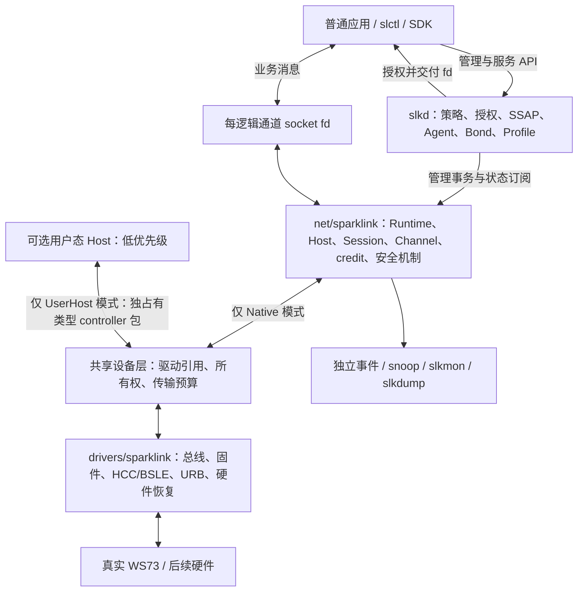
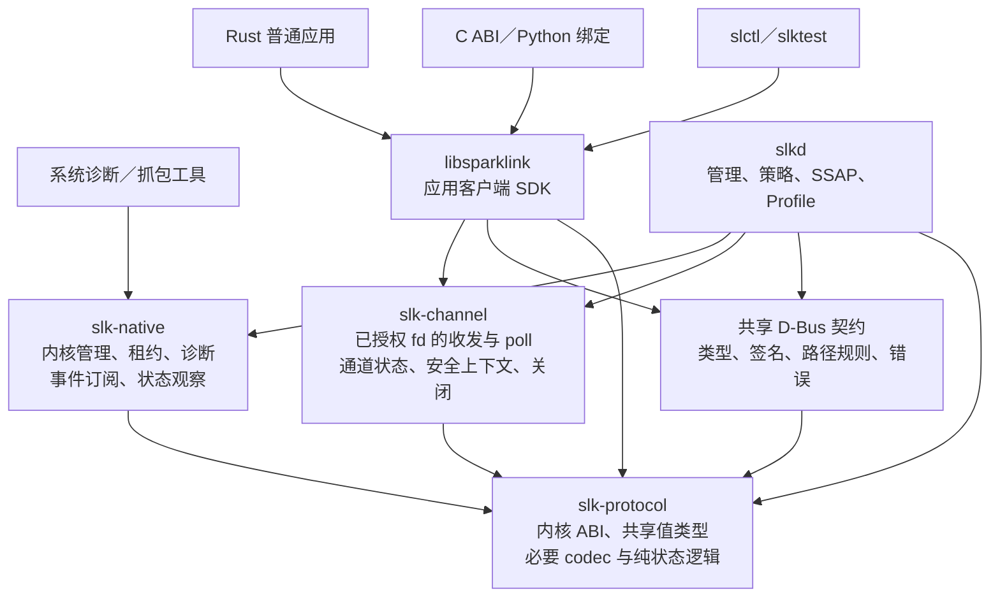
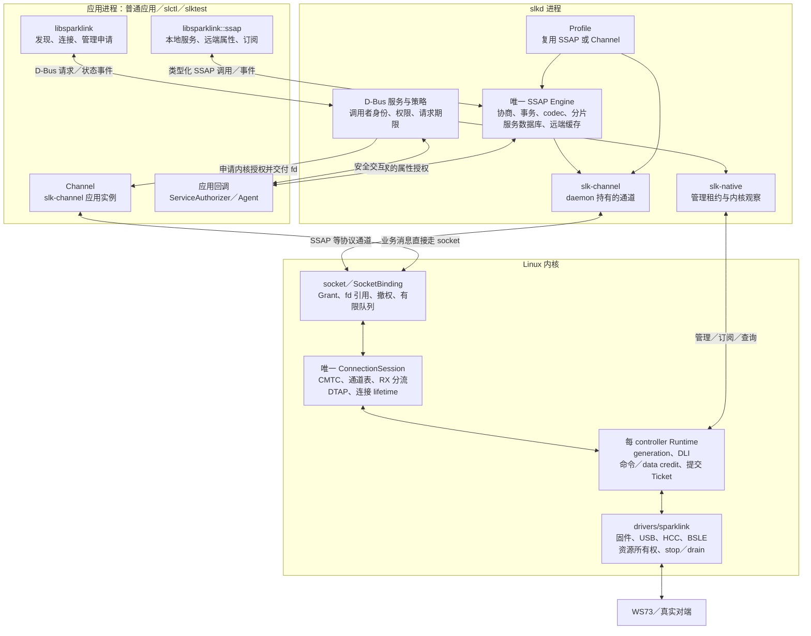

# SparkLink 架构

<!-- documentation-scope: 20261014 -->
> **阅读范围：唯一权威入口。** 目标分层、状态所有权和架构约束。
> [主题归纳与去向](../docs/project/uppercase-document-guide.md)；[推荐入口](../docs/explanation/index.md)。

Canonical：本文件定义目标所有权与分层；[ADR0001](../docs/decisions/0001-management-channel-service-boundaries.md)
、[ADR0002](../docs/decisions/0002-session-socket-lifetime-and-proof-contract.md)与
[ADR0003](../docs/decisions/0003-optional-exclusive-user-host.md)及
[ADR0004](../docs/decisions/0004-application-ownership-and-delivery.md)定义决策和接口契约；
[IMPLEMENTATION_PLAN](implementation-plan.md)是唯一执行/依赖/门禁入口，
[CURRENT_CAPABILITIES](current-capabilities.md)是唯一当前资格入口。
2026-10-13采用用户完整提案（hash f6f8e16d856072914cb30989595343e308c7535015cf47e5fcca2ea7cee19133）。
目标描述不表示代码已接通；最新事实与调整见[采用记录](../history/architecture/architecture-adoption-20261013.json)。

实现状态、逐轮门禁和历史失败不在本页维护，参阅唯一资格与实施计划。
持续 SSAP 更新的应用租约与物理 Session、Native Grant、socket Binding 分开持有；
各语言复用唯一客户端与 Engine，配置／清理复用原事务序列，等待数据让出普通读写。
租期、请求期限、在途义务与首次清理期限各自保留；协议确认、本地释放及远端清理
不能互相代替。所有权与交付边界见 ADR0004，实际开放范围仍只按资格入口读取。
按 ADR0005，保存报告的退出凭据和请求对应的证明均为必要条件；原件重放与
摘要一致性分开验证。关闭后的物理交付不记作已关闭发送端收到应用回复，另一
通道的后续业务必须独立验证，不能由本地释放或状态计数推导。
应用总线准入按具体方法、原期限和资源所有者迁移；controller 管理、远端客户端与
Owned 服务权限保持分离。非法参数预检、协议确认和对端应用处理分别验收，不从
整个接口的可调用性推导权限或交付；同一 Engine 与既有通道继续承担业务。
[拆分前的历史原文](https://github.com/OpenSparklink/sparklink/blob/670674736ac90ec0f89ca0330849e22b1bc8f81b/docs/ARCHITECTURE.md)保留原始源码身份及全部限定范围。目标职责及以下架构决策保持不变。

采用 [ADR0006](../docs/decisions/0006-event-driven-session-and-performance-evidence.md)：
唯一 Session 的事件就绪与原期限定时分离，Runtime 通知只触发重查；身份、引用、
锁序、撤销/drain、有限预算、公平性和每次实际 Ticket 提交维持现有所有权。
Runtime RX 的数据就绪仅由完整 PDU 成功入有限队列触发；PB 中间状态和丢弃不新增
提示，也不清除已有提示。真实 NOCP、安全、撤权与连接变化保留独立通知，不以提示
次数或 worker 执行次数推导硬件 credit、业务交付或性能资格。
多通道负载继续复用唯一Session、SDK与应用循环。原版本2并行基线要求全局启动／
结束屏障及全部报告；显式版本3关闭隔离保留全局启动，按每通道双端静止后结束。
真实短通道关闭、进程退出及其后另一通道的完整对端回复须独立核对，不能从退出
或协议确认推导callback排空、Free或性能资格，原基线屏障不放宽。
实际reserve池满等待与其他EAGAIN重试分开；空闲无待办不排维护轮次，通知不能
推迟更早原期限。已开始PDU保持顺序，未提交工作仍按各自原期限终结。
先取得普通 socket 的可信基线，再优化调度及有界连续 TX；TX 预分配/多在途/聚合
和单 bulk RX URB 的处理/重提交空窗均测量后另设门禁，不预设 USB 是瓶颈。
分层时间线区分应用、准入、USB、NOCP 与对端校验；无 RF/时钟证据不宣称精确
单向空口时延。实施依赖、当前资格仍由各自唯一入口维护，不在架构页累加运行结果。

连续TX的软件尝试/字节预算不属于协议credit；时间预算约束开始下一次操作，
不保证同步USB调用或整轮worker的最坏耗时。完整PDU边界轮转，阻塞后重查当前
可执行状态，不能仅据同轮早先成功而不断重排。被动观测的序号与提交阶段也不
授予权限或对端交付资格；各阶段的完整性、丢失及成本必须单独验收。

应用工具职责固定为 slctl 管理/连接/授权与日常交互，slktest 应用通道正确性、
时延、带宽/压力测试。后者内部复用唯一收发/codec/状态/报告模块，仍使用原普通
委托fd，不承担Host/协议Engine；抓包、内核selftests、形式化和资格聚合仍独立。
该职责调整参考 [BlueZ l2test 的工具定位](https://github.com/bluez/bluez/blob/master/tools/l2test.c)，
不采用其Bluetooth协议实现，不改变当前分层或支持范围。

实验资源授权与功能资格分开：本线程物理访问范围由
[端口策略](lab-resource-policy.json)限定，VM逐叶直通前和重枚举后复核拓扑、上级
hub/PCI、序列号及占用；device number、VID/PID、历史端口或枚举顺序不授型号资格。
启动入口在端口租约内只读核对 live libvirt 分配；明确属于其他线程的叶子不构成
冲突，本线程任一叶子、其上级 hub、共享 PCI 或无法解析的 WS73 选择器须先协调。
查询失败、超时或无法核对时拒绝启动，不强制解绑。该观察不证明特权 fd 或之后
非协作 QMP 操作不存在，逐次附加的驱动/fd/身份检查仍须保留。
共享控制器不允许整坞／整控制器操作。显式SDK110板型选择三份对应文件，再由实际
HCC核对型号/总线；尚未合格的混合逐设备镜像流程不得下载。构建复用
[共享预算与全局锁](build-resource-policy.json)，资格产物与增量目录分开封存。
策略只是访问边界，不替代冷ROM识别、固件执行认证、同行隔离或恢复验收。

## 目标分层及架构决策

应用发现使用独立的 DiscoverySession 策略租约，不是物理 ConnectionSession 或
通道 Grant。每 controller 的同一协调器管理 caller、过滤、水位、有限队列及到期，
实际扫描仍由原 Native 管理 guard、recipe、命令 credit 与匹配结果推进。
首个会话启动，其他会话加入固定 passive 策略；最后释放才申请真实 STOP。
管理者 STOP、Native 撤权及退休隔离旧 epoch。未知清理不得升级 Off／Free；
这些源码边界不等于新实机资格，完整门禁仍由唯一计划与能力入口维护。

### 总体结构



Native管理系统调用和特权通道fd创建集中在`slk-native`；`slkd`决定策略并持有
管理租约，传入现有身份/租约后由Native调用内核。`slk-channel`仅操作已授权fd，
普通SDK不依赖Native。SSAP共享接收仍归同一物理actor：本地租约的
owner/token/队列/期限分开，最后一个有效配置引用才请求远端停用；共享保留与
实际停用必须在终态中区分，详见[应用所有权决策](../docs/decisions/0004-application-ownership-and-delivery.md)。
动态过滤／模式合并不由引用数量推导；实现及资格按唯一记录分别开放。
每租约独立记录满队列、通知丢弃和指示拒绝，慢接收者不能阻塞其他有效租约。
指示 ACK1 仅表示至少一个队列接受；应用处理仍需实际校验及回复，见
[交付契约](../docs/reference/interfaces.md)。
D-Bus tuple与纯ABI观察映射归`slk-contract`，不反向引入
Native调用、状态缓存或协议Engine。创建fd只表示本地资源准入/暂存，实际协商、
授权和业务交付分别由原Kernel/Session/Grant机制及真实对端结果决定。

Connection 的物理观察不等待用户态服务初始化。唯一资源 owner 在发布前登记并
启动同一有界初始化任务；普通服务先预留连接级创建资源，protected 服务仍等待
真实机制。应用创建保持明确 busy，不引入无界等待。owner 退休先关闭准入，再等待
实际 Native 工作及未消费 fd 结果、原初始化器和 Engine；任务等待取消不等于排空。
这些顺序约束不制造服务 Ready，不代替 Kernel Grant、引用或 USB callback 的验证。

应用的`controller_events`可以观察同一Runtime adapter目录的有界变化，journal与目录
更新共用锁且只保存身份。它不是Kernel事件或Ready／Down／退休drain权威，不能
取代初始化前注册观察。首次成员查询与变化可重叠，缺口必须显式重快照；游标绑定
daemon owner。原期限和每caller预算限制等待，释放观察者不清理controller资源。
具体接口和资格分层维护，不由目标API树推定全部事件或语言绑定已完成。

C／Python观察视图复用同一Rust stream和Client执行器，保留一条尚未复制交付的观察。
短缓冲、peek及本地超时不静默丢失该观察；确认仅清除本地交付槽，不代表硬件或
应用业务完成。派生视图延续原caller，关闭不停止controller；同Client的同步等待
仍共享有界队列，不能推导独立调度或进程故障域。原期限、owner和Gap规则不变。

### 唯一职责

| 层 | 唯一所有者 | 禁止跨越 |
|---|---|---|
| drivers | 总线匹配、端点、固件、板配置、传输 framing、设备 I/O、电源和硬件恢复 | 应用策略、SSAP 数据库、Profile callback |
| net（Native模式） | NativeHostRuntime、DLI方言、命令事务、连接/DTAP、协议credit、安全机制、可信状态 | 用户服务数据库和厂商私有库 |
| 共享设备层（目标，待分离） | 驱动/硬件generation、互斥所有权、传输资源/提交gate、权限与故障 | UserHost时继续处理原生协议credit或伪造Ready |
| slkd | Managed 策略、授权、SSAP Engine、Agent、trust、Bond store、Profile | USB/HCC 直接操作、伪造内核安全状态 |
| 应用 | 业务协议和 UI；使用授权 fd 或服务 API | raw DLI、隐式全局 adapter、私有 transport |
| UserHost（未来可选） | 用户态独占DLI/credit/连接/DTAP/SSAP/协议安全；厂商Host适配另核对 | 伪装Native Backend、把自报状态变为原生可信状态或默认承诺SDK兼容 |
| 观察工具 | 独立订阅和诊断 | 抢占协议 RX、隐式修改硬件 |

### 采用的关键决策

| ID | 决策 | 原因／影响 |
|---|---|---|
| AD-01 | drivers / net / slkd 三层保持 | 机制、传输、策略分离，厂商差异不侵入普通应用 |
| AD-02 | ConnectionSession 独立于 fd | 关闭应用不应重建物理连接或 CMTC |
| AD-03 | Session 唯一 RX 分流，Channel 独立对象 | 防止多个 socket 抢信令和数据 |
| AD-04 | 基础不可靠消息目标使用连接式 DGRAM | socket 类型不制造可靠递送；可靠模式才开放 SEQPACKET |
| AD-05 | 内核可撤销 Grant + epoch | fd 委托不应永远绕过 owner 撤销和安全降级 |
| AD-06 | TxTicket 与明确提交线性化点 | 消除只在入口检查身份／授权的窗口 |
| AD-07 | command、controller data、peer 流控分别记账 | 不从 USB 成功或命令 credit 发明数据容量 |
| AD-08 | 不确定结果保留物理义务 | 不伪取消、不退款、不静默重试有副作用动作 |
| AD-09 | SSAP 唯一生产 Engine 在用户态 | 删除内核重复数据库／协议路径，易于服务和 Profile 演进 |
| AD-10 | 证明、开发测试、实机资格独立 | 明确假设，避免模型替代硬件 |
| AD-11 | core 不依赖 USB=y，driver 可注册 | Native/Virtual driver共同注册；UserHost独占包接口另行分离 |
| AD-12 | 未发布 UAPI 同步替换 | 不引入长期双实现和无意义兼容负担 |

| AD-13 | 可选UserHost与Native互斥；停用后接管，真实状态屏障后返Native | WP14低优先级规划替代固定vendord代理；本轮不实现 |

AD-01–AD-13已采用并映射ADR0001/0002/0003；不新建重复决定，目标实现状态以能力入口为准。


### 可选UserHost：当前只规划（AD-13 / WP14，P4）

Native主线保持：内核Host拥有DLI/协议credit/connection/DTAP/security机制，slkd用户态SSAP/Profile/策略，
应用用每逻辑通道socket。UserHost拥有完整协议Host，内核仅保留共享设备/固件/USB/HCC/BSLE、
传输预算和访问强制；两模式互斥，其他controller不中断，不复用Native Backend来代理用户Host。
当前未实现DeviceRuntime分离/UserHost UAPI/slk-vendord/厂商Host adapter；代码中的D-Bus Proxy不算它们。
首版先停用，拒绝连接/在途/未结清发送；socket对象与租约/epoch持权、dup/fork/SCM及最后引用分别处理，
撤权/join/实际控制器状态屏障后才返Native新身份并重初始化，不继承credit/link/key，也不把自报状态当Ready。
[唯一契约及未来门禁](../docs/decisions/0003-optional-exclusive-user-host.md)记录细节和未决ABI评审项；
[源码审计](../docs/evidence/userhost-planning-audit-20261013.json)区分存在代码与未来任务。WP14不成为当前主线前置。

## 固定版本参考的使用边界

除既有 NearLink Host、SDK111 与 libws73-usb 外，纳入 OpenHarmony
`drivers_peripheral` 的 NearLink DLI/HAL（本地 `879984db5c71`）。它补充包边界、
初始化回调、厂商入口和关闭/死亡清理的参考；不替代 Native Session/credit/最终票据，
不推导每设备隔离或真实交付资格。所读文件为 Apache-2.0，本批无实现复制。
[来源与映射](../docs/explanation/openharmony-dli-reference.md)记录实际差异；
厂商完整 Host 适配仍属可选 WP14/P4，不成为当前数据、安全或用户态 SSAP 前置。

## 对象、身份与引用

### 对象树

```text
ControllerSlot（接入定位、跨重枚举恢复预算）
  └─ 共享DeviceRuntime（目标：驱动引用、hardware generation、owner/epoch、传输限额）
       ├─ UserHostBinding（未来、与Native互斥：socket引用/接管租约）
       └─ NativeHostRuntime(generation)（当前仍与设备层结合，未来分离）
            ├─ BackendRef / Descriptor / Host / CommandQueue / CreditLedger
            ├─ StateSubscriptions / SnoopSubscriptions
            └─ ConnectionSession(lifetime, handle)
                 ├─ CMTC / 能力 / SecurityContext / 唯一 RX 分流
                 └─ Channel(local_tcid, remote_tcid, mode, incarnation)
                      └─ SocketBinding(grant, authorization_epoch)
                           └─ VFS file 引用：原 fd、dup、传递后的 fd
```

| 对象 | 资源及失效规则 |
|---|---|
| ControllerSlot | 定位同端口，记录当前 USB incarnation、恢复次数、阶段和期限；不是密码学身份 |
| Runtime | 一次注册 generation；Host、credit、worker、事件、连接表；退休后旧回调不得修改新实例 |
| PeerObservation | 按controller generation/地址类型/地址的有界发现观察；不是认证或连接事实 |
| ConnectionSession | 一次物理连接 lifetime；信令、协商、通道表、安全和 RX 分流；独立于 Binding |
| Channel | TCID、PI、模式、MTU/MPS、协议队列及关闭事务；重建产生新的本地 incarnation |
| SocketBinding | 一个授权应用绑定；拥有软件准入、等待和文件清理；新 lease 不复活旧 Binding |
| KernelGrant | 权限范围和撤销代次；与 Managed lease 和连接安全关联 |
| Operation | 请求者、request id、参数、原 deadline、唯一终态、结果保留期限 |
| TxTicket | 不可变提交归属、授权、credit reservation、编码结果和提交阶段 |

### 身份规则

- Registry 编号仅定位，不承载完整生命周期身份。
- 使用 controller id + generation，连接增加 lifetime；内核引用还关联实际对象。
- Wire handle、local TCID、remote TCID、PI 分开类型和转换，禁止散落魔数。
- USB 地址、handle、TCID 可复用；重枚举不继承旧 Runtime。
- generation/lifetime 不得静默回绕；跨内核重启的持久化增加 boot 作用域或稳定身份，不能只用计数。
- 地址相同不等于可信 peer，controller 与 peer 组合不丢失作用域。
- 软件 incarnation、epoch、request id 不被自动带入 wire，不能用于假关联。
- 稳定设备配置使用管理员别名／已确认设备身份；端口用于定位，不用于密码学认证。

测试与生产调度解耦：撤权/断链验收必须以实际队列、在途PDU及credit状态建立
前提，不能用固定等待假定它仍未完成。需要受控交错时复用有界真实传输暂缓，
记录原字节、作用设备、身份、显式释放和期限；不生成协议回复或改变生产期限。
实际提交、控制请求提交和Down观察分别记录，未证明的线性化窗口保持开放。

### 引用和销毁

file、worker、timer、URB callback、Backend module 各持明确引用。注销顺序为禁止新准入、逻辑失效、通知等待者、锁外 stop/drain、撤销注册、最后释放。注销返回后是否仍允许清理回调必须由接口契约明确；不得回调已释放对象。


## 正交生命周期与权威状态

### 状态分离

| 维度 | 状态示例 |
|---|---|
| Backend | Absent / Booting / Reenumerating / Online / Quiescing / Failed |
| Host | Uninitialized / Initializing / Setup / Ready / Fault |
| Managed | Free / Owned / Revoking |
| Radio | Unknown / Configured / Off / On，广播和扫描独立 |
| Connection | Connecting / Connected / Disconnecting / Dead |
| Channel | Negotiating / Open / Closing / Failed / Closed |
| Security | Unauthenticated / Authenticating / CredentialReady / Installing / EncryptedConfirmed |

Ready、Enabled、Available、Powered 不互相替代。Controller 元数据有效不自动表示 Host Ready，更不表示 Radio 已 Off。

### requested / pending / confirmed

所有有副作用操作分开请求、在途和设备确认值。真实匹配 Complete／领域事件更新 confirmed。拒绝、短写、超时、错误 opcode／generation 不提前提交状态或成功统计。

### 部分初始化清理

记录每一步成功来源、资源创建和无线事实；清理只针对已创建／已确认资源。未知广播实例不能盲目 disable。未确认 Off 不发布 Off。未知或清理失败进入隔离／恢复，不能因为本地释放 lease 就 Free。

Managed release、最后 fd、dup、在途回复、设备移除和 daemon crash 与这份初始化事实日志组合验收，保持活动 Ready 同行不变。

SSAP 初始化分开记录 Native fd 创建、内核 CMTC、用户态 ExchangeInfo 和应用可用。
每连接的用户态服务资源 owner 必须在 Native 创建开始前被 controller 生命周期持有，
独立于 D-Bus 对象发布。D-Bus 引用同一 owner；发布失败、重试或 dispatch 取消不能
另建 Engine 或失去初始化的 join。这里登记的是资源所有权，不是另一份物理连接状态。
实现以 controller 的 registration 持有同一 `ConnectionOwner`，其 context 使用 Weak
引用；D-Bus view 持有该 owner。已退休但尚未 join／移除的记录仍占每 controller
16 项总预算，不能为新连接丢弃旧工作。初始化、Engine 和实际 JoinHandle 在等待
期间保留在原槽位；取消等待不等于完成清理。Unknown 快照不启动新 owner，发布
重试复用原 owner，路径冲突不能删除其他 owner。实际 task／fd 回归与内核引用、
callback drain、Native bind 内交错和真实空口资格分别记录。
当前 creator 的同步非阻塞 bind 不经过通用 NativeWork；actor 创建成功不代表协商
完成，SOCK_NONBLOCK 也不证明锁等待有界。VM 中观察 daemon fd 数量／inode 收敛，
不能替代 initializer task join、对象退休、内核引用和 Session stop/drain 的证明。
保留单 bulk RX URB 的原始 CMTC 回复时，后续同端 Down 也延迟，故必须用真实
Managed Revoking 标识撤权时点；原规范连接仍 Up 只表示最后确认值。物理 Down
会结束该连接两端，同行 controller 的独立 Ready／RX 进展与后续业务分别验收。


### 固件身份与分阶段转发证据

配置中选择某固件、文件已staging、实际USB上传、固件执行及可信认证是不同事实。
暖启动跳过下载或搜索路径差异不能靠文件名推断；诊断需核对实际成功上传字节与
声明hash，但这仍不是执行认证。generation隔离不能替代固件身份或wire支持证明。
运行态BSS、栈和分配池边界与boot下载器的工作区是不同契约。镜像大小未超格式上限、
表项逐字节保留或运行态地址不重叠，都不能证明连续加载或新增段的安全范围。
分段固件必须单列加载地址/长度/身份与下载阶段资源，经过实际上传、恢复及运行回归。
协议包描述与Host事件分派可能属于不同固件表，不得由其中一张推断另一张支持。
固件诊断替换若牺牲其他有效类型，必须隔离，不能发布为保留全部能力的生产修复。
同一Session/credit/票据下的支持类型正向对照，只能缩小失败边界；控制器Complete
不能替代对端事件，错误类型消息不能因到达对端就发布为正确的安全协议成功。

## Backend、固件与协议差异

### 注册接口目标

接口语义包括 register、start、submit、stop、recover、RX 和 fault。使用可引用 Backend handle，接口明确进程／原子上下文、错误、取消、回调次数、模块 pinning 和 drain 屏障。语言实现可采用小型版本化 C seam；不承诺稳定 Rust ABI。

### Descriptor

分别记录 bus、identity、dialect、capability、limit、quirk、firmware/board provenance、PM/recovery capability。支持三态 Supported / Unsupported / Unknown，每项附来源和 generation。

软件预算不是硬件限制；0 不自动表示无限或已知不支持。缺少可信发送上限／完成机制时不开放发送。

### WS73启动

```text
端点校验 → 镜像/板配置校验 → 下载 → 同端口新枚举确认
→ BSP_READY → customize → CUSTOMIZE_RECEIVED
→ SLE_OPEN → BOOT_FINISH → HCC型号/总线真实查询 → DLI真实查询
→ 按初始化事实确认Radio状态 → Ready
```

每阶段共享原始总期限，另有阶段预算、有限重试、完整长度和回复校验。启动通知应由正确接收窗口捕获，不能丢失后本地合成成功。

历史 SDK111 qualification 绑定实际上传的镜像和配置 hash。暖态 version tuple 不证明刚刚上传111。combined 拼接、各段、校准、运行配置分别留来源。SHA 校验只证明内容完整性，不证明厂商签名、来源可信或板级校准。

2026-10-17 用户当前选择统一1.10.110：U/S的SDK `firmware/us` 与E的 `firmware/e`
分别保留镜像、校准及组合hash；旧111及旧四U资格不转授新硬件/固件。运行期HCC
GET_CHIP_TYPE回复自动给出U/S/E与USB/SDIO/UART，属于驱动私有平台消息，不伪装
成标准DLI或消耗DLI command/data credit。未知/失败/超时不发布Setup；sysfs快照
受每设备phase锁及元数据有效性保护。SDK110平台分配长度quirk仅限确切平台路由，
SLE/ACB长度不随之放宽；业务预算逐controller绑定真实DLI，不能硬编码U的254/5。

HCC尚未运行的ROM接口不能使用该查询选择首次冷启动镜像。首次输入仍须显式匹配，
该缺口待验证ROM识别后解决，不按VID/PID或端口默认U。混合型号业务VM移除两条
firmware查找路径的ROM镜像，仅接管已单独下载并核对的运行期设备；意外ROM状态
明确失败，禁止错型下载。固件自报型号不认证硅片/板级校准/执行镜像，平台消息无
请求nonce；其真实性、旧回复排空及硬件屏障仍是独立验证条件，不授安全资格。

ROM寄存器`0x40019000`是新的待验候选：固定SDK110 E/U同一56字节函数与日志
`0xc1380f42`调用路径已经复核，软件复位样本ROM读取与运行期/HCC一致。E返回0x0a、
U返回0；零值不能证明访问有效，真正冷启动也未验证，故不启用自动选择。详见
[限定证据](../docs/evidence/ws73-rom-chip-candidate-20261017.json)。后续通过门禁时，
选择状态必须由本设备本次ROM实例持有，绑定重枚举端口/父链及新Runtime身份；不能
共享可变全局固件目录或继承旧generation观察。选择一次同时绑定主镜像与两份校准
及版本/hash。运行期HCC不一致、S/SDIO、E/UART、错误/未知/短回复/超时均失败；
不得重试成默认U或换另一型号镜像。未满足有效性/冷启动条件时保留显式板卡输入。
该候选验证与唯一Engine授权、数据面/多通道/四设备并行，非全局前置。

### 标准、SDK、参考库及 OHOS

为每条事实维护标准版本/表格、SDK 调用约定、libws73-usb/OHOS 行为、本项目 bytes 和验证状态。0x0401 等冲突在 dialect 处理；标准路径保留独立测试。

私有 SDK 和逆向仅用于用户本地分析与独立实现，不公开固件、校准、私有库或不获许可的反汇编。参考代码复制／链接单独审查许可证；不把“协议参考”当作可直接搬运实现的许可。


## 数据与文件契约

Runtime→Session→Channel→Binding是目标TX/RX路径；Session唯一消费并分流CMTC及业务数据。
command credit、controller ACB credit、peer流控和软件包/字节预算分别记账。
软件准入、实际 USB 提交、控制器完成、对端协议接收、对端应用处理五阶段分开。
USB、NOCP、协议 ACK 和本地队列均不等于对端应用处理。
SSAP/Profile 复用同一通道路径；安全 DLI relay 是控制信令，不另造业务发送路径。

DLI PB、DTAP SAR、SSAP分片是不同层；DLI PB将一个DTAP PDU拆成控制器包，
不构成SSAP长写或可靠模式。Session拥有唯一TX分片游标，未完成PDU期间禁止同连接其他Channel/CMTC插入；
RX仍由Session唯一分流。控制器包上限与协商MTU/MPS分开，实现预算为DTAP PDU
最多2047字节、应用最多2042字节、每通道8个TX项（含持续busy的Session在途项）。

MTU限制上层SDU，MPS限制完整DTAP PDU，不能共用一个数值或把ACB分片大小
当作MPS。Channel的有效SDU预算不超过双方MTU与“双方MPS减该模式完整帧头”
的较小值；基础CUTC/SMTC分别预留5/4字节。能力响应独立公布两项，Session在
同一锁内发布原始能力及每通道有效预算；TX最终准入与RX完整PDU均执行限制。
这些实现上限及能力查询返回值不代表任意模式、动态通道或硬件全域资格。

worker在Session锁内取包并冻结该有限operation的Grant。首片实际USB准入仍要求
Binding活着；成功提交在同一锁内标记begun，是fd取消与物理义务交接的线性化点。
已经begun的PDU缓冲区在Session持有，不放回fd队列、不引用已释放SocketBinding。
最后fd关闭取消尚未开始的队列、停止新TX/RX授权，但不抹去已经begun的物理义务；
有限后续片只完成该原PDU，不能接收新payload或继承新lifetime。
每片仍经过Runtime在Host/data/gate锁下的原lease epoch、generation/lifetime检查、
已有credit预留和实际USB票据；管理撤权/断链在实际提交点阻止继续发送，不能通过
复制operation Grant绕过Runtime。FD退出与管理撤权是不同动作，不扩大fd能力。
物理Disconnect可以在Managed租约仍有效时终结连接；双方Down应使旧lifetime的
Binding失效，不得隐式撤销另一controller租约。观察到Down之后无USB提交只是在该
观察精度下的证据，不能替代最终提交点与Down处理的锁序证明。

软件准入EAGAIN/队列空间与controller packet-credit耗尽是不同观察。
poll的POLLOUT只承诺当前软件准入机会，不承诺USB提交、控制器完成或对端收到；
竞争后send仍可能EAGAIN。突发发送可填满含busy的有限8项预算，恢复后须继续
核对实际对端应用回复。不得把该观察、ref库的pool截断或NOCP日志当作硬件credit门禁。

每片欠一个controller credit，USB完成和释放operation不归还；EAGAIN保留进度，
未知失败不从头重放。软件准入的原始5秒期限在最终提交点也检查；没有物理前缀的
排队超时只退休本Binding并报ETIMEDOUT。真正物理失败、期限届满或撤权时，没有
合格的部分PDU清除/复用屏障，Session仍需明确失败及管理清理，不发布假Ready。
这不是无限后台重试或对端处理承诺。关闭后reply的USB到达不等于应用已接收。
VM受控延迟的因果关系须由请求、实际QMP状态和guest收到确认组成；宿主与guest
墙钟有独立偏移，不能直接排序。原期限使用生产准入时钟及同一guest单调时钟核对；
测试夹具的延迟上界与socket等待超时均不能替代该原期限。
受控VM的hold能力也是实验输入：需要延迟真实USB-IN超过原5秒期限的门禁，
必须独立验证QEMU的8秒hold属性及其启动产物，不能放大生产期限或以新binary
静默替换旧smoke身份。Reference Host f0872df与libws73-usb f4d85d0的完成分发仍
只有handle/count；其调度/截断策略不是本项目generation/lifetime复用屏障的证明。
实际转换序列测试须保留fixture依赖和有效初始状态，分别计配置失败尝试与真正执行
到提交回调的失败；生成二进制、种子及轨迹属于证据，不将随机探索称为穷举证明。
这些实现预算不代表当前实机资格；准确提交、分层长度边界与仍缺门禁只见
[CURRENT_CAPABILITIES](current-capabilities.md)。

完整Ticket/Grant、NOCP假设、socket语义、dup/关闭和同lifetime重开决策以
[ADR0002](../docs/decisions/0002-session-socket-lifetime-and-proof-contract.md)为准；验证与实机门禁
以IMPLEMENTATION_PLAN为准，避免在本文件维护另一套执行清单。
## 管理、事件与用户态

同步语言绑定通过现有 Rust Client 访问 broker，通过现有 Channel/普通 socket
处理业务；C/Python 不各自维护 D-Bus 路径、Host、授权或 SSAP 状态。每客户端
有界执行器仅跨越同步/异步语言边界，原期限、owner 失效、join 与返回 fd 的独立
生命周期见 ADR0004。不得由该执行器发布 Ready 或把本地等待超时当远端取消。

### 应用资源与管理权限

应用释放自己的扫描租约或通道，与管理者停止硬件扫描、停用 controller 或断开
物理连接分开。共享扫描须明确客户端过滤、授权、取消、结果归属和有界预算；
一个作者退出/超时不能清理其他作者。当前 manager scan RPC 不代表已实现共享租约。
内核强制 Grant epoch/lifetime 和管理撤权；本地 Trusted 策略不替代认证或安装结果。

### 权威接口

管理API、数据socket、观察订阅、Diagnostic、未来UserHost接管分离。
当前Native Host／ConnectionSession／Channel承担连接和数据权威；旧ConnManager/AdvScanInner/
全局角色、模型AFH/sync/PDU和第二RX分流不再编入默认内核。未支持能力不能通过本地模型报告成功。
PM决策按controller归slkd；驱动保留真实电源/板级机制。默认内核不保存PowerInner估计模型，
未接通硬件PM必须拒绝，不能用configfs全局模式限制其他controller或发布可信PM状态。genl/ioctl等若保留多个前端，仅转发到同一内部权威状态和事务，不各自写状态。

UAPI采用固定宽度、对齐、version/length/flags/reserved和可验证上限。修改同步C、Rust、Python绑定、CLI、D-Bus和CI pin。ioctl结构大小影响编号；size字段不能修复旧编号静默变化。

configfs只承载明确配置，debugfs不当稳定生产API。raw Diagnostic需权限和冲突隔离；只读接口也不能公开密钥或敏感payload。

### 事件和快照

OperationResult归原请求者；StateEvent每订阅者独立游标；Snapshot以水位重同步；Snoop独立有界队列。sequence缺口可见，慢reader不阻塞Host。

复制失败不提交消费游标，短buffer不交付半记录。快照与后续sequence一致，避免 resync窗口漏事件。移除唤醒，终态结果保留与淘汰有明确预算。

### slkd运行模型

per-controller actor 不等于独立进程故障域。daemon 崩溃、最终 fd 释放、撤权及
重启收敛分别定义，不能默认承诺业务 socket 跨 daemon 崩溃存活。


每Runtime/Session独立actor或串行协议执行上下文；D-Bus信号和耗时操作在锁外。同步fd避免阻塞Tokio工作线程，异步等待可取消。不存在active adapter全局协议状态交换。

重启时枚举、快照、确认旧owner撤销、新lease、订阅水位、重新应用策略。不能盲目重放连接／写属性等未知副作用；旧fd有效性由Grant决定。

### API和SDK：三个统一视图

采用2026-10-17用户提供的组件依赖、应用接口、运行时调用提案。下列均是**目标设计**，
不是当前已开放接口清单。只能在实际实现、迁移调用者并取得对应验收后逐项开放；
不能先生成未接线的成功facade，也不为未来模式保留永久NotSupported门面。
未发布旧入口在调用者迁移后删除，不保留永久拒绝门面；旧数值不可复用。
无生产消费者的旧布局只归私有历史测试，不能让测试反向要求生产公开旧模型。
三视图共用以下所有权与契约，名称/文件数不作为验收目标；物理crate按真实权限和依赖
边界落实。完整迁移顺序只维护于唯一计划WP16/18，当前资格只见能力入口。

#### 组件依赖视图

箭头表示“使用／依赖”，共享 D-Bus 契约的物理位置可以稍后确定，但必须独立于应用 SDK，避免 slkd 反向依赖自己的客户端。



这里有四条明确的依赖约束：

- `libsparklink` **不依赖 `slk-native`**，不向应用导出 controller 管理 lease。
- `slkd` **不依赖 `libsparklink`**，直接使用 Native、Channel 和共享契约。
- `slk-protocol` 不打开设备、不执行 ioctl、不访问 D-Bus；系统调用属于操作层。
- `slktest` 使用同一应用通道接口，负载生成、计时、报告和测试断言保留在工具内。

#### 应用接口视图

`libsparklink` 的目标公开接口按下面的模块组织。这里的目录表示 API 命名空间，不要求机械拆成同样数量的 crate。

```text
libsparklink
│
├── Client
│   ├── open_system()                 连接系统 slkd
│   ├── controllers()                 枚举实际 controller
│   ├── controller_events()           设备新增、移除、观察失效
│   ├── ssap()                        本地应用服务入口
│   ├── management()                  显式管理入口，另行授权
│   └── agents()                      安全交互注册入口，另行授权
│
├── controller
│   ├── ControllerId                  index + generation
│   ├── Controller
│   │   ├── snapshot()
│   │   ├── capabilities()
│   │   └── discover()
│   └── DiscoverySession
│       ├── next()
│       ├── update_filter()
│       └── release()                 只释放自己的发现会话
│
├── peer
│   ├── PeerId                        controller + 地址类型 + 地址
│   └── Peer
│       ├── observation()
│       └── start_connect()
│
├── connection
│   ├── ConnectionId                  controller + physical lifetime
│   └── Connection
│       ├── snapshot()
│       ├── events()
│       ├── security_snapshot()
│       ├── open_channel()
│       └── ssap()                    此连接的远端 SSAP 入口
│
├── channel                           复用 slk-channel
│   ├── ChannelOptions                模式、尺寸、安全要求、预算
│   ├── ChannelInfo                   实际协商结果与绑定身份
│   └── Channel
│       ├── send() / try_send()
│       ├── recv() / try_recv()
│       ├── readable() / writable()
│       ├── info()
│       ├── try_clone()                同一 binding 的 fd 引用
│       └── fd 互操作                  所有权转移必须显式
│
├── ssap
│   ├── definition                    纯服务定义与权限类型
│   │   ├── ServiceDefinition
│   │   ├── PropertyDefinition
│   │   ├── DescriptorDefinition
│   │   └── AccessRequirements
│   │
│   ├── local                         应用拥有的本地服务
│   │   ├── LocalServices
│   │   │   └── register_service()
│   │   ├── ServiceRegistration
│   │   │   ├── read_local()
│   │   │   ├── update_local()
│   │   │   ├── notify()
│   │   │   ├── indicate()
│   │   │   └── unregister()
│   │   └── ServiceAuthorizer
│   │       └── decide(original_request)
│   │
│   └── remote                        绑定实际连接 lifetime
│       ├── RemoteSsap
│       │   └── discover_services()
│       ├── RemoteService
│       │   └── properties()
│       ├── RemoteProperty
│       │   ├── read()
│       │   ├── write()
│       │   ├── descriptors()
│       │   └── subscribe()
│       └── Subscription
│           ├── next()
│           └── unsubscribe()
│
├── management                        经过 slkd 的受权管理
│   ├── controller 管理操作
│   ├── 强制断开物理连接
│   └── 查询管理请求结果
│
├── agent                             安全策略交互
│   ├── AgentRegistration
│   ├── SecurityPrompt
│   └── SecurityDecision
│
└── common                            各模块使用同一契约
    ├── Operation<T>                  请求身份、等待、取消、终态
    ├── Deadline                      原始绝对期限
    ├── Snapshot<T>                    观察时间、版本、有效性
    ├── EventStream<T>                 有限队列、溢出、重同步
    ├── CapabilitySet                 支持的模式与明确限制
    └── Error                         稳定分类 + 原始错误上下文
```

其中，`ssap::local` 和 `ssap::remote` 都是 **slkd 的客户端封装**。`ServiceAuthorizer` 是应用的属性访问决策回调；它与安全配对 Agent 分开，不能通过批准属性访问来制造认证、加密或 Bond 状态。

#### 运行时调用视图

这张图中的两个 `slk-channel` 是同一库在不同进程中的使用实例。



这张图对应三条应用路径：

| 应用需求 | 实际路径 |
|---|---|
| 发现设备、请求连接、申请通道 | SDK → D-Bus → slkd 策略 → Native 内核接口 |
| 已授权通道上的自定义业务数据 | SDK `Channel` → socket → 内核 Session → WS73 |
| SSAP 服务发现、属性读写、通知／指示 | SDK SSAP 接口 → slkd 唯一 Engine → 通道 socket → 内核 Session → WS73 |

自定义业务数据取得 fd 后，不需要逐包经过 D-Bus。SSAP 操作由 daemon 执行事务，SDK 不另建 SSAP Engine，也不另维护一套远端协议状态。

最后，需要把对象的“持有”与底层资源的“所有权”固定下来：

| 对象／状态 | 权威所有者 | 应用对象结束时的含义 |
|---|---|---|
| Controller generation、Ready、故障 | 内核 Runtime | 释放观察引用，不改变硬件状态 |
| 发现租约 | slkd 的调用者会话管理 | 释放自己的租约，不停止别人的扫描 |
| 物理 connection lifetime | 内核 ConnectionSession | 丢弃应用引用不等于强制断链 |
| Channel binding、Grant、fd 引用 | 内核 | 关闭一个 fd 引用；最后关闭按内核契约清理 |
| 已提交发送、credit debt | 内核 Runtime／Ticket | 不能因应用退出而消失或凭空退款 |
| 本地 SSAP 服务与属性数据库 | slkd，登记到应用 owner | 注销或 owner 退出按既定协议清理 |
| SSAP 事务、远端缓存 | slkd 唯一 Engine | 取消等待不自动撤销已发生的远端操作 |
| 安全机制与实际安装结果 | 内核机制状态；slkd 负责策略流程 | 本地批准不能直接改成认证／加密成功 |
| 持久 Bond | 未来合格的 slkd 凭据存储 | 必须有独立撤销与持久化契约 |

所有公开接口还应共同遵循：

- **成功阶段明确**：软件准入、USB 提交、控制器完成、对端协议确认、对端应用处理分别表达。
- **身份不会自动更新**：旧对象不能因重连、handle 复用或 daemon 重启而悄悄获得新授权。
- **期限不重置**：D-Bus 排队、回调、内部重试和分片共享原始期限。
- **缓存带有效性**：未知、过期、事件丢失必须可见；缓存不能制造 Ready 或安全资格。
- **能力逐项开放**：描述符、通知／指示、长写、可靠通道、持久 Bond 等须取得对应实现和验收，不能由 API 名称推导已支持。
- **语言绑定语义一致**：Rust、C、Python 可以有不同调用形式，但身份、错误、取消、关闭和完成含义一致。

#### 依赖与公开边界

Native设备操作只在slk-native；授权fd系统调用只在slk-channel；slk-protocol只保留
ABI/共享值/必要codec。libsparklink依赖Channel及独立slk-contract，不导出Native lease；
slkd直接使用Native/Channel/契约，不反向依赖自己的客户端。CLI保留参数、显示和
工具断言，业务和SSAP均复用既有路径。C/Python应用与Native库显式分开，不隐藏回退。
实际接口开放及尚缺客户端仅按唯一计划/能力记录读取；依赖图本身不是全部接口资格。
C/Python派生Connection仅持有原caller与既有Rust lifetime视图，最后引用释放
同一执行器；不持有物理Session或管理lease。其SSAP封装使用原RemoteSsap和daemon
Engine，输出失败／本地超时不撤销远端副作用。值读／短写共用boot/time namespace绑定的绝对期限和既有Query；e776产物的分项正向/保持按唯一资格入口读取，受控期限/退出/部分初始化/晚到义务及其他方法的完整期限仍缺。

旧差距快照保留在history，不继续作为当前实现描述。

Peer观察身份是controller generation、地址类型和地址。广告和物理连接共享这一
身份的发布元数据；只有Native快照决定连接关系，广告不授予Ready/安全/Grant。
一个有界pending/published/retiring集合负责对象生命周期，失败清理占用原预算，
已有连接引用未知时不能以未知作为已断链来删除它。广告TTL只使广告失效；连接
lifetime、socket Binding和在途物理义务不受缓存淘汰支配。没有广告的连接Peer必须
明确没有广告/RSSI，不能生成虚构字段。同地址不同类型不合并，未知wire类型保留
原始报告而不进入默认公共地址路径。复用原EventTask维护，不增加观察Engine。

应用DiscoverySession、公共Client的完整高阶/共享契约、完整远端Subscription和真实持久Bond仍有待接通
目标；已接通Client/Connection及C/Python限定入口不代表整棵API树完成。当前管理扫描不能被包装成已拥有应用发现租约。对象API结束不能隐式清理别人的
controller、物理连接或已提交credit义务。未经实现/验收不得由缓存或命名推导资格。


## SSAP、服务与Profile

唯一生产SSAP Engine归slkd；内核提供完整通道PDU、归属、安全上下文和实际模式能力，不保留双数据库。

Engine负责ExchangeInfo、MTU、扩展码、协商事务、SSAP分片、request-response、indication-ack、服务数据库、remote cache、handle分配、Profile路由。

没有协商事务号时按标准限定在途；不自行增加wire ID。原始事务deadline、标准规定的失败时限和分片timer分别遵守。notify/command不被无关等待无限阻塞。

ProfileRequest包含controller/generation/lifetime、attribute/op/offset/payload、security、request id、deadline。真正调用应用callback并经真实PDU返回，不用本地echo代替。

分别校验read、两种write、notify、indicate、认证、加密和授权。属性累积与offset使用checked计算和每事务/连接/全局预算，失败无假提交。

服务顺序：最小真实发现/读写 → notify → indication/ack → Battery和DeviceInfo → HID及其他Profile。必要可靠模式按所用标准接通；没有模式能力时只开放适用操作或明确不支持。Profile注册不等于服务互通。

本地应用接收登记与远端客户端配置描述符（CCC）写入是不同操作；前者不宣布
后者成功。CCC状态归物理connection lifetime，断链归初值，不按地址继承旧配置。
CCC写入的认证/授权由实际内核安全上下文与有效Grant强制，不能由用户态自报。
应用登记/有限接收队列的取消不抹除已接受指示的物理ACK义务；ACK表示协议接收，
业务完成需另外由对端应用校验。调用者退出、服务撤销与安全降级有明确终态。


## 安全、Bond、PHY和PM

### 安全职责

数字比较仍由唯一物理Session承担机制：明确IO1/method0/noBond offer，公开transcript
六位码、原作者确认、peer proof、真实安装接受和加密开启分别表达。提示和确认绑定
原File/request/generation/lifetime/epoch/原期限；T提前proof仅允许本Session有界单份，
不采用全局缓存或另造Engine。slkd以同一broker接数字Agent两阶段决策，身份策略及内核实际安全
等级/可撤销Grant仍须独立接通；自动见证码相同不代表人类身份确认。现有未认证Agent、
protected Grant和Bond支持范围不得因机制局部通过升级。见[所有权ADR](../docs/decisions/0004-application-ownership-and-delivery.md)。


内核：协议时序、密码学、active credential、加密安装及强制安全。slkd：Agent、方法选择、用户确认、trust、持久化和撤销策略。

每连接安全状态只由真实协议与安装结果提交。无owner、拒绝、proof缺失/错误、超时、非法key、FFI失败或崩溃均fail closed。失败不提交密钥、计数或Encrypted。禁止测试密钥降级和固定nonce。

能力交换是独立的未认证观察阶段，不能发布为Paired、Authenticated、Encrypted、Bond
或Agent已批准。受限实验入口要求CAP_NET_ADMIN及原Managed File，绑定完整
controller/generation/lifetime/handle/role/address/epoch；普通通道Grant不授予该权力。
它复用物理Session的唯一relay、命令credit及实际提交票据，不提供raw发送/注入RX。
原始期限覆盖批准、排队、提交、真实Complete和peer RX。撤权阻止新提交，但保留
在途物理义务；Complete与peer能力字节都观察到，才可报告本地能力交换终态。
该终态仍不表示对端应用处理或可信安装。没有经验证的迟到/复用屏障时，同一物理
lifetime不得重启交换；更换request ID不能绕过。完整Pair及其Agent策略另行接通。

安全批准期限由调用者在策略/Agent等待前确定，以未发布SUBMIT版本2的
`deadline_monotonic_ns`传入。Session的准入、密码工作、输入、最终提交票据与查询
使用同一CLOCK_MONOTONIC纳秒期限；Host的粗粒度tick仅用于清理调度，不能据此
刷新或延长准入。tick转换取实际内核速率，不取userspace HZ。CLOCK_MONOTONIC
不包含挂起时间，完整PM暂停/撤销规则仍需单独验收。RESULT/CANCEL及新增40字节数字确认仍版本1。

Agent调用者取消与物理状态分别表达：每File操作及Managed授权门当前序列化ioctl，
取消不能假装已经抹掉先前准入/在途的提交。daemon必须保留原请求与工作引用，观察
原提交完成再对原请求撤回，并报告策略操作终态与内核物理观察；取消返回不代表Off。
不能通过drop JoinHandle、释放整个controller租约或改写已成功安装结果来处理单应用退出。
限定SDK111无MITM Agent已接入原请求机制；数字比较Agent、可信安全等级/Grant与Bond
仍须后续接通。准确实机范围见CURRENT_CAPABILITIES，不由本段授予资格。

无MITM候选密钥协商仍归同一物理Session，不能另建每fd密码Engine。密码材料由
Session独占；公钥验证、ECDH、CMAC及派生在IRQ/Host/gate锁外执行。执行期间保留
物理引用，以不可复用job票据绑定原controller/generation/lifetime/epoch和原期限；
回填再次核对Host/gate/Session，实际提交仍经原最终票据。撤权/到期后，无论密码
运算成功或失败都不得创建新提交，也不抹去已有物理义务。错误或丢弃的材料清零；
只读观察不得导出私钥、共享secret或候选LTK。
无MITM协议的DH proof不是身份认证；候选派生、peer proof、真实安装、加密事件及
应用业务回复分别表达。未完成Agent/安装的实验入口不得设置Paired/Authenticated/
Encrypted/Bond或满足要求可信安全级别的Grant。

算法基于匹配标准与实际固件支持，不猜测；算法向量、协议证明和实机安装独立。

### Agent策略所有权

每controller的Agent注册绑定唯一bus连接名及注册epoch；请求另绑定原作者、完整
connection reference、request id和批准前的原期限。批准只决定是否准入已有内核
机制，不产生原生Ready、认证、可信Grant或Bond。原native任务持有原File/lease，
失联/撤回也先收敛已开始的提交，再取消原请求，不以整个controller撤权代替。
唯一bus owner的生命周期与PID不同；连接关闭、进程最后引用释放、fork/继承及
管理撤权分别验收。具体接口见[权限参考](reference/management/dbus-authorization.md)，
当前限定资格仅由能力入口给出。

### Bond

保存可恢复的受保护凭据，fingerprint不是凭据。版本化、原子更新、0600或等价严格权限、密钥保护和敏感缓冲清理；明确KEK/保护机制的威胁边界，不把普通文件编码称为加密保护。

恢复核对controller身份、peer和安全上下文。撤销覆盖持久化、active credential、相关Grant及可选控制器token；opaque token仅在真实能力支持时使用。覆盖损坏store、重复记录、升级/回滚及撤销后重连。

### PHY

net校验真实capability、允许参数及适用约束，报告confirmed实际值。slkd执行Fixed/Balanced/Throughput/LowPower策略、hysteresis、minimum dwell、backoff和公平性。未知不自动切换，不能把requested当actual。

### PM

PM需覆盖system/runtime suspend、resume/reset-resume、未完成命令/数据/安全事务和热拔出。区分保留原Runtime可继续与必须新generation重建。不得resume后重新授予旧已撤销fd。仅在匹配控制器和固件资格成立后声明支持。


## 故障根因与每设备有限恢复

### 故障分类

| 类别 | 需要区分 |
|---|---|
| 初始化 | 镜像/板配置、ACK、通知窗口、方言、参数顺序 |
| 传输 | short、stall、timeout、URB取消、QEMU owner失效 |
| 枚举 | 同端口新地址、节点不存在、host地址分配失败 |
| 硬件 | 芯片状态、供电、电气、xHCI历史warning |
| 协议 | Host状态、迟到回复、credit不确定、连接复用 |
| 多设备 | 同时启动、RF参数、共享hub、同行错误传播 |

发现某一软件原因不代表所有自然故障同根因。保留冷/暖、单/双/四设备、QEMU与宿主诊断的对照；原生实验内核测试标为未授权/未执行。

### 恢复状态和预算

```text
Fault → CloseAdmission → Revoke/Quiesce → Stop/Drain
      → Backoff → VerifiedRecovery → FullInitialization → NewGenerationReady
      → BudgetExhausted/Absent/Failed
```

恢复Coordinator按ControllerSlot保留预算，跨boot/runtime probe不清零。每动作有最大次数、总deadline、适用条件和升级理由；稳定期归零依据明确。

### 恢复层级

依次考虑协议恢复、单endpoint/transport、已核验芯片reset、同端口重新枚举和完整固件启动。读失败、短读写和结果不确定不得盲目重写复位。未知寄存器访问不进入公共UAPI。

USB总线reset、芯片reset、hub断电分别记录。缺失设备没有handle时记Absent；不能复位另一只。ganged hub动作影响全部设备，不能授予单设备恢复资格。hub off/on不证明实际冷断电。

### 成功条件

新实例完成真实初始化/查询/必要无线状态确认，并由业务测试验证恢复后可用。同行的generation、lease、队列、credit及业务连续性保持；slkd PID/连接不变。

人工注入、QMP detach、人工拔插、冷断电、协议恢复分别保留标签。自然RCA与不依赖人工拔插恢复未闭合时不关闭K10/K14/K15/K19和相关跟踪。


## 开发、部署、观测与性能

### VM环境

宿主编译+单层headless QEMU即可；不需要以嵌套虚拟化作为开发前提。实验VM拥有私有内核、模块、固件、D-Bus、slkd、普通测试用户和工具；Bond测试用guest专属持久盘。

设备测试有独占锁，固定物理端口→guest端口→Runtime。不要默认共享宿主系统盘和全部USB控制器。udev仅对目标设备配置必要权限。

uhubctl权限可用于明确的实验对照；执行前停止相关VM owner、记录范围和前后inventory。共享hub切电不属于无扰单设备恢复，也不默认进入生产恢复策略。

### 包与服务

内核core/driver、用户态daemon/SDK/工具、实验功能、固件本地准备分别打包。显式配置错误不能静默回默认；未接通策略拒绝或明确实验状态。

slkd采用最小能力、受限文件路径及服务sandbox。privileged机制复杂度增长时再评估小型broker进程；不为当前纵向闭环无条件引入额外daemon。应用运行无需sudo，宿主安装/设备权限一次性管理员配置不等于应用需要root。

### 日志和指标

日志包含port/incarnation/controller/generation/lifetime/TCID/request/ticket、状态前后、阶段、原deadline、errno/raw status和恢复预算。秘密、长期key、未授权业务payload不默认进入journal。

指标分别计admitted/submitted/transport-completed/controller-completed/app-validated、队列字节、credit/debt、RX丢弃原因、reassembly失败、stale/duplicate、event loss和recover动作。

### 性能

测试软件准入、排队、transport、controller完成、应用RTT、吞吐、CPU/内存及延迟分位。容量和radio参数相同时再比较方案；无同条件Bluetooth基线不宣称领先。

先使用有界复制接口，测量后再决定零拷贝/mmap ring。优化不得删掉身份、预算和完成校验。


## 旧实现清理与14项整改

### 三类处理

| 类别 | 内容 | 删除／保留门禁 |
|---|---|---|
| 立即删除 | 固定nonce、test-key fallback、伪Complete、错误吞掉、提前成功状态 | 调用审计、失败无副作用、相关基线保持 |
| 移入测试 | codec/golden、故障注入、模型、callback actor生命周期 | 专用后端/selftests，不进入默认生产 |
| 等待替代（原则，不是当前清单） | 仍有实际消费者的旧接口/事件/状态源 | 在唯一WP18清单核对；替代调用者和回归接通后删除 |

旧event ring及若干全局parser已经退休，不再列为当前待迁移实现。管理SSAP staging
与Owned注册用途不同，按实际权限/消费者保留；不能一概归为将删旧业务。逐入口当前
清单只维护在[唯一计划WP18](implementation-plan.md)，原14项在下表按历史发现阅读。

新旧生产状态不能长期双写或双消费。无调用者模块接通、隔离或删除，不用全局allow(dead_code)隐藏。原失败证据和有价值回归保留。

### 原14项对应工作

下表是历史发现→实施归属，不表示每项仍存在。先用新源码确认已修范围。

| 发现 | 内容 | 归入工作包/验收 |
|---|---|---|
| R01 | nonce、proof、测试密钥降级 | WP00/WP09；错误proof/旧连接/算法失败不可信 |
| R02 | crypto FFI错误吞掉 | WP00/WP09；实际包装错误传播，密钥/状态/计数不提交 |
| R03 | 重复TX与影子队列 | WP02/WP03/WP18；唯一TX、真实credit及完成阶段 |
| R04 | SSAP长度、累积与期限 | WP08；checked offset、总预算、断链和超时 |
| R05 | UART/SPI假Complete | WP00/WP13；明确unsupported，模拟移测试 |
| R06 | 配置静默降级 | WP00/WP16；显式缺失/权限/未知策略拒绝 |
| R07 | 权限位语义错误 | WP08/WP10；C/Rust/Python语义一致 |
| R08 | 通知出队/credit/归属 | WP08；保留未提交、实际确认、通知与指示分开 |
| R09 | PHY和加密提前状态 | WP09/WP15；requested/pending/confirmed |
| R10 | handle映射错误 | WP02/WP03；归属统一，无默认0偷换 |
| R11 | serdev全局parser | WP13；每设备ctx、晚回调/移除隔离 |
| R12 | event copy消费错误 | WP12/WP18；完整copy后commit，独立订阅 |
| R13 | core/USB/Virtual耦合 | WP13/WP14；可注册Backend、真实Virtual、构建矩阵 |
| R14 | dead code、严格CI与错误完成声明 | WP00/WP16/WP17/WP18；真实verdict与能力入口 |


## 质量工程与资格所有权

采用[ADR0005](../docs/decisions/0005-qualification-and-quality-gates.md)。资格的源码、
artifact、执行工具、固件/配置和必需门禁由版本化记录关联，当前摘要生成或校验；
历史/失败不重命名为当前资格。metadata、原件完整性核对、实际重放和实现证明
分别表达。受限材料不可取得、映射过期、缺必需项时不能授予当前 PASS。

原期限失败后的被动观察是测试设施能力：先保留失败，再在清理前有界捕获，不授予
新的生产状态或延长期限。迟到事件、清理提交和实际观察窗口分别标时；未复现不
构成根因排除，工具分支未在实机执行也不取得实机资格，详见ADR0005。

硬件身份还须关联物理拓扑、板/芯片型号及其信息来源；相同 VID/PID、复用端口或
成功启动不证明型号、固件/校准和板级配置通用。更换模块不继承该端口原资格，
混合型号逐端记录；硬件型号记录不能代替运行期 generation/lifetime 授权身份。

策略请求终态、controller 当前安全状态与已开始的物理义务分别表达；冻结的原生
观察字段不能冒充持续硬件状态或排空证明。取消原请求不能推定安装回滚或密钥擦除。

测试专用真实回复屏障只保留原 transfer，不合成、拆分或重排协议事件；opcode 选择
不能替代请求/gen/lifetime/作者/原期限与实际提交证据。策略撤销也不意味着硬件
密钥已清除；测试设施、受控交错和自然恢复分别验收，见 ADR0005。

分层测试复用生产入口和已有 Virtual/QEMU/WS73；fixture 明示，生产字节/状态 fuzz
与 VM 接口 fuzz、独立调试镜像、组合性质验证并行。普通应用/管理/Agent权限与
应用实际交付必须在对应 VM 环境验收。质量基础设施不成为所有数据交付的新前置，
不改变 drivers/net/slkd 的协议所有权、原期限或完整 S0–S6 退出范围。

Native通道创建可能在内核睡眠，因此由阻塞线程执行，不能占住Tokio异步worker。
同一个管理准入guard随实际工作存续，作者取消等待不释放在途义务；工作引用原owner
退休标志，调用前后拒绝退休，未发布fd按唯一所有权关闭。它不是新的授权状态机、
Engine或独立进程故障域；真正准入及撤权仍由内核generation/lifetime/lease机制
强制执行。局部offload检查不证明Native内部、parent退休和callback排空组合。

## 风险、假设与开放问题

| 风险 | 应对 | 关闭条件 |
|---|---|---|
| NOCP缺完整身份/重复 | 保留debt、复用屏障、模型反例、显式硬件假设 | SDK111实际语义和可执行防护验证；不能只靠账本证明 |
| 同lifetime重开残留包 | Session持续状态、旧RX排空、拒绝未支持reopen | 可信屏障与双端实际旧包隔离 |
| 撤销到submit窗口 | Ticket/Grant/driver门禁同一线性化契约 | 模型+VM交错+源码映射 |
| 长包/PB能力未知 | 分层实验，保持短包基线，失败明确 | 全payload往返和真实credit段数 |
| 标准SAR/方言歧义 | 版面、参考和独立capture核对 | 差异矩阵与对应golden/实机 |
| 自然启动/消失/xHCI | 时间线、冷暖/设备数量对照、有限恢复 | 可复现根因与非人工隔离恢复 |
| shared hub供电 | 不把ganged动作算单设备恢复 | 拓扑与电源能力确证；单设备恢复资格 |
| native对照不可执行 | 保持VM-only，宿主只读诊断 | 用户未来授权后另行资格；当前不宣称 |
| 私有SDK/固件许可 | 本地使用、事实独立实现、无未经授权分发 | 来源与许可审查 |
| 模型与代码漂移 | 同批hash、映射、CI变更触发 | 准确源码报告和回归 |
| 地址族/ABI未发布 | 实验明确、协调、同步迁移 | 类型语义及正式分配/发布决定 |

当前整改实现切片：K464d4d8a9de7以opaque Runtime/Backend保留票据，在驱动准备URB后
重新验证lifetime/撤销/credit并原子提交；非阻塞提交是明确的Host-lock临界区例外，
等待/cancel/join在锁外。完整Session/Channel/Grant refs、NOCP屏障和Backend组合仍按
ADR0002/IMPLEMENTATION_PLAN推进。无消费者RustNetlink副本已移除；K7c6d530ffe2e的C前端仅保留registry数量／软件版本。
旧默认controller控制、状态与简化通知已删除，未来保留的多个前端仍必须共享同一权威事务。

Runtime Session迁移切片K3c8da4fac302/Ud1f9dde：Runtime table持session kref，Session唯一
接收/CMTC，Channel有界独立队列，fd仅Binding。close撤销先赢则不能新USB提交，
同life无协议前明确拒绝重开；Runtime退休在native_lifecycle之前join Session。
准确40/249业务与dup/last-close子门禁通过，不授予动态通道、完整Grant/NOCP/恢复资格。

Managed lease epoch切片K3ee1a60bf06f/U2a97786：Host持pure authority；Session保留不可变
lease token。Managed发布/撤销、软件TX准入和实际USB提交同Host锁排序；已提交债务不退款。
socket v2同步broker，未支持方向/安全组合明确拒绝。新真实正常业务保持资格通过；完整
KernelGrant scope/security/blocked RX/VFS与受控撤销矩阵继续按WP05，不宣称整体架构完成。

RX切片Kf1034577ecc1/Ud570819：取包/PEEK引用在Host授权及Session/RX锁下线性化，
每次唤醒重新验证；copy/wait在锁外，已准入copy可完成。新40/249路径保持验收通过，
受控阻塞recv/release/last-management-fd/dup/owner-death及完整Grant仍按WP05继续。

Binding Grant切片Kbf8663/Udfb8636：Scope/方向/安全要求唯一存fd Binding，Channel借用其
持有socket的同一Grant；真正发布在Host门禁下，所有Binding锁IRQ-save。新40/249及
六撤销/两个方向资格通过；S5信任与降级、SCM_RIGHTS/daemon死亡/在途/Backend事件迁移
保持完整原计划，不能宣布全架构完成。

## 旧安全模型的实施边界

默认Runtime已不再保存controller级SecurityInner／RpaManager，也不驱动旧自动
配对响应。目标仍是每连接身份和确认安装的内核安全机制，daemon负责Agent／
策略／Bond；本地数据库、用户态自报或crypto函数成功均不能发布可信Encrypted。
内核crypto机制源码保留，未接通时不编入默认Runtime对象；历史模型仅供selftests。
当前实现、准确资格和未决只查能力与实施入口，不在本架构维护第二份资格矩阵。

## 显式 File 观察与所有权

注册表只管理controller identity/owner，不能决定某个应用默认使用谁。字符设备
File显式绑定精确registration Arc；-1仅清该File和观察订阅，dup/fork/fd传递共享
此File状态。活跃Managed/Diagnostic lease禁止重绑，先终结取消/物理清理义务。
未选Snapshot为EINVAL、退休或不匹配generation为ENODEV；旧绑定不追随复用index。
DEV_GET_ACTIVE仅报告绑定id或0xffff，不描述Ready。普通观察权限与协议控制、
raw snoop/diagnostic权限独立。无生产者的可写debug计数不能充当状态权威。
标准Diagnostic账本仍有真实取消/超时消费者，Native不采用其无关零计数推导静默。

## 配置与命令状态的单一消费者

Core configfs仅软件版本，不能用全局参数或none/0的无动作成功来驱动控制器。
参数由身份化Native请求提供；WS73板级启动/PM文件归具体驱动。Linux DEBUG_FS
控制debugfs，不设置无实际编译消费者的SparkLink子开关。安全机制接通时自己
拥有必要crypto依赖，Core不因未来用途强制算法。命令运行队列与credit归CommandHost；
驱动报告的初始credit是显式构造输入，不能替换为默认常量或平行运行状态。
标准Diagnostic作者事务/取消/超时账本有真实消费者，按迁移门禁继续保留。


## 只读发送预算与交付阶段

当前Native接口以同一Host/data/gate→Session锁序观察controller generation、物理
connection debt、Channel有限软件队列与Session持有的该Channel在途PDU。
诊断不会归还credit、改变状态或申请权限；它不取代实际USB提交票据及原期限检查。
软件准入／USB提交／控制器完成／对端协议接收／对端应用处理仍分开表达。

generation内峰值包括已知未提交后回滚的reservation，pool满拒绝只在实际ledger
容量耗尽时计数。POLLOUT不是硬件credit资格，快照不是后续连通承诺。每通道只
报告本通道队列和在途长度；控制器总债务与物理连接债务有明确不同作用域。
源码契约见[接口参考](../docs/reference/interfaces.md)，准确当前实机范围仍只维护于
[当前能力](current-capabilities.md)。完整S0–S6与真实credit/撤权/复用/自然恢复门禁保持。


### 动态通道接线的编号与方向约束

CMTC请求/响应identifier允许完整8位范围；0不是“无待回复”的哨兵。
Session以显式pending状态表示义务，能力查询使用保留的编号0；未来动态事务在同一
Session内分配其他未在途编号，不能仅改编号就宣称解决迟到消息或lifetime复用。
动态单播TCID使用标准单播范围，与广播/组播及保留范围区分；建立响应src回显
请求者本地TCID，dst才是响应方分配的TCID，收发分别使用local/remote身份。
保留实机资格仍仅固定CUTC/SMTC；K400bd6812608已接线动态Connect/Disconnect、
端点暂存、最终Grant与独立队列；K400/Ucca8/工具4b337的真实双设备门禁
已取得48次动态业务往返与A关闭/B继续业务，完整既有14组新镜像回归也已通过。
工具d14另取得8次2042字节动态往返与四槽预算拒绝后的继续回复，均按准确来源
分别限定，不代表资源完整复用或全部动态长度完成。
该切片复用唯一Session RX、ACB credit/提交票据；4个动态槽位及TCID在本物理
lifetime内保留墓碑，耗尽明确拒绝，不承诺未证明的复用。动态入口必须经过
该Session分流和完整授权，禁止仅移除原socket注册限制。标准T/XS20002-2025 §6.2/7.3.3/7.3.4是规范依据；
NearLinkHost f087的signaling/dyntrans实现用于核对，不能照搬其宽泛dynamic宏或
把本地timeout枚举当作标准线上result。用户态SSAP继续复用既有Session/Channel。


应用负载报告的结束屏障不属于协议credit或远端交付确认：循环停止后保留fd，
监督器确认双方Quiescent才授权finish，再做hex/JSON；原消息期限与在途物理义务不变。
独立应用报告核对只证明所列报告之间的一致性；实际编译/凭据/双端USB与监督器顺序
由既有VM证据层绑定，不能用局部一致升级Native或性能资格。见ADR0006与唯一计划P1。


Session 被动诊断仍服从上述所有权：采集器只读生产阶段，不授予Ready、credit或
Grant。VM专用实例在原业务/USB门禁后核对生命周期、PB和预算；提交接受、同步
返回、操作退休、NOCP及对端应用交付分别表达。容量、时钟夹逼和丢失均失败封闭；
不完整记录不能因业务循环完成而升级通过。见[ADR0006](../docs/decisions/0006-event-driven-session-and-performance-evidence.md)，
准确结果只在唯一资格入口维护，诊断不另建Host/Engine或公开ABI。


Session 只读发送观测复用 Runtime Host/data/gate → Session → TX queue 锁序与现有
授权 fd；daemon 只通过已有唯一 actor 读取，不创建新 owner。worker 私有 pending
字段由同一 Session 锁发布。瞬时计数和终态仅用于有界诊断，不授予 Ready、credit、
Free 或复用资格；测试仍需独立真实 USB/NOCP 与对端应用证据。见
[接口契约](../docs/reference/interfaces.md#session-发送观测未发布-v1)。


性能负载的count/bytes/window/interval属于应用测试请求，由同一slktest收发实现执行；
Host/guest请求、实际argv、双端报告和连接角色必须一致，窗口不能冒充协议credit。
不同内核的对照绑定相同用户态字节及配置，结果按实际版本差异限定因果范围；资源
与观测开销分层记录。此测量契约不改变Runtime/Session/Channel/Grant的所有权。


实时安全快照由唯一物理Session持有，不能从历史Agent/安装操作成功反推。
Runtime Host在安全receipt进入普通RX队列前维护每lifetime独立revision；Session
保存已处理receipt身份。查询在Host→gate→owner锁下复制一致快照，revision不符、
off/failure/rekey/撤权/Down/退休均fail closed；USB callback不获取Session睡眠锁。
该revision是软件收到事件的屏障，不证明固件handle复用、真实RF加密或可信身份。
原操作终态不随当前cipher-off改写；可撤销Grant/SSAP消费端须在实际准入和提交处
检查当前安全epoch，不能持有一次快照永久授权。K61905139固定通道消费端已接线，
新 artifact 实机资格单独验收；动态 protected、可信身份/Bond 及完整失效矩阵仍缺，
SSAP 消费边界见以下契约与唯一能力入口。


SSAP安全要求必须在其唯一SMTC首次绑定前选定并由内核Grant强制。连接发布时的
自动plain绑定不能成为后续升级的隐式前置；需要更高要求时应在同一Engine的首次
绑定前等待/拒绝，不关闭重绑已退休槽、不新造Engine。Service分支必须传递实际
要求，后续收发仍按当前generation/lifetime/lease/security epoch核对；SSAP操作位、
认证/加密、本地授权和CPCD分别表达。已验证CUTC不转授为受保护SMTC或完整安全资格。

### SSAP 最低机制与首次绑定

唯一 slkd SSAP Engine 的 SMTC 与 CUTC 共用原物理 Session 和内核 Grant；
`[ssap] channel_security` 在首次绑定前固定。非零时连接发布不创建普通 SMTC，
真实原生机制完成或显式 SSAP 请求仅提示准入。内核仍检查 generation/lifetime/
lease/等级/epoch；失败不降级、不重开退休 slot。此传输要求不替代属性级访问
策略、身份、Bond 或 Agent 授权。默认普通 SMTC 的行为和其历史身份保留。

### 属性安全消费需要接收归属与最终提交约束

已实现的 SMTC 最低安全要求作用于整条绑定，不等于一般属性级认证／加密／
本地授权。细粒度属性策略属于唯一用户态 SSAP Engine；Runtime/Session 必须为
需要保护的请求提供可验证的接收安全归属，并在响应实际提交时经原 Grant/Ticket
约束所需机制及 epoch。不能先查询当前安全状态，再把早已排队的请求当作当时
已受保护，也不能用查询后的普通发送代替最终准入。每消息 ABI 未发布，RX 观察与
受约束 TX 分离，见接口参考；机制不足的能力继续拒绝，不能把全通道配置当作
完整属性授权的替代终态。
现有固定最低要求、generation/lifetime/lease 身份及旧 fd 失效契约保持；复用同一
Session/Engine，不引入第二 Host 或 SSAP 发送路径。所需组合验证只门禁相关改动。


### 原消息接收观察与后续授权

每PDU安全消费复用Runtime原ACB receipt epoch、唯一Session分流及SocketBinding，
不再从应用读取时的最新安全快照推断旧请求资格。RX元数据保留原身份/epoch/机制
观察，dequeue只重核CURRENT、不升级旧包。它不是命名身份、Bond、RF密码证明、
本地属性授权或后续发送许可；后续TX intent必须在既有Grant/Ticket最终提交点强制，
不能仅依赖daemon检查。历史首批为RX-only；当前新增严格类型TX constraint，只收紧原Grant并在实际提交强制
原epoch和绝对期限，RX类型/未知control继续拒绝。
唯一用户态 SSAP Engine 消费该机制，不新增业务引擎或放宽原 fd 权限。


### 属性值访问与主动请求的限制

SSAP 操作指示与值访问要求分开。采用已有表32操作类型及固定 NearLink Host 的
六位本地 access API 编码；服务元数据可公开，读值/按 UUID 读/写值均先检查原 RX
观察机制，再读取值或修改数据库。未知/失效观察不能授予权限。等级2只描述当前
SDK111 数字比较机制，不授命名身份或 Bond。Owned本地授权已接通逐请求审批，管理staging仍拒绝授权位；CPCD 注册明确拒绝，
不接受应用自报授权、恢复旧 wire Engine 或另造权限语义。

初始 ExchangeInfo 和客户端请求在原授权 fd 上准备 TX intent，保留原 scope/epoch/
minimum/绝对期限，实际提交仍与原 Grant 相交。准备既不预留 credit，也不续授权；
旧 protected fd 不随新 epoch 复活。客户端回复的原 RX epoch/机制须满足原请求意图。
响应/错误/指示 ACK 保留原接收观察。超时或回复发送失败不撤销已执行的数据库写入，
不能承诺分布式事务回滚。实际接口和错误见[参考](../docs/reference/ssap-permissions.md)，
当前资格仅见[能力入口](current-capabilities.md)；局部谓词、fixture 和 RF 验收分别记录。

HCC查询的原始期限还约束每一次USB OUT：每次提交传入剩余2秒预算，过期不得
开始后续OUT或读通知；保留普通DLI默认超时与恢复上限。该收紧不改协议credit或
Session原期限。离线时钟fixture不证明USB调度/stop/drain的硬实时界；准确0cd实机
数据与另源f887生命周期资格分开记录，首5.509秒数据超时根因继续开放。


## Owned SSAP local policy implementation boundary

The sole userspace SSAP actor now admits application-owned local registrations
and asynchronous per-request policy callbacks, alongside explicit manager staging.
See [ADR0004](../docs/decisions/0004-application-ownership-and-delivery.md) and the
[exact interface contract](../docs/reference/ssap-permissions.md#应用拥有的本地服务与逐请求审批).
The implementation binds the real D-Bus unique owner and original RX identity,
security epoch and absolute deadline. It does not create a second Engine or grant
security from local approval. Retirement revokes registrations under the database
mutex, then joins owner watches outside locks. Kernel/DB admission is a snapshot,
not an atomic cross-process transaction; already committed writes cannot be undone
by later revocation. Exact source-bound Owned and service-only deployment slices are recorded in the
capability registry;pending-callback revocation/Down/deadline interleavings, CPCD,
full clean deployment and Bond remain separately gated.


## 历史实现退休约束

每个生产状态只有一个权威来源。D-Bus/SDK缓存只表达有效观察，不能通过本地布尔值
制造Ready、电源、连接、安全或完成。每个入口应明确角色、权限、完整生命周期身份、
资源所有者、原始期限及取消/关闭/错误语义。未发布旧入口在调用者迁移后删除，无兼容
门面，旧编号不复用。唯一SSAP Engine复用Channel；daemon不依赖自己的应用D-Bus
客户端。管理staging与Owned注册用途不同，不因名字相近合并。
生产不得自动加载历史配对元数据为可信Bond。实验存储/事件模型保留为显式测试，
真实Bond必须接真实安装、凭据撤销和持久化协议。权限与依赖边界决定结构，不能借
全局开关、隐式fallback或机械拆crate绕过。例外须有理由、边界与退出门禁。
退休清单、批次及状态只维护在[唯一计划WP18](implementation-plan.md)，
资格只维护在[当前能力](current-capabilities.md)。完整原范围与VM-only不变。


### 应用与Native依赖契约

App SDK不依赖Native，daemon不依赖自己的D-Bus客户端；授权fd业务走Channel，
SSAP事务与远端缓存只属于daemon唯一Engine。共享D-Bus契约独立于SDK，生产者与
调用者共同消费值/路径规则，同时保留独立签名和实际调用检查。完整三视图见本文
应用API设计；没有实现及验收的接口不由图示自动开放。

Client固定daemon unique owner。controller列表只表达注册成员观察，不授Ready；
每次准入只检查所选generation和固定lifetime，不以同行可查询为前置。属性采用
无缓存读取。旧对象不跟随daemon更换、重连或handle复用；内核最终强制Grant和身份，
SDK检查不宣称跨D-Bus／内核原子证明。C/Python必须表达同一错误、身份及关闭语义。

同一个Client scope覆盖本地staging、Owned和安全Agent调用。owner lookup前订阅变化，
同unique owner的释放/重取也使旧scope终止；clone/派生view共用有限通知task。应用
callback只持有弱Client引用，避免对象server与自己的bus形成强引用环。Agent清理核对
实际登记epoch，旧path清理不能撤销后来登记。定向原owner的撤销与新准入分开：scope
丢失禁止新工作，但原回执仍可撤销；未知回复结果不重试、不推导回滚，按原caller退出
清理。客户端不拥有wire/credit状态，不因本地取消制造物理成功或Free。

### 唯一生产状态与历史隔离

Core注册表拥有index/generation、setup/retirement、总线来源和观察元数据。
Ready、wire版本/features、ACB/ICB及协议credit来自现有Runtime/Backend快照；
注册计数只表示已分配成员。删除的能力、统计和packed版本投影不得重建第二权威。
Native统计不生成零值成功投影。未知或退休命令在访问用户指针前拒绝，旧编号不复用。

Native事件只有带generation的记录和完整链接快照，默认生产不消费旧handle事件、
配对元数据或实验Profile。未接通标准业务事件在ingress拒绝计数，解析成功不制造
连接/安全状态。历史codec、权限和callback故障测试保留在隔离selftests或实验crate；
default与all-features生产闭包均禁止通过实验feature复活旧Engine/状态来源。
生产模块以实际调用及死代码/可见性检查防回流，不通过全局豁免掩盖未接通职责。

关键故障由同一Host锁关闭准入并保存独立关键观察，避免普通RX队列满而丢失处理义务。
现有worker处理故障和作者ledger；读取观察不清除Fault，晚到credit不恢复Ready，
其他controller不共享状态。Runtime open不由应用fd触发；作者取消不抹去物理义务。
重新Ready必须经过生命周期和已验证的控制器状态屏障。

### 构建、安装与运行权限的同一契约

通用安装和软件包复用一份文件清单与路径渲染；PREFIX只控制程序/SDK位置，系统
bus、udev与sysusers位置单独指定，DESTDIR不进入运行Exec或pc。构建工具链与锁定
依赖必须可核对，release安装不能误取旧debug产物。应用与显式Native库各有独立
SONAME、头及pc；Python按运行库major加载，不依赖开发链接或回退到旧库。

安装角色定义不自动给用户授权；观察、普通通道、服务发布、controller管理与服务
所有权分开。服务运行或安装成功不生成controller/Ready，更不生成Grant或安全状态。
通用卸载保留管理员配置、权限、状态及其他库版本，清除配置属于另一个明确操作。
状态目录不是可信Bond库；包管理、实际内核授权、设备和恢复资格分别验收。

这里保留目标和持久契约，逐批进度只进入唯一计划、ADR及资格记录。
先前R3/R4进度原文封存于[历史记录](../history/architecture-retirement-progress-before-r4f2e-20261018.txt)，
其中“仍待迁移”描述其原始时间，不是当前能力；资格只从[能力入口](current-capabilities.md)取得。

验证调用者必须分别检查进程退出与真实协议结果；CLI exit0不能替代SSAP成功、
完整应用回执或服务撤回。在线执行与事后重放复用同一精确值／原始trace检查，
首个业务错误须保留，清理错误另记。并发门禁的准备、业务及退出各有原始期限，
不得用延长期限或局部成功掩盖未闭合的发布者、审批或最终屏障。

只读诊断的执行成功与原业务资格分开表达；失败原件不能生成成功阶段收据。
报告明确声明的证据等级与摘要绑定，不因摘要改名升级为实机或形式化资格。
缺少私有原件的元数据检查保持未复核状态，原失败及未完成门禁继续有效。
