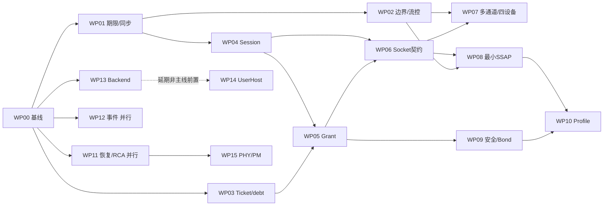

# SparkLink / Linux 联合实施方案

## 当前必要安全依赖：真实Host relay与可信安装

K b73a3dd完成内核crypto前置验证，未新增安全/CCC资格；下一步必须接通Native
per-connection lifetime的1812/0014 relay与命令credit/票据、协议协商与真实peer proof，
Agent确认/授权及安全等级，再用实际1C03/1C05与匹配0011证明安装后发布Encrypted。
[限定前置成果与反例](../docs/evidence/security-crypto-prerequisites-20261014.json)。

持续对照指定Host f087及libws73 f4d85d。standard1C04 RequestPair与WS731C04关闭
加密不同，按driver dialect区分；21/20字节加密参数不共用结构cast；一次1812真实
完成后才继续relay。算法/字节序/盐值按协商，不恢复固定随机数或测试密钥降级。
JustWorks不等于MITM认证/可信peer身份，CCC认证/授权依赖不能由自报状态满足。
不把安全全集或旧控制竞争全集设为已有读写/数据矩阵前置；S0–S6完整范围不变。


## 当前主线：完整通知／指示／订阅，保持安全依赖真实

U8e92f97接单次本地更新接收、原期限、调用者退出和确认语义；K317隔离VM原
发现/数据/长度资格保持，未声明更新能力明确拒绝。**未取得正向更新空口或订阅
资格**，不将本地观察、ACK编码或离线callback测试当完整SSAP。
[准确本批范围](../docs/evidence/ssap-update-rx-progress-20261014.json)。

每批相关wire/生命周期/SSAP/安全工作持续参考用户指定NearLink Host版本f0872d，
核对clean/dirty及实际源码hash，再与标准、SDK111和libws73-usb比较，记录差异。
不能把其他Host运行方式、厂商权限默认值或ACK结果直接当Native资格。
[参考依据与本批差异](reference/architecture/nearlink-host-reference.md)。

下一步补每connection lifetime的CCC状态、真实认证/授权、生产发送/指示ACK记账，
连续订阅/多应用callback与有限队列、丢包/背压/撤销；正向双端随机值与应用响应
实机门禁随后。标准表40使远端CCC成功路径依赖真实安全上下文，未接通前明确
拒绝；这不阻塞已有普通值读写、边界、数据credit/生命周期与形式化并行。
ACK限定生产编码已验证，不扩展到完整解析或并发；前一ReadUUID OOM仍未证明。
S0–S6/19WP/10FV/12DG、VM-only、UserHost P4及自然RCA/自主恢复开放条件不变。


## 前一批：ReadByUUID实机闭环

K317／U514cf73：标准基础ReadByUUID接唯一用户态actor并实机通过64次双方向
写前/后读取，保留发现、建链、业务短包和已取得边界。完整范围见
[准确证据](../docs/evidence/ssap-read-uuid-progress-20261014.json)。

WP08继续通知/指示/订阅与应用callback生命周期，实际多条/标准UUID/权限/长包
矩阵并行；codec形式化失败因工具资源耗尽，需优化生产纯状态表达再证明，禁止
替换为简化验证副本。原期限、取消、清理、队列、credit和旧lifetime验证持续，
不把全部控制竞争组合设为数据面前置。S0–S6/19WP/10FV/12DG及VM-only不变。
自然根因/非人工恢复未闭合；UserHost仍P4规划，无新代理实现承诺，不关闭整项issue。


## 前一批：真实发现handle与读写接通

K31769／U7d87d18：唯一actor的分层/UUID/结构发现和lifetime建议缓存真实通过，
从发现取handle做原读写，不恢复旧kernel SSAP。修正服务保留handle范围与
双角色协商期请求响应。完整范围和缺失见[准确证据](../docs/evidence/ssap-discovery-progress-20261014.json)。

WP08下一批：ReadByUUID基础信令；通知/指示/订阅与应用callback生命周期。
混合UUID/实际多页/数据库动态变更、原期限/取消/关闭/旧life与credit/满队列
实测/形式化并行，随后SSAP长包/事务与动态通道/四设备、安全/Profile。
不等待控制竞争全集。完整S0–S6、19WP/10FV/12DG、VM-only、UserHost P4及
自然RCA/非人工恢复开放条件保持；缓存不是完整resync，不关闭整项issues。


## 前一批：基础单值读写（历史增量）

K31769／Ub5cc6f5：唯一actor上有界数据库、真实基础单值读/校验写、原期限、
显式本地配置及对端应用核对接通；32写/64读与原业务/边界/受控同行取得准确
VM门禁。首轮构造参数双状态锁回归已修复，保留失败；不将该软件回归混作
自然硬件根因。新codec模型unsupported仍未证明，完整actor/数据库也未证明。
[源码、门禁、假设及缺失](../docs/evidence/ssap-values-progress-20261014.json)。

WP08继续：服务结构/UUID发现与真实远端缓存，通知/指示/订阅；随后协商的
SSAP长包、事务号和分片。actor/数据库原期限、取消/关闭/旧lifetime模型与真实
credit耗尽/满队列并行；动态多通道/四设备随后接入。未发布接口继续整改，
C/Python高层SSAP调用者未接通。完整19WP/10FV/12DG、S0–S6、VM-only、
UserHost P4、自然RCA和非人工恢复开放条件保持，部分成果不关闭整项。


## 前一批：唯一SMTC初始ExchangeInfo（历史增量）

K31769／Uceb6114：默认slkd唯一actor接通SMTC10/PI0、实际快照和Grant检查、
有限队列/原始期限/显式退役；4个连接lifetime的双端初始ExchangeInfo及原
40短消息/8轮249/16超限拒绝取得准确VM资格。旧服务wire不恢复，服务操作
仍NotSupported；形式化仅继承原有限范围，actor本批未证明。
[准确来源、失败、门禁和未决](../docs/evidence/ssap-actor-progress-20261014.json)。

下一批WP08：在此唯一actor上接有界用户态服务数据库及真实读写，复用权限
类型，按对端应用校验/回复验收；随后通知/指示与SSAP MTU/事务/长包。
与原期限/关闭/lifetime模型、真实credit背压和自然RCA并行，不等待控制面
竞争全集。保留完整S0–S6、19WP/10FV/12DG、VM-only、UserHost P4及所有整项开放条件。


## 独立文档整改：大写原文归纳

46份根目录大写Markdown已逐篇按主题补范围和阅读去向；旧API表退休、SSAP权限
参考拆出、主机部署旧步骤明确历史。见[归纳清单](../docs/project/uppercase-document-guide.md)。
本批不改变S0–S6、协议资格或开发依赖；剩余混合内容继续拆分，门禁另记。


<!-- documentation-scope: 20261014 -->
> **阅读范围：唯一权威入口。** 完整 S0–S6、工作包依赖和未完成门禁。
> [主题归纳与去向](../docs/project/uppercase-document-guide.md)；[推荐入口](../docs/project/index.md)。

## 前一批：通道能力查询与下一步SMTC（历史增量）

K31769ea4b8c0／服务和工具U82a06cd：内核在Runtime授权及Session锁下产生一致
MTU/MPS/身份/通道键快照，锁外copy，无lease泄漏或数据/credit消费。跨语言与
真实普通用户getter/copy重试门禁通过，完整范围只见资格和证据。
下一步绑定唯一slkd SMTC actor并先取得真实ExchangeInfo，随后有界服务数据库
与读写/通知/指示；不把控制竞争全集重新作为数据面前置。
完整S0–S6、VM-only、恢复开放条件与UserHostP4不变。
[源码、失败、假设与剩余](../docs/evidence/channel-info-progress-20261014.json)。


## 前一批：Session固定通道表（历史增量）

K6fe9696a04da／服务与工具Uf0cd461：一个Session worker统一消费/解码ACB，
CUTC31/PI241与SMTC10/PI0各有有限队列、fd/Grant与关闭退休；共享真实credit与
提交票据，采用有限轮转。旧CUTC准确源码实机回归通过，SMTC互通仍未验收。
[实现、有限证明、准确实机与失败](../docs/evidence/session-fixed-channel-progress-20261014.json)。
下一依赖是提供一致的实际通道能力快照、绑定唯一slkd SMTC actor并完成真实
ExchangeInfo，再接有界数据库与读写/通知/指示。动态通道、可靠模式、同lifetime
重绑以及全生命周期证明仍缺；不等待全部控制面竞争才推进数据纵向门禁。
完整S0–S6、19WP/10FV/12DG、VM-only、自然RCA/非人工恢复与UserHostP4保持。


## 当前切片：标准独立snoop迁移，Virtual与准确WS73回归通过

K580b51f9142f把标准DLI四字节头event/command接入已有CAP限制的每registration
snoop日志，profile0/format2与WS73 profile1/format1区分，record ABI大小不变。
RX在标准schema parse前复制，TX_RESULT在transport尝试返回后记录；它不是
Complete或对端收到，RX可能更早出现。日志不消费Host回复/标准作者账本，不发布
原生Ready或连接资格。flags/reserved非零在订阅前EINVAL，修正此前接口缺口。
SDK/C/Python同record，monitor/dump按profile格式解析，不增加第二套队列。
[调用审计/范围](../docs/evidence/standard-snoop-migration-audit-20261014.json)。

新增实际Virtual门禁：两独立reader字节相同但各自cursor；真实标准query及私有
Diagnostic结果完成；非零query字段输出不变；继承fd失CAP读取/poll拒绝；同行
查询保持可用。Virtual是专用测试后端，不当标准物理/RF证据。完整标准公共事件
frontend、canonical状态/loss/resync和实际标准硬件仍待完成。准确K53a110/Ueb92的双reader/CAP/flags/private-result/peer真实Virtual门禁
以及WS73发现/连接40短消息、8轮249数据/16超限拒绝、受控同行回归已重新通过。
[准确源码、失败、raw证据和未决](../docs/evidence/standard-snoop-migration-progress-20261014.json)。
原CI旧依赖harness失败保留，test-only Kce258迁移9Rust/25C通过，准确U99692 CI38475991043九项成功，仍不证明标准真实硬件。
原S0–S6、VM-only、UserHostP4及恢复/SSAP等完整未决保持；不把控制竞争全集
重新设为数据面前置，下一步接通唯一用户态SSAP并继续剩余界面迁移。


## 当前切片：measurement/config与单一命令Host，准确新配置实机通过

K654216743b68（重复TX清理K157346df6998）删除固定measurement能力投影及不经过Native事务的直接旧命令，
四入口在权限之后/context与copy之前Unsupported；SDK/D-Bus相同明确拒绝。
configfs只保留软件version，五个旧全局配置节点删除（包括none/0假成功selector）；
no-ghost/Virtual/mixed C回归改为实际ENOENT及注册表不变，精确旧源码保留历史。
SPARKLINK_SLE/DEBUGFS无编译消费者的选项删除；Linux DEBUG_FS仍控制debugfs，
实际WS73驱动与板级bsle_custom.bin/pm_config.bin保留。Core不再select无消费者
crypto，机制源码继续留在内核，未来每连接安全机制独立接通其依赖。
全量重编译暴露了历史queue len无消费者警告；进一步审计确认ControllerState的
重复queue无入队者、worker fallback永不成立，已移除副本/credits/no-op事件路径，
实际CommandHost队列与标准CmdPending作者账本保留；len检查仅cfg(test)，不压警告。
[三类审计](../docs/evidence/measurement-config-retirement-audit-20261014.json)。

资格VM配置已显式核对只移除SLE/DEBUGFS两行，从37e9ce68变为30860427；
driver/compiler/hardening等其他选项未变化，Virtual仍是独立可选测试模块。
准确 Kdfc641ae112d/service+runner U78fd3f14f5fb 的构建、空注册/Virtual、
双真实发现/连接40短消息、8轮249字节/16超限拒绝、受控同行隔离已重新通过。
新配置与旧资格严格分开。初始credit来自驱动metadata直传Host，不用默认常量。
[准确新配置门禁、失败与未决](../docs/evidence/measurement-config-retirement-progress-20261014.json)。
准确源码CI原1项旧选项测试失败保留，test-only K94d84修正四检查通过，完整U45bb87/K94d84 CI九项已逐job成功回读；运行源码与实机仍精确绑定Kdfc641/U78fd。
完整S0–S6、VM-only、UserHost P4/文档独立范围、自然RCA/非人工恢复开放条件保持。
下一步收敛未发布旧facade及标准事件/result，接通唯一用户态SSAP，数据扩展与
形式化并行；不以控制竞争全集为数据面前置。


## 当前切片：显式 File affinity 与旧观察迁移，准确新源码回归通过

K `c2dd941e5784`（pin初始化修正 `902f01dc9ea5`）删除 active_dev_id/default_selection 与全局 DEV_SWITCH；
未选择File不能访问controller，DEV_SELECT(-1)只清本File，dup/fork共享绑定，
拥有Managed/Diagnostic lease时拒绝重绑直到清理完成。源码无生产调用者的
可写debug计数删除；旧默认DLI/queue节点只读提示实际替代入口。
旧DLI_INFO及直接Backend reset明确拒绝；标准profile0的真实Diagnostic账本
及MGMT_STATS自主超时/取消回归保留，Native profile1拒绝这项旧投影。
CLI Controller/dli/query不再把旧queue统计当Native静默或metadata，SDK/D-Bus
旧aggregate明确NotSupported；没有重建重复观察状态。
[三类审计与保留理由](../docs/evidence/default-affinity-retirement-audit-20261014.json)、
[准确源码门禁/失败/未决](../docs/evidence/default-affinity-retirement-progress-20261014.json)。

新增实际VFS门禁：未选拒绝与buffer保持、dup清绑定/重绑/关闭一个引用后存续、
另一个File不受影响；79旧入口含global switch与不可靠reset拒绝。准确 Kdd11fa38a338／service+runner Uc6927630cbb1 的
Virtual及真实发现/建链40轮短数据、8轮249数据/16超限拒绝、受控同行隔离
已重新通过。首轮初始化与Virtual错误预期失败保留，旧资格不迁移；不关闭完整scope、自然RCA或非人工恢复事项。
完整S0–S6、VM-only、UserHost P4和独立文档工作不变。下一步继续剩余未发布
旧facade、无消费者模块/配置迁移，随后接通唯一用户态SSAP，不等待控制竞争全集。


## 当前整改批次：安全／隐私模型退休，限定真实数据回归通过

K `f3ef1d52778c` 已移除 ControllerState 的 SecurityInner/RpaManager 与旧 worker
自动配对响应；修正构建重复属性为 K `6f2f71298029`。crypto 机制源码保留在内核，
无默认 Runtime 消费者，暂不编入默认对象。精确旧模型移入 selftests，历史7项与
真实 crypto wrapper/C CTR 故障依赖测试不构成配对或可信密钥资格。
SDK/D-Bus/C/Python 旧安全／隐私 facade 迁移为明确 unsupported；Encrypted/Paired
未知不伪装为 false。保留 daemon Bond 存储 actor，但它不是可信凭据已安装的证明。
76项旧入口（Observe15/Protected61）已在VM核对权限、拒绝及缓冲区不变。
[三类审计](../docs/evidence/security-state-retirement-audit-20261014.json)、
[准确源码实机门禁与未决](../docs/evidence/security-state-retirement-progress-20261014.json)。

首轮内核构建警告与 sandbox LeakSanitizer 环境失败保留。准确 K6f2f/U4b949 的
Virtual、双设备发现/连接/40轮短数据、8轮249数据、16次超限拒绝及受控同行隔离
均重新通过；记录不继承旧资格，亦不证明新配对或自然恢复。K#7/#18、U#5、恢复及所有未完scope保持开放。
完整 S0–S6、VM-only、UserHost P4与独立文档工作不变。下一步观察默认选择与旧
接口调用迁移，再接通唯一用户态SSAP；不以控制面竞争全集阻塞数据纵向工作。


**唯一执行计划。** 完整S0–S6及原28项issues验收范围保持；工作包不是新issue或缩小scope。
采用2026-10-13用户提案并核对最新源码/证据/在线issues，调整记录见
[ARCHITECTURE_ADOPTION](../history/architecture/architecture-adoption-20261013.json)。
原长期追加日志已完整移入[历史归档](../history/plans/implementation-history-pre-20261013.md)，不再并列维护“当前计划”。
目标分层见[ARCHITECTURE](architecture.md)，接口决策见ADR0001/0002；
当前五维资格只在[CURRENT_CAPABILITIES](current-capabilities.md)维护，
goal的剩余工作/依赖持久记录见[GOAL_EXECUTION_STATE](goal-execution-state.json)。

## 近期整改：重复连接／发现模型已退休，继续安全／地址与观察路由迁移

按[调用审计](../docs/evidence/protocol-state-retirement-audit-20261014.json)退休旧连接、发现、角色、AFH/sync/PDU模型
及第二接收分流，实际Native Host／Session／Channel路径保留；删除混合统计并迁移CLI与故障门禁消费者。
准确源码、首次失败及实机范围只从[当前资格](current-capabilities.md)和
[本批证据](../docs/evidence/protocol-state-retirement-progress-20261014.json)进入。
下一批逐项核对SecurityInner／RPA、default_selection/debugfs/诊断观察及未发布旧入口，
保留真正密码／授权机制与有价值测试，迁移或拒绝后删除错误状态来源。
canonical loss/拓扑／owner-death、完整callback与生命周期、真实credit/NOCP和数据纵向门禁并行；
不先穷尽控制竞争，不缩小原S0–S6或提前关闭整项。

## 近期整改：软件 PM 与旧统计展示剥离后，继续统一剩余状态

本批按[审计](../docs/evidence/power-model-retirement-audit-20261014.json)移除默认软件PM、
跨controller全局策略与旧daemon统计展示。Native链路摘要取得准确源码回归；
完整门禁和限制只从[当前资格](current-capabilities.md)与
[证据](../docs/evidence/power-retirement-progress-20261014.json)进入。
剩余conn/adv/security/RPA/local_role、旧ioctl/debugfs默认选择及混合内核统计继续逐项迁移：
先接真正消费者或明确拒绝，再删重复状态。每设备实际PM机制／slkd策略另有正向硬件门禁，
不能以模型删除、权限拒绝或Virtual通过宣称完成。原S0–S6、纵向data/用户SSAP、自然RCA及非人工恢复范围保留。

## 近期整改：Netlink 默认设备投影已剥离，继续统一状态来源

本批按[调用审计](../docs/evidence/genl-retirement-audit-20261014.json)删除无生命周期身份的
旧 Netlink 控制／状态／通知，仅保留真实 registry 数量／软件版本。准确 K7c/Uffc 的
实际 Virtual 与真实 WS73 子门禁见[当前资格](current-capabilities.md)和
[本批证据](../docs/evidence/genl-retirement-progress-20261014.json)，不在本页复制资格矩阵。
下一批逐项审计剩余 normalized connection/radio/power/security 及 ioctl/debugfs
默认选择：迁移真正调用者，未支持能力明确拒绝，再删重复状态。canonical loss/resync、
拓扑／owner-death、实际 callback join 和自然恢复并行；不把全部控制面组合设为数据前置。
WP12仍部分完成；Session/Channel/Grant/Host分层、真实data路径、完整S0–S6和P4 UserHost保留。

## 当前子门禁：完整事件替代旧 read／队列统计

精确编译内核 `e78b88f050aa`／service `bf7a189a4a52`。
[三类调用审计](../docs/evidence/read-retirement-audit-20261014.json)和
[当前源码、实际VFS门禁与未决](../docs/evidence/read-retirement-progress-20261014.json)：默认read(2)明确Unsupported，
删除44字节SleWireEvent／EventQueue／BroadcastRing／全局序号及per-fd旧poll队列，0x70/71及SDK统计类型删除。
ADV/RAW_ADV/CONN_RESP/CONN_DATA生产ioctl注入明确拒绝，旧源码及copy/overflow/actor价值测试隔离保存。
原9read-copy和6poll-copy仅历史资格；旧live supervisor明确拒绝，不恢复旧ABI。

Native完整ControllerEvent、私有DiagnosticResult和独立CAP snoop保留。
D-Bus／slctl events改为实际LinkSnapshot注册gen/index/event_seq水位，锁外syscall；水位不是投递ACK或pending/delivered统计。
被动uid1000 Cprobe在两个连接角色／两设备的正常两批执行8次，**32实际guarded-page部分copy故障**，
观测真实改写前缀、EFAULT readiness保留、完全重试、独立reader重放；旧read/stats拒绝且buffer不变。
真实新slctl events八份回执匹配对应设备。新empty模块／Virtual Core/Host两轮42查询通过。

准确新实机 [40短消息](../docs/evidence/read-retirement-real-short-20261014.json)、
[8次249／16边界拒绝](../docs/evidence/read-retirement-real-boundary-20261014.json)、
[受控启动失败同行8](../docs/evidence/read-retirement-fault-real-20261014.json)通过；随机序号／数据实际对端校验回复，
正常224 ACB SDU／112 NOCP、零kernel capture drops／taint0。原首次panic/最后回复关闭/旧prepare失败保留。
CI0174 pin Ke78九项通过。未升级完整形式化、并发overflow或自然恢复资格。

**WP12／完整目标仍OPEN**：旧normalized state/genl调用者／通知权威迁移、canonical loss/resync/拓扑/快照/owner-death全集、
完整IRQ/module/PM/callback、标准typed/data真硬件及mixed real/Virtual仍缺。自然RCA／非人工恢复继续开放。
所有原S0–S6／19WP／10FV／12DG及真实WS73纵向路径保留，P4 UserHost仍只规划；不关闭整项issue。


## 当前子门禁：删除破坏性 DLI poll 与重复队列

编译内核 `96f18513c0a1`／service `bf117ad6254f`。
[三类调用审计](../docs/evidence/event-poll-retirement-audit-20261013.json)和
[准确源码、门禁、失败与未决](../docs/evidence/event-poll-retirement-progress-20261013.json)：删除旧0x82 ioctl／Raw256公开类型、
重复DLI队列及其producer、空backend poll钩子，同步删除Rust/C/Python poll、EventReceiver/50ms fallback、
monitor --legacy 和旧scan wire path。所有daemon构建均拒绝未接通的标准typed管理；实验feature不能复活旧订阅。
Native ControllerEvent、私有DiagnosticResult和CAP限制的独立snoop保留。

历史copy/codec/actor回归隔离到selftests／cfg(test)，旧类型仅私有测试头。
旧poll依赖的live诊断matrix明确拒绝；它不是新矩阵通过。原失败、反例和旧资格保留版本，不转授当前镜像。
首次准备在旧probe C编译失败，未接USB，已保留并修正测试依赖；不恢复生产接口。

当前源码严格Rust、35跨语言ABI、459离线工具、9实际read-copy＋6历史copy边界通过；
稳定配置完整镜像、空WS73/standard模块及真实Virtual Core/Host两轮42查询通过，旧编码ENOTTY且不改用户buffer。
新真实WS73 VM [40短消息](../docs/evidence/event-retirement-real-short-20261013.json)、
[8次249／16超限拒绝](../docs/evidence/event-retirement-real-boundary-20261013.json)、
[受控失败同行8](../docs/evidence/event-retirement-fault-real-20261013.json)通过，uid1000/caps0、随机数据双端校验回复。
正常224 ACB SDU／112 NOCP、零kernel capture drops／taint0；NOCP不代替对端收到。

**WP12仍未完成**：旧read/BroadcastRing、normalized state/genl镜像及loss/resync/拓扑/owner-death全门禁仍待迁移，
完整IRQ/PM/module/callback和混合真实/Virtual、标准真硬件typed/data仍缺。自然RCA/非人工恢复继续OPEN；
QMP、注入及hub切电不替代自然恢复。完整S0–S6、实际data路径和P4 UserHost不变，不关闭整项issue。


## 当前子门禁：标准 Diagnostic 统一与真实 Virtual 生命周期

生产内核 `1ed6963f0f7f`／service `231f61e03d80`：标准 profile0 查询统一到独占版本化 Diagnostic，
固定方言参数由内核提供，保留在途回复和原期限，撤销未执行队列；标准 Managed／typed／data 仍明确不支持。
旧 raw admission 生产函数已删除，旧编码／SDK wrapper 明确拒绝，最终 UAPI／绑定删除仍待迁移。

[准确源码、构建与限定范围](../docs/evidence/standard-diagnostic-progress-20261013.json)：配置37e9不变，完整构建、
空 USB WS73／standard 模块 VM、实际 Virtual Core/Host VM 两轮通过。追加仅 selftest 的 K4ea441验证管理 fd 的
*dup 保留租约、最后引用关闭撤销、两条排队取消及一条在途回复、同行查询隔离*；编译镜像仍为K1ed，不转授重建K4ea资格。
两轮42查询；Setup不伪装Ready。已进入callback的确定性join、完整IRQ/module/PM及mixed real/Virtual仍缺。

准确 K1ed/U231 的真实 WS73 VM： [40短消息](../docs/evidence/standard-diagnostic-real-short-20261013.json)、
[8次249字节／16超限拒绝](../docs/evidence/standard-diagnostic-real-boundary-20261013.json)、
[受控启动失败同行8业务](../docs/evidence/standard-diagnostic-fault-real-20261013.json) 通过。
普通uid1000/caps0，对端随机序号／载荷实际校验回复，交换连接角色，两端USB/HCC/A3与NOCP佐证；
正常两批224个ACB SDU／112个NOCP完成、零capture kernel drops／taint0。NOCP不代替对端收到。
QMP和注入重试不是自然恢复／物理拔插验收，原人工及首次panic/最后回复关闭失败证据保留。

CI pin K1ed 的U860f04f九项通过；离线函数50诊断／55撤销及连接边界回归不冒充VFS／空口／形式化实现证明。
标准真USB硬件、完整控制/数据Virtual、canonical事件、标准ticketed数据、旧接口最终删除及自然RCA仍开放；
部分子门禁通过不关闭WP13、K#3/K#8/K#19/U#8或完整S0–S6。


## 独立文档整改（WP17／WP18 附属，不阻塞真实 WS73）

采用 Diátaxis 的读者任务导航，原 ARCHITECTURE／本文件／CURRENT_CAPABILITIES／ADR／GOAL_EXECUTION_STATE 路径与权威性保留。
独立 root docs dependency group + uv.lock；Python 3.12 CI、严格 Sphinx/MyST/Furo HTML、artifact 与单独外链检查。
最新清单覆盖基线 64 份 Markdown，原始版本／hash／处置完整；历史报告及受限 SDK／标准／抓包不整体进入站点。

[文档工作附页](../docs/project/documentation-migration.md) 记录 D0–D6。基础设施、导航、README 和第一批内容拆分已落实；
严格 HTML／干净锁定环境／内部资源检查通过；第二批已有准确提交浏览器实测，外链限流不算 PASS。
API 全字段／错误矩阵、其余混合页、首次真实硬件操作教程、离线 Mermaid 和正式发布仍待完成。
文档不改协议架构、源码功能、准确实机资格、原验收和 VM-only，也不成为当前整改／数据面／用户态 SSAP 的前置依赖。
U#8／K#19 及所有未完成事项保持开放；部分导航或构建通过不关闭整项工作。

第二批按 U `311556185275` 更新 87 份用户态／10 份内核资料清单、当前事件参考及历史入口，
独立 clean checkout locked 构建与实际 Firefox 导航／搜索／图形／移动布局通过。
初始搜索 JS 失败及整改保留；外链60项429仍未核实。内容拆分未全部完成，
首次真实设备执行教程与发布延期；不影响 S0–S6 依赖或硬件资格。
详见[文档工作附页](../docs/project/documentation-migration.md)。
第三批按最新 U ca72b4915854／K 5582a10c5ec8 复核，拆分 snoop 操作与字段／错误契约，
修正历史验证冲突与 bindings 声明；独立文档工作不更改 S0–S6 依赖、代码或资格。

## 采用后的准确基线与优先级

最新执行阶段：**先完整整改到采用的目标架构，再继续扩展功能。** 旧SSAP业务剥离已取得本批退出资格；
当前统一Session/Ticket/Grant与socket文件契约，接着整改Backend注册及事件权威来源/重复路径。
长度与真实credit的必要现有路径回归/证明并行；新长包、多通道、SSAP/Profile等扩展随后推进。
不要求所有旧控制面竞争组合先穷尽，保持当前WS73能力。
[当前SSAP调用审计/三类清单](../history/ssap/ssap-production-separation-20261013.md)。


## 历史基线：K883 Virtual VM 失败及待验条件

K`88372a9b7cbcea7fcbca4f34cc9d5707488be46e` / U`5a985078756eb1d323b59e968db328d0aad3c7c9`：
旧仅日志Rust模块删除，专用可选C测试驱动已实现；默认关闭、root-only控制设备每个File注册独立TEST-bus
standard-DLI query Runtime，dup共享，最后关闭精确退休generation并join有限reply worker。
共同Backend/Host/credit/超时及带身份标准ingress复用；有限delay/drop/fail注入仅测试模块。
有界一个排队reply槽及正在执行的callback；不宣告Ready/RF/连接/data，daemon不自动生成回复。

[实际范围和未决门禁](../docs/evidence/virtual-provider-progress-20261013.json)：实际codec65819项ASan/UBSan检查、
工具456、准确CI38388711225九项成功；[直接生产codec100性质](../docs/evidence/virtual-provider-formal-20261013/production/report.json)
限定通过，弱unsupported守卫反例映射实际穷举拒绝测试。不证明Host credit、worker/cancel/join/IRQ/引用/lifetime。
[Virtual File有限抽象模型](../docs/evidence/virtual-file-model-20261013/report.json)32513状态、弱join反例；
依赖VFS/工作队列/精确ingress契约，不是实现证明，已进入callback的确定性join实测仍缺。
全量镜像/模块构建正在执行；准确新提交的VM生命周期与真实WS73回归尚未通过，不能沿用旧资格。
测试运行器已提供query/两controller/dup/最后关闭pending取消/旧gen/复用/drop/fail/迟到回复与模块reload门禁。

下一步先完成当前构建及这些VM门禁，再推进mixed real/Virtual、运行中callback join、Virtual控制/数据模拟与
WP12统一事件/旧ring/重复消费者；标准typed/ticketed及完整module/IRQ/PM/lifetime/自然RCA并行。
旧Kae5/U967真实WS73资格及证据保留，当前未把新source记作实机通过。
完整S0–S6/19WP/10FV/12DG与原28项scope保持，整体架构先整改再功能扩展；未完成整项保持OPEN。
[本批十二项issues回读](../docs/evidence/virtual-provider-issues-20261013.json)，原scope保持，当前原28项全部OPEN。

## 前批已验收：驱动归 drivers，Core 不依赖 USB

准确源码 K`ae5b24535a898fb05b9c4f08aa0e7e2004911072` / VM service及工具
U`967ad220271009498319f3bb71d93fbfb9c63e83`。实际 EP0/interrupt/context/URB 和 USB 注册已移入
`drivers/sparklink/standard_usb.c`，独立 `SPARKLINK_STANDARD_USB` 模块；Core 只保留
`sle_standard_dli` 协议解码及带身份入口，不包含 USB driver/objects，不再要求 USB=y。
probe在I/O前精确reserve，失败与disconnect先退休该身份再释放USB；PM明确-EBUSY。
旧Core注册/wrappers仅selftests历史；旧USB_DEV_COUNT明确Unsupported，用ListRegistrations观察。
标准profile0仍query-only，未接通typed/data/PM不授予能力；WS73路径保留。

[离线及准确构建](../docs/evidence/standard-driver-move-offline-20261013.json)：实际driver6、adapter14、
binding25/8、metadata44/context19、Core18/Native33等源码回归；工具456、[CI九项](../docs/evidence/standard-driver-move-ci-20261013.json)
通过。依赖fixture不证明完整Core/IRQ/module/refcount/lifetime。初次六项warning修正后准确build零compiler warning。
[模块VM门禁](../docs/evidence/standard-driver-move-module-smoke-20261013.json)：标准与WS73各一个空USB VM，
各两轮load/unload、三次空注册表检查；不是三次VM启动，不授予物理标准或PM资格。
[USB构建组合](../docs/evidence/standard-driver-move-build-matrix-20261013.json)单独记录最终配置和产物，
首个USB=n被Kconfig重新select的配置失败保留，不计成功。

[metadata314](../docs/evidence/standard-driver-move-formal-20261013/metadata/report.json)、
[writer116](../docs/evidence/standard-driver-move-formal-20261013/writer/report.json)在准确源码限定重核；
锁/USB依赖模型、memcpy范围假设保持，不扩大为并发/module/URB/引用/lifetime/credit/物理证明。
[真实40短](../docs/evidence/ws73-standard-driver-move-short-repeat-20261013.json)、
[249边界](../docs/evidence/ws73-standard-driver-move-249-boundary-20261013.json)、
[故障同行8往返](../docs/evidence/ws73-standard-driver-move-fault-isolation-20261013.json)通过：VM-only普通用户、
两角色随机对端校验回复，40短/8次249/16拒绝，双端USB/HCC/A3、normal224 SDUs/112 NOCP、零drop/taint0。
RF/建链断链/dup/最后关闭同life拒绝、dynamic observer/newgen/旧path拒绝/同slkd及同行保持。
NOCP/USB成功不替代业务收到；缺文件/QMP不替代自然恢复。

下一批按架构整改推进：专用真正Virtual provider（当前仅placeholder）、WP12统一事件及旧ring/重复连接
消费者、标准typed policy/Session-ticketed ACB/canonical ingress、module/IRQ/PM/回调join与完整生命周期。
Ticket/Session/Grant/socket在途、NOCP复用屏障、真实credit/背压和自然RCA并行；已完成的驱动迁移不重复实现。
整体目标架构整改后再扩展长包、多通道/四设备和唯一用户态SSAP。
完整S0–S6、19WP/10FV/12DG及原28项scope保持；所有未完成整项保持OPEN，未取得自然恢复或完整部分初始化资格。
[本批十二项issues回读](../docs/evidence/standard-driver-move-issues-20261013.json)，原scope不变；原28项全部开放。

## 历史子门禁：共同标准provider注册与静态USB路径删除

K`a368cf5f178416d44c1ffe83536f22c074eebf5f` / VM编译service和工具U`168c8709`：
标准C adapter把同一锁下查询metadata及不可变reservation交共同descriptor/ops；standard0仅query caps0，
WS73_1保留已有typed/data路径。get/put保留同一C allocation，open精确核对id/generation并处理partial-open；
共同Runtime安装/open-adoption/close/命令port和RX身份路由接通，注册/install不宣布Ready。
Native provider metadata区分standard/WS73/Test标签，standard不把hardware buffers冒充软件PDU/模式能力。
Native callback异常正返回值明确EIO。**已删除** UsbController、ControllerBackend::Usb/new_usb、
Core sle_switch_controller_usb/open_usb_runtime；所有运行时消费者经同一provider，不是仅改enum名称。

[实际源码/离线/构建](../docs/evidence/common-standard-provider-offline-20261013.json)：actual adapter14、
生产descriptor40、C entry拒绝11+standard正向case、共同port2/projection5、Core18/pending9/Native33、
Host全源码与cleanup callback、binding25/8、metadata44、context19通过；历史static info11/open6等仅retired。
旧测试中的Unsupported backend variant已改为真正provider callback拒绝，默认生产无额外模拟provider。
初次integration未使用导入warning和fixture迁移错误保留、修正后准确清洁build零compiler warning/空VM三次。
[准确CI九项](../docs/evidence/common-standard-provider-ci-20261013.json)U168c/pin Ka368通过。

[descriptor242及capability弱guard反例](../docs/evidence/common-standard-provider-formal-20261013/descriptor/report.json)：
直接验证生产pure validator，任意ABI字段/callback有无，假设provider-owned内核对象指针有效。
standard0不得宣告未接通typed/data caps；删guard产生counterexample，对应实际standard+ACB flag拒绝回归。
metadata314/writer116按准确源码限定重核；copy/USB/锁等依赖假设保持，不证明Runtime/IRQ/module/URB/引用/
并发/lifetime/Host credit/Ready或物理。模型结果不扩大实际adapter依赖fixture的范围。

[新fault同行8业务](../docs/evidence/ws73-common-standard-provider-v2-fault-isolation-20261013.json)、
[新40短](../docs/evidence/ws73-common-standard-provider-v2-short-repeat-20261013.json)、
[新249与16拒绝](../docs/evidence/ws73-common-standard-provider-v2-249-boundary-20261013.json)：VM-only真实WS73、
普通用户，两角色随机对端校验回复及双端USB/HCC/A3；normal224 SDUs/112真实NOCP、capture零drop/taint0。
RF/建链断链/dup/最后关闭同life拒绝及动态fault/observer/newgen/oldpath/同行/同slkd保持。
受控缺文件/QMP仅开发支撑，不是标准USB物理、完整partial-open/引用或自然自动恢复资格。

下一批：将实际USB transport/driver registration移drivers并验证core USB=n/m，专用真正Virtual provider，
标准typed policy/Session-ticketed ACB/canonical RX事件、WP12旧ring/重复连接消费者与module/IRQ/PM矩阵。
已完成共同注册与static Usb删除不重复实现。Ticket/Session/Grant/socket剩余在途/lifetime/NOCP/真实背压和
自然RCA并行；整体目标架构整改完成后再扩展长包、多通道/四设备和唯一用户SSAP。
完整S0–S6/19WP/10FV/12DG保留，整个Backend/架构/自然恢复及原整项issues仍OPEN。
[十二项相关issues回读](../docs/evidence/common-standard-provider-issues-20261013.json)原scope保持，实际全部28项仍开放。

## 历史子门禁：纠正标准USB binding，隔离未合格实验wire

K`6db8a530f9c69df1fe09060dd3f09220a55ea946` / VM编译service和工具U`2484932`：
调用审计查明旧标准路径把UART标识A1和指令放bulk、从bulk读Complete，不符合用户提供的
T/XS10003-2025 §6.2/§7.2–7.3。已改为EP0四字节DLI头、class request0/value0，按descriptor选择
device20/index0或interface21/实际接口号；bootstrap回复取interrupt。设备及接口class ID均匹配。
USB wLength包含四字节头，参数65531可编码、65532及以上拒绝；这是transport bound，不冒充设备能力。
RX endpoint lane显式归属，事件URB预算65539（u16参数+header），不把maxPacketSize当完整event上限。
标准裸handle数据没有Session/lifetime/credit/PB所有权，TX明确Unsupported、bulk RX拒绝；
未接通标准typed mutation/recipe/connection拒绝，raw只准明确核对的query schema。
**这不是缩减最终标准后端目标：** standard typed policy和ticketed ACB仍按WP13/原issues继续接通。

默认net/sparklink/sle_fw.rs、假定F810/F811/A5通用下载及其C FFI删除；boot-ROM/FW归厂商driver。
历史74C/12Rust及旧C数据边界迁selftests/retired-*，不再称生产wire或标准firmware资格。
WS73 SDK111/HCC/BSLE/固件/真实ACB保持其独立driver路径，不能把标准binding错误当作WS73自然故障根因。
[三类清理/调用者/替代](../history/cleanup/standard-usb-binding-cleanup-20261013.md)。

[准确实现/离线/构建](../docs/evidence/standard-binding-offline-20261013.json)：actual writer25/Rust prepare+lane8、
metadata44、context19/info11、port5/pending-open15/ingress9；完整清洁内核/空VM三次通过。
[准确CI九项](../docs/evidence/standard-binding-ci-20261013.json)U2484932/pin K6db通过并核对新binding和retired日志；
新proof classifier后工具456通过。decode/USB/allocator/registry替换是fixture依赖，不是物理或并发验证。

[actual metadata314](../docs/evidence/standard-binding-formal-20261013/metadata/production/report.json)限定范围重核；
[actual writer116](../docs/evidence/standard-binding-formal-20261013/writer/production/report.json)检验全int32参数长度/
USB return/timeout、u16 opcode/index/u8 target、NULL/active/alloc失败；valid source object65531。
memcpy仅抽象为读写范围断言，**不证明payload字节复制**；USB/LE primitive也是依赖模型，
不证明硬件、并发/IRQ/URB/module/引用/Host credit/Complete/Ready。
[忽略四字节头的反例](../docs/evidence/standard-binding-formal-20261013/writer/negative-control.json)映射实际65532/65535
预提交拒绝；弱模型均NOT_PROVEN，超时/unsupported/未展开不得PASS。solver/trace gzip保留原始hash。

[新fault同行8业务](../docs/evidence/ws73-standard-binding-fault-isolation-20261013.json)、
[新40短](../docs/evidence/ws73-standard-binding-short-repeat-20261013.json)、
[新249与16拒绝](../docs/evidence/ws73-standard-binding-249-boundary-20261013.json)：VM-only真实WS73，普通用户
两角色随机业务对端校验回复及双端USB/HCC/A3佐证；normal224 SDUs/112真实NOCP、capture零drop/taint0。
发现/建链断链/dup/最后关闭同life拒绝、dynamic fault/observer/旧path/newgen、同行与同slkd保持。
受控缺文件/QMP仅开发支撑，非物理/自然/非人工恢复；没有标准DLI物理资格。

下一批仍是common standard profile0 descriptor/Host/provider retained ops/RX-open-close/get-put，
迁调用者后删static Usb/core USB依赖；标准ticketed ACB/typed policy、真正Virtual、USB=n/m/moduleIRQPM及
WP12事件/旧ring并行。Ticket/Session/Grant/socket剩余在途/lifetime/NOCP/背压和自然RCA继续；
整体目标架构完成后才扩展长包、多通道/四设备和唯一用户SSAP。完整S0–S6/19WP/10FV/12DG不变，整项OPEN。
[十二项相关issues回读](../docs/evidence/standard-binding-issues-20261013.json)原scope不变，实际全部28项仍开放。

## 历史子门禁：单一不可变标准metadata生产消费者

K`1d6b3195484fa7ee63b675e5345dfc263850e44c` / VM编译service和工具U`8a7666e`：
C以一个io_lock快照返回查询的version/address/command credit/command最大长度/ACB/ICB/features；
Rust构造器读取一次、核对原bootstrap身份/版本/credit，冻结到provider，不在Runtime锁下重新取USB锁。
info保留80-bit features；controller snapshot保留完整版本、地址及buffer并标记queried metadata。
live Host credit/Ready/error由Host提供，getter和fill_snapshot不覆盖它们；buffer不推断SSAP MTU/MPS、
DTAP可靠模式、连接数或security policy。旧get_version/get_capabilities接口及调用者删除，UAPI未发布无兼容期。

[准确源码/离线/构建](../docs/evidence/standard-snapshot-offline-20261013.json)：实际C44，context18+实际Rust
构造器/info/snapshot11，固件74C/12Rust、Core18/pending-open15、port5、ingress9、Native33通过；
C/Rust metadata30-byte/align2及offset18/23/29核对。完整清洁准确内核编译、空VM三次通过。
初版K8e884ef构建因EPROTO不在kernel Rust prelude失败，K1d6b用bindings构造errno修正；失败原记录保留，
不能用离线fixture/模型通过覆盖内核编译失败。
[准确CI九项](../docs/evidence/standard-snapshot-ci-20261013.json)U8a7666e/pin K1d6b通过并核对44/74/11及工具454日志。

[实际C限定CBMC314](../docs/evidence/standard-snapshot-formal-20261013/production/report.json)：原bootstrap/validator
及combined getter，只提升static linkage，六次顺序查询、相关18-byte任意/length-return任意、unwind19，
getter的mutex是抽象依赖；验证成功一致快照、错误不覆盖输出、失效与有限查询。不证明USB/并发/LKMM/
callback/refcount/module/lifetime/Ready。[弱失效反例](../docs/evidence/standard-snapshot-formal-20261013/negative-control.json)
映射实际失败查询ENODATA/输出不变回归；弱源码仍NOT_PROVEN。原solver/反例以gzip保存并记录原始hash，
可用生产提取工具重现；超时/unsupported/未展开不得PASS。

[新受控故障与同行8往返](../docs/evidence/ws73-standard-snapshot-v2-fault-isolation-20261013.json)、
[新40短](../docs/evidence/ws73-standard-snapshot-v2-short-repeat-20261013.json)、
[新249与16拒绝](../docs/evidence/ws73-standard-snapshot-v2-249-boundary-20261013.json)：VM-only真实SDK111 WS73、
普通用户、两角色随机载荷对端校验回复和双端USB/HCC/A3证据；normal224 SDUs/112真实NOCP，零drop/taint0。
发现/建链断链/dup/最后关闭同life拒绝、动态fault/observer/移除/新gen/oldpath、同行与同slkd保持。
受控缺文件/QMP仅测试支撑，非自然/物理/非人工恢复，不授予标准USB物理资格。

下一批：标准profile0共同descriptor/Host与provider ops/RX/open-close/get-put→迁调用者删static Usb及
core USB耦合→USB=n/m、真正Virtual/module/IRQ/PM；WP12事件/旧ring及剩余Ticket/Session/Grant/socket
lifetime/在途/NOCP/真实背压门禁并行。已完成的query/snapshot消费者不重复实现。
整体目标架构完成后再扩展长包、多通道/四设备和唯一用户SSAP Engine；自然RCA/非人工恢复、
整项issues及完整S0–S6/19WP/10FV/12DG仍开放。
[八项相关issues回读](../docs/evidence/standard-snapshot-issues-20261013.json)确认原scope不变；实际全部28项仍OPEN。

## 历史子门禁：标准 Backend 的真实能力查询基础

K`1f23fc2197ad43b18d187b235d231583147cc7d1` / VM编译service和工具U`afc491db`：
标准初始化现在真实查询0401指令最大长度、0402 ACB/ICB长度及个数、0403完整80-bit特性，
0404完整版本和带地址类型参数的0406。只在六个匹配Complete全部成功后提交metadata；
保留上一阶段command credit准入，失败重新查询使观察失效，getter不覆盖失败输出。
范围值/成对零buffer/无效地址均验证。WS73 SDK111的0406零参数方言保持在自己的driver。

[准确源码/构建/离线](../docs/evidence/standard-capabilities-offline-20261013.json)：实际查询/回滚/getter44，
C固件及参数编码74/Rust12，context18/metadata7、保留port5、Core18、pending/open15、ingress9、Native33；
清洁准确内核编译和空VM三次通过；工具454通过，
[新准确CI九项](../docs/evidence/standard-capabilities-ci-20261013.json)通过（U9a262dd/pin K1f23）。
[实际C限定CBMC](../docs/evidence/standard-capabilities-formal-20261013/production/report.json)218属性，
原函数只提升static linkage，六次顺序查询、每回复相关18字节/长度/返回值任意，unwind19。
调用者持锁且context存续是明确假设；不证明USB、并发、callback、module、lifetime或Ready。
[破坏失效处理反例](../docs/evidence/standard-capabilities-formal-20261013/negative-control.json)映射失败查询
ENODATA/输出不变的实际回归。超时/unsupported/未展开/弱实现均不得PASS；工具命令与hash随报告保存。

[新故障/同行8往返](../docs/evidence/ws73-standard-capabilities-fault-isolation-20261013.json)、
[新40短](../docs/evidence/ws73-standard-capabilities-short-repeat-20261013.json)、
[新249与16拒绝](../docs/evidence/ws73-standard-capabilities-249-boundary-20261013.json)均VM-only真实SDK111、
普通用户随机业务对端校验回复，两端USB/HCC/A3证据；normal224 SDUs/112真实NOCP，零capture drop/taint0。
发现/建链断链/dup/最后关闭同life拒绝路径保留；故障对象控制及默认observer、同行和slkd隔离保持。
受控缺文件/QMP不是自然、物理或非人工恢复，不授予标准USB物理资格。

**未完成：** 新C capabilities snapshot尚无生产Rust消费者，FULL_METADATA未发布；
下一批冻结真实metadata到provider，再接版本化共同descriptor/profile0 Host/RX/open-close/get-put，
迁移调用者后删除static Usb及core USB耦合。真正Virtual、USB=n/m、module/IRQ/PM和WP12事件/旧ring整改随后；
Ticket/Session/Grant/socket剩余lifetime/在途/NOCP/背压门禁并行。整体目标架构完成后才扩展长包、
多通道/四设备和唯一用户态SSAP Engine。完整S0–S6/19WP/10FV/12DG保留，整项issues不关闭。
自然RCA和非人工自动恢复仍未通过。
[八项相关issues回读](../docs/evidence/standard-capabilities-issues-20261013.json)确认原scope和OPEN不变。

## 历史子门禁：共同保留提交接口与标准metadata

K`0fdbcf9a477cb17cbe5bd757c5ed7a964c8055ef` / 编译service及工具U`bda960d`：
CommandPort提供独立保留的provider上下文，Native/标准USB同一TX worker在释放Runtime state后
才阻塞传输；不持Host/IRQ锁、不按复用index重新找资源。Transport成功不支付controller/data debt，
不代表Complete或对端收到。Native typed tag原样传递，标准provider未接的connection/multi-step/
recreate/standby明确不支持，单步ON/OFF精确核对参数；旧send/send_command_transport包装删除。

标准Reset/version/MAC真实查询后完整保留5-byte version，failed requery关闭metadata有效性，getter
未知/退休明确失败且不覆盖输出；完整tuple冻结到Rust，info不再在Runtime锁内等待USB I/O锁。
controller snapshot不再丢第五字节，identity/install不再推断Host Ready；features/buffers仍未完整查询，
FULL_METADATA不伪造。仍有ControllerBackend::Usb/profile0 descriptor拒绝和core USB耦合，不能称完整Backend迁移。

[准确源码/离线/限制](../docs/evidence/backend-command-port-offline-20261013.json)：实际port5、
bootstrap/strict reply/getter18、C资源18/Rustmetadata7、Core18/pending/open15、ingress9、firmware67C/12Rust、
Native33/actual ticket/C发送回归通过，准确清洁build/空VM三次/CI9通过。make j1 jobserver提示保留，
零compiler warning；fixtures仅替代allocator/USB/锁/response依赖，worker释放顺序仅源码检查。
没有新增形式化资格，不证明workqueue/IRQ/callback/module或跨语言lifetime refinement。
Fixture路径/type/static提取及sandbox LSan失败保留，修正后重核；没有归因硬件故障。

[新故障对象/普通双用户+8业务](../docs/evidence/ws73-backend-command-port-fault-isolation-20261013.json)、
[新40短](../docs/evidence/ws73-backend-command-port-short-repeat-20261013.json)、
[新249/16超限](../docs/evidence/ws73-backend-command-port-249-boundary-20261013.json)：VM-only真实SDK111
WS73，独立两端USB/HCC/A3/NOCP及应用随机载荷校验/回复；normal224 SDUs/112NOCP、零drop/taint0，
RF22/连接双端Down/dup/最后关闭同life拒绝、default observer/control Fault/移除/newgen/oldpath保持。
QMP/受控缺文件仅支撑，非物理/自然/非人工恢复；不授予标准USB物理、ROM、partial-open/URB/module/PM资格。

下一批主线保持完整标准Backend迁移：真实buffer/features/command能力查询及metadata有效字段→
标准provider版本化common descriptor/ops/get-put/RX/open-close/Host dialect→迁调用者删static Usb分派→
core USB=n/m与真正Virtual/module/IRQ/PM；WP12事件/旧ring和旧dead_code清理并行。
保留WS73路径，整体架构整改后扩展长包/多通道/四设备和唯一用户SSAP Engine；
自然RCA/有限恢复仍未闭合，整个WP13/原issues和完整S0–S6不缩小、不关闭。

## 历史切片：动态注册生命周期

K`9c0e616c8d36` / 编译service及实机工具U`1cccf5d79b254b96f8d94803bfaeae5046e6795e`：
新增generation-bound `org.sparklink.Registration` 与Manager.ListRegistrations；
每次GetSnapshot/列表都核对实际Core，不以拓扑目录或notification cache宣布可用/Ready。
Pending/Fault只发布只读观察对象，不创建Adapter/不获取Managed；仅Installed且再次匹配gen才启动Adapter。
Installed不是Ready，Retiring不是Free；GetSnapshot只给一份Core原子观察，之后仍可移除。
250ms轮询及SnapshotChanged是提示，不承诺捕获所有中间状态或完整事件拓扑。
普通用户：`slctl registrations` / `slctl registration /org/sparklink/slkN_gG`；业务选择继续只允许Adapter。

[源码/离线](../docs/evidence/registration-daemon-offline-20261013.json)：workspace201、Python36、工具451、
strict default/all-features clippy、准确CI9通过。实际private D-Bus配/dev/null ENOTTY证明缓存不能假成功、
无Ready/AcquireManagement接口、删除/复用不把旧path转给新身份；不是模拟控制器成功。
新SDK tuple别名后[实际predicate Kani重核](../docs/evidence/registration-daemon-sdk-formal-20261013/production/index.json)
83checks限定通过及weak-gen反例；仅SDK纯函数，未新增Core/daemon/refinement/lifetime/授权证明。
首个测试借用错误及clippy失败日志保留；未伪装为实机故障。

[三真实设备动态对象门禁](../docs/evidence/ws73-registration-daemon-fault-isolation-20261013.json)：
UID1000控制用户、UID1001/caps0且无直接kernel access的default observer均从actual slctl/D-Bus
读取精确Core ENOENT Fault；移除后旧对象直接调用拒绝、列表不包含；新gen Installed、旧gen仍拒绝。
fault期间及恢复后共8随机业务对端实际校验/回复，同行identity及slkd PID/start ticks保持。
实机本批覆盖Fault→移除→新gen Installed，不授予短暂Pending采样或所有中间过渡资格。
独立[新40短](../docs/evidence/ws73-registration-daemon-short-repeat-20261013.json)、
[新249/16超限](../docs/evidence/ws73-registration-daemon-249-boundary-20261013.json)：224两端SDU/112NOCP、
capture零drop/taint0，RF22/连接双端Down/dup/最后关闭同life重开拒绝保持；QMP仅支撑。

下一批：将标准USB迁入同一可注册Backend的真实ops/RX/stop及来源/metadata/生命周期，删除static Usb分派；
随后core USB=n/m、真正Virtual/module/IRQ/PM和WP12统一事件/旧ring迁移；旧dead_code/重复实现与
自然RCA/有限恢复并行。整体架构整改后扩展长包、多通道/四设备及唯一用户SSAP Engine。
ROM/部分open/URB/callback和自然/非人工恢复仍未通过，整项issues与完整S0–S6保持OPEN/active。

## 历史切片：Core权威注册诊断

K`9c0e616c8d36` / 编译service U`71ef24d` / 实机工具 U`ff5ab35`：40-byte/align8未发布
registration snapshot接通Core、Rust/C/Python和CLI。无需Runtime选择或lease，按index/gen在Core锁下
观察Pending/Fault/Installed/Retiring；phase/error仅pending，Installed不是Ready，Retiring不是Free。
控制器查询能力与Host Ready仍取独立controller snapshot；没有从sysfs或daemon缓存推断成功。
普通用户可执行 `slkconfig --adapter N --generation G registration`；adapters可显示pending/fault。

[离线/准确源码与限制](../docs/evidence/registration-diagnostic-offline-20261013.json)：actualCore18/authorization4、
workspace200、Python36（含C/Rust/Python/32-bit ABI）、工具450、strict default/all-features clippy；
清洁内核/空VM通过，零compiler warning，但一条make jobserver降为j1提示保留。SDK/工具准确CI9通过。
[SDK实际纯predicate Kani](../docs/evidence/registration-sdk-formal-20261013/production/index.json)83checks限定通过；
所有ABI字段/full u16/u64，无assume；[弱gen guard](../docs/evidence/registration-sdk-formal-20261013/weak-control/index.json)
失败一条expected-generation性质，映射现有SDK gen7/expected8回归。不是Core producer/锁/生命周期/授权/硬件证明。
原allocator Kani unsupported与NOCP假设继续开放；不将工具安装或模型通过代替实机。

[新真实Core ABI故障门禁](../docs/evidence/ws73-registration-diagnostic-fault-isolation-20261013.json)：三真实SDK111
WS73、UID1000/caps0经Python→C→Rust→kernel读实际ENOENT Fault及CLI相同诊断；不绑定Runtime，
取消后和同槽新gen复用后旧gen都ENODEV；故障期间及恢复后共8对端实际校验/回复，同行与同slkd保持。
首次SDK装载路径失败的整轮原证据保留，没有归因为内核/自然故障。
另独立[新40短](../docs/evidence/ws73-backend-diagnostic-short-repeat-20261013.json)、
[新249/16超限](../docs/evidence/ws73-backend-diagnostic-249-boundary-20261013.json)：随机载荷真实对端校验回复、
224两端SDU/112真实NOCP、零drop/taint0；RF22/连接双端Down/dup/最后关闭拒绝同life重开保持。
QMP仅支撑，不是物理拔插或自然自动恢复；未新增ROM/部分open/URB/module/IRQ/PM资格。

下一批先把同一Core快照接到slkd动态pending/fault对象及slctl普通用户流程，完成过渡/移除/复用与
同行数据回归；随后标准Backend真实ops/RX/stop、static Usb删除、USB=n/m/真正Virtual与WP12事件
迁移。旧dead_code/重复模块整改、自然RCA/有限恢复并行，整个目标架构整改后再扩展多通道、长包、
四设备两组与唯一用户SSAP Engine；完整S0–S6与原issues范围保持，整项保持OPEN。

## 历史切片：单设备早期失败隔离（工具c07120f）

K`308e5398dccc83a27ca3bd92f0611b93cf2d7bbe` / 编译service U`420cc1266347a00fbd3afbb0a9eae1ab06119aa9` / 工具 U`c07120f4f4ab3b1d11553d2c04c42e0fa9b096d0`：
三只真实SDK111 WS73在VM中完成受控缺custom文件的真实ENOENT，Core保留pending phase/error且无Runtime/Ready；
UID1000/caps0拒绝选择故障身份。另两只保持身份并交换角色完成4轮随机业务对端校验/回复；
恢复原文件、只移除/重加guest故障设备后pending计数清零、同槽新generation，恢复设备与健康设备再完成4轮。
slkd PID/start ticks不变，独立两端USB/HCC/A3/NOCP和1223包零丢失、taint0核对。
[原始记录、独立证明及四次整轮失败](../docs/evidence/ws73-early-bootstrap-fault-isolation-20261013.json)完整保留；
失败依次为tail启动竞态、stats缺adapter、快照schema不一致、漏封存daemon凭据，未重写为PASS。
这是pre-metadata受控失败/精确取消子门禁，未覆盖ROM上传、URB部分open/回调/module/IRQ生命周期；
QMP重接不等于自然或非人工恢复。没有扩大形式化范围，也不替代原40短/249资格。

下一批接通Core权威只读pending诊断与跨语言调用者、slkd动态pending/fault对象，随后标准provider
operations/RX/stop、移除static Usb/core USB=n/m/真正Virtual及统一事件迁移。
仍需完整callback/module/IRQ/PM、自然故障根因与非人工恢复；WP13/WP18及原issues继续开放。
整体架构整改完成后再扩展长包、多通道、四设备数据与唯一用户态SSAP Engine；原S0–S6范围保持。

采用的近期次序：WP18-SSAP实际调用审计、旧内核业务剥离、调用者拒绝/迁移及三类清单
作为WP08新用户态Engine的前置门禁；本批剥离门禁已通过，整个WP18未完成。保留DTAP/CMTC/TCID/credit/socket/Grant/安全机制；
不恢复不可靠旧wire Engine，不把全部旧控制面整改当作数据开发前置。


SSAP剥离历史整改切片K770364dcc152/U7d8857b已签名，旧SSAP生产依赖与18 ioctl退出，离线通过；
精确K770364dcc152/U96ac968新VM：40短消息、249八轮/16超限、RF22与建链断链
均通过，历史18命令root/ordinary全部ENOTTY。WP18-SSAP本批退出条件通过；
整个目标架构、WP18和相关原issues仍开放。此前Kd3/afb证据完整保留。
WP01协商原期限/锁快照已实现，FV01/FV03限定通过，新镜像DG01每角色20/共40轮通过。
application249/DTAP254八轮、application250/253/254/255十六次EMSGSIZE且捕获零载荷
已独立封存；不是其他分层边界、长包或credit耗尽资格。DG02同Binding恢复短包仍补测。
Kani unsupported/超时仍NOT_PROVEN；NOCP四步风险反例和生产ledger回归保留。

采用提案时的纵向依赖仍有效；最新架构整改阶段优先序如上。必要数据门禁依赖为：
收尾WP01必要worker/期限负向映射（不以控制面竞争全集阻挡数据）→
WP02同Binding尺寸/各层边界、真实credit/背压/有限队列→WP03提交票据/复用屏障→
WP04 Session唯一RX→WP05内核可撤销Grant→WP06 socket类型及文件契约→
所需长包模式、多通道/四设备两组与真实SSAP。WP11自然RCA/有限恢复、WP12事件及
WP18旧代码清理持续并行。缺可信能力/屏障时明确拒绝；保留真实短包路径。

VM-only：实验驱动/真实WS73 I/O只在VM；宿主仅编译、纯模型和只读诊断。
原生实验内核对照未授权/未执行。人工拔插、hub切电、QMP或注入不代替自然恢复。
所有原issue及goal维持开放/active；部分证明或门禁不得关闭整项。

## 连续目标与不变约束


### 连续交付目标

| 目标 | 普通用户能够完成 | 必须获得的证据 |
|---|---|---|
| NS1：发现 | 选择两只真实 WS73，一只广播，一只发现；交换角色和重插仍成功 | 独立 Ready；随机标识、数据、地址、RSSI；10 秒内匹配；20 轮；物理隔离；同 slkd；非人工故障恢复单列验收 |
| NS2：业务数据 | 每逻辑通道 socket 上双向业务往返 | 随机序号／载荷；对端应用校验并回复；交换方向；两端 USB/HCC/数据证据 |
| NS3：并行数据 | 四只设备组成两组并行 | 队列、身份、credit、断链和恢复不串扰 |
| NS4：服务 | 真实 SSAP 发现、读写、通知、指示 | 服务端真实 callback／数据库；客户端结果；指示确认和负向语义 |
| NS5：安全 | 配对、加密、保存 Bond 并重连 | 双角色、拒绝／超时／错误凭据、真实安装、重启恢复与撤销 |
| NS6：运行 | 热插拔、进程崩溃、有限恢复、PM 后继续使用 | 同行不受影响、旧对象不复活、明确失败、无人工恢复要求逐项通过 |

NS2 的短消息切片及旧SSAP剥离后回归已封存。近期先整改目标架构，并保持NS2纵向路径；后续扩展NS2。必要的身份、安全边界和状态同步必须完善；控制面竞争全集不作为启动数据开发的前置条件。

### 不变约束

1. 实验内核和真实 WS73 I/O 只运行在 VM；宿主可编译、运行纯软件验证和读取诊断。
2. 不在宿主安装／启动实验内核；原生实验内核对照未授权、未执行。
3. 保留已验证广播扫描、连接与短消息路径；每批有影响的变更取得准确新提交的回归。
4. 不伪造 Complete、密钥、nonce、加密状态、能力和硬件回复。
5. UAPI 尚未发布；调用者迁移后直接删除旧接口，没有旧 ABI 兼容期限。
6. 自然故障根因和无人工自动恢复未闭合时，相关 issue 继续开放。
7. 小提交可 review，按既有签名和 trailer 要求提交推送；文档与 issues 同步范围和证据。
8. 部分成果不关闭完整 issue，不把普通 CI 或注入替代实机。
9. 本期首先交付 SLE；其他星闪能力逐项进入能力和标准矩阵。


## 标准基线与章节映射

用户提供的本地标准归档已定位为相邻目录 `../sparklink-standards`；其 `00_标准清单.csv` 记录版本和 hash。本方案使用该归档的版本，不宣称它们是联盟当前最新版本。标准正文、测试规范、故事图解分开；故事图解只作辅助。源码现有注释与常量必须重新和正文/表格核对。

| 归档标准 | 重点章节 | 实现与验收归属 |
|---|---|---|
| T/XS 00001-2025 V2.0.0 架构 | §6–§9 | 分层/传输通道与功能归属；K#1/#6，U#3 |
| T/XS 10003-2025 V1.1.0 数据连接接口 | §6–§9；§10 测试；附录 B/C/D | 标准 transport/packet/opcode/event/错误码；K#2/#11/#13/#16/#19 |
| T/XS 10002-2025 V2.1.1 SLE | §7、§9、§11/§13；加解密示例附录 F | 链路机制与安全/测试向量；K#7/#18/#19，U#5 |
| T/XS 20001-2025 V1.2.0 设备发现与服务管理 | §6、§7.2–§7.4、UUID 附录 B | 广播/SSAP Engine、权限、协商、事务、Profile；K#2/#6，U#3 |
| T/XS 20002-2025 V1.1.2 传输与控制规范 | §6–§8 | TCID、传输模式/帧/分片、连接能力与测量；K#6/#17，U#3/#4 |
| T/XS 40001-2022 V1.0.0 网络安全通用要求 | §6–§9 | 安全/授权/凭据/日志；K#5/#7，U#5/#7 |
| T/XS 30011-2025 V1.1.0 电量信息管理 | §7、附录 A | 正确 Battery service/attribute/权限；U#3 |
| T/XS 30004-2025 V1.1.0 HID 数据交互；30013-2025 V1.1.0 HID 应用配置 | 30004 §7–§10/附录 A；30013 §6–§9 | HID+DeviceInfo 服务、描述符/权限、数据路径；U#3 |
| T/XS 30012-2025 V1.1.0 设备信息管理 | 正文/UUID 表，实施前逐项核对 | HID 的必选服务依赖；U#3 |
| T/XS 50003-2025 V1.2.0 SLE 设备测试 | §4 的 mandatory/conditional 特性矩阵 | 按实际角色/能力选择测试；K#19 |
| T/XS 50004-2025 V1.2.0 基础服务层测试 | §6–§11；数据集附录 | discovery/connection/SSAP/data 与异常；K#6/#17/#19，U#3 |
| T/XS 50005-2025 V1.0.0 电量信息服务测试 | §6–§9；数据集附录 | Battery discovery/read/descriptor/notify/indicate；U#3 |

已核对的设计约束：标准 TCID 是按 peer 独立的一字节标识，local/remote TCID 可不同；WS73 envelope 的 LE16 表示只属于方言适配。默认 SMTC 使用基础模式，可靠 SSAP 需分别协商连接与 SSAP 能力后建立可靠通道。SSAP、底层流/可靠 SDU、USB/HCC/ACB 三层分片独立；默认基础模式不能借任意底层切分替代 SSAP 分片。

SSAP Engine 先 ExchangeInfo，再使用协商 MTU/扩展码/分片/事务号/可靠能力；未协商事务号时，每 peer/channel 的 request-response 与 indication-ack 各自单在途，双向交互按标准 30s 失败门禁；command/notify 不受该等待阻塞。分片 timer、丢片/断链、属性修改的不确定状态按正文错误语义测试。

实验 Battery 已改为星闪 `0x060A/0x1034` 和正确命名权限；描述符/通知/用户态 Engine/真实互通仍须验收。DeviceInfo 的旧 `0x180A` 须重新核对 30012。HID 不能仅靠 callback unit test 宣告符合，需完成应用配置及必选 DeviceInfo 依赖。标准没有规定 SSAP 必须在哪个 OS 层，迁入 slkd 是本项目的明确架构选择。

每条验收增加 `标准号/版本/hash → 章/表/规范用例 id → 角色与 mandatory/conditional 判定 → 实现 → golden/负向测试 → 实机证据`。标准内部疑似勘误单列（例如 DLI §7.2 表 7 的范围与分组规则），结合具体命令表/实际 wire 核对，不盲抄；固件不支持或偏离标准的能力显式报告，不能由 Host 伪造符合性。完整正文 PDF 保持本地归档，不附到公共 issues。


## 完整S0–S6原退出条件

阶段表保留原范围，阶段不是要求近期数据先等待整项前序issue关闭。

| 阶段 | 主要工作与 issue | 退出条件 |
|---|---|---|
| **S0：可信基线** | K#1/#5/#13/#19、U#1：修 selftest verdict / ABI 漂移 / 同步 fd 的 Tokio 依赖；清理 fmt/clippy 与严格 CI 基线；冻结源码、toolchain、config；Host/Backend/owner ADR 和 WS73 证据矩阵 | 故意失败不能 PASS；C/Rust/Python conformance 通过；30s 静默事件期间并发 D-Bus 响应和 shutdown 正常；严格质量检查及现有基线失败明确 |
| **S1：每设备骨架** | K#4/#9/#10/#11/#12：可注册 runtime、descriptor、引用/模块所有权、generation；先实现真实 VirtualBackend，再迁标准 USB | 两 controller 交错同 opcode、inactive RX、不串状态；register 不冒充 Ready；失败/注销无 UAF/睡眠原子上下文；无 USB 的 core+Virtual 可构建 |
| **S2：公共 Host 与控制面** | K#2/#3/#5；U#2/#6：typed transaction、统一事件/snoop、Managed owner、动态 adapter 对象和枚举快照 | Virtual 和标准 QEMU USB 同一事务通过；迟到/重复/丢失事件与多 reader 负向通过；无锁内 I/O；独立 Enabled/Available/Powered 可观察 |
| **S3：优先完成 WS73 RF** | K#13/#14/#15/#16：USB/HCC/BSLE、固件/取消、Host dialect、真实版本/buffer、广播扫描建链断链 | G0 boot → G1 SLE/真实 DLI → G2 RF；标准 codec 不受影响；四设备独立 Ready，失败阶段明确；TX/RX capture 可复现 |
| **S4：真实数据与用户态 SSAP** | K#6/#17；U#3：TCID/ACB/credit、PDU owner、用户态 Engine/Profile、工具/绑定迁移 | G3 两组双向数据、长 PDU/253–255B 边界、真实远端 Profile callback/read/write/notify/indication；daemon crash、满队列、断链有确定结果 |
| **S5：安全、策略及延期UserHost** | K#7/#18 与 U#5；U#4；K#1/#5 与 U#7 独立分支 | G4 实机配对/加密、Bond 重启重连与 revoke；PHY policy replay/实际能力门禁；未来UserHost所有权/权限/切换/crash及适配端到端（P4非前置）。真实闭源库未提供时明确未验证 |
| **S6：收敛与发布** | K#8/#19 及所有剩余 checklist：PM、hotplug/mixed backend、诊断构建、构建/模块组合、迁移删除、文档/包 | G5/G6、所有原验收项对应证据；关闭已满足 issue；支持矩阵区分模拟、实验、硬件验证；总跟踪最后关闭 |


## 并发、内存与形式化验证

### 执行和锁

原子回调只有界复制/排队/调度。协议和可睡眠工作每设备执行；Session唯一RX。状态、队列准入和关闭明确锁保护，避免分散atomic形成不一致快照。

registry只索引可引用对象。锁序、worker/timer引用和cancel路径进入设计审查；不锁内USB等待、用户copy或同步drain。逐步以事件唤醒替代10/50ms补偿poll。

### 资源预算

每Binding/Channel/Session/Runtime/全局有包数和字节预算，重组另有片数和deadline。OOM/满队列/恶意持续分片必须有确定错误或计数；不出现无限grow、timer续命或silent drop假可靠。

### 工具现状

| 工具 | 用途 | 已安装状态 |
|---|---|---|
| TLC/TLA+ | 生命周期、交错、有限恢复与反例 | `tlc` |
| Kani 0.68.0 | Rust生产纯转换 | 普通用户Cargo安装，`cargo kani` |
| CBMC 6.11.0 | C生产状态和codec | `cbmc` |
| herdtools7 7.58 | LKMM共享发布和锁 | `herd7` |
| Tamarin / ProVerif | 安全协议性质 | `tamarin-prover` / `proverif` |
| Maude | Tamarin依赖 | `maude` |
| Ghidra | SDK/固件参考分析 | `ghidra` / `ghidra-headless`；不是证明工具 |

全局入口在`/usr/local/bin`；Kani在普通账户`~/.cargo/bin`。系统安装记录：`/opt/opensparklink-verification-tools-20261013/system-smoke-tests.json`。13项安装检查只证明工具可运行。

### 证明工作包

| FV | 生产对象 | 工具 | 性质 | 必须声明的边界 |
|---|---|---|---|---|
| FV01 | channel纯转换 | CBMC | 构造与归纳不变量、原期限、关闭终态 | 不证明VFS/worker映射 |
| FV02 | CreditLedger | Kani | 精确软件守恒、无溢出、不确定不退款、controller隔离 | 不证明NOCP真实/唯一 |
| FV03 | 状态发布/准入关闭 | LKMM | 禁止半初始化/关闭后准入的指定观察 | 锁/内存序及源码映射 |
| FV04 | Managed/部分初始化 | TLC | 唯一owner、唯一终态、未清理不Free | cleanup事实、timer公平性 |
| FV05 | TxTicket/Down/Revoke | TLC | 提交线性化、无新准入、保留物理义务 | driver commit契约及回调 |
| FV06 | Session/Binding/reopen | TLC | fd独立、引用清理、旧数据不误投 | wire身份不足及屏障假设 |
| FV07 | NOCP复用 | TLC | 显式展示危险反例，验证屏障模型 | 同/跨lifetime重复语义 |
| FV08 | wire/PB/SAR | CBMC/Kani | checked长度/偏移、归属、预算、失败无提交 | input/unwind/模式范围 |
| FV09 | 配对/Bond | Tamarin/ProVerif | 认证、保密、重放、peer/lifetime绑定 | primitives和endpoint假设 |
| FV10 | 恢复/PM/未来UserHost | TLC | 有限收敛、旧gen不复活、崩溃隔离 | 无法要求永久故障必Ready |

### 证明方法

直接编译生产纯转换，避免复制更简单的实现。符号初态用表示不变量建立归纳域，构造器另证；不assume硬件永远正确。TLC动作与生产状态/锁/调用逐项对应。

控制器永久无回复时允许最终TimedOut/Failed；活性声明timer和调度公平性。不能通过weak fairness自动获得硬件回复。

Proof结果分PROVED_SCOPED、MODEL_CHECKED_SCOPED、BOUNDED_PASS、COUNTEREXAMPLE和NOT_PROVEN。超时、unsupported、漏property、未完整unwind均非PASS。期望反例是风险发现成功，不是能力验收成功。

### 当前接入点

当前已签名推送`formal/channel`、`formal/credit`、`formal/lifecycle`、`formal/lkmm`和`tools/run_formal.py`。报告绑定K d3abbdc/U40c7fba；FV01/FV03限定通过，FV04抽象模型784状态，FV07反例，FV02未证明。详见formal/README及能力入口；完整实现refinement和VM KCSAN/lockdep尚缺。


## 可复现测试与真实设备资格

### 证据层级

| 层级 | 证明范围 |
|---|---|
| 生产纯函数测试 | codec及局部状态转换 |
| 形式化 | 指定性质、假设和边界 |
| VirtualBackend | Host和生命周期契约 |
| QEMU注入 | 受控交错和传输故障 |
| 真实WS73双端USB/HCC/DLI | 控制器协议和业务端到端 |
| 物理拔插 | 真实移除/重接及同行隔离 |
| 独立RF嗅探 | PHY/空口更强协议证据 |

USB/HCC抓包不称独立PHY嗅探。真正对端应用收包是业务空口行为证据，但也不能扩展成标准认证。

### 当前数据门禁

| Gate | 用例 | 合格条件 |
|---|---|---|
| DG01 | 短PDU，两角色 | 每角色至少20轮；随机完整校验、真正回复；UID/caps；准确image/source |
| DG02 | 应用249/250 | 249实际完整往返；250按当前能力EMSGSIZE且零wire/debt；随后短包可用 |
| DG03 | 分层253/254/255 | 每条标明层；成功或明确拒绝与真实limit一致 |
| DG04 | 长包/PB/SAR | 仅支持模式；全载荷hash、片序、真实完成段数；错片/超时不交付 |
| DG05 | credit耗尽 | 真正无预算停止提交，恢复后继续；USB成功不refund |
| DG06 | 满队列/内存 | 包/字节限制、EAGAIN、poll变化、无无限grow；同行正常 |
| DG07 | 文件生命周期 | release/最后fd/dup/linger/shutdown/在途/排队各阶段有明确结果 |
| DG08 | 断链与旧身份 | 旧fd拒绝、新lifetime不收旧片/旧数据；handle复用屏障 |
| DG09 | Grant撤销 | 无新准入/commit、等待唤醒、旧fd不因新lease复活 |
| DG10 | reopen/多通道 | Session唯一分流、信令无竞争、残留数据隔离 |
| DG11 | 四设备两组 | 独立随机流、同地址作用域、一个故障同行仍往返 |
| DG12 | 真实SSAP | 客户端与服务端实际操作、notify/indicate及确认 |

随机run_id、sequence、payload及hash避免旧缓存误匹配。两端应用实际收到、检查和回复，不能用daemon模拟。

### 基线回归

影响共享Runtime/Host/driver的批次，运行已封存发现、连接和短数据门禁；局部文档或纯工具变更不机械重复全部硬件矩阵。必要负向用例随风险选择。新失败保留，不能覆盖旧证据。

### 诊断构建

按实际支持分别配置lockdep/DEBUG_ATOMIC_SLEEP、KASAN、KCSAN、UBSAN、故障注入。不要假定所有Rust和sanitizer组合可同时运行。使用独立VM镜像并绑定config/hash。


## 原全生态硬件G0–G6范围（继续保留）

DG01–12细化S4；不能取代原G0–G6、NS1或自然恢复条件。

| Gate | 实机退出条件 |
|---|---|
| **G0 Boot** | 四设备 cold 下载、runtime 枚举；warm/缺固件/损坏/拔出分开记录。已有旧 run 仅提供正向 boot 证据 |
| **G1 Ready / DLI** | 各自 BSLE/SLE、真实 version/buffer/features；可用能力来自各自查询，失败不标 Ready |
| **G2 RF** | A 广播、B 扫描建链，C/D 同时 discovery；交换角色；断链原因来自真实事件 |
| **G3 Data / SSAP** | 两组同时连接，用 controller/connection/seq 标记不同 payload；双向无串包、credit/253–255B/长 PDU；远端 PDU 触发 Profile、读写/通知/确认 |
| **G4 Security** | 双角色授权配对、实际加密数据、拒绝/timeout/错 key；daemon 与 guest restart 后 Bond 重连、不重新配对；revoke 后不能恢复 |
| **G5 Isolation / PM** | 保留 C↔D 业务时 reset/拔出 A 或 B，其他对象/订阅/调用持续；suspend/resume/reset-resume 与重复循环 |
| **G6 Mixed / 性能** | 标准 QEMU controller 与 WS73 同 guest；可选双 guest 各两设备。记录吞吐、RTT、掉包、credit stall/队列、payload/时长；先测基线再设目标 |

CI 每 PR 跑 fmt/check/clippy/unit/golden/ABI/Python/私有 D-Bus；有适用模型的集成 runner 跑 Virtual/标准 USB/未来UserHost test adapter（后者当前不实施）；真实硬件 runner 串行执行 lab。任何 required test 未执行、timeout、FAIL、kernel BUG/WARNING 或缺预期用例均不能成为 PASS；不适用项使用明确 SKIP 及原因。先验证测试工具自身的失败判定。


## 工作包：落到实现、依赖与退出条件

优先级P0=禁止错误生产行为；P1=当前数据/生命周期安全与正确性；P2=扩展能力；P3=发布扩展。优先级是安排顺序，不改变原issue严重程度。每包拆为reviewable小提交，至少产出代码或明确unsupported、测试/证明、能力与证据更新。

代码范围是候选落点，实施前审计调用者；不为匹配文件名而重写已验证路径。

### WP00：基线和错误能力封锁（P0，S0，持续）

- 范围：现有review/cleanup清单、`sle_security.rs`/crypto/transport、slkd config、CI和capabilities。
- 动作：复核14项最新状态，确认生产不存在test nonce/key/Complete；显式错误不默认成功；配置不静默弱化。
- 依赖：无整项依赖；执行前读取主线程dirty改动。
- 交付：逐项已修/未修表、生产调用链、失败传播用例、当前支持矩阵。
- 退出：对应不可靠能力拒绝，已验证WS73路径保持；不是整个S0/S6关闭。

### WP01：协商原期限和共享状态（P1，S4）

- 范围：`sle_channel_socket.c`、`sle_channel_state.h`、实际selftest、`formal/channel`/`formal/lkmm`。
- 动作：Negotiating/Open/Failed/Closed转换，原deadline限制所有必要步骤；同锁快照，send准入与close排序，worker引用可靠。
- 依赖：WP00的当前基线；不等待Session整体迁移。
- 证明：FV01/FV03，弱同步负对照必须展示允许的错误观察。
- 实机：新镜像DG01；协商回复暂留/credit阻塞/关闭不永久挂起；同行继续收发。
- 退出：报告范围和未证映射明确；新短数据资格，不宣称reopen已解决。

### WP02：尺寸、分片和有界数据预算（P1，S4）

- 范围：`sle_native_data.rs`、`sle_data_credit.rs`、A3/ACB及channel wire、slctl channel测试。
- 动作：先DG02/DG03，再明确SDK111 DLI TX PB和NOCP计段；分片游标、重组总期限、包/字节预算。
- 依赖：WP01最低稳定门禁；codec/边界harness可并行。
- 证明：FV02/FV08；输入边界、unsupported和unwind报告。
- 实机：249/250、各层253/254/255、credit耗尽、队列满、长包完整hash与恢复短包。
- 退出：只开放实际支持长度和模式；长包未知不增加默认上限。

### WP03：提交票据、旧debt和复用屏障（P1，S1/S4）

- 范围：Runtime/native TX、driver submit、credit ledger、连接Down和owner撤销调用链。
- 动作：定义commit点；Ticket绑定身份和Grant；保留旧物理义务；handle复用门禁；无可信屏障明确拒绝。
- 依赖：可与WP02并行；对Grant先固定接口，WP05接通撤销。
- 证明：FV05/FV07；重复/迟到允许，保留NOCP信息不足反例。
- 实机：在途Down、暂留NOCP、复用、short/uncertain发送；同行snapshot与业务保持。
- 退出：软件性质与硬件假设分开，不能把全部数据安全归于数值守恒。

### WP04：Session唯一RX与Channel对象（P1，S4）

- 范围：`sle_native.rs`连接表/ACB入口、socket registry/worker、slkd Connection对象。
- 动作：Session拥有CMTC和协商；RX一次消费后分流；Binding独立；保留单消费者限制直到迁移；支持通道身份和关闭事务。
- 依赖：WP01；WP03的接口契约；不等待完整控制面竞争。
- 证明：FV06；fd/worker/session引用和旧信令隔离。
- 实机：DG07/DG08，close/dup不重建CMTC；重新绑定/旧残留按已定义契约拒绝或验收。
- 退出：一条Session权威路径，原socket直接ACB消费退出；多通道未验不开放。

### WP05：可撤销Grant和普通用户fd委托（P1，S2/S4）

- 范围：`sle_authorization.rs`、Managed、socket Binding/Ticket；slkd D-Bus授权与fd传递。
- 动作：lease+epoch范围、方向和安全要求；撤销的新准入/commit门禁；新lease不复活旧fd。
- 依赖：WP03/WP04最低接口；授权负向用例可提前编写。
- 证明：FV05/FV06与Managed组合。
- 实机：DG09，release/daemon death/安全状态变化/dup/fd传递；另一设备业务不受影响。
- 退出：内核强制，不只改变D-Bus属性；普通应用仍UID1000/caps0收发。

WP05当前子门禁：工具8f19590/Kbf8663/编译Udfb8636已取得pre-daemon SCM_RIGHTS
六例准确实机资格（两角色×release/last management fd/dup、16实际往返）。
应用关闭继承authority后普通身份接收，broker关闭原fd；blocked RX拒绝和successor不续旧fd。
实际slkd死亡、可信安全/降级和在途USB交错仍缺；不关闭WP05或相关整项issue。
详见CURRENT_CAPABILITIES唯一资格与公开证据。复现复用签名VM prepared manifest，
执行`tools/ws73_target.py run --setup-release-verify --managed-channel-grant
--managed-channel-scm-rights --managed-connected-case release|close|dup
--managed-connected-index 0|1`，同时明确`--prepared`/新`--output`及两真实`--ports`；
六个独立VM终态与两端capture seal均需通过。prepared工具hash必须匹配8f19590，
Kernel/编译service按公开证据固定，禁止宿主直接执行设备gate。

### WP06：Socket语义收敛与迁移（P1，S4）

- 范围：socket UAPI、`sle_channel_socket.c`、slkd/channel、slctl/channel、libsparklink/绑定。
- 动作：基础DGRAM与可靠SEQPACKET能力分开；poll/error/PEEK/TRUNC/zero/shutdown/linger矩阵；删除实验旧类型或旧CONN_SEND/RECV调用者。
- 依赖：WP01/WP04/WP05与所用模式的WP02/03；不能把迁移设为重新验证短包之前全部完成的要求。
- 实机：新类型准确提交的DG01、DG07–09；协议wire路径保持。
- 退出：未发布UAPI一致、可靠性承诺准确、应用无需sudo。

### WP07：多通道和四设备两组（P2，S4）

- 范围：Session channel表/TCID allocator、调度、slkd对象、双端测试。
- 动作：local/remote TCID、模式协商、每通道预算；先同Session多通道，再四设备两组。
- 依赖：WP02/03/04/05最低验收；模式必要部分按WP06契约。
- 实机：DG10/DG11；一组拔出/断链/单设备故障，另一组持续实际回复。
- 退出：无错投、队列/credit/恢复不串扰；共享hub全组reset不算通过。

### WP08：唯一用户态SSAP Engine（P2，S4）

- 范围：slkd service/connection运行时，slk-protocol codec，正式SSAP Engine/DB候选模块。
- 动作：ExchangeInfo、模式/MTU/事务、分片预算、真实read/write/notify/indication；ProfileRequest带security/lifetime/deadline。
- 依赖：先通过WP18旧SSAP生产剥离批次；WP04/05/06最小通道契约和WP02必要尺寸；四设备和全部动态模式不作为首次两端SSAP的硬前置。需要可靠模式的操作等待该模式接通。
- 证明：FV08及事务TLC；权限跨语言语义，原deadline和不确定写结果。
- 实机：DG12；实际远端callback/DB与双端PDU，无本地echo。
- 退出：旧内核SSAP生产Engine/DB调用者迁移后退出；实验模型保留，不宣称全Profile完成。

### WP09：每连接安全和Bond（P2，S5；设计可提前）

- 范围：内核security/crypto/relay、slkd Agent/policy/store及Grant安全要求。
- 动作：确认标准/SDK111算法与wire，真实配对/安装；wrapped凭据、恢复和revoke；拒绝与崩溃fail closed。
- 依赖：WP03/04/05可信lifetime和实际数据/relay；算法向量和模型可并行，不等待全部Profile。
- 证明：FV09，算法错误传播与真实向量另证。
- 实机：双角色pair/encrypt、错key/proof、deadline、owner crash、重启重连和撤销。
- 退出：只有实际支持安全级别可声明；fingerprint或本地bool不构成Bond/Encrypted。

### WP10：服务和Profile（P2，S4/S5）

- 范围：正式Profile运行时、Battery/DeviceInfo/HID、SDK及工具。
- 动作：标准UUID/权限/descriptor、真实callback、notify/indicate；生命周期有界；mandatory依赖。
- 依赖：WP08；需要认证的操作依赖WP09，公开适用服务可先开发。
- 实机：服务规范用例与实际应用互通、卸载/重启、并行连接。
- 退出：默认程序只注册有资格服务；旧experimental不冒充生产。

### WP11：自然RCA与有限恢复（P1，S3/S6，持续并行）

- 范围：driver recovery、Slot预算、QEMU re-enumeration、host/guest诊断工具。
- 动作：自然故障分类/时间线；协议/endpoint/chip/枚举恢复分级；预算跨probe；稳定期归零；安全的同端口确认。
- 依赖：现有WS73路径和恢复接口；不用等WP07/08，逐步纳入数据同行。
- 证明：FV04/FV10；失败最终Failed而非无限重试。
- 实机：冷暖/单双四；人工注入先支撑，真正自然故障与非人工恢复独立资格；同slkd/同行保持。
- 退出：根因和恢复条件分别闭合；人工重插、ganged hub、QMP支持不关闭整项。

### WP12：事件、快照和daemon接任（P1/P2，S2）

最新调用核对：Native订阅已使用ControllerEventReceiver/每注册完整事件日志；
86bfbc8已将`adapters.rs`的Legacy EventReceiver与event actor start从默认生产构建隔离，
profile0在lease/对象发布前Unsupported；仅显式实验feature/tests保留。
`ioctl_legacy_dli_poll`及低层库/CLI消费者尚未全部退出，内核旧ring仍可存在。
继续迁移/删除余下生产调用者是本阶段整改，
不得把现有Native已迁移路径回退到旧ring。精确Kbf8663/U86bfbc8新VM40短、249八轮/16超限、RF22及建链断链通过，
不扩为原事件门禁全集或自然恢复。现有daemon SIGKILL门禁仅活动广播扫描，
不能授予“业务fd存活且旧Grant失效”的资格；后续必须跨实际slkd死亡保留应用fd。f2859a0/d3039b2专用OpenChannel fd客户端/
内核凭据接收器已实现并严格构建/本地拒绝通过，VM监督tools82aa65a已在两个连接角色取得共同daemon死亡/接任子门禁：
4实际随机往返，两端USB/HCC封存、blocked首醒按物理Down或Grant先终止；
Free后/新daemon后双方旧fd严格EACCES。初始顺序断言失败保留，具体契约见ADR0002。
独立管理所有者/四设备两组同行业务、在途与安全条件仍开放，不关闭整项。
同一slkd拥有两设备时死亡会撤销两lease，不能声称另一lease不受影响；
要验证设备隔离，应独立管理所有者或采用四设备两组，记录实际所有者拓扑。


- 范围：controller_event、snapshot、libsparklink receiver、slkd event_loop和registry、mon/dump。
- 动作：独立游标、copy后commit、loss/resync水位、移除唤醒；停止旧破坏性poll；接任不盲重放副作用。
- 依赖：现有Runtime；可与数据主线并行，涉及Session的快照跟随WP04。
- 实机：多reader、坏copy/短buffer、overflow、30秒静默期间D-Bus响应、daemon崩溃和同行业务。
- 退出：唯一状态来源；旧ring/fallback调用者迁移后删除。

### WP13：Backend可注册、driver拆分和Virtual（P2，S1/S6）

当前整改三类审计（Kddb58a/95f2c81/ab9e5ec，参考原Kbf8663）：

- **立即删除，已实施**：`init_subsystem`的configfs None/Uart/Spi构造、忽略open失败的
  注册及临时默认ControllerState；`ControllerBackend`对应变体/构造器/dispatch。
  模块启动为空注册表，只有实际bus driver成功注册后创建Runtime。全局selector仅none/0
  接受，uart/spi/usb及数字选项EOPNOTSUPP，非法值EINVAL，不能制造已选择硬件。
- **移入测试，已实施**：原UART/SPI完整模型精确保存在kernel selftests/retired-transport；
  Unsupported方法原回归2项、实际UART接收parser/历史UART-SPI encoder5项严格测试保留。
  SPI模块、UART controller/unused encoder退出默认module graph；UART全局dead_code掩盖移除，
  保留parser的7项可见性警告以pub(crate)修复。旧模型不代表硬件或标准SPI互通。
- **等待替代，仍开放**：USB/serdev/WS73剩余selector和driver callbacks、serdev全局parser、
  core与USB耦合；须统一register/unregister描述、引用/模块/generation与停止-回调屏障，
  真Virtual注册同Runtime、bus移drivers，再删除余下enum/active选择及重复event路径。
  暂时profile0拒绝仍是未迁移能力限制，不能恢复旧ring或退回假UART/SPI对象来提供支持。

新Kernel清洁构建零warning；Kab9e5ec/U9124bc4空USB实际configfs/ioctl三次检查、
签名module/load-unload及双WS73准确40短/249八轮/16超限、RF22/建链断链通过，CI9。首轮空VM因测试错误地预期unbound snapshot ENODEV失败，
实际接口要求fd affinity、无绑定EINVAL；改为额外检查缺设备选择ENODEV/活动idFFFF/注册mask0，
原失败保留。未以静态审计或历史codec通过宣布整个WP13/相关issue完成。


新的调用审计更正（K6030e0/6d49b12；原ab9e5ec）：旧serdev并非已接通的bus driver。
没有serdev_device_driver/probe/remove注册入口，rust_ctx/alloc链没有调用者；全局parser丢弃ctx，
RX可能睡眠分配、命令表无引用屏障、初始化失败仍继续。因此不在默认core里修补这个孤立模型。

- **立即删除，已实施**：core/Makefile的serdev FFI链接和parser初始化，Serdev enum/factory/
  activation，以及没有provider的H4/SPI登记。去掉transport全局dead_code后删除真正无消费者
  的ID、速率/result类型、注销/绑定helper和不可能dispatch arm。编译后二进制确认无旧callback/
  parser/命令表符号，不把注册descriptor当作已支持的hardware。
- **移入测试，已实施**：serdev Rust/C完整骨架、最后消费者退出后的UART decoder、旧transport
  framework按ab9e5ec精确归档；原USB生产metadata/注册、隔离serdev info、decoder/encoder/
  不支持硬件方法回归保留，严格构建。旧GFP_KERNEL/ctx/失败后defaults问题仅历史参考，不能复用到生产。
- **等待替代，仍开放**：实际USB/WS73 selector/注册与core USB耦合；真正serdev/Virtual必须提供
  common Backend register/start/submit/stop/RX/fault，per-registration bounded ingress/parser、
  禁止atomic callback睡眠分配、generation/module引用及stop/drain屏障。不能以全局legacy parser
  或无调用者的“未来接口”冒充新架构，也不缩成永久USB/WS73-only支持目标。

新K6d49b12/Uc830f09构建零warning、空USB三次实际门禁、准确新40/249八轮/16超限、
原RF22/建链断链/fd生命周期VM回归通过，CI9；旧controlled Grant/death仍绑定其原提交。
本批是孤立骨架剥离，整个Backend seam/Virtual和原K4/K9/K10/K12/K19/U1/U6/U8 scope仍开放。

注册契约第一批：K1c720574d72f 已把生产WS73和显式open fixture迁至
版本/size/bus/能力描述符；旧register符号删除，静态variant改名Native。
原引用与generation/closejoin路径复用，没有另造生产模拟后端。
38项生产validator回归、CBMC221性质限定通过；准确VM资格见CURRENT_CAPABILITIES。
证明仅覆盖准入，不覆盖模块/context引用、Runtime发布、注销/回调竞争或其他硬件。
K7e654fde另修版本/size在尾部复制及ops跟随前拒绝；实际入口11项sanitizer和前版负对照
已记录。K5f8e310仅迁测试fixture并取得Native33/连接operation12+Host回归，
不改变生产代码；当前实机编译K7e654fde/U67165b6独立40/249通过，准确CI另记录。
下一批按实际标准USB probe→注册→setup→RX→stop调用链迁移，
之后删除重复binding/selector并完成独立Backend构建/真实Virtual；WP12事件迁移并行。

共同Runtime ingress本批已落地K3b72c7fe/80a362ff（准确service/tools Uf4c65fb）：
迁实际route/Host ingress/worker/Session调用者至sle_ingress，删除USB内重复实现，
发布持gate/精确Arc撤销/worker不再publish/per-Runtime decode统计。
RX与两个命令producer统一Host→gate，旧RX actual-body rank负对照检出反转。
实际函数9项（含只读health）/Native33/link publisher、限定LKMM Never+weakSometimes、零warning/
空VM3/准确40短/249八轮及16拒绝/CI9通过。无lockdep/KCSAN或完整callback证明。

三类清单：立即删除已完成USB的通用route函数和global decode计数及worker重复发布；
移入测试保留前版RX函数的rank反例和现有真实故障证据（不在生产）；等待替代为
标准USB真实probe→C表→bootstrap/query→Runtime→RX→quiesce/unregister/PM，
以及重复binding/协议表/静态enum、未消费SleUrbCtx Rust wrappers/global dead_code mask。
后者调用审计为仅sle_usb内部声明/实现，须保留C实际URB调用者和有效codec测试再剥离；
不能机械删除实际USB或恢复未经迁移profile0支持。

最后观察者K7de1d1316412同样Host→gate；直接抽取的health函数9项依赖回归
及显式let gate→Host语法审计记录。准确K7de1d131/Ued815bc取得新40短/249八轮/
16拒绝和CI9；旧80a362ff资格保留历史。实际lockdep/KCSAN、间接锁及回收门禁仍缺。

标准USB pending/open本批Kb619aecf：删生成MAC/预先setup_complete、proto/binding表；
reserve只保留未知metadata的id/gen，Driver携带精确identity；C注册失败不清理外部owner。
detach标UNREGISTERING并保留index至join后，listener open与close共生命周期屏障，
无state锁跨I/O，部分失败/退休成功openjoin，transport_open仅实际adopt后发布。
未发布stats同步kernel/SDK/CLI为pending_count/runtime_count，36-byte未改、非Ready数。
保留完全相同历史transport/projection与有效codec/firmware测试，删除生产module依赖。
actual13注册/open+bootstrap/metadata/Native33/ingress9、零warning/空VM3/CI9通过。
生产allocator两harness均NOT_PROVEN_UNSUPPORTED，不从raw solver成功授予资格。
首轮40数据子门禁完成但peer Down1112ms超旧1s门禁全轮FAIL；新单5s预算+真实Down
证据关联下，新40/249八轮/16拒绝通过（编译U7e64b89、工具U552fc62，必须分开）。
上一批待迁C表已由本批私有context替代（见下）；继续common Backend注册与module/callback屏障，
删除静态Usb分派/拆分bus构建；无USB core/真正Virtual/profile0/标准USB物理未通过。

标准USB资源所有权本批 **K5a49caef5a6e / 编译service与运行工具U5e4d68b**：
删除全局C资源表；每次probe私有分配context，持有USB interface/device引用及不可变id/generation，
Rust UsbDevice通过get/put、Clone/Drop持引用，所有实际FFI/固件/PM调用者传context。
同一io_lock串行I/O与退休，退休关准入并kill/join URB，最终put释放资源；旧context不因index复用
指向新设备。固件内部使用已加锁入口，避免递归取锁；命令超限明确拒绝，不静默截断。
C实际注册/资源18项与metadata7、Core13、firmware67C/12Rust、TX11、Native33/ingress9依赖回归，
含受控I/O/退休交错及同行独立context；不是内核refcount/IRQ/module/callback的完整证明。
清洁构建零warning、空VM三次、工具440、准确CI9通过。新40轮短消息、8轮249及16超限拒绝，
对端应用真实校验/回复；224两端SDU/112NOCP，捕获零drop、taint0，RF22/连接/dup/最后关闭保持。
未新增context形式化证明，旧allocator两harness仍NOT_PROVEN_UNSUPPORTED。
common Backend标准USB注册、静态Usb分派删除、bus构建拆分、真正Virtual、模块/回调/IRQ/PM及
标准USB物理设备门禁仍缺；自然故障根因和非人工恢复继续开放，QMP只作测试支撑。

本批三类清单：

- **立即删除，已实施**：全局C资源表和按index查资源；Rust可复制借用资源handle；命令长度静默截断。实际生产调用者全部传持引用context。
- **移入测试，保留**：实际C分配/get-put/退休及交错依赖fixture、历史codec/firmware及已有实机失败证据；未把USB依赖fixture编入生产。
- **等待替代**：标准USB完整common Backend adapter/注册、静态Usb分派与core bus耦合、module/IRQ/callback/PM门禁；未消费Rust SleUrbCtx/sync wrappers及模块级dead_code须按调用审计剥离，C实际RX URB helpers不能机械删除。

近期先完整整改目标所有权、事件和构建边界，再继续用户态SSAP及数据扩展；
保留完整S0–S6/19WP/10FV/12DG与已有实机路径，不以控制面竞争全集作为数据开发前置。

当前正常路径 **K06c901906b7e / 编译service及运行工具U0960ed9**：
删除无消费者Rust SleUrbCtx/同步bulk包装、对应C OUT/sync函数和无注册身份回调；
实际RX alloc/submit/kill/join仅C内部使用，保留不可变注册id/generation的RX入口、持引用context、
controller/固件/probe/PM调用者。USB模块级dead_code/unreachable_pub掩盖移除；
无消费者编码器/async header parser及常量从生产删除，原始codec片段隔离selftests，
三项历史截断/掩码见证不等于支持行为，实际live event parser四项边界独立回归。
实际资源18C/metadata7、Core13、firmware67C/12Rust、TX11、Native33/ingress9均通过；
清洁准确源码构建零warning、链接旧全局符号不存在、空VM三次、工具440、准确CI9通过。
新普通用户两角色40短、8轮249对端校验/回复、16超限拒绝无捕获数据；
224两端SDU/112真实NOCP，捕获零drop/taint0，RF22/连接/dup/最后关闭/QMP支撑保留。
未新增形式化证明，原allocator两harness仍NOT_PROVEN_UNSUPPORTED，IRQ/module/callback未证明。
标准USB完整common Backend/无USB构建/真正Virtual/PM/物理门禁及自然根因/非人工恢复仍开放。

本批三类清单：

- **立即删除，已实施**：无消费者Rust URB/sync包装、C OUT/sync helper、opaque callback fallback；模块级dead_code/unreachable_pub及过时table注释。实际C RX helper改为本地符号。
- **移入测试，已实施**：无消费者的编码器/async header parser，保持K5a49caef原始片段，三项截断/掩码历史见证；live event parser四项独立测试，有效资源/固件/数据回归和历史失败不删除。
- **等待替代**：标准USB完整common Backend、static Usb和core USB=y耦合、真实Virtual/其他bus；其他模块dead_code及旧event ring调用者继续审计，非本批完成。

实际接入约束：descriptor支持TEST但C→Rust未传bus，NativeController.info仍硬编码USB；
先修正保留来源，再统一reserve/install/drop，提供真实标准方言的validate/send/RX/open/close，
不能只放宽profile1校验。随后删Usb enum和bus构建耦合，以core USB=n/m、provider模块生命周期
及WS73准确新实机回归为门禁；自然故障/非人工恢复仍开放。

当前正常路径 **Kc44b74509c41 / 编译service及运行工具U4d14b35**：
common Backend验证后的bus复制进持引用C transport，独立于wire profile；Rust安装Runtime前
检查并映射internal USB1/TEST2至public USB4/TEST6，未知来源拒绝。TEST名称sparklink-test，
不冒充物理USB/WS73或合格VirtualBackend。registry/SciDevInfo/DLI info/snapshot使用此info来源。
未发布UAPI/SDK结构尺寸和旧值不变；内核/Rust/生成C enum/Python同步Test=6，跨语言实际编译核对。
C实际注册原11拒绝+2来源复制（原descriptor修改后值不变）及Rust4转换/投影通过；
旧K06c90190 info在依赖fixture下将TEST返回USB，3通过/1预期失败见证保留，不称实机串标签。
Native33/ingress9/Core13、workspace199/Python35/工具440、strict default/all-features clippy，
清洁内核零warning/空VM三次/准确CI9通过。新普通用户40短+8 app249对端实际校验回复、
16超限拒绝无捕获数据，224两端SDU/112真实NOCP，capture零drop/taint0，RF22/连接/dup保持。
本批未新增形式化证明，原allocator仍NOT_PROVEN_UNSUPPORTED，依赖fixture不证明module/IRQ。
TEST provider实际VM注册、标准方言、统一早期reserve/install/fault生命周期、bus构建/真正Virtual
及自然根因/非人工恢复仍缺；本批来源修正不等于完整Backend迁移。

本批三类清单：

- **立即删除，已实施**：Native info固定USB来源，TEST误用WS73名称；C注册遗失descriptor bus已修正为持引用immutable字段。
- **移入测试/保留**：旧info实际错误投影的预期失败见证（仅source fixture）、actual C拒绝/来源复制、Rust转换/投影、四语言bus对照及全部历史失败/当前数据回归。
- **等待替代**：双注册路径与早期bootstrap fault/资源所有权差异、static Usb、core USB=y、真正Virtual/其他bus及旧事件消费者/其他模块掩盖。

下一批先统一实际reserve/install/retire与partial init清理：标准USB先pending，WS73查询后才register，
须让早期设备故障和资源属于同一生命周期，同时保持真实metadata查询与Ready终态。
标准方言validate/send/RX/open/close未实现前不放宽profile1；接通后删除static Usb、拆bus，
core USB=n/m与module/callback及新实机回归为门禁。自然RCA/非人工恢复与WP12事件继续并行。

当前正常路径 **Ke5d1e3311261 / 编译service及运行工具Ue7275d2**：
Native与标准USB实际调用者共用reserve_backend_identity、install_backend_runtime及cancel/retire。
拥有值形式registration snapshot，Runtime分配/候选析构移出registry mutex；发布前再次核对
精确generation、退休和slot占用，失败不覆盖他人Runtime/选择/硬件metadata。Native注销复用
common detach，预留但无Runtime也释放精确identity；重复安装入口/无消费者identity helper删除。
actual10受控构造/析构、pending/open15、资源18C/metadata7、firmware67C/12Rust、Native33/
ingress9/bus4、工具443、清洁内核零warning/空VM三次/准确CI9通过；是依赖回归，不是内核回收证明。
旧Native注销在无Runtime预留状态留下slot，actual旧函数8通过/1预期失败见证保留，未声称实机可达。
TLC两slot/两候选/三全局generation的抽象safety模型16453状态检查完；弱最终gen校验有7步反例，
映射actual复用回归。Live仅表示安装，非Ready；无fairness/liveness、C/Rust refinement或callback证明，
FinishRetire抽象已join边界不证明join真实完成。原allocator Kani仍NOT_PROVEN_UNSUPPORTED。
新普通用户40短+8 app249对端实际校验回复、16超限拒绝无数据证据，224两端SDU/112NOCP，
capture零drop/taint0，RF22/连接/dup/最后关闭/QMP支撑保持。
WS73仍查询后才register Core；bootstrap前pending/故障可见性、实机partial-init失败、标准方言、
static Usb/bus拆分、真正Virtual、module/IRQ/callback/PM及自然根因/非人工恢复继续未完成。

本批三类清单：

- **立即删除，已实施**：独立Native退休与allocator/installer重复逻辑、SubsystemShared重复安装入口、无消费者registration_identity。两实际消费者共用Core入口。
- **移入测试/保留**：actual旧Native pending提前返回的失败见证（仅fixture状态，非自然实机根因）、共同安装10受控interleave与析构、pending/open15及资源/固件/真实数据历史；TLC弱gen反例映射actual复用回归。
- **等待替代**：WS73在bootstrap前Core reservation/early fault/partial init资源纳入生命周期，统一C注册API；标准方言/静态分派/bus构建/真正Virtual及事件消费者/其余掩盖。

下一批在现有共同Core入口上接C provider早期reservation与取消，不另造allocator/Runtime表；
Boot/Setup/fault必须有真实阶段/诊断、有限超时和精确generation清理，未知能力不Ready。
随后接标准provider真实operations/RX/stop，移除static Usb、core USB=n/m及模块门禁；
自然故障根因/非人工恢复与WP12事件迁移继续并行。有限模型不是全控制面前置或硬件替代。

当前正常路径 **K308e5398dccc / 编译service及运行工具U420cc12**：
C provider早期reserve/register_reserved/cancel及pending status/query接Canonical Core；保存未知能力、
明确bus/profile，查询后精确代际与来源验证，成功沿用reservation generation安装Runtime。
WS73 probe在启动work前预留，断开先join所有producer再cancel；Core保存pending phase/error，
sysfs读取Core诊断。诊断回调不能分配或复活已取消代际；显式已join故障/有界重试才可新预留。
失败open可退休旧预留，后续故障记录用新identity；不声明旧generation保活或自然恢复成功。
actual Core14/pending-open15/driver10及C入口11拒绝+2bus/3reserved拒绝/1复制、资源/固件/
Native33/ingress9/bus4、工具444、清洁内核零warning/空VM三次/准确CI9通过；依赖fixtures非回收证明。
新普通用户两设备两轮共8条runtime接口bootstrap观测：metadata_valid0、streaming0、Nativeid=-1
时Core pending query成功，UID1000/caps0读取，后续Ready沿用同id/gen；未覆盖ROM冷启动上传。
新40短/8 app249对端实际校验回复、16超限拒绝无捕获数据，224两端SDU/112NOCP，
capture零drop/taint0，RF22/连接/dup/最后关闭/QMP保持。
旧有限安装TLC模型按准确新hash重核，scope不扩大到新增C/driver/profile/diagnostic/recovery。
原allocator Kani仍NOT_PROVEN_UNSUPPORTED；模型与normal-path不替代callbacks/module/IRQ。
动态daemon pending/fault adapter、新公开诊断绑定、ROM/自然冷启动、实际失败及partial-init/同行隔离、
标准方言/bus构建/真正Virtual/PM及自然根因/非人工恢复继续缺，整项issues保持开放。

本批三类清单：

- **立即删除/替代，已实施**：WS73查询后另分配Core身份改为early reservation同gen adoption；静默无Core pending阶段改为Core诊断/sysfs；诊断自身触发预留/复活已禁止。
- **移入或保留测试**：actual Core14/driver10/C注册与reserved边界、pending15、ordinary pending采样/格式验证；旧panic/丢回复/Down/预留缺口及其他历史证据全部保留。
- **等待替代**：slkd动态pending/fault adapter及公开诊断ABI、真正ROM/failed bootstrap/partial init/同行隔离实机门禁、标准provider/common Backend/bus/Virtual、旧事件与其余掩盖。

下一批以真实故障纵向门禁完善early lifecycle：受控单设备缺固件或partial-init失败，Core pending
error由实际失败产生、不可选Ready，确认另一只保持业务；join/cancel及新generation重试无需重启
slkd；受控failure/QMP仍不当自然恢复。接动态pending/fault对象及跨语言只读诊断契约，然后继续
标准provider operations/RX/stop/static Usb/bus拆分/Virtual。S0–S6/全部工作包与数据面保持。

- 范围：core注册、Backend seam、USB/serdev/parser、drivers Kconfig/Makefile、Virtual。
- 动作：引用/模块/回调契约；bus迁driver；core不依赖USB=y；Virtual真正注册同Runtime；parser每设备。
- 依赖：先固定接口，不等K4/K9整个issue互相关闭；避免与当前WS73关键整改同时大范围移动。
- 测试：core USB=n/m、明确支持的driver组合；Virtual热插拔和模块unload；真WS73回归。
- 退出：删除enum/active swap/内置重复Virtual调用路径；没有模型不降级PASS。

### WP14：可选独占UserHost及厂商Host适配（P4，S5/S6，延期；本轮只规划）

[ADR0003](../docs/decisions/0003-optional-exclusive-user-host.md)取代固定BackendProxy/slk-vendord架构。
审计K88372a9b7cbc/Ub967674：无vendord服务、Proxy/UserHost UAPI或Host adapter实现；共同Native
Backend及D-Bus代理不是它们。此次范围调整不表示U#7/K#1/#5或其他原issue完成，不删已有代码。

- 接口包：共享设备层与NativeHostRuntime分离，UserHost独占有类型/方向/长度界限的controller包。
  内核保留驱动/FW/USB/HCC/BSLE、传输限额与权限；用户Host独占DLI、协议credit、connection、
  DTAP、SSAP及协议安全。不是Native Backend，不消费Native事件/credit或自报原生Ready/link/security。
- 所有权包：停用后接管；连接/在途事务/准入或未结清发送/work引用未清理时拒绝，不做热迁移。
  每controller独占，socket对象+必要lease/epoch，dup/fork/SCM载体排队引用/最终释放与进程死亡/
  管理撤权明确区分；实际提交重新核对。monitor仅复制；接管授权不等普通业务Channel Grant。
- 屏障包：撤权→停提交/原生命令事件DTAPcredit处理→join/清理→已验证控制器状态屏障；不确定留
  Fault/Quarantined，不能Ready。返Native重新初始化/新生命周期，不继承link/TCID/credit/key。
  软件epoch不证明固件回复/NOCP排空；reset、state clear及key erase逐型号固件单独验证。
- 适配包：逐SDK审计包send/receive/callback、USB/fd所有权和各协议层职责，不能假定所有vendor库
  都能接入。可选隔离Host进程，不固定vendord框架。slctl/slkd/SSAP/Bond兼容另任务、默认无承诺。
  保留可信库映射、ABI/symbol/hash/许可证/架构libc校验、LSM/service account/systemd隔离、缺库、
  partial/EAGAIN/坏包/预算/卡死/hangup/crash/restart/stale/permission及benchmark门禁；不伪Complete。
- 依赖：WP03身份/submit生命周期、WP05权限、WP11真实清理/状态屏障、WP12模式观察、WP13共享设备
  与driver引用。只要求将来使用的最小接口，不等待整项互关；**WP14不是当前WS73、生命周期整改、
  WP02–08数据/SSAP、安全或Native发布主线的前置依赖**。本轮不实现接口、模型、适配或实机矩阵。
- 未来形式化：纳入FV04/05/06/10及codec/安全适用范围，所有权FSM/双owner/旧gen与epoch/切换失败/
  fd最终ref/取消/cleanup/提交与回调。TLC+实际pure代码Kani/CBMC+LKMM及KCSAN/lockdep；记录hash、
  映射/假设/边界/反例/工具版本，禁止把reset/drain/lease清理当未验证强假设。当前全部未证明。
- 未来VM-only门禁：双真实WS73隔离、Idle接管、活动/inflight/debt拒绝、旧提交与在途回复、失败屏障、
  dup/fork/SCM/最后引用/进程死亡/lease revoke、单只拔插/新generation/Native重初始化；另一只持续
  随机双向业务校验。UserHost↔Native/所选Host业务与两端USB/HCC/controller包证据，随后四设备；
  不以日志/USB写/用户自报状态或fake库替代真实空口及厂商适配资格。对应既有DG增加mode维度。
- 退出：整个接口/所有权/资源/故障/证明与适用实机门禁满足，所选Host适配及兼容范围单独结论；
  无真实SDK/私有库时明确未验证或有依据的不兼容。规划重写、fake adapter或部分门禁不关闭整项。

### WP15：PHY和PM（P2/P3，S5/S6）

- 范围：真实mechanism、slkd policy、driver suspend/resume/recover。
- 动作：真实capability、实际确认；hysteresis/dwell/backoff；PM在途清理和generation决策。
- 依赖：WP03/04/11及真实查询；策略replay提前，硬件资格后开放。
- 实机：合法/拒绝参数、实际值、suspend/resume/reset-resume、断链/安全/credit/Grant保持或明确失效。
- 退出：支持矩阵逐型号/固件/模式，未知能力不自动调整。

### WP16：SDK、工具、配置和部署（P2，S2–S6，持续）

- 范围：libsparklink、C/Python绑定、slctl/slkconfig/mon/dump、D-Bus/systemd/package。
- 动作：同UAPI conformance、明确Unsupported/Unknown、请求/confirmed显示、服务sandbox、安装与卸载。
- 依赖：跟随各API包，不独立复制协议。
- 测试：实际打开/调用、32/64位布局、非root权限、显式配置错误、私有bus和运行包。
- 退出：应用无需sudo，部署与发布支持矩阵准确；不因工具功能列表存在称能力完成。

### WP17：证据、CI、形式化与发布（P1–P3，S0–S6，持续）

- 范围：formal runner、证据validator、CI、支持矩阵、构建pin。
- 动作：hash/版本/范围/原始输出，故意失败分类，模型-源码映射，硬件runner与普通CI分离。
- 依赖：各工作包输出；不等最后补证据。
- 退出：scope完整、无skip当pass；所有原issue条件满足才关闭，总跟踪最后关闭。

### WP18：迁移删除与文档收敛（P1/P2，持续）

- 范围：三类清单、旧UAPI/SSAP/事件/TX/总线/实验功能、architecture/ADR/API/README。
- 动作：调用者迁移和回归同批，删重复生产路径；保留测试和失败历史；失效配置/完成标记删除。
- 依赖：对应替代包，不要求全项目先迁移。
- 退出：只有一条权威生产路径；采用内容只维护canonical文档，不保留第二套长期规划。


## 依赖顺序与近期里程碑

### 依赖不是整个issue互相等待



图只表达主要接口依赖。WP08首次双端SSAP不必等WP07四设备全部完成；WP09标准/算法分析不必等全部SSAP。WP16/17/18贯穿全图。

### 下一批实际执行顺序

1. WP00基线已刷新并保存采用记录；后续每批仍核对HEAD/diff/证据，不重复已接通路径。
2. WP01原期限/状态锁已提交，FV01/FV03及新镜像DG01通过限定范围；剩余worker/受控期限负向按改动门禁继续。
3. WP02当前249正向/应用超限子门禁已通过；补同Binding短包恢复/各层边界，继续真实credit/背压及FV02。NOCP反例已封存，屏障仍未证明。
4. 本批K464d4d8a9de7/U854f364实际URB提交ticket切片已实现并通过25/10/49/48源码回归、限定LKMM及精确40短/249实机；credit回滚Kani未证明，controlled交错和NOCP屏障仍缺。WP04 Session迁移子集已在下项取得资格，WP03剩余controlled交错/NOCP证明并行，不设为控制面竞争全集前置。基础DGRAM类型迁移K4b4c6add8189/U59479e0子门禁通过（40短/249及实际SO_TYPE/SEQPACKET拒绝）；完整WP06仍开放。继续分小提交接通WP03提交门禁和最小复用限制；不确定条件明确拒绝。
5. WP04 K3c8da4fac302/Ud1f9dde Runtime Session/唯一RX与fd分离已接通，真实40/249及dup/last-close/rebind拒绝子门禁通过；继续旧RX/在途关闭、动态TCID/关闭协议与完整引用资格。以此推进WP05可撤销Grant，其他控制组合与自然RCA并行。
6. WP05 K3ee1a60bf06f接通Host lease epoch、软件TX准入和USB提交、v2绑定；精确U2a977的新VM40短/249保持回归与离线限定证明通过，Kf1034577ecc1/Ud570819授权RX取包新40短/249与actual C/限定LKMM通过，release/last-management-fd/dup两角色六实机子门禁已通过，Kbf8663/Udfb8636 Binding canonical scope/方向、最终发布与IRQ-save通过新40/249及六撤销/两方向门禁；protected明确拒绝，直接继续SCM_RIGHTS/daemon owner-death、S5可信安全与在途隔离，方向/安全仍缺。WP06文件语义并行。
7. 根据实际能力扩展长包/模式，然后WP07多通道和四设备；WP08最小真实SSAP在其必要接口就绪后并行推进。
8. WP09/10完成安全、Bond和标准Profile，WP13/14/15完成其他NativeBackend/PM；WP14 UserHost低优先级独立延期。

WP11自然恢复、WP12事件和WP18清理在每批保持独立子任务和证据，不用长期控制面排列阻塞步骤3–7。

### 里程碑

| 里程碑 | 退出条件 | 不包含 |
|---|---|---|
| M0：准确基线 | 当前HEAD/diff/工具/证据清楚，假成功无生产调用 | 完整生态 |
| M1：短数据可信修复 | 新提交DG01、原期限/同步报告 | 多通道、reopen、安全 |
| M2：有界数据扩展 | DG02–06和所需长包模式，真实credit/背压 | 没有协商的可靠模式 |
| M3：Session/授权文件契约 | DG07–10、Grant、提交和复用屏障、类型迁移 | 所有未来Profile |
| M4：四设备和服务 | DG11–12，真实SSAP适用操作和标准服务 | 自动安全符合性 |
| M5：安全和持久化 | 配对/安装/Bond/revoke及相应证明 | 全PM/所有厂商库 |
| M6：运行与发布 | 原S0–S6、恢复/PM/Backend/部署/支持矩阵完整 | 未提供私有库或未授权native对照 |

不承诺未经测量的日历日期。每个里程碑以可复现退出条件安排；若协议/硬件未知导致阻塞，保留当前能力并推进不依赖它的包，记录阻塞事实和需要的实验。


## 完整S0–S6与issues映射

K表示`OpenSparklink/linux`，U表示`OpenSparklink/sparklink`。以下关联是现有scope与本工作包的映射，不是新issue编号或在线状态声明。

### 阶段保留

| 阶段 | 范围 | 工作包 |
|---|---|---|
| S0 | 可信基线、契约、安全假成功和严格verdict | WP00/17/18 |
| S1 | per-device Runtime、注册、Backend、能力和引用 | WP03/11/13 |
| S2 | Host、事务、管理、事件、动态对象 | WP01/05/12/16 |
| S3 | WS73启动、发现、建链与根因恢复 | WP00/11/13/17 |
| S4 | 数据通道、credit、边界、多设备、SSAP/Profile | WP01–08/10/16 |
| S5 | 安全/Bond、PHY策略及可选延期UserHost | WP09/14/15 |
| S6 | PM、完整运行、构建/部署、清理和发布 | WP11–18 |

### Linux issues

| Issue | 原范围 | 工作包与补充验收 |
|---|---|---|
| [K#1](https://github.com/OpenSparklink/linux/issues/1) | Host/Backend/Channel seam | WP03/04/13/14；Native/Virtual共同Host；UserHost独占共享设备并自有Host |
| [K#2](https://github.com/OpenSparklink/linux/issues/2) | typed发现与连接事务 | WP00/11/12；完整参数、真实事件、取消 |
| [K#3](https://github.com/OpenSparklink/linux/issues/3) | 事件/结果/snoop | WP12/16；独立订阅、loss/resync、copy提交 |
| [K#4](https://github.com/OpenSparklink/linux/issues/4) | per-controller状态 | WP01/03/04/07/13；无global swap、同行隔离 |
| [K#5](https://github.com/OpenSparklink/linux/issues/5) | UAPI/权限/raw收窄 | WP05/06/14/16；Grant epoch、实际调用、诊断冲突 |
| [K#6](https://github.com/OpenSparklink/linux/issues/6) | 用户态SSAP channel | WP04/06/08/18；Session分流、唯一用户态Engine |
| [K#7](https://github.com/OpenSparklink/linux/issues/7) | Security mechanism | WP09；fail closed、真实安装、凭据恢复/撤销 |
| [K#8](https://github.com/OpenSparklink/linux/issues/8) | 厂商框架/WS73总跟踪 | 全部适用包和原硬件gates，最后关闭 |
| [K#9](https://github.com/OpenSparklink/linux/issues/9) | 注册/引用/模块 | WP03/13；callback/drain/unload与失败回滚 |
| [K#10](https://github.com/OpenSparklink/linux/issues/10) | setup/enable/恢复生命周期 | WP01/04/11/15；部分初始化、有限恢复、PM |
| [K#11](https://github.com/OpenSparklink/linux/issues/11) | descriptor/caps/limits/quirks | WP00/02/13/15；来源、三态、运行时值 |
| [K#12](https://github.com/OpenSparklink/linux/issues/12) | driver迁移/构建 | WP13/17/18；core USB=n/m和实际Virtual |
| [K#13](https://github.com/OpenSparklink/linux/issues/13) | 协议来源与差异 | WP02/09/11/17；标准/SDK/参考/捕获/许可 |
| [K#14](https://github.com/OpenSparklink/linux/issues/14) | USB/HCC/URB | WP02/03/11/13；short/stall/cancel/晚回调 |
| [K#15](https://github.com/OpenSparklink/linux/issues/15) | 固件/BSLE/SLE启动 | WP00/11；冷暖、配置、通知和同端口枚举 |
| [K#16](https://github.com/OpenSparklink/linux/issues/16) | WS73 Host dialect | WP00/02/03/11；真实命令、完成与credit |
| [K#17](https://github.com/OpenSparklink/linux/issues/17) | TCID/ACB/credit | WP01–07；尺寸、PB/SAR、NOCP、Session/Grant/socket |
| [K#18](https://github.com/OpenSparklink/linux/issues/18) | pairing relay/加密 | WP09；双角色与错key、revoke、重连 |
| [K#19](https://github.com/OpenSparklink/linux/issues/19) | 全矩阵/证据/维护 | WP00/07/11/15/17/18；准确verdict和适用性 |

### 用户态issues

| Issue | 原范围 | 工作包与补充验收 |
|---|---|---|
| [U#1](https://github.com/OpenSparklink/sparklink/issues/1) | 事件循环/锁/取消 | WP12；静默D-Bus响应、锁外signal、shutdown |
| [U#2](https://github.com/OpenSparklink/sparklink/issues/2) | 独立事件/监控订阅 | WP12/16/18；多reader/overflow/旧poll删除 |
| [U#3](https://github.com/OpenSparklink/sparklink/issues/3) | SSAP/Profile迁移 | WP04/06/08/10/18；真实服务和模式、权限、标准依赖 |
| [U#4](https://github.com/OpenSparklink/sparklink/issues/4) | PHY policy | WP15；策略replay与真实actual能力 |
| [U#5](https://github.com/OpenSparklink/sparklink/issues/5) | Agent/Bond/授权 | WP05/09/16；撤销、crash、持久化安全 |
| [U#6](https://github.com/OpenSparklink/sparklink/issues/6) | 动态多设备对象 | WP04/07/11/12；generation、快照、同地址和重插 |
| [U#7](https://github.com/OpenSparklink/sparklink/issues/7) | 可选UserHost/厂商Host适配 | WP13/14/16；隔离、坏帧、崩溃和真实性范围 |
| [U#8](https://github.com/OpenSparklink/sparklink/issues/8) | 联合实施总跟踪 | 全部S0–S6及适用验收；不是仅工具issue |
| [U#10](https://github.com/OpenSparklink/sparklink/issues/10) | 第一北极星 | NS1原全部条件；自然恢复条件未满足时继续开放 |

不为缺少的编号推测issue。采用前读取最新issue标题、正文和checklist，补充上述子项及证据，不删原scope、不复制创建平行总跟踪。


## 原issue设计与退出条件（完整保留）

| Issue | 阶段与实现内容 | 完成必须额外看到的证据 |
|---|---|---|
| [K#1](https://github.com/OpenSparklink/linux/issues/1) | S0 契约；S1–S2 Host/Backend/DliChannel；S5延期UserHost | Virtual、真实Native使用Native/Virtual使用同一Host；UserHost独占切换/边界另验收 |
| [K#2](https://github.com/OpenSparklink/linux/issues/2) | S2 typed adv/scan/connect；S3 实机 | 完整参数/顺序/回滚和 status/complete/domain 关联，实机 trace，无合成成功 |
| [K#3](https://github.com/OpenSparklink/linux/issues/3) | S2 独立订阅、requester completion、raw snoop | slkd+mon+dump 同时运行，立即唤醒、overflow、慢 reader、重开 |
| [K#4](https://github.com/OpenSparklink/linux/issues/4) | S1–S2 每 controller 独立 Host/状态/worker | 无 active swap；至少双设备并行、同 opcode 交错、单侧拔出不影响另一侧 |
| [K#5](https://github.com/OpenSparklink/linux/issues/5) | S0 ABI；S2 owner/权限；S5延期UserHost | 非 root 负向测试、raw/Managed 冲突、stale generation、长度/保留字段、跨语言真实调用 |
| [K#6](https://github.com/OpenSparklink/linux/issues/6) | S4 connection PDU channel 与 SSAP 迁移 | 独占 owner、完整 PDU/安全上下文、重组/flow control、crash；内核旧 DB 退出权威 |
| [K#7](https://github.com/OpenSparklink/linux/issues/7) | S5 Security request/action/credential | 无 owner/crash/deadline fail closed；wrapped restore/revoke；optional token unsupported 明确 |
| [K#8](https://github.com/OpenSparklink/linux/issues/8) | S0–S6 Native WS73 总跟踪 | 关联子项及所有真实硬件 gates 完成后关闭 |
| [K#9](https://github.com/OpenSparklink/linux/issues/9) | S1 register/unregister + Backend handle | 新驱动不改 enum；引用、模块、callback/teardown 竞争和失败回滚 |
| [K#10](https://github.com/OpenSparklink/linux/issues/10) | S1 生命周期；S6 PM/recover | Ready 门禁、取消/generation、recover timeout、suspend/resume/reset-resume |
| [K#11](https://github.com/OpenSparklink/linux/issues/11) | S1 descriptor；S3 能力查询 | bus/dialect/identity/caps/limits/quirks 分开；每项证据来源，unknown 不变成默认能力 |
| [K#12](https://github.com/OpenSparklink/linux/issues/12) | S1/S3 drivers 迁移；S6 build 矩阵 | core 无 USB 依赖；标准 USB/WS73/Virtual 独立选项；已支持的模块组合和卸载 |
| [K#13](https://github.com/OpenSparklink/linux/issues/13) | S0–S3 wire/source/license 矩阵 | 参考/SDK/本项目 capture 分列；0x0401 冲突、completion 偏移、single-link/254B 逐项核验 |
| [K#14](https://github.com/OpenSparklink/linux/issues/14) | S3 per-device USB/HCC/scatter/worker | 原子安全、RX 聚合长度/fragment、TX 背压、short/stall/cancel/拔出，不串设备 |
| [K#15](https://github.com/OpenSparklink/linux/issues/15) | 已有 boot 第一切片；S3 BSLE/SLE | BSP_READY→customize→CUSTOMIZE_RECEIVED→SLE_OPEN→BOOT_FINISH→DLI 查询；warm/cold/missing/corrupt/notify timeout |
| [K#16](https://github.com/OpenSparklink/linux/issues/16) | S2 Host 通用；S3 WS73 codec | A1/A2 wire golden 和真实 Version/Buffer/adv/scan/connect completion，credit 和 timeout |
| [K#17](https://github.com/OpenSparklink/linux/issues/17) | S4 TCID/ACB/credit/PDU | TCID 不当作连接 handle；253/254/255 边界、分片/重组、credit 耗尽与恢复；实机双向 |
| [K#18](https://github.com/OpenSparklink/linux/issues/18) | S5 SMP relay / 加密 mechanism | relay layout/算法来源；双角色真实 pair/encrypt、错 key、revoke、Bond reconnect |
| [K#19](https://github.com/OpenSparklink/linux/issues/19) | 每批证据；S6 全矩阵 | 严格 verdict、Virtual/标准 USB/WS73 分开；mixed backend、故障/PM/性能/复现与支持范围 |
| [U#1](https://github.com/OpenSparklink/sparklink/issues/1) | S0 独立 receiver/cancel、短锁、同步 fd 分离 | 真实 D-Bus 静默 30s 仍响应；对象 signal 在锁外；并发更新与 shutdown |
| [U#2](https://github.com/OpenSparklink/sparklink/issues/2) | S2 StateSubscription/SnoopSubscription | 与 K#3 联调，工具不抢事件；移除主路径破坏性 poll/50ms fallback |
| [U#3](https://github.com/OpenSparklink/sparklink/issues/3) | S4 SSAP Engine/session/DB/Profile；修标准 UUID/权限 | goldens+malformed+MTU/长读写；未协商事务号时单在途；真实 Battery/HID/DeviceInfo PDU；restart/卸载/并行连接 |
| [U#4](https://github.com/OpenSparklink/sparklink/issues/4) | S5 每连接 PHY policy | telemetry replay 的 hysteresis/dwell/backoff/clamp/rollback/fairness；只广告真能力 |
| [U#5](https://github.com/OpenSparklink/sparklink/issues/5) | S5 Agent、凭据 store、授权 | accept/reject/timeout/crash；restart 无重新配对重连、损坏 store/revoke/权限负向 |
| [U#6](https://github.com/OpenSparklink/sparklink/issues/6) | S2 registry/adapterN；S3/S6 多设备 | snapshot+event race、同地址 peer 隔离、disable 不开 channel；四设备对象与重插 generation |
| [U#7](https://github.com/OpenSparklink/sparklink/issues/7) | S5/S6延期UserHost及所选Host adapter | 保留库映射/ABI/缺库/partial/owner/stale/corrupt/crash/timeout/隔离/benchmark；增互斥模式及真实屏障，适配兼容独立 |


## 提交、issues和验收治理

### 每个小提交

包含具体问题与结果、生产调用者、实现范围、相关WP/FV/DG/R编号、验证命令、准确源码和仍缺失项。按仓库现有签名/trailer要求提交并持续推送。跨仓库UAPI同步用明确kernel pin；不得一边静默改变layout、一边运行旧用户态。

### issue更新

建议追加统一块：

```text
实现：准确commit、调用链、开放/拒绝能力
离线：实际命令、结果、原始日志
形式化：性质、假设、边界、hash、源码映射、未证明项
实机：VM/image/firmware、两端业务、捕获、UID、角色、同行
删除：旧调用者、旧接口、保留测试
仍缺：原checklist未满足项与阻塞事实
关闭条件：原完整scope，未满足则保持OPEN
```

### Definition of Done

工作包完成：契约清楚、调用者接通、必要生产回归与证明范围、准确新提交实机资格、旧路径按门禁退出、文档/能力一致。

Issue关闭：原全部checklist和新增必须条件满足，而不是只完成本包。总体goal完成：全部适用S0–S6、真实硬件、恢复、安全、服务、部署和发布范围满足；未知项不能用工具安装或模型替代。

### 批次选择

优先修真实生产假成功和确定性内存/授权问题，再最小数据纵向门禁；有影响的共享变更保留WS73回归。测试适应变更，不机械反复跑无关矩阵。失败/反例保留并转成实际回归。


## 最新证据索引与后续门禁

* [新K d3abbdc/Uafb5ee2四十轮短消息](../docs/evidence/ws73-ordinary-channel-state-repeat-20261013.json)。
* [新版本249字节/应用超限](../docs/evidence/ws73-ordinary-channel-249-boundary-20261013.json)。
* [形式化限定报告](../docs/evidence/formal-20261013/manifest.json)及其原始输出/反例。
* 旧40轮、注册panic、最后回复关闭丢弃，以及历史部分初始化/取消/恢复失败证据保留。

下一批门禁为DG02同Binding的61→249→拒绝→61、DG03按层253/254/255、DG05实际credit耗尽和DG06满队列；
并行FV02/FV08、WP03/FV05/FV07提交/复用契约。没有安全屏障不放开复用/多通道。
WP04–06接通后运行DG07–10，再DG11–12。自然故障RCA与非人工恢复保持独立资格。

第四批独立文档复核基线 U99692b58／Kce258f23：业务证据核对与证据边界分别
拆为 how-to／explanation；全部91份用户态文档和10份内核资料都有处置。
锁定基础设施沿用，不把导航完成等同全部内容完成，不新增功能资格或硬件操作。

### 文档物理迁移（独立工作，第六批）

按后续用户要求，46份原大写资料已移至顶层project/、history/，改为小写文件名，
并按11主题归纳；机器状态及架构采用记录同步迁移。此要求取代首批保留原路径的
安排。三权威来源仍唯一，文档站以include-only入口读取；旧新路径表和固定旧提交
保留历史定位，旧HTML入口生成重定向，GitHub旧分支blob无法自动转向。
[准确迁移门禁](../docs/evidence/diataxis-physical-migration-20261014.json)通过，混合资料拆分、
外链和正式发布继续开放。不改S0–S6依赖、目标预算、VM-only或实机资格。
