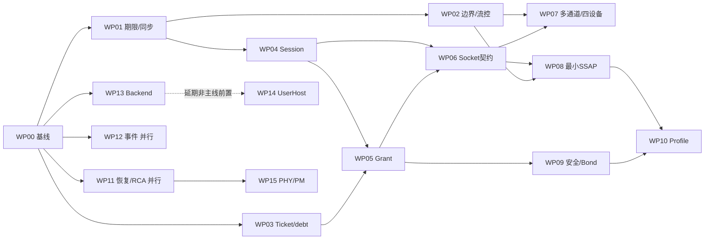

# SparkLink / Linux 联合实施方案

## 当前批次：有界 issue 复核已完成，恢复既有功能主线

35项现有issue和七个子项关系已在线读回；U#1/U#21按自身原条件关闭的结论保留，
本轮没有新增关闭或重复拆分。U#3/U#22/K#19正文收敛为当前源码、剩余条件、依赖及
证据入口，原验收条款逐字保留。自然根因和非人工恢复继续开放；完整安全、Bond或
发布不作为无关小项的关闭前置。具体处置以现有issue维护记录为准。

公开源码5c06c49已接通方法VM场景和双端判定，复用实际C/Python SDK请求工具、
CLI Provider、唯一Engine和现有runner。相关105项离线检查及严格HTML已核对，
I/O与捕获fixture不授予实机或形式化资格；旧环境错误、屏障失败和原始反例保留。

下一步直接用准确新artifact运行现有方法门禁：两连接角色、两业务方向，随机参数、
独立结果、错误／空结果和注销后拒绝，核对双端材料及原路径保持。随后继续方法命令、
发现、长结果、原生命周期及数据／安全／SSAP主线，不再重复实现已存在的场景。
本轮仅维护状态，没有新增功能资格；完整S0–S6/19WP/10FV/12DG、VM-only和UserHost P4不变。

## 有界 issue 清理结果与主线恢复

已复核35项：2项按自身条件关闭（U#1、U#21），18项有限收尾、3个已拆分父项、12项长期跟踪。
本批重新读回35项；U#1/U#21既有关闭维持，七个既有子项不重复创建。
U#3/U#22/K#19正文已收敛为5c06c49所覆盖的当前源码；方法VM场景与双端判定不再误列为缺失实现。
K#17/#19现有范围及七个子项关系已复核，原验收条款不变。Rust/C/Python/CLI方法入口、实际请求工具、VM场景与双端判定已接通；准确新产物真实交付仍需验收，源码不转授实机资格。
本次没有新增关闭或拆分。历史CI、失败及反例保留原身份，不冒充最新HEAD的检查。
[逐项处置与历史读回](issue-maintenance-20261026.json)保留原范围、快照和失败。

U#1原六条事件循环条件已逐项核对，关闭只结算该范围。Native receiver、retry取消、
最小临界区和原期限保持；fixture、离线检查及授权本地准确产物材料分别解释。
原完整保持运行失败仍是FAIL，不能由此关闭其他项或授予当前HEAD整体资格。

公开源码`bac12d127cd4d32874949b61b0088baa0c0fe9e8`的五项CI完成；其中WS73/CMTC
有界fuzz报告及artifact已核对，实际内核pin为`c39a1765fc6036da0a635a755cbd2022de4f0b28`，
不是开发内核`52ae7f08f2eafc3d79920fe5a14892970ecdd284`。旧b154来源检查超时保留，
新成功不证明旧超时根因已修复；K#24的调试VM及完整覆盖继续开放。

U#10自然根因/非人工恢复保持原条件。U#3→U#21/#22/#23，K#17→K#21/#22，
K#19→K#23/#24；父项原验收不因拆分而减少。维护批次已完成，随后运行现有方法VM门禁、核对双端证据及适用保持门禁
和原数据/安全/SSAP主线，不追加无关完整控制面前置。
S0–S6/19WP/10FV/12DG、VM-only和UserHost低优先级规划不变。

| 原 issue | 分类 | 本批动作与剩余责任 |
| --- | --- | --- |
| [K#1](https://github.com/OpenSparklink/linux/issues/1) | 长期跟踪 | 正文收敛；Native 实现与验收分别由 K#2–#19 承接，本项维护所有权边界与映射；UserHost 独占包接口、状态屏障、权限/租约/故障矩阵由 U#7 和 WP14 延后实现。保留全部经修订的原要求，不把 P4 接管设为当前 Native 业务前置。 |
| [K#2](https://github.com/OpenSparklink/linux/issues/2) | 有限收尾 | 正文收敛；按实际支持的标准/WS73 profile 逐项核齐参数、顺序、Status/Complete/领域终态、取消与晚到；保持故障拒绝和完整 packet 边界。未来 UserHost 不是 Native Backend；原厂商 Host 要求按 U#7 单独适配，不能用该延期项阻塞已支持 Native 路径收尾。 |
| [K#3](https://github.com/OpenSparklink/linux/issues/3) | 有限收尾 | 正文收敛；收尾 U#2 的过滤后捕获完整性；按准确产物验证多订阅/慢消费者/退出重开/高流量、copy fault、退休唤醒与结果作者隔离。保留输入截断、订阅 overflow 与完整日志负对照；不把模型/fixture 升级为真实内核并发资格。 |
| [K#4](https://github.com/OpenSparklink/linux/issues/4) | 有限收尾 | 正文收敛；将现有双设备交错及单侧退休门禁逐项映射到当前支持范围，继续补回调/worker/drain 与分配失败组合；多通道/四设备压力由 K#17 子项承接。安全/PHY 子系统功能由各自 issue 负责，本项验证其状态归属，不能等待全部协议特性后才判断隔离。 |
| [K#5](https://github.com/OpenSparklink/linux/issues/5) | 有限收尾 | 正文收敛；按实际公开入口核齐唯一管理者、CAP/凭据、fd 传递/最终关闭、旧 generation/Grant epoch 与畸形输入；系统总线部署权限须在 VM 验证。原 BackendProxy 条款按 ADR0003 转为 U#7 的 UserHost 独占授权/隔离要求，不恢复 Native 任意命令旁路。 |
| [K#6](https://github.com/OpenSparklink/linux/issues/6) | 有限收尾 | 正文收敛；按实际支持模式补齐 syscall/poll、预算、撤权/关闭/断链、原期限与旧 lifetime 拒绝；protected/可靠模式只按真实机制开放，未支持明确拒绝。双连接、长 PDU、慢 owner 与 daemon 退出继续按原门禁验收；SSAP 事务/属性业务归 U#3，data credit/通道公平归 K#17。 |
| [K#7](https://github.com/OpenSparklink/linux/issues/7) | 长期跟踪 | 正文收敛；按方法完成真实 prompt/action、错误证明/密钥、重放、撤销、断链、owner 丢失及安装失败；实现/验证真实重连凭据 import/remove 与安全清理。opaque token 仅可选版本化能力，不伪造支持；长期协议/安全模型和 U#5/K#18 原验收继续开放。 |
| [K#8](https://github.com/OpenSparklink/linux/issues/8) | 长期跟踪 | 正文收敛；由 K#1–#7/#9–#19 及 U#1–#8/#10 和本批子项逐条承接原范围；原厂商 Proxy 方向按 UserHost 修订。兼容期要求已由未发布 UAPI 的同步迁移/删除规则替代，旧编号不复用。全部必需条件完成前保持父项开放。 |
| [K#9](https://github.com/OpenSparklink/linux/issues/9) | 有限收尾 | 正文收敛；逐项核齐注册失败回滚、模块引用、两实例交错、并发 unregister、旧 callback、stop/drain 和部分初始化；内建/模块组合由 K#12 联验。保留确定终态和引用排空要求，不以应用 fd 数量代替物理 drain。 |
| [K#10](https://github.com/OpenSparklink/linux/issues/10) | 长期跟踪 | 正文收敛；保留部分初始化/重复 enable-disable/fd 最终关闭/stop-drain 门禁；查清自然启动超时、重枚举失败、消失及不依赖人工操作的有界恢复，之后验证 PM/reset-resume。人工拔插、hub 切电、QMP 与注入只能作各自受控测试，不能结算自然恢复。接口/固件/USB 根因分别复用 K#9/#14/#15；不新建重复总项。 |
| [K#11](https://github.com/OpenSparklink/linux/issues/11) | 有限收尾 | 正文收敛；按设备/固件审计 known/unknown/unsupported、limits/quirks 和失败策略，补精确匹配/错误 fallback 与跨语言输出门禁。E/U 主固件与两份校准必须每设备一致；冷 ROM READM 有效性/稳定性及混合型号资格未闭合前保留显式板型。 |
| [K#12](https://github.com/OpenSparklink/linux/issues/12) | 有限收尾 | 正文收敛；核齐所声明支持的 USB off/Virtual、通用 USB/WS73 独立开关、built-in/module 与实际加载卸载；检查匹配无抢占与迁移前后回归。Kconfig help 中遗留的功能状态说明需按当前资格边界更新，不能从目录迁移宣称所有构建或其他总线完成。 |
| [K#13](https://github.com/OpenSparklink/linux/issues/13) | 有限收尾 | 正文收敛；审计 opcode/event、ACB/TCID/relay、USB/HCC/BSLE 字段矩阵的来源类型和未知项；核齐去敏 fixture 的来源/许可、最小配置/版本查询与每份固件适用范围。参考库不是标准裁判；不复制受限标准或未授权 blob。 |
| [K#14](https://github.com/OpenSparklink/linux/issues/14) | 有限收尾 | 正文收敛；补适用 KASAN/lockdep/故障注入、畸形/截断/聚合、取消/拔出/重提交与 buffer 所有权门禁；测量单 RX URB callback/重提交空窗后再决定有界多 URB 或热路径优化，保持顺序/generation/stop-drain。自然 USB 根因由 K#10/#15 协同，不能以重新枚举替代状态清除。 |
| [K#15](https://github.com/OpenSparklink/linux/issues/15) | 长期跟踪 | 正文收敛；继续缺失/损坏镜像、通知乱序/超时、部分初始化/退出与自然启动失败根因；E 运行期实验地址不等于出厂唯一身份，cold-ROM 自动选择、混合型号与无人工恢复仍须各自原门禁。许可/来源与复现输入保持外部，不上传未授权固件。 |
| [K#16](https://github.com/OpenSparklink/linux/issues/16) | 有限收尾 | 正文收敛；核齐 READ/version/buffer、广播/扫描/建链/断链与同 opcode 并发、取消/超时后晚到、异步交错和重置身份；各 profile 的 golden 与实际支持接口分别验收。未知操作保持明确不支持，诊断入口遵循独占权限。 |
| [K#17](https://github.com/OpenSparklink/linux/issues/17) | 需要拆分 | 正文收敛；K#21 credit/Ticket/撤权/复用组合；K#22 动态通道背压/公平/多设备压力；父项四条原验收保留。 |
| [K#18](https://github.com/OpenSparklink/linux/issues/18) | 长期跟踪 | 正文收敛；完成原两角色配对/加密数据/Bond 重连和各方法的拒绝/超时/crash/错误 proof/key/重放/断链/reset；真实凭据存储由 U#5，公共机制由 K#7。SDK110 与历史111的缺包/固件诊断失败保留；既有实现或限定门禁不能关闭完整安全。 |
| [K#19](https://github.com/OpenSparklink/linux/issues/19) | 需要拆分 | 正文收敛；K#23 资格/判定器闭包；K#24 生产 fuzz/调试 VM；跨后端、真实门禁、部署/发布边界仍属父项五条原要求。 |
| [U#1](https://github.com/OpenSparklink/sparklink/issues/1) | 可关闭／已关闭 | 原六条事件循环条件逐项审计完成，按自身范围关闭；源码/离线与授权本地准确材料分开。原业务保持失败和剩余门禁不改判，未授当前HEAD整体资格。 |
| [U#2](https://github.com/OpenSparklink/sparklink/issues/2) | 有限收尾 | 正文收敛；过滤发生在丢失/截断报告之前的监控完整性缺口；实际多订阅、慢消费者、退出重开与退休回归。 |
| [U#3](https://github.com/OpenSparklink/sparklink/issues/3) | 需要拆分 | 正文收敛；U#21 SDK READ Provider 生命周期、U#22 剩余 SSAP 操作/长值/更新事务、U#23 真实 Profile；父项原完整验收保留。 |
| [U#4](https://github.com/OpenSparklink/sparklink/issues/4) | 长期跟踪 | 正文收敛；核对实际 PHY／telemetry 查询、合法性／监管约束及 readback；接通 per-controller/per-connection fixed、balanced、throughput、low-power 策略和 hysteresis／驻留／退避；覆盖拒绝、断链、切换与公平性。 |
| [U#5](https://github.com/OpenSparklink/sparklink/issues/5) | 长期跟踪 | 正文收敛；完成各认证方法的 Agent/调用者退出、原期限、晚到批准及安装失败门禁；真实重连凭据的安全存储、原子持久化、迁移、撤销与 bonded reconnect 仍按原范围验收。机制依赖 K#7/#18，不新造安全 Engine。 |
| [U#6](https://github.com/OpenSparklink/sparklink/issues/6) | 有限收尾 | 正文收敛；按准确产物核齐产品 disable/enable、初始化失败、同地址不同地址类型、单侧退休与重新发布；确认每一公开方法的角色/权限和 unavailable 错误。独立 Bond/PHY 能力由 U#5/#4负责；本项只验证路由与状态消费，不等待它们整项交付。 |
| [U#7](https://github.com/OpenSparklink/sparklink/issues/7) | 长期跟踪/P4 | 正文收敛；UserHost 独占所有权、接管/退出屏障、授权与隔离；P4 规划，非 Native 主线前置。 |
| [U#8](https://github.com/OpenSparklink/sparklink/issues/8) | 长期跟踪 | 正文收敛；完整 S0–S6、19WP、10FV、12DG 及原验收全部保留；按每个生产行为的小项独立收尾/关闭，父跟踪只维护范围映射。自然故障根因、非人工恢复、剩余数据/安全/SSAP/Profile、部署/发布继续开放；UserHost 低优先级且非当前前置。 |
| [U#10](https://github.com/OpenSparklink/sparklink/issues/10) | 有限收尾 | 正文收敛；保留运行期/物理拔插闭环原验收，以及用户追加的不依赖人工拔插故障恢复要求。后者仍须查明自然启动超时、重枚举失败与设备消失根因，并验证有界自动恢复及同行隔离；对应 K#10/#14/#15/#19 复用现有任务，不另建重复恢复跟踪。不等待与本里程碑无关的完整安全、Bond 或发布。 |

| 已有子项 | 当前处置 | 独立退出范围 |
| --- | --- | --- |
| [U#21](https://github.com/OpenSparklink/sparklink/issues/21) | 可关闭，已独立关闭；本次复核保留 | 原六项 READ SDK Provider 生命周期；后续代码不继承旧资格 |
| [U#22](https://github.com/OpenSparklink/sparklink/issues/22) | 有限分批收尾，开放 | 唯一 Engine 剩余操作/长值/更新；Down/晚答、daemon restart v2、长值 v2 及 command Provider v3 门禁已接通；method请求/发现与daemon方法Provider已接通；Rust/C/Python/CLI方法入口与VM场景已接通，准确新产物交付、描述符Provider及完整原操作矩阵仍需收尾，准确产物资格按授权本地记录核对 |
| [U#23](https://github.com/OpenSparklink/sparklink/issues/23) | 长期跟踪，开放 | Battery/DeviceInfo/HID 的真实调用、启用/卸载及隔离 |
| [K#21](https://github.com/OpenSparklink/linux/issues/21) | 有限分批收尾，开放 | credit/Ticket/撤权/断链/原期限/复用组合及硬件假设 |
| [K#22](https://github.com/OpenSparklink/linux/issues/22) | 有限分批收尾，开放 | 动态通道背压、公平性、多设备业务及关闭隔离 |
| [K#23](https://github.com/OpenSparklink/linux/issues/23) | 有限分批收尾，开放 | 资格身份/原材料/判定器闭包，缺失和篡改负对照 |
| [K#24](https://github.com/OpenSparklink/linux/issues/24) | 长期跟踪，开放 | 生产 fuzz、实际调试镜像和适用内核接口覆盖 |

拆分映射：U#3 → U#21（SDK READ Provider 待决撤回/原期限/同行）、U#22（唯一 Engine
剩余操作/长值/更新）、U#23（真实 Profile）；K#17 → K#21（credit/Ticket/撤权/复用）、
K#22（通道背压/公平/多设备压力）；K#19 → K#23（资格判定闭包）、K#24（fuzz/调试 VM）。
每项接口、依赖、退出条件和剩余门禁已写入对应 issue；原范围仍由父项映射，不另建总跟踪。

U#1 已按原六条条件关闭；同一 Native receiver 的 suite v2、原期限、取消及关闭依据
见该 issue 与维护记录。旧入口 UnknownMethod、早期 fixture 和完整业务保持失败均保留
原身份；后续产物仍按改动范围回归，不能把旧“Native 订阅待验”继续作为本项关闭缺口。
U#2 保留过滤前丢失报告缺口；U#10 保留用户追加的第八项自然恢复，不能只按七项早期范围关闭。
旧正文完整留于授权本地快照，评论、原提交、失败与反例保留；公共表不披露实机详情。
本批无生产协议变化、无新实机/形式化资格，未修改既有资格记录或把旧 PASS 转授新 HEAD。

U#21 已收尾；继续 U#22 的真实服务行为及既有数据／安全主线；完整 S0–S6、19WP、
10FV、12DG、VM-only、UserHost P4 及原范围不变；自然根因、非人工恢复继续开放。

### 历史批次 R156：Owned type0 动态只读 Provider

当前批次以本页生成摘要为准；下文保留 R156 的源码职责与限定范围，不表示后续产物已验收。

沿 WP08/WP16/WP17 的现有 Owned 登记、唯一 Engine 和 SDK 增加只读 Provider，
不另设计划或协议状态来源。原 caller 通过 `BindOwnedReadProvider` 为操作位恰好
READ 的属性绑定同总线 callback；绑定消耗原存储值，登记内不能更换或解除，后续
本地读取/替换 NotSupported。Rust 共享准入/等待与现有 CLI 的交互式 provider
复用同一 caller；授权和提供值各有一个有界槽位。type1 公开说明独立，完整 C/Python Provider 收件箱与
动态写入仍缺；它们现有远端读取可消费动态响应。精确字段及错误只维护在
[接口参考](../docs/reference/ssap-permissions.md#owned-read-only-provider)。

本批源码契约与验收范围：审批先于 provider，原身份/安全观察/绝对期限贯穿等待与响应；复用
原 owner watch、8条义务预算，等待不持数据库锁，结果消费复核同一登记绑定。
动态值单项及每义务累计2042字节，UUID 多项共享；错误、空值、剩余预算、畸形/
超长结果、回调缺失、owner/登记退出和原期限失败均须覆盖。公开验证范围包括相关
生产函数、实际 D-Bus/SDK 签名及文档离线检查。真实对端读回、应用错误、审批、
期限、生命周期及既有属性/说明和普通业务回归的准确产物身份与门禁结果，
只由授权的本地结构化记录维护。
CLI 的实际准入、值/错误答复、不同/重复/晚到 token、owner 关闭、两槽位隔离及
最大行输入分别验证；响应编码进入 Pending 后保留不可变字节，不把注销视为撤回。

公共文档只记录源码契约与通用状态，不发布本地实机执行身份或材料。既有准确资格
不转授新增入口；完整 S0–S6、19WP、10FV、12DG、VM-only、UserHost P4，以及数据/
安全/多通道/四设备、部署、自然故障根因和非人工恢复范围保持开放，不新增控制面
组合全集作为本批前置。CLI 操作及限制随实际 frontend 同步到接口、how-to 与手册。

### R5f9h：实际 User Native 返回跨 controller 退休（两角色限定通过，原两FAIL保留）

准确服务77f7953／工具1433132／内核2fc及SDK110US的两独立角色VM已完成本批
有限退出；[来源、原FAIL、原件hash与限定范围](../docs/evidence/native-controller-return-20261018.json)
及结构化记录 `native-controller-user-return-r5f9h` 关联同一结果。固定target slot0，
分别作为实际发起/接受者；精确原owner拒绝后释放真实bind返回，原申请得到退休错误，
peer真实Disconnect/known Down及4→7→4个OS socket fd收敛后，原同行扫描启停
断言通过。原daemon未重启，重新HCC/新generation后两角色共16次实际对端校验回复，
44次发现，8072 USB包/零捕获丢包；原始HCC三次/VM，独立raw封装复核。
13定向、879工具、116严格文档及36输入负对照通过；8项资格源码/缺产物/hash/范围/
门禁负对照拒绝。登记器第一次因status用了说明字符串而拒绝，保留该日志，将说明
移入detail后继续原v1枚举绑定，未削弱检查器。新增形式化证明0。

本批复用既有单叶子 QMP remove/re-add、唯一 Native 返回库及 Root 观察器。
每 VM 显式选择发起或接受角色；真实 `SYS_bind` 成功后保留原返回不超过两秒，
同一普通应用仍等待授权 fd 时移除 slot0，观察旧注册撤销与另一 controller 的原
Ready/generation，再显式释放并要求实际退休错误。之后结清仍通电 peer 的真实
连接，观察原 socket inode 收敛，再让原 runner 重新附加同一白名单叶子。
普通两角色8次随机业务往返放在新 generation Ready 后，原广播/扫描仍保留。
首轮发起角色 VM 原始 FAIL 保留，接受角色未执行：Core 旧选择已拒绝时，daemon
owner 尚未必观察到退休；`slktest` 取得 fd 后的再次 Connection 查询可能先报
registration removed，不能当作预期 owner 拒绝。Manager.ListAdapters 直接重查
Core，不能用它代替 owner 屏障。修正为普通用户通过固定原 daemon 唯一总线名，
直接调用旧 Connection 现有 OpenChannel，严格观察 connection owner retiring
后才释放原 Native 返回；busy/unknown/error/success均不冒充该状态。显式封存
gdbus探针及依赖hash；原迟到fd拒绝断言和两秒expiry FAIL不变，无据此改写生产状态。
不增加额外 QMP 拔插循环，不修改生产 Host/Session/Engine、Grant/credit/Ticket、
Kernel 或原期限；C库仍先执行真实 syscall，不伪造结果或协议字节。

修正屏障后的第二轮仍原始 FAIL：精确 owner-retiring 及迟到 Native fd 拒绝均
实际到达，但通电 peer 尚有物理连接，原 parent survivor scan 先执行并报 EBUSY；
随后 scan-off 的0x0b亦保留。将同一真实 peer Disconnect/known Down/fd drain
前移到 removed()，再执行原扫描断言；不把EBUSY/0x0b视为成功，不改生产Kernel。
初版离线定向11项、工具877项通过；随后修正的13/879见上。原ae40/26b四Connection切片、8业务回复及22
发现匹配的原始输入经新公共解码器重放通过，不转授新运行资格。
本批有限退出（已逐项取得，不是完整生命周期退出）：两角色各一独立 VM、原 Root C bytes/加载库/daemon身份、真实两端 Up、
peer Down、QMP单叶子证据及新注册 HCC/原业务均闭合；首 FAIL 与 expiry 原样保留。
本项是受控 guest controller 移除，不是物理断电、Kernel ref/callback/UAF 证明或
自然恢复资格；fd inode 收敛与 SDK 旧选择拒绝的范围分别表达。缺 lease/event 的
上一批私有bus检查仍限定离线，不升级。仅本批相关性质门禁；动态creator、完整
fd/期限及其他组合、数据/安全/SSAP/多通道/四设备继续按原范围并行。


### R5f9g：实际 Native 返回与 Connection 退休屏障（四实机切片限定通过，完整组合开放）

只在显式测试 VM 加载 interposer：先执行真实 SYS_bind，成功且匹配原
controller/generation/Service 或 User 身份后，最多保留返回两秒；返回原结果/errno，
不制造 fd、协议结果或 Ready。默认 daemon 不依赖它，Root 控制目录及库 hash 固定。
四切片为 Service 发起/接受、User 发起/接受；复用原 connect/断链/SSAP/普通通道
工具。真实对端断链后，旧物理对象仍能观察 Down，实际返回释放前不能提前移除；
释放后旧 fd 与对象收敛，原 daemon/另一 controller 保持，随后完成原八次真实业务。
User 在途创建需返回退休错误；新的普通 SDK 调用按自身 live 检查拒绝 Down，
不能把这次 SDK 拒绝写成直接 broker/Kernel 准入探针。动态 creator、controller
拔除、完整 release/finalfd/dup/SCM/期限组合和 Kernel ref/callback/UAF 证明仍缺。
退出：实际 C 选择器/Unix syscall、parser/超限/expiry/缺失证据负对照及全工具回归；
准确新工具/库配原26b服务、2fc内核/SDK110US，在白名单 U 两口取得四原始返回记录、
真实两端 Up/Down、Root 原 inode 与原应用回复闭包。首失败保留，expiry 必须 FAIL。
上述四切片及原八次回复已由26b服务/ae40工具在真实U双设备VM取得并重新核对，
另以旧6dc服务触发原物理发布耦合FAIL；没有把该FAIL转成旧runtime资格。
原C结构、Root收据、两端Up/Down、库/产物身份、21输入负对照与8项资格负对照
分别记录，见[准确限定范围](../docs/evidence/native-return-connection-retirement-20261018.json)。
最初旧版准备被source/bundle一致性guard拒绝；保留失败，以旧生产/新tools-only
隔离目录复核，未放宽guard。四切片通过后继续controller/dynamic及相关fd/期限
纵向链路，不重设所有竞争组合为数据面前置。原S0–S6与整项issues仍开放。
后续 controller 父级退休新增两类限定离线切片：未发布 active root、已发布 retiring
root；直接执行生产 `Node::remove` 与同一 owner/shutdown，作者取消后仍等待原
initializer，保留资源根、拒绝新初始化，并保持另一 controller 的本地接口。定向1项、
default/all-features各368及严格Clippy通过，源码hash/编译测试文件/日志已封存于
goal 的 `native_return_controlled_gate.controller_offline_followup`。`/dev/null`、
缺少 lease/event 和有限失败依赖均明确记录；另一接口是本地ObjectServer检查，
不当作真实总线调用、Native/USB、callback排空或新实机/形式化资格。controller
实际拔出/返回与重接、动态creator及相关fd/期限仍按原门禁推进。
本批不新增协议 Engine，不改变完整 S0–S6/19WP/10FV/12DG；数据/安全/SSAP/
多通道/四设备与自然故障根因/非人工恢复仍并行，不把全部控制面设为前置。

### R5f9f：连接级Native创建排空与独立物理投影（限定保持通过，后续受控切片见R5f9g）

两项生产函数/私有bus反例已保留：取消等待后Connection提前清理，及挂起Native
初始化挡住物理Connection发布；Native/table依赖是明确fixture，不是实机UAF。
本批以同一owner的创建guard覆盖实际work和未消费的fd结果；shutdown先撤销新
准入，再join原initializer、创建结果和Engine，重试/取消不抹去原任务或提前释放预算。
物理发布只prime同一初始化slot，不等待服务结果、不制造SSAP Ready；protected
仍按真实机制延后。唯一Service initializer可在原五秒期限内等待原资源，应用保留
明确busy；阻塞池晚启动及晚到fd不能越过原期限。
第三项有限反例也保留：异步prime后应用可能先争得Native创建gate。仅NotStarted
调用惰性factory，唯一普通Service initializer在发布前预留同一gate；已有任务或
终态不再构造额外预留。它只约束本地资源顺序，不授予Kernel权限或服务Ready。
限定离线：定向5、default/all-features各367及Clippy通过；Native/table为有限
fixture。原all-features fd关闭失败及受控CLOEXEC/fork反例保留，未归因；相关
用例在exec隔离后保持原join/关闭断言通过，不据此宣布旧失败根因修复。
签名26b服务/Host/guest、原2fc内核及SDK110US，在本线程U两口完成十个有限VM：
CMTC/Exchange两切片、七尺寸/OwnedSSAP及basic动态通道原路径保持。准确来源、
两端实际应用回复、捕获及负对照见[离线](../docs/evidence/native-creation-drain-offline-20261018.json)
与[实机](../docs/evidence/native-creation-drain-real-20261018.json)，不转授整个HEAD。
本批后续真正Native返回/Connection退休受控切片见R5f9g；内核ref/callback/UAF与
完整fd/Grant/credit组合仍按原范围推进，不将fixture或保持回归升级资格。
原v4 fd判据失败需按准确旧patch追踪fork/exec/close及实际socket引用持有者；隔离
通过不作归因证据。该诊断不重新成为数据/安全/SSAP全部控制面前置条件。

### R5f9e：Native bind 离开异步worker（有限实机保持完成，完整退休排空仍缺）

本批只将现有Native socket/bind/connect移动到阻塞线程，原owner退休标志和实际
lease guard随在途工作持有，调用前后拒绝退休，实际返回的fd仍唯一拥有。
原Session／Engine、Kernel Grant／credit／Ticket、协议和五秒期限不变。
退出门禁：生产helper验证异步worker可运行、取消不释放在途guard、退休后返回fd
被关闭、Native错误不变成功；严格default/all-features与Clippy；新准确服务artifact
在VM内回归原发现／连接／业务及适用SSAP／长度／撤权路径。
fixture不能证明真实Native syscall内部交错、parent退休或kernel引用排空；这些仍
待受控VM屏障，不将本批保持回归升级为完整生命周期资格。
生产helper三项已通过，default/all-features各363项与严格Clippy通过；首轮筛选
漏选第三项被计数门禁拒绝，原失败保留。实际测试源码为97e46ad基线加本批dirty
字节，已映射签名6dc提交并封存执行文件，不冒充干净提交编译。构建按共享锁单独12路执行。

[离线](../docs/evidence/native-bind-offload-offline-20261018.json)与
[实机保持](../docs/evidence/native-bind-offload-real-20261018.json)分别绑定源码和产物：
6dc服务/guest/Host、2fc内核、显式SDK110US，只操作本线程U两口；原CMTC/Exchange
撤权、七尺寸/Owned SSAP及双basic动态通道各自门禁完成。准确数量及范围见结构化
记录，不把原253 FAIL、Native内部或整个当前HEAD改为通过。d538只取得终态工具离线资格。

本批动态门禁的原始 `supervisor_exit` 为0，但独立篡改负对照发现旧通用verdict在
该模式接受 `supervisor_exit=1`。原审计FAIL保留；统一终态检查要求QEMU和supervisor
都有整数0，只有producer内部明确pending可暂缺尚未写出的supervisor凭据。
866项工具检查通过，完整fixture补明确终态字段，故意缺失用例继续拒绝；首轮
fixture迁移误补故意缺失字段的失败也保留。新verdict仅离线重放旧VM，不改写其
6dc执行身份，也不通过重跑硬件取得另一个“成功”来覆盖原反例。

下一批直接验证两项生产入口：User/dynamic Native创建是否随Connection退休全部
排空，以及物理Connection发布等待SSAP Native初始化的耦合。controller等待lease
guard不等于连接级全部工作已join；源码风险不是已发生UAF或串包。以同一有界owner
和原任务解决，再补实际Native返回/parent退休屏障；完整release/最终fd/dup/SCM、
Down/原期限/复用、task/ref/callback/UAF仍开放，不追加数据/SSAP/安全的控制面全集前置。

### R5f9d：被动诊断已接通，四轮未复现；根因仍开放

原253 FAIL保持必需失败。它的peerDown约在断链OUT后5.08秒、清理广告命令之后
到达；现有证据不能区分监督超时与清理流量影响，不能归咎单RX空窗或只改原因码。
固定Host f087与SDK请求语义支持0x10，libws73保留0x13差异；既有新旧原因码都曾
快速成功的反例继续保留，不重复把原因码单独当根因。Kernel cleanup的语义收敛仍并行待办。

本批复用原runner与5秒共同期限，仅增加显式6/12秒失败后被动抓包窗口：先保存FAIL，
不发测试控制请求，窗口结束后仍抛原失败并执行原清理。默认路径不变，单独记录
实际起止／命令数／中断；二端USB需证明窗口是否真静默，不由sleep本身推定。
`8f51d59`已签名接通，863项工具测试及严格HTML／116份文档检查通过；原期限、
先保存FAIL、无新增ctl、中断和旧guest拒绝均由现有runner的离线用例覆盖。
[准确诊断记录](../docs/evidence/down-passive-diagnostic-20261018.json)绑定8f51 Host/guest、
复用ccef服务/2fc内核、SDK110US和本线程U两口：事先限定的四轮分别通过，合计32次
真实应用回复／88次发现、每轮4223条USB／零丢包，24项证据与6项资格负对照通过。
但原超时复现数和实机被动窗口均为0，**RCA与该分支实机验收仍UNPROVED**。

已到四轮上限，不继续以重复成功替换失败；原七尺寸FAIL和全部历史证据保留。
下一批回到Native返回／parent退休屏障及task/ref/callback排空，继续原release、
最终fd、dup/SCM、Down、原期限与复用组合；自然故障再现时使用已封存工具观察。
本批工具和有限诊断交付完成，不代表已隔离根因，不关闭旧FAIL或整项；
数据／SSAP／安全／多通道继续并行，不追加控制面全集前置条件。

### R5f9c：稳定服务 owner 已接通，原253断链门禁失败保留

`ccef310` 将唯一服务owner在Native创建前登记到controller资源表；D-Bus仅引用它，
初始化／stop等待取消仍保留原task，发布失败/重试复用同一owner。active+retiring
总预算16，未完成join/移除不释放预算；Unknown不启动新owner。物理状态仍来自
Kernel canonical links，原Session／Grant／credit／Ticket及唯一Engine不变。

[离线](../docs/evidence/native-service-owner-offline-20261018.json)与
[三轮实机](../docs/evidence/native-service-owner-real-20261018.json)分别封存：360×2／
Clippy／6项owner测试和实际CMTC／ExchangeInfo撤权／SSAP owner原期限，均限定范围。
不是整批部分初始化、Native bind内部、task/ref/UAF/drain或全生命周期证明。

同一ccef新artifact的[原七尺寸矩阵](../docs/evidence/native-service-owner-preservation-20261018.json)
整体FAIL：253轮对端Down未进入原共同5秒期限；另六尺寸及其Owned/超限门禁分别通过。
原失败、未完成第二角色及cleanup失败保留，不放宽期限、不改断言、不重跑覆盖。
USBmon显示对端RX持续在途，低负载样本重提交max46µs；本次未见缺少已提交RX的
五秒空窗。固件／RF／USB／QEMU／调度原因未证明，不能把重枚举或重提交优化当恢复。

近期退出调整为：先以实际断链命令、双端原始事件／canonical快照和原期限定位该
失败，再推进准确Native返回／parent退休屏障、任务与引用排空；本批有限结果不关闭
整项。数据/credit/多通道/四设备/SSAP/安全并行，不追加控制面竞争全集前置条件。
资格校验新增`result_binding_version:1`，独立绑定各门禁结果，防止整体FAIL内标签漂移；
41项检查与20项本批负对照通过。历史记录、全S0–S6／19WP／10FV／12DG、VM-only、
端口白名单、共享12/8预算、UserHost P4及自然RCA／非人工恢复范围保持不变。

### R5f9：部分初始化清理（有限 CMTC／ExchangeInfo 门禁通过，整批开放）

R5f9b 的生产行为仍是同一 initializer/Engine，在实际 ExchangeInfo Response 尚被
保留时撤权，不创建另一套 Engine。本批只将既有 gate 参数化为 `--ssap-initialization-stage
exchange`，CMTC旧记录及其准确工具不变。原始请求TX、对端RX、对端Response TX与
CMTC先决完成必须在捕获中成立；目标不可先收到另一份响应。仍使用原2秒hold及
原5秒协议期限，随后原8次业务/22次发现作为保持回归。两个角色切片不冒充完整2×2。

测试 QEMU 的独立 ExchangeInfo 选择器与CMTC共用一份有界HCC解析，不改原始字节；
互斥选择、skip/error/reset禁用、callback/drain沿用既有机制。新二进制hash
`2063f9913aeafd9103fc43a87f199bf4757ae3a3b618e5b7d4970beff9731ea2`，共享锁内预算8、
实际单编译单元；无USB根启动通过。1220个旧成功RX重放匹配CMTC8/Exchange4，72变异拒绝，
854工具离线检查通过。这些离线结果不授实机资格；新增形式化证明0。

固定 NearLink Host f087 的 `ssap_pkt.h`/`SSAPC_ExchangeInfoReq` 采用旧版packed控制位，
开启fragment/multiProcessing，版本为1.3；本项目当前基本模式仅MTU/版本1.2，未声明
这些能力。只参考请求/回复职责及生命周期，不复制不适用的封装或升级为互通资格。
该有限退出已在[独立实机记录](../docs/evidence/ssap-initialization-exchange-revocation-20261018.json)登记：
准确1cd2bfd工具、DA服务/应用、2fc内核，首轮4179USB／零丢包、27有效输入负对照，
原回复/清理/fd收敛、同行RX/Ready及后续8次真实回复/22次发现分别通过。私有审计
初版因错误时间过滤产生无效变异而FAIL，原件保留；v2禁止将未改变输入的用例计为负对照。
下一步先核对实际Nativefd返回/initializer退休所有权再选受控屏障；不把调用前暂停
称为内核bind内部交错，也不等待所有控制面组合才继续数据/SSAP/security主线。
task join、Nativebind内部、内核引用/UAF/drain、E/混合与自然恢复保持开放。

R5f9c 当前整改：根据[历史调用审计](../history/architecture/native-initialization-owner-audit-20261018.json)，
现路径先初始化、后ObjectServer.at，而parent EventTask可取消dispatch；仅证明直接
调用者取消保留JoinHandle，尚未证明未发布owner被controller退休稳定持有并join。
在已有每controller/物理lifetime资源关系中登记同一个SSAP owner，再开始Nativefactory；
D-Bus只引用它，发布失败/取消/重试统一收敛。保留唯一initializer/Engine，不通过
只提前发布D-Bus对象掩盖资源所有权，也不复制Kernel物理状态或引入永久Arc环。
有限退出包括实际生产取消/发布失败/重试回归，准确Native返回屏障和新artifact VM
发现/连接/短包/原长度/SSAP/同行保持；尚未执行的join、引用/UAF性质不计通过。

本批已接通 controller registration 稳定持有同一个 ConnectionOwner、弱 context、
16 项 active+retiring 总预算和取消安全的原 Engine/task join；原 Kernel 物理状态、
唯一 Engine、Session／Grant／credit／Ticket 不变。Native 创建／返回前后检查退休，
发布失败或 parent dispatch 取消后重试不再创建第二 owner。离线退出检查实际
reconcile、ObjectServer、取消/重试、Unknown、预算保留、foreign owner 拒绝和实际
Unix fd 关闭；Native 依赖/table fixture 显式标注。新编译 artifact 的 VM 门禁仍待执行，
尤其 Native 同步 bind 内部交错与引用/UAF/drain 不由这些离线用例替代。
上述实施顺序现由页首R5f9c结果接续，原审计与准备步骤保留。离线有限退出已通过：default/all-features 各360项（含实际私有D-Bus/C/Python调用），
严格Clippy、架构检查、15资源守卫/构建预算用例及116文档严格HTML。原失败保留。
同一源码新服务artifact已封存并执行白名单U双设备逐叶VM；有限通过和253原失败分开登记，不转授旧DA资格。

本切片[实机记录](../docs/evidence/ssap-initialization-cmtc-revocation-20261018.json)已登记：
准确7b90092工具、DA服务/应用、2fc内核；仅分配的U两口，六轮实机保留五个整体FAIL。
最终双端撤权、原回复、fd收敛、后续8次业务/22次发现及21证据负对照通过；850离线
检查和6资格负对照分别记录，新增形式化证明0。完成这条有限纵向门禁后继续实际
ExchangeInfo等待阶段的owner退休及Nativebind/taskjoin/引用排空缺口；全局release／
最后fd／dup／SCM／Down／原期限、数据/多通道/四设备/SSAP与完整S0–S6并行，不以
控制面竞争全集作前置。E/混合/冷ROM自动选择、自然RCA和非人工恢复继续开放。
以下构建/离线和失败步骤为本切片历史，不是当前资格的第二权威来源。


生产行为目标：复用唯一 initializer/Engine/Session，在 fd 已创建而内核 CMTC 或
SSAP ExchangeInfo 尚未完成时退休 owner；不让迟到任务发布新 Ready，不分离后台任务，
真实 fd、guard、worker 引用必须收敛。Native 同步 bind 入口内的交错另列，不由
CMTC 屏障冒充已覆盖；协议原五秒期限不延长。本批无新增 Host/Engine 或业务旁路。

第一步采用现有 QEMU 两秒有界真实 IN81 保留机制，加测试专用的 SDK110 CMTC
CapabilityRsp 选择器。它只识别完整有界 aggregate 中的当前基本格式，不修改或
生成回复；不匹配的原始输入仍走原 callback。对象身份/期限由现有 coordinator
与双端独立捕获核对，选择器本身不证明 lifetime。4 项实际 C helper 离线测试通过；
对原 B847 捕获的1171个成功RX逐一重放，准确匹配4个能力回复，24个变异负对照拒绝。
这是新测试 helper 对旧证据的映射检查，**不是新 VM、固件或初始化清理资格**。

第一步退出：选择器/回调补丁可审查、真实旧捕获匹配且不改字节、失败拒绝、
准确测试 QEMU 构建身份封存。初始两次共享锁拒绝保留，第三次在同一锁下完成
单编译单元/预算8构建，原二进制及930链接对象不变；新测试 QEMU SHA256 为
`1622d935beca86ed20d6413e569c4e8ff676c7d262ec768b5e8d1191067cd832`，
仅构建完成，不授予设备资格。现有逐叶直通 runner 已接入 opt-in 门禁，在指定 U 双设备取得受控 CMTC/协商等待、
退休/Down、旧回复及新 lifetime 的真实证据，并单独保留普通业务和长度资格回归。
物理 Down 会结束同一条链路两端，不将其解释为同行 controller 故障；另一只
controller 的独立 Ready/管理推进与后续实际业务需分别检查。E/混合不授旧 PASS。

已接入的首个实测切片是 `--ssap-initialization-verify`。67cd 工具首轮 VM 在预期
EACCES 返回后被成功专用的 `ctl` 包装提前中止，整轮 FAIL 原样保留于
`.dev/main-thread-01a120fe/ssap-initialization-us-v2`，不授资格。负向调用改用原始
command collector 并继续准确校验非零退出及 EACCES；普通调用者凭据复用现有
四项 capability 观察器，不放宽为缺字段通过。修复后需新 guest/Host artifact 重跑。
59ce 工具第二轮在首个真实撤权/旧回复/fd收敛完成后，因第二次沿用 OFF connectable
广播集而失败，整轮保留于 `ssap-initialization-us-v3`。每个切片结束后通过实际
管理事务恢复两端 beacon，再复用原连接门禁；保留“必须重建”断言，不接受少一步
初始化来迁就当前状态。首个切片不升级为完整双端门禁通过。
1e72 第三轮又明确暴露 ON beacon 不能重建（Host 准入要求 advertising OFF），保留
`ssap-initialization-us-v4` 的真实 EBUSY。恢复必须包含实际 stop Complete，使保留的
配置为 OFF beacon；禁止重试掩盖原 EBUSY 或弱化 Host 准入。
90f0 第四轮完成双端撤权、8次后续业务和22次发现，但新核验器把 Managed 清理原因
错写为公开主动 Disconnect 的 `0x10`，整轮仍 FAIL。准确内核 `sle_workers.rs:64`
及两端原始 OUT 均为 `0x13`；仅此清理门禁改为严格 `0x13`，不接受两者任选。
修正核验器对旧捕获重放通过也不回写旧 FAIL；必须以新 artifact 重验。
单 bulk RX URB 持有 CMTC 时，后续同端 Down 也不能进入 guest，故使用真实 Managed
lease Revoking 作原始屏障：原 lifetime 在该端规范快照中尚为 Up（Down仍被hold），
旧 Engine 报当前 EACCES 并收敛 fd；
再明确释放原回复，要求真实 Disconnect/Status/两端 Down、清理及重新取得管理权。
复用唯一连接发现/Create/Down及抓包函数，不生成取消作者的 Disconnect 成功结果。
有限切片为显式 slot0 发起侧撤权、slot1 接受侧撤权各一次；不是完整2×2矩阵。
QMP slot来自固定 guest端口/原始输入映射，不能由 Native controller index或USB枚举号推断。
随后同 VM 运行原普通用户连接的实际角色交换、SSAP协商及8次随机业务回复。

VM root 只读取固定 daemon 的八个 `/proc/PID/fd` 快照，普通用户不因此获得 root
权限、fd 副本或 ioctl 旁路。固定请求顺序/原 PID start_ticks/实际 inode/根收据分别
核对；这只说明 daemon fd 收敛，不是内核引用、worker/drain、UAF 或 bind 内部证明。
847项工具fixtures及重构后原 B847 双端连接证据复算通过，均为离线限定范围。

本批门禁仅约束这条初始化纵向链路；Native bind 内部竞争、全部引用/回收组合、
全复用屏障、SSAP 原期限和其他剩余生命周期范围仍开放，不能因 helper 通过关闭整项。

### R5f8：真实 requester 退出、旧回复排空与挂起期间同行业务（有限批次已封存）

同一新guest的[原owner/原期限保持](../docs/evidence/ssap-requester-owner-preservation-20261018.json)
另以1f15 Host重跑：C/Python实际errno110约5.010/5.057秒，8次后续真实回复、27负对照。
它是旧调用者保持；本批合计3次VM尝试，首轮FAIL及两个独立成功均保留，不称稳定性统计。

下一批调用审计已按实际DA/2fc源码重核：`authorized_fd` 当前在持有 NativeLease guard
时直接调用 `slk-native::channel::open_service` 的同步 `SOCK_NONBLOCK` socket/bind，
并非通用 NativeWork。FD创建后，Engine任务再异步等待内核CMTC和SSAP ExchangeInfo；
初始化任务CompletedOk不等于协议Ready。默认SMTC无linger；fd释放与连接级worker stop/drain
也不同。旧 `ws73_initialization_lifecycle.py` 是Managed广告/扫描配方测试，不能冒充
SSAP部分初始化实测。源码hash与阶段边界记入goal关联状态；下一批先确定实际屏障，
再验证/整改；不先假定bind等待USB或新建factory框架。此审计不授予任何新证明或实机资格。

首个 e68 实机整体 FAIL 原样保留：新测试漏掉既有 CLI 的 `Selected` 行，虽收到
正确值仍错误拒绝。已改为精确校验选择身份及值的两行，额外/重复/错身份/错载荷
继续拒绝；第二份B847 artifact两角色独立通过，首轮失败不变。
[准确限定记录](../docs/evidence/ssap-requester-drain-held-business-20261018.json)包含8次
挂起期间真实回复、旧写回复实际排空、新读独立校验及32负对照；不是完整生命周期资格。

本批先复用已存在的 `caller_scoped`、`ClientRequest` 和唯一 Engine，不新增协议路径。
退出条件：真实对端 ask 提示之后 SIGKILL 普通公共 C/Python requester；旧回复未到时
同连接下一 SSAP 请求明确忙且无 USB 发送；批准原提示后，真实对端实际写入，旧成功
回复仍按原事务排空，随后另一 owner 的新读独立校验成功。取消不承诺撤回已到达对端
的写入。分别记录 app 死亡、软件准入、USB、peer 协议和对端应用快照。

同时复用现有唯一 slktest CUTC 收发用例，在原 ask 提示与批准之间完成其正常随机
校验回复；不另开第二套循环，不重绑已经最终关闭的通道。要求两种连接角色都通过，
原 SDK/peer 五秒期限不放宽，所有失败和 busy 尝试保留，原 Session 不重启。
只证明所列交错，不声称取消在某个未观测微观时点完成、NOCP真值、全复用屏障或恢复。

离线门禁覆盖参数、真实 killed-process 收据、严格时序/身份/双端报文、漏包/错数据/
重复/缺场景负对照及共享应用 helper 的旧调用者；准确新 artifact 在指定 U 双设备 VM
运行，再独立重放。新工具尚未验收，不继承 cd7 的前一批 PASS。若暴露实际生产缺陷，
保留失败后修同一实现。通过后继续部分初始化及其余架构整改，不扩充本批前置全集。

2026-10-18 硬件资源调整不改变本计划的 S0–S6、19 WP、10 FV、12 DG 或门禁。
本线程资源与 USB 序列号 hash 绑定见 [执行配置](lab-resource-policy.json)；
实际机壳编号未知，型号先按用户布置，启动后用现有 HCC 独立核对。
先完成严格白名单、独立目录、逐次附加复核及 SDK110 全套固件拒绝检查；
使用新准确 guest/host artifact 在 U 同型号双设备继续现有 owner/原期限链路。
E 同型号另建 E guest，先核对 HCC/启动，再验证业务；现有驱动为全局固件目录，
混合 E/U 下载保持拒绝，不能借本批资源修改另造启动流程或默认落入 US。
只用叶子设备直通，禁止 hub/PCI 切电、复位、透传、强制解绑或终止其他任务；
资源冲突、缺失或映射变化先协调。共享重构建锁和跨线程总12/VM8路预算继续执行。
本批资源限定退出已达：离线拒绝越界/替换/旧镜像/混装，
[准确新 U guest 的独立门禁](../docs/evidence/shared-allocation-u-gate-20261018.json)确认 HCC、
两角色owner/原五秒期限、8次实际回复及27证据负对照。完整生命周期退出仍缺。
R5f8 requester退出/晚到物理回复排空及挂起期间业务已取得准确 B847 限定记录；
近期 Native 返回门禁与剩余 controller/dynamic 创建排空范围见本页 R5f9g；
不把 E/混合资格或全部控制面组合设为新前置。E/混合与恢复继续单列开放。
本次重新只读核对四个序列号 pin、父 hub/PCI、live VM hostdev、可见 fd 和共享锁，
与既有白名单一致，不修改已封存资格或覆盖原10个未提交文件。15项现有端口/构建
守卫检查通过；特权 fd 可见性限制保留，未执行设备 I/O，不授新 E 或混合资格。
准确核对记录及 hash 仅维护于 goal 的 `hardware_resource_allocation.latest_readonly_recheck`；
goal 中旧 E1/U234 的操作映射已标为历史，当前只引用本白名单。
资格一致性检查拒绝旧操作映射、跨线程端口、E/U 对调及独立运行目录漂移；
这些检查不授予新设备或新 artifact 的实机资格。

资源边界后续小批：将现有人工 preflight 的 live libvirt 分配检查接入同一
`ws73_target.run`，在叶子租约内、自己的 QEMU 启动前执行。核对本线程全部四口，
明确其他线程的叶子可并行；本线程叶子/上级hub/共享PCI、未解析WS73选择器、
查询失败或共同五秒审计预算耗尽时停止协调，不执行detach/stop/reset。
退出门禁是实际启动入口拒绝、失败后租约释放、瞬时device number变动、另一线程
明确分配不误拦及原工具回归；仅工具边界，不授新服务/内核/E/混合实机资格。
完成本小批即返回 `qualification_view.current_batch` 的应用发现会话/共享扫描
主线，不将硬件配置更新改成新的协议或控制面前置条件。
该小批已按[准确527b及限定来源记录](../docs/evidence/shared-allocation-launch-guard-20261019.json)
完成工具边界退出：896项工具检查、严格HTML116清单及真实只读审计通过；未启动
新VM或操作USB。原调用环境失败保留，不授E/混合/新实机或自然恢复资格。


当前按2026-10-17架构优先指令，先完成现有生产路径的R4退休、R5应用接口/调用者和
R6干净VM部署收敛，再扩展功能。采用唯一架构中的组件依赖、应用接口、运行时三视图；
不是另建Host/Engine或把全部控制面竞争组合变成前置。保留完整S0–S6、19WP、10FV、
12DG、VM-only、已封存WS73路径及未提交生命周期开发，UserHost仍为P4规划。
R4f2e有限14门禁已经封存，当前进入WP18/R5应用客户端／共享契约及R6部署整改；历史Owned/安全/数据资格只按
[当前能力入口](current-capabilities.md)所选准确产物及记录保留，不转授新HEAD。

<!-- qualification-summary:start -->
以下摘要由 `project/qualification-records.json` 生成；不以文档提交替代编译身份。

当前实施批次（不是新产物资格，直接读取唯一记录）：
```json
{
  "id": "ISSUE-MAINTENANCE-CURRENT-READBACK-v5",
  "state": "BOUNDED_MAINTENANCE_COMPLETE_NO_NEW_QUALIFICATION",
  "implementation_sources": {
    "public": "5c06c49e2e4e4eb9416059a35e3b40e2aa133124",
    "kernel": "52ae7f08f2eafc3d79920fe5a14892970ecdd284"
  },
  "production_behavior": "No production change. Current issue scope reconciled against source, retained qualification and offline reports; do not reimplement the existing method VM scenario.",
  "offline_scope": "Reviewed 35 current issues, seven existing child relations and exact source/offline materials. Scenario source has 105 finite Python checks and strict HTML success; I/O/capture fixtures are not kernel concurrency or hardware qualification.",
  "issue_sync": {
    "observed_at": "2026-10-27T18:41:29.796789+00:00",
    "updates": [
      {
        "repository": "sparklink",
        "number": 3,
        "state": "open",
        "body_sha256": "0caf9270312edb67c692c71fb272600662f8fc2de786d8e411f476cf813e63e7",
        "source_offline_only": true
      },
      {
        "repository": "sparklink",
        "number": 22,
        "state": "open",
        "body_sha256": "af5c94dced67548d7a39e50fc2565ec43a66879ec29fe5258fdba44a44f11944",
        "source_offline_only": true
      },
      {
        "repository": "linux",
        "number": 19,
        "state": "open",
        "body_sha256": "825e250f97ad1149843fb324cdc13cf70fa49adaaac459fad82f58b9b12d5504",
        "source_offline_only": true
      }
    ],
    "retained_closed": [
      "U#1",
      "U#21"
    ],
    "newly_closed": [],
    "new_children": []
  },
  "formal_status": "NO_NEW_PROOF; existing source mappings, assumptions, bounded results and counterexamples unchanged",
  "hardware_status": "NO_NEW_HARDWARE_QUALIFICATION; original failures and private execution details retained locally. No current HEAD qualification inferred.",
  "exit_conditions": [
    "All 35 issues classified with per-issue basis",
    "U1/U21 original closure scopes retained; U10 natural recovery still open",
    "U3/U22/K19 bodies updated online and exact readback; original acceptance unchanged",
    "Existing seven child relations retained; no duplicate issue or goal",
    "Canonical plan, capability and goal views agree; maintenance is not a new functional prerequisite"
  ],
  "next": "Resume the existing method VM gate at source 5c06c49 with an exact new artifact and paired evidence, then original data/security/SSAP mainline. Scenario and verifier already exist; actual method delivery, original preservation and remaining operation/lifetime gates still require qualification. No new all-control-plane prerequisite.",
  "verification_limits": "69 qualification/document checks per worktree and generated-view/unchanged-record assertions passed. Supplemental full-history source-map scan was stopped as outside this metadata-edit batch: NOT COMPLETED, not a proof or new qualification. Original running builds/regressions untouched."
}
```


选定保留产物（不是当前工作树整体资格）：**K2fc/Ud9：共享发现显式release及Negotiable-T七尺寸/Owned/C-Python限定实机**。
仅记录范围：`real_device` / `PASS`。
compiled_kernel `2fc210af68ee3bce0eed3553117d8be635dfdd15`。
compiled_userspace `d9dc373120cbb173be195647d22da10c25987641`。
executed_host_tools `d9dc373120cbb173be195647d22da10c25987641`。
executed_guest_tools `d9dc373120cbb173be195647d22da10c25987641`。
compiled_kernel_helpers `c39686a8095818d8aed9e42ac1d15e0eee47e1e6`。
evidence_validator `6c7a2e31bd7c99a171fd435a3e5c0fde14090290`。
[准确范围与剩余条件](../docs/evidence/application-discovery-negotiable-20261019.json)。

限定边界由同一记录生成；计数不代替必需门禁、假设或范围：
```json
{
  "app_discovery_observations": 18,
  "app_discovery_readers": 4,
  "application_sizes": [
    61,
    249,
    250,
    253,
    254,
    255,
    2042
  ],
  "business_round_trips": 66,
  "c_python_ssap_api_calls": 48,
  "c_python_ssap_operations": 16,
  "captured_usb_packets": 39537,
  "compiled_kernel": "2fc210af68ee3bce0eed3553117d8be635dfdd15",
  "compiled_userspace": "d9dc373120cbb173be195647d22da10c25987641",
  "connection_advertising": "explicit negotiable-t;wire mode3 role0/posture0-1",
  "distinct_discovery_RX": 16,
  "owned_ssap_checks": 8,
  "rf_rounds": 198,
  "vm_runs": 9
}
```

以下为全部限定/历史记录索引；旧 PASS 不转授选定产物。


| 契约（仅所列范围） | 证据层级 | 记录结果 |
|---|---|---|
| 历史2d81/575：原期限及21组限定实机门禁 | `real_device` | `PASS` |
| 生产原期限算术：四种HZ、100检查 | `formal_bounded` | `PASS` |
| 生产安装/取消组合：unsupported，1766检查不是证明 | `formal_bounded` | `UNPROVED` |
| Agent完整权限部署与在途安装退出矩阵：仍缺 | `implemented` | `MISSING` |
| 动态多通道/四设备故障与压力全矩阵：仍缺 | `implemented` | `MISSING` |
| 自然故障根因与非人工恢复：仍缺 | `implemented` | `MISSING` |
| Agent策略离线16175：15 private-D-Bus +1生产时钟用例 | `offline` | `PASS` |
| Agent实机85cdf/db6：六模式交换角色48次应用回复 | `real_device` | `PASS` |
| 数据保持85cdf/db6：11门禁136回复/32拒绝/2严格fd | `real_device` | `PASS` |
| 正式CLI实机6385/300a：批准拒绝两角色16次对端应用回复 | `real_device` | `PASS` |
| CLI镜像6385/300a数据保持：11门禁136回复/32拒绝/2严格fd | `real_device` | `PASS` |
| 生产C codec有界fuzz：19固定+20000探索无发现（非证明） | `offline` | `PASS` |
| 独立CI Clang18 codec有界探索：artifact/源码/目标执行已核对 | `offline` | `PASS` |
| 四设备d01aa82：两组两角色80次实际应用回复及USB业务重叠 | `real_device` | `PASS` |
| 四设备d01/ff13：轮换受控断链，48次对端实际校验回复 | `real_device` | `PASS` |
| 四设备d01/d42：64次2042字节往返、队列背压及预算观察 | `real_device` | `PASS` |
| 生产CMTC编号codec：256值与16字节输入有界限定通过 | `formal_bounded` | `PASS` |
| 历史d75 MTU/MPS违约FAIL保留；当前K90由独立实机回归记录取代 | `implemented` | `FAIL` |
| 生产MTU/MPS修复：直接限长与六步状态转换限定证明 | `formal_bounded` | `PASS` |
| 历史K90/U2ee固定通道：328次往返及2次在途交付（准确原身份保留） | `real_device` | `PASS` |
| 动态CMTC生产纯转换：六步有界检查与取消复活负对照 | `formal_bounded` | `PASS` |
| 双真实WS73动态双通道：48次业务、不对称TCID及关闭同行隔离 | `real_device` | `PASS` |
| K400/Ucca8既有14组回归：328次往返、32次拒绝、2次在途交付 | `real_device` | `PASS` |
| 动态2042字节与四槽预算：56次总往返，含8次动态长包 | `real_device` | `PASS` |
| 动态七尺寸/槽位门禁：392次往返、14次拒绝，原失败保留 | `real_device` | `PASS` |
| 动态C突发/真实credit：80次往返（含32次2042突发） | `real_device` | `PASS` |
| 新编译CLI重验七尺寸：392次动态往返、14次槽位拒绝 | `real_device` | `PASS` |
| 受控数据生命周期：8项撤权/Down＋2项原期限，原整轮失败保留 | `real_device` | `PASS` |
| 生产NativeTX序列探索：1024×32事件、2个指定反例 | `offline` | `PASS` |
| 事件调度/可复现socket性能与压力：待基线，未授资格 | `implemented` | `MISSING` |
| 普通socket测量工具：13+5本地CLI、20报告检查及30负对照（无性能资格） | `offline` | `PASS` |
| 应用负载AF_UNIX循环：rate/window/duplex与24+5/32负对照（非性能资格） | `offline` | `PASS` |
| slktest独立入口：空USB KVM普通用户22项应用回归（非WS73/性能资格） | `virtual_integration` | `PASS` |
| schema2应用双端核对与结束屏障：生产报告重放/空USB VM25项（非Native或性能资格） | `virtual_integration` | `PASS` |
| slktest真实双端测量闭包：5次/240往返及RX空窗（非完整性能资格） | `real_device` | `PASS` |
| 新artifact保留路径矩阵：16通过/1对端Down迟到失败，原失败未覆盖 | `real_device` | `FAIL` |
| a0/3f10受控未完成PDU：release/最后管理fd/dup/Down/原期限双向10项 | `real_device` | `PASS` |
| a0/f355原保留矩阵：15通过/1前缀前提失败/9未运行，原失败保留 | `real_device` | `FAIL` |
| a0唤醒限定依赖验证：46生产fixture、CBMC300有界、TLC117649状态 | `formal_bounded` | `PASS` |
| bfaa事件/原期限：32项双WS73数据与生命周期限定门禁 | `real_device` | `PASS` |
| bfaa生产调度：20步CBMC301与32/64位期限各28检查 | `formal_bounded` | `PASS` |
| bfaa原32项矩阵：14通过/1前提前缀失败/17未运行 | `real_device` | `FAIL` |
| bfaa/2451实机工具误读ACTIVE失败保留，不改内核契约 | `real_device` | `FAIL` |
| bfaa/e34逐消息测量：窗口1/4与xHCI开关12项480往返（非完整性能） | `real_device` | `PASS` |
| 073首次窗口1：40次业务但trace请求/实际容量误判，原整轮FAIL保留 | `real_device` | `FAIL` |
| Hi3873U端口2/3：新工具双向十项生命周期与受控撤权屏障 | `real_device` | `PASS` |
| 型号更换后中止初始1/4矩阵：保留监督器中断与两项子结果 | `real_device` | `FAIL` |
| c4连续TX首批：双U三项48次真实业务，完整P2d未退出 | `real_device` | `PASS` |
| c4实际Rust48及C dispatch/enqueue依赖fixture | `offline` | `PASS` |
| c4生产预算12步69检查及排队/期限/游标限定证明 | `formal_bounded` | `PASS` |
| c4空USB启动与签名模块，仅虚拟集成 | `virtual_integration` | `PASS` |
| c4完整P2d：trace/生命周期/公平性/成本仍未证明 | `real_device` | `UNPROVED` |
| 首批burst缺16轮参数：启动前拒绝，原矩阵FAIL保留 | `real_device` | `FAIL` |
| c4双U：release/最后管理fd/dup/Down/原期限十项新实机门禁 | `real_device` | `PASS` |
| Session实际阶段与USB关联：新e08长包32次业务，零丢失限定通过 | `real_device` | `PASS` |
| 旧8a7长包追踪溢出9147条：原整轮FAIL保留 | `real_device` | `FAIL` |
| Session追踪成本/PDU公平/同配置性能仍未证明 | `real_device` | `UNPROVED` |
| c4动态七种长度：448次业务，整矩阵burst失败另列 | `real_device` | `PASS` |
| 动态burst最终物理debt未在窗口排空：原整轮FAIL | `real_device` | `FAIL` |
| 动态关闭排空屏障与完整公平/成本：仍未证明 | `real_device` | `UNPROVED` |
| 双真实短长通道：72并发＋8基线，有限交错进展 | `real_device` | `PASS` |
| slktest实际27测试ELF、669工具与严格clippy | `offline` | `PASS` |
| 已准入队列公平上界、关闭排空与性能：未证明 | `real_device` | `UNPROVED` |
| 14d9/42e动态burst：80＋8真实回复，受控关闭观测 | `real_device` | `PASS` |
| Session只读接口：生产C/Rust/跨语言与671工具限定检查 | `offline` | `PASS` |
| 物理callback/ref drain、复用、公平及性能：未证明 | `real_device` | `UNPROVED` |
| 14d9/42e：七长度/并行/十生命周期，552次真实回复 | `real_device` | `PASS` |
| 18份原件重放及172实际证据负对照 | `offline` | `PASS` |
| 物理callback/ref drain、复用、公平及性能：未证明 | `real_device` | `UNPROVED` |
| 同U42/f2的bfaa/14d9：十二有限负载，2560次真实回复 | `real_device` | `PASS` |
| Native可变负载：673工具、16实际重放及192证据负对照 | `offline` | `PASS` |
| 完整性能/观测成本/内核峰值/公平/恢复：未证明 | `real_device` | `UNPROVED` |
| SDK111真实回复选择器：实际callback sanitizer与暂停QMP（非实机） | `offline` | `PASS` |
| 历史aa0d636离线阶段：当时安装在途实机未运行；新U6166仅限定取消通过 | `real_device` | `UNPROVED` |
| K14d9/U6166：安装在途原请求取消两角色与三项保持，32次真实回复 | `real_device` | `PASS` |
| U6166：681冻结工具/严格clippy/2Rust、六历史重放及15实际证据负对照 | `offline` | `PASS` |
| 历史两次工具接线失败：init漏传及普通目录拒绝，原FAIL保留 | `real_device` | `FAIL` |
| 完整安装lease/fd/Down/期限与迟到后物理义务、认证/恢复：未证明 | `real_device` | `UNPROVED` |
| K323/U862：数字比较六门禁与三项路径保持，48次真实回复 | `real_device` | `PASS` |
| K323/U862：34转换/272Rust、684及685工具、54真实证据负对照 | `offline` | `PASS` |
| K323：实际crypto材料/数字向量及无USB签名模块VM | `virtual_integration` | `PASS` |
| 历史数字批次解析器/CI/环境失败：保留FAIL不升级 | `offline` | `FAIL` |
| 历史U862完整安全范围未闭合；后续b873限定Agent另记，等级/Grant/Bond仍缺 | `real_device` | `UNPROVED` |
| K323/Ub873：数字Agent六角色与三项保持，48次真实回复 | `real_device` | `PASS` |
| Ub873：生产privatebus/ENOTTY、688/689工具及38实际证据负对照 | `offline` | `PASS` |
| 历史私有重放输出元数据错误：原FAIL保留 | `offline` | `FAIL` |
| 安全等级/可撤销Grant/Bond、数字CLI与完整生命周期/恢复：仍缺 | `real_device` | `UNPROVED` |
| K6861/U13bb：32当前机制快照、48真实回复及两项长度保持 | `real_device` | `PASS` |
| 34状态/51入口/14link、跨语言与31实际证据负对照，准确13bb CI | `offline` | `PASS` |
| 实际安装/取消/当前机制Kani：unsupported，未证明 | `formal_bounded` | `UNPROVED` |
| 历史私有准备/见证所有权/沙箱失败：原FAIL保留 | `offline` | `FAIL` |
| 实时失效矩阵、安全Grant/SSAP消费及完整原范围：仍缺 | `real_device` | `UNPROVED` |
| K619/U73：固定安全epoch Grant，16真实受保护回复与20等级拒绝 | `real_device` | `PASS` |
| 53实际入口/Session sanitizer、279Rust、跨语言及39真实证据负对照 | `offline` | `PASS` |
| 生产纯Grant helper：CBMC79检查与三负对照，限定通过 | `formal_bounded` | `PASS` |
| 实际锁/引用/USB/credit/撤权/晚到/复用组合：未证明 | `formal_bounded` | `UNPROVED` |
| 原构造器/路径/fixture/LSan/证明监督器失败保留 | `offline` | `FAIL` |
| 受保护实时失效/SSAP消费者及完整原范围：仍缺 | `real_device` | `UNPROVED` |
| K619/U73普通通道十项生命周期：受保护矩阵不继承 | `real_device` | `PASS` |
| K619/U390：两等级两端20项受保护通道生命周期，48真实回复 | `real_device` | `PASS` |
| K619/U390：受保护249边界及完整2042双角色16回复 | `real_device` | `PASS` |
| 701冻结工具/42新共享库ABI/20重放360负对照；原失败保留 | `offline` | `PASS` |
| 实际锁/引用/提交撤权晚到与复用组合：未证明，无新形式化运行 | `formal_bounded` | `UNPROVED` |
| 原c51首个真实受保护release整轮FAIL：命令核算缺口 | `real_device` | `FAIL` |
| 唯一SSAP安全消费者与完整S0-S6/恢复等原范围：仍缺 | `real_device` | `UNPROVED` |
| K619/U331：唯一受保护SSAP首次绑定，两等级两角色32组读写及16 CUTC回复 | `real_device` | `PASS` |
| 干净331/f46：90daemon与704工具、准确CI及完整SMTC离线核对 | `offline` | `PASS` |
| U331默认短包整轮FAIL：对端Down超原5秒，249/2042未运行 | `real_device` | `FAIL` |
| 新SSAP消费者的实际锁/Grant/撤权/提交与晚到组合：未证明 | `formal_bounded` | `UNPROVED` |
| 默认回归、属性权限/Bond及完整S0-S6/恢复：仍缺 | `real_device` | `UNPROVED` |
| K619/U8bd：SLE主动断链10，六项SSAP/61/249/2042实机，48往返 | `real_device` | `PASS` |
| 干净8bd705工具、六原件重放42负对照及相同Create参数 | `offline` | `PASS` |
| 实际锁/引用/Grant/提交撤权/晚到复用及SSAP组合：未证明 | `formal_bounded` | `UNPROVED` |
| 原超时根因未闭合：新旧13对照反证单字节致因，仍需诊断 | `real_device` | `UNPROVED` |
| 内核清理迁移/属性权限/Bond及完整S0-S6/恢复：仍缺 | `real_device` | `UNPROVED` |
| K8c/U625接收机制上下文：六实机门禁48回复/96上下文/24控制拒绝 | `real_device` | `PASS` |
| 接收上下文：706冻结工具/43封存绑定/Session sanitizer/90实证负对照 | `offline` | `PASS` |
| 生产receipt/dequeue纯转换CBMC65及三负对照：限定有界通过 | `formal_bounded` | `PASS` |
| Owner真值/锁/引用/USB与撤权晚到复用组合：未证明 | `formal_bounded` | `UNPROVED` |
| SSAP属性策略/最终TX intent/实际失效矩阵与完整S0–S6：仍缺 | `real_device` | `UNPROVED` |
| K1bc/Ub4受约束响应：六实机门禁48回复/144旧意图拒绝 | `real_device` | `PASS` |
| 受约束响应：707冻结工具/44封存绑定/91Engine/132实证负对照 | `offline` | `PASS` |
| 生产constraint/Grant纯guard CBMC168及三负对照：限定有界通过 | `formal_bounded` | `PASS` |
| Owner真值/锁/引用/USB与撤权晚到复用组合：未证明 | `formal_bounded` | `UNPROVED` |
| SSAP属性策略/主动请求intent/实际失效矩阵与完整S0–S6：仍缺 | `real_device` | `UNPROVED` |
| K1bcb/Ud4/工具49：六实机72属性案例含36真实拒绝与48业务往返 | `real_device` | `PASS` |
| 属性访问：713冻结工具/48封存绑定/92Engine/192实证负对照 | `offline` | `PASS` |
| 生产constraint/Grant CBMC168及三负对照：单快照限定通过 | `formal_bounded` | `PASS` |
| 生产属性访问谓词Kani：诊断保留，未证明 | `formal_bounded` | `UNPROVED` |
| 实际Owner/引用/USB与撤权晚到复用组合：未证明 | `formal_bounded` | `UNPROVED` |
| 历史首轮VM缺guest模块：原FAIL保留，未执行属性门禁 | `real_device` | `FAIL` |
| 本地授权/Bond/新失效组合及完整S0–S6：仍缺 | `real_device` | `UNPROVED` |
| F887/836/e513：110三机制两来源30项原意图生命周期 | `real_device` | `PASS` |
| 首110原期限实测5.509秒：原FAIL保留且根因开放 | `real_device` | `FAIL` |
| 真实时延根因/Owner晚完成复用/完整原范围：仍未闭合 | `real_device` | `UNPROVED` |
| K0cd/836/ee8：HCC逐笔期限修复新四门禁32真实业务回复 | `real_device` | `PASS` |
| 新HCC期限：1116生产函数/sanitizer、730冻结工具/48封存ABI | `offline` | `PASS` |
| 真实OUT阻塞/5.509秒数据失败根因与完整原范围：仍未闭合 | `real_device` | `UNPROVED` |
| K0cd/836/ee8：110两安全机制受保护SSAP及16真实业务回复 | `real_device` | `PASS` |
| 110受保护SSAP：两准确重放及64复制实证负对照 | `offline` | `PASS` |
| 逐属性授权/CPCD、完整安全范围及自然恢复仍未闭合 | `real_device` | `UNPROVED` |
| ROM候选：四轮E/U软件复位对照，非首次冷启动识别 | `real_device` | `PASS` |
| ROM候选：特殊指令/741工具/四重放60负对照 | `offline` | `PASS` |
| 首次冷启动、零值有效性及每设备自动固件选择未验收 | `real_device` | `UNPROVED` |
| 历史HCC110整包原文档日志丢失：原hash保留，整包重放未证明 | `implemented` | `UNPROVED` |
| Owned SSAP：基本/机制2两角色真实审批与owner退出 | `real_device` | `PASS` |
| 同c6产物：249/超限与2042完整往返回归 | `real_device` | `PASS` |
| Owned SSAP：严格构建、生产函数/私有D-Bus及冻结工具 | `offline` | `PASS` |
| 生产access审批性质：Kani诊断未消除，未证明 | `formal_bounded` | `UNPROVED` |
| Owned SSAP完整交错/权限部署/CPCD等范围仍缺 | `real_device` | `UNPROVED` |
| 退休R1：去虚假状态/元数据Bond；cd35四实机保持+服务组权限 | `real_device` | `PASS` |
| R2观察预算/发布生命周期；6aad四实机保持，非128地址压力资格 | `real_device` | `PASS` |
| R3a Channel操作层迁移；17ed四实机保持，SDK整体仍缺失 | `real_device` | `PASS` |
| R3c应用/Native/共享契约：6d30真实新SDK路径四门禁，整架构未完 | `real_device` | `PASS` |
| R4a旧controller安全入口退休：98c4b65四真实门禁，整架构未完 | `real_device` | `PASS` |
| R4b旧SSAP门面全链退休：6434055四真实门禁，整架构未完 | `real_device` | `PASS` |
| R4c旧Native Event及空Profile feature退休：6841e4e四真实门禁，整架构未完 | `real_device` | `PASS` |
| R4d旧Native接口全链退休：997ea19四真实门禁及C/CLI元数据，整架构未完 | `real_device` | `PASS` |
| R4e注册状态整改：K64/U0a/工具997四真实门禁，整架构未完 | `real_device` | `PASS` |
| R4e2命令接线退休：Kb35/UEf/工具997分层门禁，整架构未完 | `real_device` | `PASS` |
| R4f1 DLI元数据退休：K7025/Uc032/工具997分层门禁，整架构未完 | `real_device` | `PASS` |
| R4f2b critical fault: production34a/U8a/tools997,Virtual probea991;full architecture incomplete | `real_device` | `PASS` |
| 历史K4b6/U2bd总门禁：parser预算依赖不匹配，聚合未证明 | `real_device` | `UNPROVED` |
| K4b6/U2bd保留产物：2d268直接生产预算修正，实际240边界限定通过 | `real_device` | `PASS` |
| K2fc/U2c8旧rawABI退休：四真实VM与当前Native测试工具限定通过 | `real_device` | `PASS` |
| K2fc/Ua37远端SSAP应用客户端：四真实VM限定通过，完整R5/R6开放 | `real_device` | `PASS` |
| K2fc/U4736管理应用客户端：四真实VM限定通过，完整R5/R6开放 | `real_device` | `PASS` |
| K2fc/U0fe、工具8aa：Typed Peer四真实VM限定通过，完整R5/R6开放 | `real_device` | `PASS` |
| K2fc/U41ae、工具268：现有Owned/Agent客户端六真实VM限定通过，完整架构开放 | `real_device` | `PASS` |
| U668：干净Debian VM通用安装、四角色system bus与外部基础SDK限定通过；软件包/实机另验 | `virtual_integration` | `PASS` |
| U247：实际Debian分包基础安装/四角色bus/外部SDK/重装remove限定通过；升级发布仍开放 | `virtual_integration` | `PASS` |
| U40c公共Client桥接：限定离线证据，未包含部署权限或WS73资格 | `offline` | `PASS` |
| C/Python完整公开接口、部署与生命周期矩阵：仍未完成 | `implemented` | `MISSING` |
| U3ff/工具004c:C/Python真实授权fd与双端业务限定通过；完整矩阵仍缺 | `real_device` | `PASS` |
| U3ff/工具004c:七真实VM原短包与七尺寸保持，完整架构未退出 | `real_device` | `PASS` |
| 22cd固定Connection/SSAP读短写：限定private-bus序列化与生命周期，未包含RF或权限资格 | `offline` | `PASS` |
| 17b4:公共C/Python真实通道与16组SSAP32字节限定通过，原矩阵/权限/完整架构仍开放 | `real_device` | `PASS` |
| 17b4:八真实VM长度与独立Owned有限保持；ENODATA根因及完整架构开放 | `real_device` | `PASS` |
| fa310:真实apps-only公共SDK通道与管理SSAP限定通过；完整架构开放 | `real_device` | `PASS` |
| fa310:七真实VM原短包/Owned/七尺寸有限保持；完整生命周期开放 | `real_device` | `PASS` |
| 81bd Native创建器迁移：offline限定通过；完整架构开放 | `offline` | `PASS` |
| 81bd Native创建器迁移：apps-real限定通过；完整架构开放 | `real_device` | `PASS` |
| 81bd Native创建器迁移：preservation-real限定通过；完整架构开放 | `real_device` | `PASS` |
| 81bd Native创建器迁移：factory-real限定通过；完整架构开放 | `real_device` | `PASS` |
| e776 SSAP值期限/共享初始化：offline限定通过；完整架构开放 | `offline` | `PASS` |
| e776 SSAP值期限/共享初始化：apps-real限定通过；完整架构开放 | `real_device` | `PASS` |
| e776 SSAP值期限/共享初始化：preservation-real限定通过；完整架构开放 | `real_device` | `PASS` |
| e776 SSAP值期限/共享初始化：factory-real限定通过；完整架构开放 | `real_device` | `PASS` |
| 服务owner/SDK原期限：offline限定通过；完整架构开放 | `offline` | `PASS` |
| 服务owner/SDK原期限：real限定通过；完整架构开放 | `real_device` | `PASS` |
| 服务owner/SDK原期限：allocated-u限定通过；完整架构开放 | `real_device` | `PASS` |
| Requester进程退出／旧写回复排空／提示挂起期间业务：限定通过；完整架构开放 | `real_device` | `PASS` |
| 同一新guest的原服务owner／五秒期限保持：限定通过；完整架构开放 | `real_device` | `PASS` |
| CMTC等待期间撤权／原回复／daemon fd收敛：有限实机通过；完整部分初始化开放 | `real_device` | `PASS` |
| ExchangeInfo等待期间撤权／原回复／daemon fd收敛：有限实机通过；完整部分初始化开放 | `real_device` | `PASS` |
| 稳定服务owner及取消清理：生产函数/私有D-Bus/OSfd限定离线通过 | `offline` | `PASS` |
| 稳定服务owner：CMTC/ExchangeInfo撤权及SSAP原期限有限实机保持 | `real_device` | `PASS` |
| 稳定服务owner：原七尺寸整体FAIL，253迟到Down保留；六轮限定通过 | `real_device` | `FAIL` |
| 被动Down诊断：四轮原门禁有限通过、未复现；真实失败观察与根因未证明 | `real_device` | `UNPROVED` |
| Native创建离开异步worker：生产guard/OSfd与通用终态有限离线通过 | `offline` | `PASS` |
| 6dc服务十轮有限实机保持；d538仅离线校验，不授Native完整排空资格 | `real_device` | `PASS` |
| 连接级Native创建排空与独立物理投影：限定离线通过 | `offline` | `PASS` |
| 26b十轮原路径实机保持：真实Native返回/parent屏障仍缺 | `real_device` | `PASS` |
| 26b服务/ae40工具：四个真实Native返回/Connection退休切片及旧发布耦合反向FAIL | `real_device` | `PASS` |
| 77服务/143工具：真实User返回跨controller退休两角色、新generation业务；原两FAIL保留 | `real_device` | `PASS` |
| U247→Udb724→U247：实际开发Debian修订升级/回滚、匹配SDK和状态保留限定通过 | `virtual_integration` | `PASS` |
| fd0服务/4d9工具：默认observer真实目录变化，两角色与七尺寸/Owned保持；原启动前FAIL保留 | `real_device` | `PASS` |
| 3bdSDK/80e运行/d912离线校验：真实C/Python目录观察及七尺寸保持，反例保留 | `real_device` | `PASS` |
| Scoped discovery daemon/Rust SDK/CLI：397+397及封存14项限定离线 | `offline` | `PASS` |
| 实际生产scanner epoch：初始/任意u64单步/八步及错误性质负对照 | `formal_bounded` | `PASS` |
| 真实共享发现显式release限定正向；整轮建链保持失败及其他门禁仍缺失 | `real_device` | `FAIL` |
| K2fc/Ud9：共享发现显式release及Negotiable-T七尺寸/Owned/C-Python限定实机 | `real_device` | `PASS` |

历史registry基线（非当前资格）：K `0cd4731dd3e673d1309a2b570b38769f9a98681f`；编译 U `83625029e313552ffe7bb87d572245e232a58a49`；执行工具 `ee8c4d2d05d8b8dc38ea585d2964c0aa6b213eb1`。

**当前工作树整体资格：NOT_REVALIDATED；完整范围：INCOMPLETE。** 分项按各自准确源码记录。
公开 CI 只验证元数据（METADATA_ONLY_NOT_REVERIFIED）；私有原材料不可取得时不授予当前 PASS。
本地完整性核对也不等于重放、独立空口解码或实现证明。层级、假设及门禁见
[资格契约 ADR](../docs/decisions/0005-qualification-and-quality-gates.md)。
预备/guest 工具 `ee8c4d2d05d8b8dc38ea585d2964c0aa6b213eb1`；上列执行工具为 Host 校验工具，分别记录。
<!-- qualification-summary:end -->

Agent注册按controller绑定唯一bus owner和epoch，请求绑定完整连接引用、原作者和
原期限；未知方法/缺Agent/拒绝不自动降级。丢失作者或Agent不能遗失在途原生引用、
抹去物理义务或释放整个controller租约。策略批准、真实安装/加密观察、身份认证和
Bond分别表达；契约见[ADR0004](../docs/decisions/0004-application-ownership-and-delivery.md)，
历史六模式、正式CLI双模式及新镜像保持范围均见唯一资格入口与准确报告。
完整systemd/udev权限部署、在途安装组合、认证及Bond仍缺，不能由局部通过关闭WP09。

仅将本批相关不变量设为门禁。在途Status/0011/撤权/Down/复用组合继续并行，
不再追加控制面竞争全集为数据前置。长包/credit、动态多通道、四设备两组和
唯一用户态SSAP通知/指示/ACK继续推进。自然RCA/非人工恢复、部分初始化清理、
事件迁移及旧代码整改并行，未完成issues保持OPEN；UserHost仍P4规划。

原版111的147/1ff缺包及退役RAM下载失败保留历史证据，不重试连续填充镜像。
后续固件诊断须先明确下载器工作区/段身份/加载边界及可复现恢复，默认不改blob；
现有原版13X正向路径继续推进。人工重插恢复实验条件不等于自然故障恢复。
已完成/失败的逐批叙述移入[历史归档](../history/architecture/progress-snapshots-20261014.md)，
原始证据hash、反例和适用版本保持，不新增第二套计划或资格入口。

## 连续目标与不变约束


### 连续交付目标

| 目标 | 普通用户能够完成 | 必须获得的证据 |
|---|---|---|
| NS1：发现 | 选择两只真实 WS73，一只广播，一只发现；交换角色和重插仍成功 | 独立 Ready；随机标识、数据、地址、RSSI；10 秒内匹配；20 轮；物理隔离；同 slkd；非人工故障恢复单列验收 |
| NS2：业务数据 | 每逻辑通道 socket 上双向业务往返 | 随机序号／载荷；对端应用校验并回复；交换方向；两端 USB/HCC/数据证据 |
| NS3：并行数据 | 四只设备组成两组并行 | 队列、身份、credit、断链和恢复不串扰 |
| NS4：服务 | 真实 SSAP 发现、读写、通知、指示 | 服务端真实 callback／数据库；客户端结果；指示确认和负向语义 |
| NS5：安全 | 配对、加密、保存 Bond 并重连 | 双角色、拒绝／超时／错误凭据、真实安装、重启恢复与撤销 |
| NS6：运行 | 热插拔、进程崩溃、有限恢复、PM 后继续使用 | 同行不受影响、旧对象不复活、明确失败、无人工恢复要求逐项通过 |

NS2 的短消息切片及旧SSAP剥离后回归已封存。近期先整改目标架构，并保持NS2纵向路径；后续扩展NS2。必要的身份、安全边界和状态同步必须完善；控制面竞争全集不作为启动数据开发的前置条件。

### 不变约束

1. 实验内核和真实 WS73 I/O 只运行在 VM；宿主可编译、运行纯软件验证和读取诊断。
2. 不在宿主安装／启动实验内核；原生实验内核对照未授权、未执行。
3. 保留已验证广播扫描、连接与短消息路径；每批有影响的变更取得准确新提交的回归。
4. 不伪造 Complete、密钥、nonce、加密状态、能力和硬件回复。
5. UAPI 尚未发布；调用者迁移后直接删除旧接口，没有旧 ABI 兼容期限。
6. 自然故障根因和无人工自动恢复未闭合时，相关 issue 继续开放。
7. 小提交可 review，按既有签名和 trailer 要求提交推送；文档与 issues 同步范围和证据。
8. 部分成果不关闭完整 issue，不把普通 CI 或注入替代实机。
9. 本期首先交付 SLE；其他星闪能力逐项进入能力和标准矩阵。


## 标准基线与章节映射

用户提供的本地标准归档已定位为相邻目录 `../sparklink-standards`；其 `00_标准清单.csv` 记录版本和 hash。本方案使用该归档的版本，不宣称它们是联盟当前最新版本。标准正文、测试规范、故事图解分开；故事图解只作辅助。源码现有注释与常量必须重新和正文/表格核对。

| 归档标准 | 重点章节 | 实现与验收归属 |
|---|---|---|
| T/XS 00001-2025 V2.0.0 架构 | §6–§9 | 分层/传输通道与功能归属；K#1/#6，U#3 |
| T/XS 10003-2025 V1.1.0 数据连接接口 | §6–§9；§10 测试；附录 B/C/D | 标准 transport/packet/opcode/event/错误码；K#2/#11/#13/#16/#19 |
| T/XS 10002-2025 V2.1.1 SLE | §7、§9、§11/§13；加解密示例附录 F | 链路机制与安全/测试向量；K#7/#18/#19，U#5 |
| T/XS 20001-2025 V1.2.0 设备发现与服务管理 | §6、§7.2–§7.4、UUID 附录 B | 广播/SSAP Engine、权限、协商、事务、Profile；K#2/#6，U#3 |
| T/XS 20002-2025 V1.1.2 传输与控制规范 | §6–§8 | TCID、传输模式/帧/分片、连接能力与测量；K#6/#17，U#3/#4 |
| T/XS 40001-2022 V1.0.0 网络安全通用要求 | §6–§9 | 安全/授权/凭据/日志；K#5/#7，U#5/#7 |
| T/XS 30011-2025 V1.1.0 电量信息管理 | §7、附录 A | 正确 Battery service/attribute/权限；U#3 |
| T/XS 30004-2025 V1.1.0 HID 数据交互；30013-2025 V1.1.0 HID 应用配置 | 30004 §7–§10/附录 A；30013 §6–§9 | HID+DeviceInfo 服务、描述符/权限、数据路径；U#3 |
| T/XS 30012-2025 V1.1.0 设备信息管理 | 正文/UUID 表，实施前逐项核对 | HID 的必选服务依赖；U#3 |
| T/XS 50003-2025 V1.2.0 SLE 设备测试 | §4 的 mandatory/conditional 特性矩阵 | 按实际角色/能力选择测试；K#19 |
| T/XS 50004-2025 V1.2.0 基础服务层测试 | §6–§11；数据集附录 | discovery/connection/SSAP/data 与异常；K#6/#17/#19，U#3 |
| T/XS 50005-2025 V1.0.0 电量信息服务测试 | §6–§9；数据集附录 | Battery discovery/read/descriptor/notify/indicate；U#3 |

已核对的设计约束：标准 TCID 是按 peer 独立的一字节标识，local/remote TCID 可不同；WS73 envelope 的 LE16 表示只属于方言适配。默认 SMTC 使用基础模式，可靠 SSAP 需分别协商连接与 SSAP 能力后建立可靠通道。SSAP、底层流/可靠 SDU、USB/HCC/ACB 三层分片独立；默认基础模式不能借任意底层切分替代 SSAP 分片。

SSAP Engine 先 ExchangeInfo，再使用协商 MTU/扩展码/分片/事务号/可靠能力；未协商事务号时，每 peer/channel 的 request-response 与 indication-ack 各自单在途，双向交互按标准 30s 失败门禁；command/notify 不受该等待阻塞。分片 timer、丢片/断链、属性修改的不确定状态按正文错误语义测试。

实验 Battery 已改为星闪 `0x060A/0x1034` 和正确命名权限；描述符/通知/用户态 Engine/真实互通仍须验收。DeviceInfo 的旧 `0x180A` 须重新核对 30012。HID 不能仅靠 callback unit test 宣告符合，需完成应用配置及必选 DeviceInfo 依赖。标准没有规定 SSAP 必须在哪个 OS 层，迁入 slkd 是本项目的明确架构选择。

每条验收增加 `标准号/版本/hash → 章/表/规范用例 id → 角色与 mandatory/conditional 判定 → 实现 → golden/负向测试 → 实机证据`。标准内部疑似勘误单列（例如 DLI §7.2 表 7 的范围与分组规则），结合具体命令表/实际 wire 核对，不盲抄；固件不支持或偏离标准的能力显式报告，不能由 Host 伪造符合性。完整正文 PDF 保持本地归档，不附到公共 issues。


## 完整S0–S6原退出条件

阶段表保留原范围，阶段不是要求近期数据先等待整项前序issue关闭。

| 阶段 | 主要工作与 issue | 退出条件 |
|---|---|---|
| **S0：可信基线** | K#1/#5/#13/#19、U#1：修 selftest verdict / ABI 漂移 / 同步 fd 的 Tokio 依赖；清理 fmt/clippy 与严格 CI 基线；冻结源码、toolchain、config；Host/Backend/owner ADR 和 WS73 证据矩阵 | 故意失败不能 PASS；C/Rust/Python conformance 通过；30s 静默事件期间并发 D-Bus 响应和 shutdown 正常；严格质量检查及现有基线失败明确 |
| **S1：每设备骨架** | K#4/#9/#10/#11/#12：可注册 runtime、descriptor、引用/模块所有权、generation；先实现真实 VirtualBackend，再迁标准 USB | 两 controller 交错同 opcode、inactive RX、不串状态；register 不冒充 Ready；失败/注销无 UAF/睡眠原子上下文；无 USB 的 core+Virtual 可构建 |
| **S2：公共 Host 与控制面** | K#2/#3/#5；U#2/#6：typed transaction、统一事件/snoop、Managed owner、动态 adapter 对象和枚举快照 | Virtual 和标准 QEMU USB 同一事务通过；迟到/重复/丢失事件与多 reader 负向通过；无锁内 I/O；独立 Enabled/Available/Powered 可观察 |
| **S3：优先完成 WS73 RF** | K#13/#14/#15/#16：USB/HCC/BSLE、固件/取消、Host dialect、真实版本/buffer、广播扫描建链断链 | G0 boot → G1 SLE/真实 DLI → G2 RF；标准 codec 不受影响；四设备独立 Ready，失败阶段明确；TX/RX capture 可复现 |
| **S4：真实数据与用户态 SSAP** | K#6/#17；U#3：TCID/ACB/credit、PDU owner、用户态 Engine/Profile、工具/绑定迁移 | G3 两组双向数据、长 PDU/253–255B 边界、真实远端 Profile callback/read/write/notify/indication；daemon crash、满队列、断链有确定结果 |
| **S5：安全、策略及延期UserHost** | K#7/#18 与 U#5；U#4；K#1/#5 与 U#7 独立分支 | G4 实机配对/加密、Bond 重启重连与 revoke；PHY policy replay/实际能力门禁；未来UserHost所有权/权限/切换/crash及适配端到端（P4非前置）。真实闭源库未提供时明确未验证 |
| **S6：收敛与发布** | K#8/#19 及所有剩余 checklist：PM、hotplug/mixed backend、诊断构建、构建/模块组合、迁移删除、文档/包 | G5/G6、所有原验收项对应证据；关闭已满足 issue；支持矩阵区分模拟、实验、硬件验证；总跟踪最后关闭 |


## 并发、内存与形式化验证

### 执行和锁

原子回调只有界复制/排队/调度。协议和可睡眠工作每设备执行；Session唯一RX。状态、队列准入和关闭明确锁保护，避免分散atomic形成不一致快照。

registry只索引可引用对象。锁序、worker/timer引用和cancel路径进入设计审查；不锁内USB等待、用户copy或同步drain。逐步以事件唤醒替代10/50ms补偿poll。

### 资源预算

每Binding/Channel/Session/Runtime/全局有包数和字节预算，重组另有片数和deadline。OOM/满队列/恶意持续分片必须有确定错误或计数；不出现无限grow、timer续命或silent drop假可靠。

### 工具现状

| 工具 | 用途 | 已安装状态 |
|---|---|---|
| TLC/TLA+ | 生命周期、交错、有限恢复与反例 | `tlc` |
| Kani 0.68.0 | Rust生产纯转换 | 普通用户Cargo安装，`cargo kani` |
| CBMC 6.11.0 | C生产状态和codec | `cbmc` |
| herdtools7 7.58 | LKMM共享发布和锁 | `herd7` |
| Tamarin / ProVerif | 安全协议性质 | `tamarin-prover` / `proverif` |
| Maude | Tamarin依赖 | `maude` |
| Ghidra | SDK/固件参考分析 | `ghidra` / `ghidra-headless`；不是证明工具 |

全局入口在`/usr/local/bin`；Kani在普通账户`~/.cargo/bin`。系统安装记录：`/opt/opensparklink-verification-tools-20261013/system-smoke-tests.json`。13项安装检查只证明工具可运行。

### 证明工作包

| FV | 生产对象 | 工具 | 性质 | 必须声明的边界 |
|---|---|---|---|---|
| FV01 | channel纯转换 | CBMC | 构造与归纳不变量、原期限、关闭终态 | 不证明VFS/worker映射 |
| FV02 | CreditLedger | Kani | 精确软件守恒、无溢出、不确定不退款、controller隔离 | 不证明NOCP真实/唯一 |
| FV03 | 状态发布/准入关闭 | LKMM | 禁止半初始化/关闭后准入的指定观察 | 锁/内存序及源码映射 |
| FV04 | Managed/部分初始化 | TLC | 唯一owner、唯一终态、未清理不Free | cleanup事实、timer公平性 |
| FV05 | TxTicket/Down/Revoke | TLC | 提交线性化、无新准入、保留物理义务 | driver commit契约及回调 |
| FV06 | Session/Binding/reopen | TLC | fd独立、引用清理、旧数据不误投 | wire身份不足及屏障假设 |
| FV07 | NOCP复用 | TLC | 显式展示危险反例，验证屏障模型 | 同/跨lifetime重复语义 |
| FV08 | wire/PB/SAR | CBMC/Kani | checked长度/偏移、归属、预算、失败无提交 | input/unwind/模式范围 |
| FV09 | 配对/Bond | Tamarin/ProVerif | 认证、保密、重放、peer/lifetime绑定 | primitives和endpoint假设 |
| FV10 | 恢复/PM/未来UserHost | TLC | 有限收敛、旧gen不复活、崩溃隔离 | 无法要求永久故障必Ready |

### 证明方法

直接编译生产纯转换，避免复制更简单的实现。符号初态用表示不变量建立归纳域，构造器另证；不assume硬件永远正确。TLC动作与生产状态/锁/调用逐项对应。

控制器永久无回复时允许最终TimedOut/Failed；活性声明timer和调度公平性。不能通过weak fairness自动获得硬件回复。

Proof结果分PROVED_SCOPED、MODEL_CHECKED_SCOPED、BOUNDED_PASS、COUNTEREXAMPLE和NOT_PROVEN。超时、unsupported、漏property、未完整unwind均非PASS。期望反例是风险发现成功，不是能力验收成功。

### 当前接入点

当前已签名推送`formal/channel`、`formal/credit`、`formal/lifecycle`、`formal/lkmm`和`tools/run_formal.py`。报告绑定K d3abbdc/U40c7fba；FV01/FV03限定通过，FV04抽象模型784状态，FV07反例，FV02未证明。详见formal/README及能力入口；完整实现refinement和VM KCSAN/lockdep尚缺。


## 可复现测试与真实设备资格

### 证据层级

| 层级 | 证明范围 |
|---|---|
| 生产纯函数测试 | codec及局部状态转换 |
| 形式化 | 指定性质、假设和边界 |
| VirtualBackend | Host和生命周期契约 |
| QEMU注入 | 受控交错和传输故障 |
| 真实WS73双端USB/HCC/DLI | 控制器协议和业务端到端 |
| 物理拔插 | 真实移除/重接及同行隔离 |
| 独立RF嗅探 | PHY/空口更强协议证据 |

USB/HCC抓包不称独立PHY嗅探。真正对端应用收包是业务空口行为证据，但也不能扩展成标准认证。

### 当前数据门禁

| Gate | 用例 | 合格条件 |
|---|---|---|
| DG01 | 短PDU，两角色 | 每角色至少20轮；随机完整校验、真正回复；UID/caps；准确image/source |
| DG02 | 应用249/250 | 249实际完整往返；250按当前能力EMSGSIZE且零wire/debt；随后短包可用 |
| DG03 | 分层253/254/255 | 每条标明层；成功或明确拒绝与真实limit一致 |
| DG04 | 长包/PB/SAR | 仅支持模式；全载荷hash、片序、真实完成段数；错片/超时不交付 |
| DG05 | credit耗尽 | 真正无预算停止提交，恢复后继续；USB成功不refund |
| DG06 | 满队列/内存 | 包/字节限制、EAGAIN、poll变化、无无限grow；同行正常 |
| DG07 | 文件生命周期 | release/最后fd/dup/linger/shutdown/在途/排队各阶段有明确结果 |
| DG08 | 断链与旧身份 | 旧fd拒绝、新lifetime不收旧片/旧数据；handle复用屏障 |
| DG09 | Grant撤销 | 无新准入/commit、等待唤醒、旧fd不因新lease复活 |
| DG10 | reopen/多通道 | Session唯一分流、信令无竞争、残留数据隔离 |
| DG11 | 四设备两组 | 独立随机流、同地址作用域、一个故障同行仍往返 |
| DG12 | 真实SSAP | 客户端与服务端实际操作、notify/indicate及确认 |

随机run_id、sequence、payload及hash避免旧缓存误匹配。两端应用实际收到、检查和回复，不能用daemon模拟。

### 基线回归

影响共享Runtime/Host/driver的批次，运行已封存发现、连接和短数据门禁；局部文档或纯工具变更不机械重复全部硬件矩阵。必要负向用例随风险选择。新失败保留，不能覆盖旧证据。

### 诊断构建

按实际支持分别配置lockdep/DEBUG_ATOMIC_SLEEP、KASAN、KCSAN、UBSAN、故障注入。不要假定所有Rust和sanitizer组合可同时运行。使用独立VM镜像并绑定config/hash。


## 测试与质量工程整改（2026-10-15 纳入；不新增工作包）

采用 [ADR0005](../docs/decisions/0005-qualification-and-quality-gates.md)，审查基线
K8cbf53/Ueaea706；Agent五文件 dirty 接线保留，未继承旧资格。完整 S0–S6、19 WP、
10 FV、12 DG 和原 issues scope 保持。以下是现有 WP 的增补门禁，不是平行路线图。
文档采用与工具安装不计实现完成，未列出执行报告的门禁均为计划/未运行。

### 有限批次及依赖

| 批次 | 本批行为与相关不变量 | 离线与 VM/实机退出 | 归属及现有 issues |
|---|---|---|---|
| Q1 资格一致性（首批已实现） | 记录契约→源码→编译 artifact→工具→配置/固件→必需门禁→结果/范围；生成能力/计划/goal摘要；保留历史 | 自动拒绝旧源码、缺 artifact、错 hash、scope错配、缺门禁和非PASS聚合；local核对原件；metadata不升级实机。工具/文档不改数据路径，无本批新增RF资格 | WP00/17/18；K#19、U#8 |
| Q2 Agent（六模式子集通过，其余开放） | 复用唯一Session/credit/票据；批准非信任；作者和Agent epoch/原期限/实际安装各自关联 | approve/reject/未知/缺Agent/Agent与caller退出/晚到/重复/原期限/安装失败；private bus只作集成，实际system bus+udev/组/内核授权VM及两角色真实业务正向 | WP05/09/16/17；K#4/#7/#18、U#5/#6/#8 |
| Q3 fuzz/调试/组合（并行） | 生产 parser/transition；预算/identity/credit/唯一终态；不确定失败保留义务 | 固定corpus短探索、状态序列、适用syzkaller；独立debug VM确认插桩+实际路径；reserve→revoke/Down/deadline→submit→lateComplete/NOCP→reuse | WP03–06/09/11/17；K#4/#6/#9/#10/#14/#16/#17/#18/#19 |
| Q4 数据扩展 | Session唯一RX/通道预算/公平性；SSAP复用socket | DG03–12随长包/多通道/四设备/SSAP交付扩展，随机对端实际校验回复；故障另一组仍业务 | WP02–08/10/17；K#6/#17/#19、U#3/#8 |
| Q5 部署/长期/发布 | 路径/ABI/组/权限一致、配置保留；资源收敛；真实恢复单独统计 | 干净VM安装/升级/回滚/卸载、外部C/Python、system bus实际调用；长期四设备、自然故障；供应链/支持矩阵/发布汇总 | WP11/13/15/16/17；K#9/#10/#12/#14/#15/#19、U#1/#2/#6/#8 |

Q1通过就进入Q2及Q3，不把Q3全部组合或Q5作为Agent/数据面前置。
每批先固定生产行为、相关不变量、离线/VM门禁、退出及剩余条件；新增风险另排批次。

### 分层测试清单（先映射已有入口，再补缺项）

逐项登记被测生产入口、真实依赖/fixture、输入及状态空间边界、oracle、覆盖/未覆盖
契约、环境与准确命令、源码/配置 hash；提取函数 fixture 不称真实锁/引用并发通过。
现有入口包括内核 `tools/testing/selftests/sparklink`、用户态 Cargo/私有 D-Bus、
`tools/tests`、Virtual/QEMU 及冻结 WS73 runner。完整逐测试登记仍待Q3，不能把此表
称为所有现有测试已分类完成。

| 层 | 复用入口与必须补充的场景 |
|---|---|
| USB/HCC/BSLE/DLI | 生产codec及已有capture checker；截断、长度、拆粘包、重复/非法类型、乱序启动；错误后合法帧仍处理 |
| Backend/Runtime | 注册/退休selftests与Virtual；alloc失败、旧generation、模块ref、stop/drain、部分初始化 |
| Command/Managed | 实际Host/Managed函数与QEMU；同opcode、Status/Complete顺序、cancel/timeout晚回复、清理失败、唯一终态 |
| Credit/Ticket | 实际CreditLedger与提交入口；reserve撤权/Down、确定未提交/不确定失败、旧debt/重复迟到NOCP/复用 |
| Session/Channel | 生产CMTC/DTAP；TCID/PI错投、协商/分片、残留、有限队列与公平性 |
| Socket/Grant | 真实syscall/内核授权；blocking/nonblocking、poll/epoll/丢唤醒、零长、PEEK/TRUNC/短缓冲/EFAULT/信号/原期限、dup/fork/SCM_RIGHTS/exec/最终ref、shutdown/linger支持或拒绝、旧fd/新lease/重连不复权 |
| slkd/D-Bus | 实际部署权限、多作者/慢客户端、Agent生命周期/原期限、daemon死亡/接任；actor不等于进程故障域，不默认业务跨daemon死亡存活 |
| SSAP/Profile | 唯一用户态Engine；事务/CCC、notify/indicate、ACK时点、满队列、接收者/callback退出、写入结果不确定；应用处理由真实回复证明 |
| Security/Bond | 生产向量/错误proof/key/重放、安装失败/等级；原子替换/持久顺序/权限/满盘/损坏/kill/迁移/撤销。旧元数据不能直接变可信凭据 |
| Recovery/PM | 自然与注入分列、有限重试/枚举/休眠、同行实际业务、长期对象/fd/worker/timer/URB/队列收敛 |

### 三类 fuzz 与调试 VM

Q3先接正在使用的 DLI/relay envelope、ACB/CMTC/DTAP、SSAP codec 及 Session/Grant/credit
生产转换：Rust cargo-fuzz/libFuzzer、C生产源或正式接口加sanitizer，不另造简化Engine。
字节fuzz检查界限/溢出/循环/过量分配/失败原子性/错误后恢复；序列fuzz先建有效
状态再插取消/撤权/Down/超时/晚回复/重开/复用，每步查身份/预算/终态/副作用。
syzkaller描述socket/ioctl/订阅/fd与有效种子，只在专用VM执行。FFI调用者指针契约
与内核坏用户地址分开；实际捕获语料先去密钥/身份/受限材料。

PR固定corpus重放和短探索；独立定时长探索，保存seed/序列/源码hash/覆盖与最小
失败样本；确认缺陷转固定回归，所有失败保留。无崩溃只代表探索范围，不称证明。
任何畸形USB/固件输入先离线/Virtual，真实WS73只跑受控门禁。

分开构建 KASAN/UBSAN、KCSAN/PROVE_LOCKING/DEBUG_ATOMIC_SLEEP、FAULT_INJECTION/
泄漏、KCOV/syzkaller 镜像；先核对内核/Rust/工具链支持及插桩范围。当前保留镜像
有UBSAN，不因日志parser能识别其他报告而声称其他检测已运行。每镜像绑定config、
source、toolchain、boot完整日志与用例表；确认目标路径运行和用例完成，无报告
不单独算PASS。不放宽原协议期限；优先Agent/relay/socket/Managed/Backend退休/在途清理。

### 组合证明与测试设施可信度

保留FV01–10。优先实际 CreditLedger/有限队列/codec/Grant/Session/取消转换的Kani或
CBMC；TLC映射对象/锁/ref/identity/线性化点（不是已证明refinement），LKMM发布/
关闭准入/等待唤醒加真实VM并发；安全Bond随S5使用Tamarin/ProVerif并列原语/随机数/
端点假设。组合覆盖 reserve→revoke/Down/deadline→实际submit→lateComplete/NOCP→reuse：
撤销票据无新提交；作者取消/关闭不抹在途义务；确定未提交与不确定失败不同记账；
旧generation/lifetime不获资格；最多一终态；无可靠屏障旧完成不结算新连接；命令、
controller data、peer credit及软件预算独立；callback/worker/ref未收敛不得Free。

每报告保存源码hash/性质/边界/假设/工具版/原结果/反例/回归；直接生产逻辑，不用
永远成功桩或无意义边界排除真实失败。NOCP准确性/重复晚到、callback排空、固件
清除/复用屏障、调度公平性显式待验证。未证明区分缺陷、工具限制、状态空间爆炸，
分别安排修实现/替代工具或拆分组合与加不变量；timeout/unsupported/展开不足/缺性质
持续UNPROVED。反例转生产回归及适用VM交错，局部有界检查不升级长期不变式。

监督器/parser/schema/聚合逻辑也需负对照：缺用例/截断日志/crash/timeout/SKIP/捕获丢包/
身份不符、少一端捕获、旧manifest、payload/hash/source篡改必须拒绝；监督器crash
不得留下合格状态。改预期说明契约变化，不能为输出放宽断言。尽量独立校验捕获，
标准向量与固定NearLink Host/SDK111/libws73差分解释封装差异，参考实现不是标准裁判。

### CI、安装与长期质量的剩余门禁

复用Cargo.lock/uv.lock/bundle，统一Cargo --locked；固定资格toolchain，浮动stable
独立兼容；缓存/vendor离线另验。default与all-features分测；按已声明范围测built-in/
module、USB/后端组合/compat，不虚报不支持平台。按影响触发及统一结果汇总，现有
release job产物仅构建artifact，不宣称所有发布门禁通过。固定Actions SHA、最小
token权限、实际核实rulesets/required checks及硬件runner隔离；本批只核对不自动改
仓库治理。补漏洞/许可证/来源/私密材料、适用SBOM及构建来源；签名不代审查或来源证明。

WP16重新核对并修 Makefile默认/usr/local与固定/usr/sbin、Debian实际liblibsparklink.so、
头文件/pkg-config及.pc安装、SONAME/SDK升级、uninstall误删配置、组/udev/状态目录/
服务启动一致性，清旧URL/占位/能力及配置链接。干净VM真实构建安装/启动/普通调用、
外部C/Python、升级回滚卸载，检查管理员配置与状态保留；不能以DESTDIR静态演练代替。
不在宿主安装实验内核或真实驱动测试。

长期基线记录硬件/VM/负载/范围，吞吐/尾延迟、CPU/内存/内核对象/fd/worker/timer/URB/
队列峰值，慢消费者/持续广播/并发/满队列的预算公平性，多轮连接/服务/daemon重启
收敛，四设备两组一组故障另一组真实随机校验回复。所有尝试失败计入，自然故障
与注入分列；manual/hub/QMP不算非人工恢复；单daemon死亡按实际所有权影响解释。
不以总体行覆盖率为唯一门槛，跟踪高风险转换/错误分支/关键拒绝的负对照有效性。

## 原全生态硬件G0–G6范围（继续保留）

DG01–12细化S4；不能取代原G0–G6、NS1或自然恢复条件。

| Gate | 实机退出条件 |
|---|---|
| **G0 Boot** | 四设备 cold 下载、runtime 枚举；warm/缺固件/损坏/拔出分开记录。已有旧 run 仅提供正向 boot 证据 |
| **G1 Ready / DLI** | 各自 BSLE/SLE、真实 version/buffer/features；可用能力来自各自查询，失败不标 Ready |
| **G2 RF** | A 广播、B 扫描建链，C/D 同时 discovery；交换角色；断链原因来自真实事件 |
| **G3 Data / SSAP** | 两组同时连接，用 controller/connection/seq 标记不同 payload；双向无串包、credit/253–255B/长 PDU；远端 PDU 触发 Profile、读写/通知/确认 |
| **G4 Security** | 双角色授权配对、实际加密数据、拒绝/timeout/错 key；daemon 与 guest restart 后 Bond 重连、不重新配对；revoke 后不能恢复 |
| **G5 Isolation / PM** | 保留 C↔D 业务时 reset/拔出 A 或 B，其他对象/订阅/调用持续；suspend/resume/reset-resume 与重复循环 |
| **G6 Mixed / 性能** | 标准 QEMU controller 与 WS73 同 guest；可选双 guest 各两设备。记录吞吐、RTT、掉包、credit stall/队列、payload/时长；先测基线再设目标 |

CI 每 PR 跑 fmt/check/clippy/unit/golden/ABI/Python/私有 D-Bus；有适用模型的集成 runner 跑 Virtual/标准 USB/未来UserHost test adapter（后者当前不实施）；真实硬件 runner 串行执行 lab。任何 required test 未执行、timeout、FAIL、kernel BUG/WARNING 或缺预期用例均不能成为 PASS；不适用项使用明确 SKIP 及原因。先验证测试工具自身的失败判定。


## 工作包：落到实现、依赖与退出条件

优先级P0=禁止错误生产行为；P1=当前数据/生命周期安全与正确性；P2=扩展能力；P3=发布扩展。优先级是安排顺序，不改变原issue严重程度。每包拆为reviewable小提交，至少产出代码或明确unsupported、测试/证明、能力与证据更新。

代码范围是候选落点，实施前审计调用者；不为匹配文件名而重写已验证路径。

### WP00：基线和错误能力封锁（P0，S0，持续）

- 范围：现有review/cleanup清单、`sle_security.rs`/crypto/transport、slkd config、CI和capabilities。
- 动作：复核14项最新状态，确认生产不存在test nonce/key/Complete；显式错误不默认成功；配置不静默弱化。
- 依赖：无整项依赖；执行前读取主线程dirty改动。
- 交付：逐项已修/未修表、生产调用链、失败传播用例、当前支持矩阵。
- 退出：对应不可靠能力拒绝，已验证WS73路径保持；不是整个S0/S6关闭。

### WP01：协商原期限和共享状态（P1，S4）

- 范围：`sle_channel_socket.c`、`sle_channel_state.h`、实际selftest、`formal/channel`/`formal/lkmm`。
- 动作：Negotiating/Open/Failed/Closed转换，原deadline限制所有必要步骤；同锁快照，send准入与close排序，worker引用可靠。
- 依赖：WP00的当前基线；不等待Session整体迁移。
- 证明：FV01/FV03，弱同步负对照必须展示允许的错误观察。
- 实机：新镜像DG01；协商回复暂留/credit阻塞/关闭不永久挂起；同行继续收发。
- 退出：报告范围和未证映射明确；新短数据资格，不宣称reopen已解决。

### WP02：尺寸、分片和有界数据预算（P1，S4）

- 范围：`sle_native_data.rs`、`sle_data_credit.rs`、A3/ACB及channel wire、slctl channel测试。
- 动作：先DG02/DG03，再明确SDK111 DLI TX PB和NOCP计段；分片游标、重组总期限、包/字节预算。
- 依赖：WP01最低稳定门禁；codec/边界harness可并行。
- 证明：FV02/FV08；输入边界、unsupported和unwind报告。
- 实机：249/250、各层253/254/255、credit耗尽、队列满、长包完整hash与恢复短包。
- 退出：只开放实际支持长度和模式；长包未知不增加默认上限。

### WP03：提交票据、旧debt和复用屏障（P1，S1/S4）

- 范围：Runtime/native TX、driver submit、credit ledger、连接Down和owner撤销调用链。
- 动作：定义commit点；Ticket绑定身份和Grant；保留旧物理义务；handle复用门禁；无可信屏障明确拒绝。
- 依赖：可与WP02并行；对Grant先固定接口，WP05接通撤销。
- 证明：FV05/FV07；重复/迟到允许，保留NOCP信息不足反例。
- 实机：在途Down、暂留NOCP、复用、short/uncertain发送；同行snapshot与业务保持。
- 退出：软件性质与硬件假设分开，不能把全部数据安全归于数值守恒。

### WP04：Session唯一RX与Channel对象（P1，S4）

- 范围：`sle_native.rs`连接表/ACB入口、socket registry/worker、slkd Connection对象。
- 动作：Session拥有CMTC和协商；RX一次消费后分流；Binding独立；保留单消费者限制直到迁移；支持通道身份和关闭事务。
- 依赖：WP01；WP03的接口契约；不等待完整控制面竞争。
- 证明：FV06；fd/worker/session引用和旧信令隔离。
- 实机：DG07/DG08，close/dup不重建CMTC；重新绑定/旧残留按已定义契约拒绝或验收。
- 退出：一条Session权威路径，原socket直接ACB消费退出；多通道未验不开放。

### WP05：可撤销Grant和普通用户fd委托（P1，S2/S4）

- 范围：`sle_authorization.rs`、Managed、socket Binding/Ticket；slkd D-Bus授权与fd传递。
- 动作：lease+epoch范围、方向和安全要求；撤销的新准入/commit门禁；新lease不复活旧fd。
- 依赖：WP03/WP04最低接口；授权负向用例可提前编写。
- 证明：FV05/FV06与Managed组合。
- 实机：DG09，release/daemon death/安全状态变化/dup/fd传递；另一设备业务不受影响。
- 退出：内核强制，不只改变D-Bus属性；普通应用仍UID1000/caps0收发。

WP05当前子门禁：工具8f19590/Kbf8663/编译Udfb8636已取得pre-daemon SCM_RIGHTS
六例准确实机资格（两角色×release/last management fd/dup、16实际往返）。
应用关闭继承authority后普通身份接收，broker关闭原fd；blocked RX拒绝和successor不续旧fd。
实际slkd死亡、可信安全/降级和在途USB交错仍缺；不关闭WP05或相关整项issue。
详见CURRENT_CAPABILITIES唯一资格与公开证据。复现复用签名VM prepared manifest，
执行`tools/ws73_target.py run --setup-release-verify --managed-channel-grant
--managed-channel-scm-rights --managed-connected-case release|close|dup
--managed-connected-index 0|1`，同时明确`--prepared`/新`--output`及两真实`--ports`；
六个独立VM终态与两端capture seal均需通过。prepared工具hash必须匹配8f19590，
Kernel/编译service按公开证据固定，禁止宿主直接执行设备gate。

### WP06：Socket语义收敛与迁移（P1，S4）

- 范围：socket UAPI、`sle_channel_socket.c`、slkd/channel、slctl/channel、libsparklink/绑定。
- 动作：基础DGRAM与可靠SEQPACKET能力分开；poll/error/PEEK/TRUNC/zero/shutdown/linger矩阵；删除实验旧类型或旧CONN_SEND/RECV调用者。
- 依赖：WP01/WP04/WP05与所用模式的WP02/03；不能把迁移设为重新验证短包之前全部完成的要求。
- 实机：新类型准确提交的DG01、DG07–09；协议wire路径保持。
- 退出：未发布UAPI一致、可靠性承诺准确、应用无需sudo。

### WP07：多通道和四设备两组（P2，S4）

- 范围：Session channel表/TCID allocator、调度、slkd对象、双端测试。
- 动作：local/remote TCID、模式协商、每通道预算；先同Session多通道，再四设备两组。
- 依赖：WP02/03/04/05最低验收；模式必要部分按WP06契约。
- 实机：DG10/DG11；一组拔出/断链/单设备故障，另一组持续实际回复。
- 退出：无错投、队列/credit/恢复不串扰；共享hub全组reset不算通过。

### WP08：唯一用户态SSAP Engine（P2，S4）

- 范围：slkd service/connection运行时，slk-protocol codec，正式SSAP Engine/DB候选模块。
- 动作：ExchangeInfo、模式/MTU/事务、分片预算、真实read/write/notify/indication；ProfileRequest带security/lifetime/deadline。
- 依赖：先通过WP18旧SSAP生产剥离批次；WP04/05/06最小通道契约和WP02必要尺寸；四设备和全部动态模式不作为首次两端SSAP的硬前置。需要可靠模式的操作等待该模式接通。
- 证明：FV08及事务TLC；权限跨语言语义，原deadline和不确定写结果。
- 实机：DG12；实际远端callback/DB与双端PDU，无本地echo。
- 退出：旧内核SSAP生产Engine/DB调用者迁移后退出；实验模型保留，不宣称全Profile完成。

### WP09：每连接安全和Bond（P2，S5；设计可提前）

- 范围：内核security/crypto/relay、slkd Agent/policy/store及Grant安全要求。
- 动作：确认标准/SDK111算法与wire，真实配对/安装；wrapped凭据、恢复和revoke；拒绝与崩溃fail closed。
- 依赖：WP03/04/05可信lifetime和实际数据/relay；算法向量和模型可并行，不等待全部Profile。
- 证明：FV09，算法错误传播与真实向量另证。
- 实机：双角色pair/encrypt、错key/proof、deadline、owner crash、重启重连和撤销。
- 退出：只有实际支持安全级别可声明；fingerprint或本地bool不构成Bond/Encrypted。

### WP10：服务和Profile（P2，S4/S5）

- 范围：正式Profile运行时、Battery/DeviceInfo/HID、SDK及工具。
- 动作：标准UUID/权限/descriptor、真实callback、notify/indicate；生命周期有界；mandatory依赖。
- 依赖：WP08；需要认证的操作依赖WP09，公开适用服务可先开发。
- 实机：服务规范用例与实际应用互通、卸载/重启、并行连接。
- 退出：默认程序只注册有资格服务；旧experimental不冒充生产。

### WP11：自然RCA与有限恢复（P1，S3/S6，持续并行）

- 范围：driver recovery、Slot预算、QEMU re-enumeration、host/guest诊断工具。
- 动作：自然故障分类/时间线；协议/endpoint/chip/枚举恢复分级；预算跨probe；稳定期归零；安全的同端口确认。
- 依赖：现有WS73路径和恢复接口；不用等WP07/08，逐步纳入数据同行。
- 证明：FV04/FV10；失败最终Failed而非无限重试。
- 实机：冷暖/单双四；人工注入先支撑，真正自然故障与非人工恢复独立资格；同slkd/同行保持。
- 退出：根因和恢复条件分别闭合；人工重插、ganged hub、QMP支持不关闭整项。

### WP12：事件、快照和daemon接任（P1/P2，S2）

最新调用核对：Native订阅已使用ControllerEventReceiver/每注册完整事件日志；
86bfbc8已将`adapters.rs`的Legacy EventReceiver与event actor start从默认生产构建隔离，
profile0在lease/对象发布前Unsupported；仅显式实验feature/tests保留。
`ioctl_legacy_dli_poll`及低层库/CLI消费者尚未全部退出，内核旧ring仍可存在。
继续迁移/删除余下生产调用者是本阶段整改，
不得把现有Native已迁移路径回退到旧ring。精确Kbf8663/U86bfbc8新VM40短、249八轮/16超限、RF22及建链断链通过，
不扩为原事件门禁全集或自然恢复。现有daemon SIGKILL门禁仅活动广播扫描，
不能授予“业务fd存活且旧Grant失效”的资格；后续必须跨实际slkd死亡保留应用fd。f2859a0/d3039b2专用OpenChannel fd客户端/
内核凭据接收器已实现并严格构建/本地拒绝通过，VM监督tools82aa65a已在两个连接角色取得共同daemon死亡/接任子门禁：
4实际随机往返，两端USB/HCC封存、blocked首醒按物理Down或Grant先终止；
Free后/新daemon后双方旧fd严格EACCES。初始顺序断言失败保留，具体契约见ADR0002。
独立管理所有者/四设备两组同行业务、在途与安全条件仍开放，不关闭整项。
同一slkd拥有两设备时死亡会撤销两lease，不能声称另一lease不受影响；
要验证设备隔离，应独立管理所有者或采用四设备两组，记录实际所有者拓扑。


- 范围：controller_event、snapshot、libsparklink receiver、slkd event_loop和registry、mon/dump。
- 动作：独立游标、copy后commit、loss/resync水位、移除唤醒；停止旧破坏性poll；接任不盲重放副作用。
- 依赖：现有Runtime；可与数据主线并行，涉及Session的快照跟随WP04。
- 实机：多reader、坏copy/短buffer、overflow、30秒静默期间D-Bus响应、daemon崩溃和同行业务。
- 退出：唯一状态来源；旧ring/fallback调用者迁移后删除。

### WP13：Backend可注册、driver拆分和Virtual（P2，S1/S6）

当前整改三类审计（Kddb58a/95f2c81/ab9e5ec，参考原Kbf8663）：

- **立即删除，已实施**：`init_subsystem`的configfs None/Uart/Spi构造、忽略open失败的
  注册及临时默认ControllerState；`ControllerBackend`对应变体/构造器/dispatch。
  模块启动为空注册表，只有实际bus driver成功注册后创建Runtime。全局selector仅none/0
  接受，uart/spi/usb及数字选项EOPNOTSUPP，非法值EINVAL，不能制造已选择硬件。
- **移入测试，已实施**：原UART/SPI完整模型精确保存在kernel selftests/retired-transport；
  Unsupported方法原回归2项、实际UART接收parser/历史UART-SPI encoder5项严格测试保留。
  SPI模块、UART controller/unused encoder退出默认module graph；UART全局dead_code掩盖移除，
  保留parser的7项可见性警告以pub(crate)修复。旧模型不代表硬件或标准SPI互通。
- **等待替代，仍开放**：USB/serdev/WS73剩余selector和driver callbacks、serdev全局parser、
  core与USB耦合；须统一register/unregister描述、引用/模块/generation与停止-回调屏障，
  真Virtual注册同Runtime、bus移drivers，再删除余下enum/active选择及重复event路径。
  暂时profile0拒绝仍是未迁移能力限制，不能恢复旧ring或退回假UART/SPI对象来提供支持。

新Kernel清洁构建零warning；Kab9e5ec/U9124bc4空USB实际configfs/ioctl三次检查、
签名module/load-unload及双WS73准确40短/249八轮/16超限、RF22/建链断链通过，CI9。首轮空VM因测试错误地预期unbound snapshot ENODEV失败，
实际接口要求fd affinity、无绑定EINVAL；改为额外检查缺设备选择ENODEV/活动idFFFF/注册mask0，
原失败保留。未以静态审计或历史codec通过宣布整个WP13/相关issue完成。


新的调用审计更正（K6030e0/6d49b12；原ab9e5ec）：旧serdev并非已接通的bus driver。
没有serdev_device_driver/probe/remove注册入口，rust_ctx/alloc链没有调用者；全局parser丢弃ctx，
RX可能睡眠分配、命令表无引用屏障、初始化失败仍继续。因此不在默认core里修补这个孤立模型。

- **立即删除，已实施**：core/Makefile的serdev FFI链接和parser初始化，Serdev enum/factory/
  activation，以及没有provider的H4/SPI登记。去掉transport全局dead_code后删除真正无消费者
  的ID、速率/result类型、注销/绑定helper和不可能dispatch arm。编译后二进制确认无旧callback/
  parser/命令表符号，不把注册descriptor当作已支持的hardware。
- **移入测试，已实施**：serdev Rust/C完整骨架、最后消费者退出后的UART decoder、旧transport
  framework按ab9e5ec精确归档；原USB生产metadata/注册、隔离serdev info、decoder/encoder/
  不支持硬件方法回归保留，严格构建。旧GFP_KERNEL/ctx/失败后defaults问题仅历史参考，不能复用到生产。
- **等待替代，仍开放**：实际USB/WS73 selector/注册与core USB耦合；真正serdev/Virtual必须提供
  common Backend register/start/submit/stop/RX/fault，per-registration bounded ingress/parser、
  禁止atomic callback睡眠分配、generation/module引用及stop/drain屏障。不能以全局legacy parser
  或无调用者的“未来接口”冒充新架构，也不缩成永久USB/WS73-only支持目标。

新K6d49b12/Uc830f09构建零warning、空USB三次实际门禁、准确新40/249八轮/16超限、
原RF22/建链断链/fd生命周期VM回归通过，CI9；旧controlled Grant/death仍绑定其原提交。
本批是孤立骨架剥离，整个Backend seam/Virtual和原K4/K9/K10/K12/K19/U1/U6/U8 scope仍开放。

注册契约第一批：K1c720574d72f 已把生产WS73和显式open fixture迁至
版本/size/bus/能力描述符；旧register符号删除，静态variant改名Native。
原引用与generation/closejoin路径复用，没有另造生产模拟后端。
38项生产validator回归、CBMC221性质限定通过；准确VM资格见CURRENT_CAPABILITIES。
证明仅覆盖准入，不覆盖模块/context引用、Runtime发布、注销/回调竞争或其他硬件。
K7e654fde另修版本/size在尾部复制及ops跟随前拒绝；实际入口11项sanitizer和前版负对照
已记录。K5f8e310仅迁测试fixture并取得Native33/连接operation12+Host回归，
不改变生产代码；当前实机编译K7e654fde/U67165b6独立40/249通过，准确CI另记录。
下一批按实际标准USB probe→注册→setup→RX→stop调用链迁移，
之后删除重复binding/selector并完成独立Backend构建/真实Virtual；WP12事件迁移并行。

共同Runtime ingress本批已落地K3b72c7fe/80a362ff（准确service/tools Uf4c65fb）：
迁实际route/Host ingress/worker/Session调用者至sle_ingress，删除USB内重复实现，
发布持gate/精确Arc撤销/worker不再publish/per-Runtime decode统计。
RX与两个命令producer统一Host→gate，旧RX actual-body rank负对照检出反转。
实际函数9项（含只读health）/Native33/link publisher、限定LKMM Never+weakSometimes、零warning/
空VM3/准确40短/249八轮及16拒绝/CI9通过。无lockdep/KCSAN或完整callback证明。

三类清单：立即删除已完成USB的通用route函数和global decode计数及worker重复发布；
移入测试保留前版RX函数的rank反例和现有真实故障证据（不在生产）；等待替代为
标准USB真实probe→C表→bootstrap/query→Runtime→RX→quiesce/unregister/PM，
以及重复binding/协议表/静态enum、未消费SleUrbCtx Rust wrappers/global dead_code mask。
后者调用审计为仅sle_usb内部声明/实现，须保留C实际URB调用者和有效codec测试再剥离；
不能机械删除实际USB或恢复未经迁移profile0支持。

最后观察者K7de1d1316412同样Host→gate；直接抽取的health函数9项依赖回归
及显式let gate→Host语法审计记录。准确K7de1d131/Ued815bc取得新40短/249八轮/
16拒绝和CI9；旧80a362ff资格保留历史。实际lockdep/KCSAN、间接锁及回收门禁仍缺。

标准USB pending/open本批Kb619aecf：删生成MAC/预先setup_complete、proto/binding表；
reserve只保留未知metadata的id/gen，Driver携带精确identity；C注册失败不清理外部owner。
detach标UNREGISTERING并保留index至join后，listener open与close共生命周期屏障，
无state锁跨I/O，部分失败/退休成功openjoin，transport_open仅实际adopt后发布。
未发布stats同步kernel/SDK/CLI为pending_count/runtime_count，36-byte未改、非Ready数。
保留完全相同历史transport/projection与有效codec/firmware测试，删除生产module依赖。
actual13注册/open+bootstrap/metadata/Native33/ingress9、零warning/空VM3/CI9通过。
生产allocator两harness均NOT_PROVEN_UNSUPPORTED，不从raw solver成功授予资格。
首轮40数据子门禁完成但peer Down1112ms超旧1s门禁全轮FAIL；新单5s预算+真实Down
证据关联下，新40/249八轮/16拒绝通过（编译U7e64b89、工具U552fc62，必须分开）。
上一批待迁C表已由本批私有context替代（见下）；继续common Backend注册与module/callback屏障，
删除静态Usb分派/拆分bus构建；无USB core/真正Virtual/profile0/标准USB物理未通过。

标准USB资源所有权本批 **K5a49caef5a6e / 编译service与运行工具U5e4d68b**：
删除全局C资源表；每次probe私有分配context，持有USB interface/device引用及不可变id/generation，
Rust UsbDevice通过get/put、Clone/Drop持引用，所有实际FFI/固件/PM调用者传context。
同一io_lock串行I/O与退休，退休关准入并kill/join URB，最终put释放资源；旧context不因index复用
指向新设备。固件内部使用已加锁入口，避免递归取锁；命令超限明确拒绝，不静默截断。
C实际注册/资源18项与metadata7、Core13、firmware67C/12Rust、TX11、Native33/ingress9依赖回归，
含受控I/O/退休交错及同行独立context；不是内核refcount/IRQ/module/callback的完整证明。
清洁构建零warning、空VM三次、工具440、准确CI9通过。新40轮短消息、8轮249及16超限拒绝，
对端应用真实校验/回复；224两端SDU/112NOCP，捕获零drop、taint0，RF22/连接/dup/最后关闭保持。
未新增context形式化证明，旧allocator两harness仍NOT_PROVEN_UNSUPPORTED。
common Backend标准USB注册、静态Usb分派删除、bus构建拆分、真正Virtual、模块/回调/IRQ/PM及
标准USB物理设备门禁仍缺；自然故障根因和非人工恢复继续开放，QMP只作测试支撑。

本批三类清单：

- **立即删除，已实施**：全局C资源表和按index查资源；Rust可复制借用资源handle；命令长度静默截断。实际生产调用者全部传持引用context。
- **移入测试，保留**：实际C分配/get-put/退休及交错依赖fixture、历史codec/firmware及已有实机失败证据；未把USB依赖fixture编入生产。
- **等待替代**：标准USB完整common Backend adapter/注册、静态Usb分派与core bus耦合、module/IRQ/callback/PM门禁；未消费Rust SleUrbCtx/sync wrappers及模块级dead_code须按调用审计剥离，C实际RX URB helpers不能机械删除。

近期先完整整改目标所有权、事件和构建边界，再继续用户态SSAP及数据扩展；
保留完整S0–S6/19WP/10FV/12DG与已有实机路径，不以控制面竞争全集作为数据开发前置。

当前正常路径 **K06c901906b7e / 编译service及运行工具U0960ed9**：
删除无消费者Rust SleUrbCtx/同步bulk包装、对应C OUT/sync函数和无注册身份回调；
实际RX alloc/submit/kill/join仅C内部使用，保留不可变注册id/generation的RX入口、持引用context、
controller/固件/probe/PM调用者。USB模块级dead_code/unreachable_pub掩盖移除；
无消费者编码器/async header parser及常量从生产删除，原始codec片段隔离selftests，
三项历史截断/掩码见证不等于支持行为，实际live event parser四项边界独立回归。
实际资源18C/metadata7、Core13、firmware67C/12Rust、TX11、Native33/ingress9均通过；
清洁准确源码构建零warning、链接旧全局符号不存在、空VM三次、工具440、准确CI9通过。
新普通用户两角色40短、8轮249对端校验/回复、16超限拒绝无捕获数据；
224两端SDU/112真实NOCP，捕获零drop/taint0，RF22/连接/dup/最后关闭/QMP支撑保留。
未新增形式化证明，原allocator两harness仍NOT_PROVEN_UNSUPPORTED，IRQ/module/callback未证明。
标准USB完整common Backend/无USB构建/真正Virtual/PM/物理门禁及自然根因/非人工恢复仍开放。

本批三类清单：

- **立即删除，已实施**：无消费者Rust URB/sync包装、C OUT/sync helper、opaque callback fallback；模块级dead_code/unreachable_pub及过时table注释。实际C RX helper改为本地符号。
- **移入测试，已实施**：无消费者的编码器/async header parser，保持K5a49caef原始片段，三项截断/掩码历史见证；live event parser四项独立测试，有效资源/固件/数据回归和历史失败不删除。
- **等待替代**：标准USB完整common Backend、static Usb和core USB=y耦合、真实Virtual/其他bus；其他模块dead_code及旧event ring调用者继续审计，非本批完成。

实际接入约束：descriptor支持TEST但C→Rust未传bus，NativeController.info仍硬编码USB；
先修正保留来源，再统一reserve/install/drop，提供真实标准方言的validate/send/RX/open/close，
不能只放宽profile1校验。随后删Usb enum和bus构建耦合，以core USB=n/m、provider模块生命周期
及WS73准确新实机回归为门禁；自然故障/非人工恢复仍开放。

当前正常路径 **Kc44b74509c41 / 编译service及运行工具U4d14b35**：
common Backend验证后的bus复制进持引用C transport，独立于wire profile；Rust安装Runtime前
检查并映射internal USB1/TEST2至public USB4/TEST6，未知来源拒绝。TEST名称sparklink-test，
不冒充物理USB/WS73或合格VirtualBackend。registry/SciDevInfo/DLI info/snapshot使用此info来源。
未发布UAPI/SDK结构尺寸和旧值不变；内核/Rust/生成C enum/Python同步Test=6，跨语言实际编译核对。
C实际注册原11拒绝+2来源复制（原descriptor修改后值不变）及Rust4转换/投影通过；
旧K06c90190 info在依赖fixture下将TEST返回USB，3通过/1预期失败见证保留，不称实机串标签。
Native33/ingress9/Core13、workspace199/Python35/工具440、strict default/all-features clippy，
清洁内核零warning/空VM三次/准确CI9通过。新普通用户40短+8 app249对端实际校验回复、
16超限拒绝无捕获数据，224两端SDU/112真实NOCP，capture零drop/taint0，RF22/连接/dup保持。
本批未新增形式化证明，原allocator仍NOT_PROVEN_UNSUPPORTED，依赖fixture不证明module/IRQ。
TEST provider实际VM注册、标准方言、统一早期reserve/install/fault生命周期、bus构建/真正Virtual
及自然根因/非人工恢复仍缺；本批来源修正不等于完整Backend迁移。

本批三类清单：

- **立即删除，已实施**：Native info固定USB来源，TEST误用WS73名称；C注册遗失descriptor bus已修正为持引用immutable字段。
- **移入测试/保留**：旧info实际错误投影的预期失败见证（仅source fixture）、actual C拒绝/来源复制、Rust转换/投影、四语言bus对照及全部历史失败/当前数据回归。
- **等待替代**：双注册路径与早期bootstrap fault/资源所有权差异、static Usb、core USB=y、真正Virtual/其他bus及旧事件消费者/其他模块掩盖。

下一批先统一实际reserve/install/retire与partial init清理：标准USB先pending，WS73查询后才register，
须让早期设备故障和资源属于同一生命周期，同时保持真实metadata查询与Ready终态。
标准方言validate/send/RX/open/close未实现前不放宽profile1；接通后删除static Usb、拆bus，
core USB=n/m与module/callback及新实机回归为门禁。自然RCA/非人工恢复与WP12事件继续并行。

当前正常路径 **Ke5d1e3311261 / 编译service及运行工具Ue7275d2**：
Native与标准USB实际调用者共用reserve_backend_identity、install_backend_runtime及cancel/retire。
拥有值形式registration snapshot，Runtime分配/候选析构移出registry mutex；发布前再次核对
精确generation、退休和slot占用，失败不覆盖他人Runtime/选择/硬件metadata。Native注销复用
common detach，预留但无Runtime也释放精确identity；重复安装入口/无消费者identity helper删除。
actual10受控构造/析构、pending/open15、资源18C/metadata7、firmware67C/12Rust、Native33/
ingress9/bus4、工具443、清洁内核零warning/空VM三次/准确CI9通过；是依赖回归，不是内核回收证明。
旧Native注销在无Runtime预留状态留下slot，actual旧函数8通过/1预期失败见证保留，未声称实机可达。
TLC两slot/两候选/三全局generation的抽象safety模型16453状态检查完；弱最终gen校验有7步反例，
映射actual复用回归。Live仅表示安装，非Ready；无fairness/liveness、C/Rust refinement或callback证明，
FinishRetire抽象已join边界不证明join真实完成。原allocator Kani仍NOT_PROVEN_UNSUPPORTED。
新普通用户40短+8 app249对端实际校验回复、16超限拒绝无数据证据，224两端SDU/112NOCP，
capture零drop/taint0，RF22/连接/dup/最后关闭/QMP支撑保持。
WS73仍查询后才register Core；bootstrap前pending/故障可见性、实机partial-init失败、标准方言、
static Usb/bus拆分、真正Virtual、module/IRQ/callback/PM及自然根因/非人工恢复继续未完成。

本批三类清单：

- **立即删除，已实施**：独立Native退休与allocator/installer重复逻辑、SubsystemShared重复安装入口、无消费者registration_identity。两实际消费者共用Core入口。
- **移入测试/保留**：actual旧Native pending提前返回的失败见证（仅fixture状态，非自然实机根因）、共同安装10受控interleave与析构、pending/open15及资源/固件/真实数据历史；TLC弱gen反例映射actual复用回归。
- **等待替代**：WS73在bootstrap前Core reservation/early fault/partial init资源纳入生命周期，统一C注册API；标准方言/静态分派/bus构建/真正Virtual及事件消费者/其余掩盖。

下一批在现有共同Core入口上接C provider早期reservation与取消，不另造allocator/Runtime表；
Boot/Setup/fault必须有真实阶段/诊断、有限超时和精确generation清理，未知能力不Ready。
随后接标准provider真实operations/RX/stop，移除static Usb、core USB=n/m及模块门禁；
自然故障根因/非人工恢复与WP12事件迁移继续并行。有限模型不是全控制面前置或硬件替代。

当前正常路径 **K308e5398dccc / 编译service及运行工具U420cc12**：
C provider早期reserve/register_reserved/cancel及pending status/query接Canonical Core；保存未知能力、
明确bus/profile，查询后精确代际与来源验证，成功沿用reservation generation安装Runtime。
WS73 probe在启动work前预留，断开先join所有producer再cancel；Core保存pending phase/error，
sysfs读取Core诊断。诊断回调不能分配或复活已取消代际；显式已join故障/有界重试才可新预留。
失败open可退休旧预留，后续故障记录用新identity；不声明旧generation保活或自然恢复成功。
actual Core14/pending-open15/driver10及C入口11拒绝+2bus/3reserved拒绝/1复制、资源/固件/
Native33/ingress9/bus4、工具444、清洁内核零warning/空VM三次/准确CI9通过；依赖fixtures非回收证明。
新普通用户两设备两轮共8条runtime接口bootstrap观测：metadata_valid0、streaming0、Nativeid=-1
时Core pending query成功，UID1000/caps0读取，后续Ready沿用同id/gen；未覆盖ROM冷启动上传。
新40短/8 app249对端实际校验回复、16超限拒绝无捕获数据，224两端SDU/112NOCP，
capture零drop/taint0，RF22/连接/dup/最后关闭/QMP保持。
旧有限安装TLC模型按准确新hash重核，scope不扩大到新增C/driver/profile/diagnostic/recovery。
原allocator Kani仍NOT_PROVEN_UNSUPPORTED；模型与normal-path不替代callbacks/module/IRQ。
动态daemon pending/fault adapter、新公开诊断绑定、ROM/自然冷启动、实际失败及partial-init/同行隔离、
标准方言/bus构建/真正Virtual/PM及自然根因/非人工恢复继续缺，整项issues保持开放。

本批三类清单：

- **立即删除/替代，已实施**：WS73查询后另分配Core身份改为early reservation同gen adoption；静默无Core pending阶段改为Core诊断/sysfs；诊断自身触发预留/复活已禁止。
- **移入或保留测试**：actual Core14/driver10/C注册与reserved边界、pending15、ordinary pending采样/格式验证；旧panic/丢回复/Down/预留缺口及其他历史证据全部保留。
- **等待替代**：slkd动态pending/fault adapter及公开诊断ABI、真正ROM/failed bootstrap/partial init/同行隔离实机门禁、标准provider/common Backend/bus/Virtual、旧事件与其余掩盖。

下一批以真实故障纵向门禁完善early lifecycle：受控单设备缺固件或partial-init失败，Core pending
error由实际失败产生、不可选Ready，确认另一只保持业务；join/cancel及新generation重试无需重启
slkd；受控failure/QMP仍不当自然恢复。接动态pending/fault对象及跨语言只读诊断契约，然后继续
标准provider operations/RX/stop/static Usb/bus拆分/Virtual。S0–S6/全部工作包与数据面保持。

- 范围：core注册、Backend seam、USB/serdev/parser、drivers Kconfig/Makefile、Virtual。
- 动作：引用/模块/回调契约；bus迁driver；core不依赖USB=y；Virtual真正注册同Runtime；parser每设备。
- 依赖：先固定接口，不等K4/K9整个issue互相关闭；避免与当前WS73关键整改同时大范围移动。
- 测试：core USB=n/m、明确支持的driver组合；Virtual热插拔和模块unload；真WS73回归。
- 退出：删除enum/active swap/内置重复Virtual调用路径；没有模型不降级PASS。

### WP14：可选独占UserHost及厂商Host适配（P4，S5/S6，延期；本轮只规划）

[ADR0003](../docs/decisions/0003-optional-exclusive-user-host.md)取代固定BackendProxy/slk-vendord架构。
审计K88372a9b7cbc/Ub967674：无vendord服务、Proxy/UserHost UAPI或Host adapter实现；共同Native
Backend及D-Bus代理不是它们。此次范围调整不表示U#7/K#1/#5或其他原issue完成，不删已有代码。

- 接口包：共享设备层与NativeHostRuntime分离，UserHost独占有类型/方向/长度界限的controller包。
  内核保留驱动/FW/USB/HCC/BSLE、传输限额与权限；用户Host独占DLI、协议credit、connection、
  DTAP、SSAP及协议安全。不是Native Backend，不消费Native事件/credit或自报原生Ready/link/security。
- 所有权包：停用后接管；连接/在途事务/准入或未结清发送/work引用未清理时拒绝，不做热迁移。
  每controller独占，socket对象+必要lease/epoch，dup/fork/SCM载体排队引用/最终释放与进程死亡/
  管理撤权明确区分；实际提交重新核对。monitor仅复制；接管授权不等普通业务Channel Grant。
- 屏障包：撤权→停提交/原生命令事件DTAPcredit处理→join/清理→已验证控制器状态屏障；不确定留
  Fault/Quarantined，不能Ready。返Native重新初始化/新生命周期，不继承link/TCID/credit/key。
  软件epoch不证明固件回复/NOCP排空；reset、state clear及key erase逐型号固件单独验证。
- 适配包：逐SDK审计包send/receive/callback、USB/fd所有权和各协议层职责，不能假定所有vendor库
  都能接入。可选隔离Host进程，不固定vendord框架。slctl/slkd/SSAP/Bond兼容另任务、默认无承诺。
  保留可信库映射、ABI/symbol/hash/许可证/架构libc校验、LSM/service account/systemd隔离、缺库、
  partial/EAGAIN/坏包/预算/卡死/hangup/crash/restart/stale/permission及benchmark门禁；不伪Complete。
- 依赖：WP03身份/submit生命周期、WP05权限、WP11真实清理/状态屏障、WP12模式观察、WP13共享设备
  与driver引用。只要求将来使用的最小接口，不等待整项互关；**WP14不是当前WS73、生命周期整改、
  WP02–08数据/SSAP、安全或Native发布主线的前置依赖**。本轮不实现接口、模型、适配或实机矩阵。
- 未来形式化：纳入FV04/05/06/10及codec/安全适用范围，所有权FSM/双owner/旧gen与epoch/切换失败/
  fd最终ref/取消/cleanup/提交与回调。TLC+实际pure代码Kani/CBMC+LKMM及KCSAN/lockdep；记录hash、
  映射/假设/边界/反例/工具版本，禁止把reset/drain/lease清理当未验证强假设。当前全部未证明。
- 未来VM-only门禁：双真实WS73隔离、Idle接管、活动/inflight/debt拒绝、旧提交与在途回复、失败屏障、
  dup/fork/SCM/最后引用/进程死亡/lease revoke、单只拔插/新generation/Native重初始化；另一只持续
  随机双向业务校验。UserHost↔Native/所选Host业务与两端USB/HCC/controller包证据，随后四设备；
  不以日志/USB写/用户自报状态或fake库替代真实空口及厂商适配资格。对应既有DG增加mode维度。
- 退出：整个接口/所有权/资源/故障/证明与适用实机门禁满足，所选Host适配及兼容范围单独结论；
  无真实SDK/私有库时明确未验证或有依据的不兼容。规划重写、fake adapter或部分门禁不关闭整项。

### WP15：PHY和PM（P2/P3，S5/S6）

- 范围：真实mechanism、slkd policy、driver suspend/resume/recover。
- 动作：真实capability、实际确认；hysteresis/dwell/backoff；PM在途清理和generation决策。
- 依赖：WP03/04/11及真实查询；策略replay提前，硬件资格后开放。
- 实机：合法/拒绝参数、实际值、suspend/resume/reset-resume、断链/安全/credit/Grant保持或明确失效。
- 退出：支持矩阵逐型号/固件/模式，未知能力不自动调整。

### WP16：SDK、工具、配置和部署（P2，S2–S6，持续）

- 范围：libsparklink、C/Python绑定、slctl/slkconfig/mon/dump、D-Bus/systemd/package。
- 动作：同UAPI conformance、明确Unsupported/Unknown、请求/confirmed显示、服务sandbox、安装与卸载。
- 依赖：跟随各API包，不独立复制协议。
- 测试：实际打开/调用、32/64位布局、非root权限、显式配置错误、私有bus和运行包。
- 退出：应用无需sudo，部署与发布支持矩阵准确；不因工具功能列表存在称能力完成。

### WP17：证据、CI、形式化与发布（P1–P3，S0–S6，持续）

- 范围：formal runner、证据validator、CI、支持矩阵、构建pin。
- 动作：hash/版本/范围/原始输出，故意失败分类，模型-源码映射，硬件runner与普通CI分离。
- 依赖：各工作包输出；不等最后补证据。
- 退出：scope完整、无skip当pass；所有原issue条件满足才关闭，总跟踪最后关闭。

### WP18：迁移删除与文档收敛（P1/P2，持续）

- 范围：三类清单、旧UAPI/SSAP/事件/TX/总线/实验功能、architecture/ADR/API/README。
- 动作：调用者迁移和回归同批，删重复生产路径；保留测试和失败历史；失效配置/完成标记删除。
- 依赖：对应替代包，不要求全项目先迁移。
- 退出：只有一条权威生产路径；采用内容只维护canonical文档，不保留第二套长期规划。


#### 历史实现退休与架构一致性（架构优先；仍未完成）

按用户2026-10-17指令，先完成现有生产路径的架构整理/整改，再扩展功能。唯一
architecture/ADR0004维护组件依赖、应用接口、运行时三视图，不另建平行规划。
完整S0–S6、19WP、10FV、12DG、原验收、drivers/net/slkd、唯一Session/Engine、
Grant/credit/Ticket、VM-only保留；UserHost为P4。保留在途生命周期工具和两份用户WIP，
不把控制面竞争全集重新设为前置条件。自然RCA/非人工恢复及未完成整项继续OPEN。

顺序：R1真实状态/历史Bond → R2观察预算/发布 → R3 Native/Channel/契约/应用边界 →
R4逐入口/绑定/CLI/权限/事件/raw ABI退休（下文按准确历史批次保留） →
**当前R5共享契约/公共SDK/原期限与生命周期整改** → R6干净VM部署/外部SDK/文档闭合。每批生产代码、消费者、绑定、测试、文档同步，小签名提交；迁移
接通后删旧路，不用永久alias/NotSupported门面、测试成功或全局dead_code掩盖未实现。

##### R4阶段历史资格与迁移边界（不替代当前资格）

以下为原R4e阶段的保留记录；当前选择由结构化selected_qualification生成/校验：
[K64/U0a/工具997注册状态整改](../docs/evidence/kernel-registry-retirement-r4e-20261017.json)
准确四VM、32对端回复、24Owned/96审批/120事务、68角色拒绝，另8C+8CLI元数据。
19安装+9当前注册与6历史接管fixture分开；49新产物ABI，旧Rust/工具suite不冒充新跑。
R1–R4d及其他旧资格只按各自身份留在历史/记录索引，不转授当前树。

b35命令候选当时要求完成六离线子集、实际Rust组件Werror、完整Kernel/link与准确
四VM/独立重放，才推进主分支；构建通过不是实机资格。其余DLI/全局掩盖/rawABI/旧selftests、R5完整契约与来源、
R6干净VM部署仍未完成。能力入口不再叠加逐轮进度，原文以23f快照/hash归history。

##### 三类迁移清单（按生产职责；不是删除行数验收）

| 分类/当前范围 | 生产入口/调用者与实际功能 | 状态/权限/资源权威 | 替代、剩余条件与回归 | 现有issues |
|---|---|---|---|---|
| 立即删除，R1已退休：Powered/历史Bond | AdapterIface/AdapterState/slctl show；Security.ListBonded/RemoveBond/bonded/--storage与policy/VM消费者 | 旧布尔与磁盘元数据不能制造硬件/可信凭据状态 | 已删无alias；实际ControllerState/Connection机制继续；旧文件不读写/升级/删除。只按R1准确资格，不授予真实Bond或电源控制 | U#5/#6/#8，K#10/#19 |
| 移入测试，R1已隔离：历史存储/配对写入 | bonding.rs/旧SecurityChanged元数据、磁盘阻塞/cancel/退出回归 | 仅test，实验feature也不进入生产 | 原fixture与故障证据保留；实际安全/Agent不依赖旧库 | U#1/#5，K#7/#18 |
| 等待完整验收，R2已接线：观察预算/发布 | on_adv_report、EventTask/dispatch、DeviceIface、adapters::remove | 每controller观察，非Peer/连接权威 | 128条/64KiB、name256/payload2048/path256、TTL60s；Pending/Published/Retiring，确认前占slot；每轮8实际操作/同一100ms原期限，1stick静默重试；无锁跨bus await，同State Arc/地址接口所有权。真实128地址/TTL/发布故障/长时压力仍缺 | U#2/#6，K#3/#19 |
| 等待完整接口/部署验收，R3核心边界已接通 | Native Rust/C/明确Python、SDK Client、Channel、独立contract、slktest、VM/bundle/CI | Native管理与普通fd分离；slkd不依赖SDK；protocol无设备/ioctl操作；App无Native依赖/导出 | 唯一Channel实现/Engine；旧默认Adapter及申请重复逻辑删除；typed路径/tuple共用、独立signature检查保留。C/Python完整broker/SSAP、高级Channel API仍属WP03/06/08，不生成假门面 | U#3/#6，K#5/#6 |
| 立即删除，R4a准确98限定通过：旧controller安全门面 | Native11方法/C3导出、Security9方法/2属性、slctl pair/security、slkconfig五组、observer白名单、旧SDK2类型 | 仅拒绝，没有真实连接安全；实际机制/安装结果权威在Kernel，策略在slkd | 下方有限批次；真实Agent Register/Unregister和Connection机制保留；缺失入口/符号/CLI强负对照与新artifact回归 | U#5/#8，K#7/#19 |
| 移入测试，R4a：旧PSK输入格式 | 仅旧SetPsk使用的十六进制/Unicode解析 | 历史格式fixture，无生产key/Host | 原Unicode拒绝测试保留；删除生产解析/业务入口，不把fixture当可信安装 | U#5，K#7 |
| 立即删除，R4b准确643限定通过：旧SSAP门面 | ServiceManager十旧方法、RemoteService全接口、slctl四旧命令/slkconfig十旧命令、observer三白名单；event_loop发布和adapter清理 | 没有真实wire功能，不得描述为现有Engine；保留七个当前本地/Owned方法和Connection唯一actor | 同批删生产门面与调用者；实际bus introspection/UnknownMethod、CLI未知命令；新artifact发现/连接/61/249/2042/Owned/机制2回归 | U#3/#6/#8，K#6/#17/#19 |
| 移入测试，R4b：旧连接callback模型 | EventTask fixture与on_conn_state_changed仅test/显式实验；历史codec/权限解析仅test | 无Native生产连接权威；实际链接来自gen/lifetime快照 | 删除伪RemoteService发布；保留阻塞callback、cancel、panic、drain、慢存储及权限/Unicode回归；新路径仍唯一Session | U#1/#2/#3，K#6/#17 |
| 立即删除/移入测试，R4c准确684限定通过：旧Native Event | slk-native混合Event公开导出；slkd广告dispatch借用旧enum及测试handle/metadata分支 | Native typed ControllerEventReceiver/LinkSnapshot为生产权威；广告只更新有界观察 | 删除公开Event/生产旧dispatch，广告直接同一consumer；旧codec/shape和callback actor回归仅test；实验feature不恢复旧路径；新准确artifact四VM保留门禁 | U#2/#3/#6，K#3/#6/#19 |
| 立即删除，R4d准确997限定通过：旧Native/Controller/ExtAdv | 80Native包装/87未消费ioctl包装、C九导出、Controller38旧方法/ExtAdv对象、旧CLI及Device/bare-handle入口、Discovering副本/白名单 | 真实Kernel typed请求/结果/快照、单一Core bitmap；不让地址观察对象管理连接 | 保留实际三Controller观察、typed管理/发现/连接/安全、Local/Owned/唯一Session。slkconfig connections迁到完整快照；新精确artifact四VM及实际C计数/CLI metadata见证；C错误统一-errno/open errno | U#3/#6/#8，K#3/#5/#6/#7/#17/#19 |
| 移入测试/等待raw声明同迁，R4d：五旧SDK布局 | Python Scan/Connect/ConnInfo/DliInfo/PhyInfo及旧C头类型 | 仅历史raw ABI fixture，不是当前能力；无公开Python类/旧C函数 | 原C/Rust/kernel布局、64位宽度/写边界保留私有fixture；所有当前public布局继续独立校验；rawKernel声明/selftests下一批审计，旧编号不复用 | U#3，K#5/#19 |
| 等待调用者迁移，R4其他旧API/事件 | Controller/ExtAdv、旧连接/scan/PM/AFH/sync/privacy/measurement、slkconfig/CLI/C/Python/policy；旧handle事件 | Native typed Peer/Connection按地址类型/gen/lifetime；Device地址alias仅观察 | 按入口审计所有消费者，迁移/拒绝当前未支持新模式后删除旧入口；保留合法管理staging/Owned。抽出实际Native广告消费者，旧模型移test，保留慢callback/cancel/panic/drain；新artifact发现/连接/数据/SSAP及同行回归 | U#1/#2/#3/#5/#6/#8，K#3/#5/#6/#7 |
| 等待同批迁移，R4 raw ABI/测试 | 内核sle_uapi、UAPI声明及retired C/Rust selftests仍有明确消费者 | 不是支持旧语义或兼容承诺；未发布旧编号不复用 | 审计/迁移selftests和全部绑定后删声明，更新准确CI pin/独立ABI与内核新artifact门禁；不能因旧pin年龄判不一致 | K#5/#7/#19，U#3/#8 |
| 等待闭合，R5/R6：契约与部署 | Cargo/公开导出/D-Bus/CLI/头/SDK、Makefile/systemd/包/CI/文档 | 管理员配置/状态属于管理员；构建artifact不是合格release | 实际default依赖闭包和删除入口负对照已接线，继续完整导出/依赖/fixtures范围。R6a卸载保留配置/嵌套/symlink/状态仅staged通过；prefix/库/SONAME/pc/组/权限/启动/升级回滚/C-Python消费者需干净VM实测 | U#8，K#19 |

##### 当前R4a有限退出

起点6d30调用审计：Native pair/sec_info/encrypt_on/set_psk/get_passkey/
confirm_passkey/reject_passkey/input_passkey/set_oob/set_password/sec_reset；C slk_sec_info/
slk_pair/slk_encrypt_on；Security GetInfo/SetPsk/Pair/Encrypt/GetPasskey/ConfirmPasskey/
RejectPasskey/InputPasskey/Reset及Paired/Encrypted；全部CLI/观察权限/旧SlePairParams/
SleSecInfo SDK绑定。仅删这些过时入口，不机械删除当前ConnectionSecurity/SCM/Grant、
Agent、权限语义、合法管理staging或Owned；旧Kernel声明与剩余selftests另批审计。

门禁：default/all-features/严格clippy；实际private-bus UnknownMethod/UnknownProperty
和Agent正向/退出回归；Rust compile-fail、实际C符号/类型不存在、全部当前跨语言ABI、
实际CLI/parser拒绝；当前文档/工具/CI一致。准确新artifact在VM验证真实发现/连接、
普通用户短消息、已有长度边界/长包、Owned/机制2及同行；6d30不替代该批门禁。
原拒绝入口测试换成缺失入口契约，不放宽成功断言；有价值权限/codec/callback/故障测试
保留，历史证据可按原source重放。通过后进入其余R4条目，不无限追加控制面组合。

##### 当前R4b有限退出

基于98c4b65生产调用链审计：旧ServiceManager十方法与RemoteService八方法只拒绝；
旧handle事件分支仍发布无功能对象。保留实际七个Local/Owned接口、原权限类型、
唯一Connection SSAP actor及当前ssap-* CLI。移除旧四slctl/十slkconfig命令、白名单与
公开返回类型，callback生命周期fixture继续，不生成第二Engine。实际旧方法返回
UnknownMethod，旧RemoteService对象不再发布；未实现的新模式继续明确拒绝。
严格default/all-features/clippy、实际D-Bus/CLI缺失负对照、755工具和严格文档；新准确
artifact必须重验61/249+超限/2042/Owned/机制2以及发现/连接/同行。离线或旧98资格
不能代替新回归。原WIP不覆盖；R4 rawABI/剩余API、R5/R6与全部未完成scope继续开放。

##### R4c历史有限退出（准确684资格保留）

起点643/d99调用审计：Native公开混合Event只有广告仍被生产消费者构造；
其余旧handle/配对/PM仅旧模型/测试。删除公开Event，原codec/shape移为test-only；
生产Native广告直接进入同一有界观察函数，typed RX/完整LinkSnapshot不变。
daemon旧Source/dispatch/handle模型仅test；删除没有Native调用者的experimental-legacy-profiles
入口及normal依赖，独立实验crate/dev-dependency和原actor测试保留。default与allfeatures
均核对实际normal依赖闭包，不能通过恢复旧事件模型消除死代码告警。
callback/慢存储/cancel/panic/drain测试保留；不能将fixture当真实并发/排空证明。
退出：严格default/allfeatures/clippy、旧导出compile-fail、实际旧对象缺失、工具/文档，
新准确artifact四VM发现/连接/普通socket 61/249+超限/2042/Owned/机制2和同行回归。
其他Native旧API、rawABI/selftests、R5/R6/完整原始scope与自然恢复保持开放。

##### R4d有限退出：准确997已取得限定资格

生产行为：退休已明确EOPNOTSUPP/无消费者的Native旧广播/scan/连接收发/PHY/role/
AFH/PM/sync/privacy/measurement/测试crypto包装，迁移全部C/CLI/DBus/权限调用者。
保留三Controller实际观察、所有typed管理/诊断/发现/连接/安全、唯一Session/Engine。
地址Device仅观察；旧管理门面/Discovering布尔副本删除，ScanningState来自既有权威。
五旧布局仅历史fixture，当前C/Python不再导出；原宽度/布局/写边界回归保留。

发现旧device_count忽略scalar ioctl返回，在封存684真实库+显式ABI fixture复现三非空
bitmap返回0；修复复用同一Core bitmap，包含pending/fault，不称Ready计数。C count/info
统一负errno，open NULL+线程errno，Python OSError及NUL路径拒绝；v1旧-1测试预期改为
契约要求的精确ENOTTY，失败源码/库/日志先封存，不放宽断言。fixture只模拟两种已有
ioctl约定，其余真实委托；不算Kernel锁/硬件证明。实际Cmetadata与slkconfig完整身份
快照必须在新VM产物中再验，不能用fixture或ABI编译替代。

门禁：严格default/allfeatures/clippy、实际工厂/DBus/CLI缺失与当前正向接口、完整
当前ABI/历史fixture、独立两头、Retired接口manifest负对照及双配置依赖闭包、工具/严格
文档。准确新artifact四VM保留61/249+超限/2042/Owned/机制2及发现/连接/同行，并在
真实角色交换Down后核对普通Native observer C bitmap/count和实际slkconfig快照；
保留原失败/SourceHash。只涉及本批不变量，不追加全部控制面组合。

`project/retired-interface-contract.json`是已退休名字的机器契约，check脚本进入CI和
make arch-check；仅声明级最小防回流，实际ELF/ABI/DBus/CLI独立验证仍须保留。
不是完整公开API清单或refinement证明。剩余Kernel raw ABI/selftests/global masks、
R5完整契约/每次尝试来源、R6干净VM部署和所有原范围未完；自然RCA/非人工恢复OPEN。

##### R4e原始有限退出与历史进度：内核历史边界

先核对实际调用链，逐条分类，不机械删名称：

| 分类 | 已核对入口/消费者 | 实施与门禁 |
|---|---|---|
| 立即删除候选 | `sparklink_core.rs`仅EOPNOTSUPP旧adv/scan/connection/security/infra分派，头/private Rust旧声明；生产Native包装已在997退休 | 先迁移monolithic selftest/绑定历史布局消费者，再删除未发布声明和空门面，保留编号不得复用；实际typed Native、标准Diagnostic统计、Core文件亲和性不误删 |
| 移入测试候选 | 旧monolithic selftest中模拟连接/crypto/PM/PHY等已失效能力模型；未链接`sle_crypto.rs`仍有remediation/probe脚本消费 | 原codec/权限/失败/callback证据保持身份；原实现只保留一份明确测试归属并迁移全部脚本，不进入生产依赖，不伪Complete |
| 等待调用审计后替代 | 已链接`sle_dev`/`sle_mgmt`/`sle_dli`全局dead_code；真实USB/标准DLI消费者及实际状态字段 | 删除未消费成员，保留真实生命周期/命令/decoder/driver语义；无模块级mask。不能拿未接通路径做能力声明 |

本批先静态调用清单、严格准确配置构建及实际生产函数回归；影响Kernel Runtime/事件/
UAPI后，封存新Kernel artifact并VM内重验发现/连接/短包/既有边界/Owned/机制2及相关
撤权/关闭/同行。只门禁本批相关性质，不追加所有控制面组合。历史crypto两文件已由1814b96逐字移入selftests，7f40666同步实际生产
P256/CMAC include；七Rust/五C故障和专用无USB crypto VM通过。原LSan/模块构建失败
保留，不转授WS73资格。64a3248已删除注册对象未消费flags/能力/统计和便捷方法，模块改deny(dead_code)，
19安装+9当前注册、6历史静态接管fixture当时通过；其后64/0a准确四VM资格已封存，见对应报告，当前选定产物由上方结构化摘要给出。
其余已链接模块mask及rawABI仍在审计，未宣称整批内核整改或证明。之后进入R5/R6，完整S0–S6/19WP/10FV/12DG保留。

##### R4e2准确门禁与当前R4f

[命令路径退休](../docs/evidence/kernel-command-retirement-r4e2-20261017.json)绑定
Kb35/编译Ef/工具997，10行必需矩阵包含实际Rust组件Werror、完整Kernel/link、
无USB启动、六离线子集、49ABI、C导出和四真实VM；32对端回复及81+56负对照。
199现行函数子集与1历史command fixture分开，未声称真实锁/IRQ/USB或形式化证明。
主分支在全部门禁和独立重放后推进b35，原64/0a资格仍独立保留。

立即删除已完成：旧SleController open/raw发送/重置、Backend便捷包装、Native raw/
Ingress/Host裸命令接线、by-opcode待决作者匹配及默认包装。实际typed请求/Port/
credit/Ticket/原期限和Runtime open/close不变。移入测试：原raw ingress一项故障
fixture，不编入默认内核；原构造器仅cfg(test)，测试子集的替代依赖显式可见。

当前R4f先刷新调用清单，再同迁DLI未消费metadata/catalog/global mask、93旧raw
ioctl/结构/权限表、monolithic selftests和Rust/C/Python历史布局。真实Core registry/
文件亲和性、typed Native/Session/DTAP/安全机制不机械删除；仍有消费者先迁移。
已退休编号不复用，无兼容期；合法尚未支持的新模式仍明确拒绝。每批保持原WS73
发现/连接/短包/既有边界/Owned/安全路径，准确新artifact再验。不是全部控制面组合前置。

##### R4f1已验收与R4f2唯一待办清单

[准确DLI元数据报告](../docs/evidence/kernel-dli-metadata-retirement-r4f1-20261017.json)
绑定K7025/编译Uc032/工具997；八子集、实际Rust组件Werror、完整Kernel/link、无USB
启动、49ABI、独立ELF导出及四真实VM通过。新Native snapshot五项与历史projection
五项分开；保留32真实对端回复、24Owned/96审批/120事务、68角色拒绝、8C+8CLI
元数据命令以及81+56重放负对照。没有新增形式化或整生命周期证明。

| 分类 | 生产调用者／实际功能与权威来源 | 替代／删除条件、issues与门禁 |
|---|---|---|
| 立即删除，7025已实施 | Native.info写入但无人读取的name、features/ext、PDU/连接上限、MTU/MPS、mode/measurement/security投影；OGF/事件码辅助目录无生产消费者 | 删除虚假接口面；真实NativeInfo/fill_snapshot保留完整5字节version/10字节features及ACB/ICB；Runtime继续唯一Ready/credit来源。K#6/K#17/K#19/U#3/U#8；上述准确分层及实机门禁 |
| 移入测试，7025已实施 | 旧packet/bus/metadata类型仅历史UART/SPI/USB/serdev需要，旧projection五项只验证历史字段 | exact b35声明/函数/原断言隔离于retired-dli-metadata；当前快照五项独立执行。旧reserve的name写入仅隔离pending fixture适配去掉，原归档函数不改；不声称历史模型是当前设备功能 |
| 等待调用者迁移，当前R4f2 | 剩余DLI event payload/全局dead_code mask、registry packed version写副本；93旧raw ioctl的声明/授权/分派和monolithic selftests/私有布局 | 刷新精确名引用：7025/c032时21份引用源码，上层生产旧包装已退休；仍需独立AST/实际调用核对，不能把文本无匹配当完整证明。保留真实registry/file-affinity/Diagnostic与typed Host，迁移有价值codec/权限/取消/失败测试后删除旧编号门面，编号不复用；同批跨语言/CI pin/拒绝测试并重验新artifact。K#6/K#17/K#19/U#3/U#8，scope按原任务保持 |

R4f2先处理真实事件归属：源码审计发现HardwareError已由Native/标准decoder构造，
Host.receive原样退回，RX worker当前只消费relay/installation后计数丢弃。此为缺少
故障消费者的源码发现，不宣称实机已触发；必须接现有每controller故障/清理契约，
保留在途物理义务和同行隔离，不能为去掉dead field而删除硬件错误。

R4f2退出不等全部控制面组合：生产不再编入未消费历史业务事件/接口，当前真实事件有
明确消费者或明确拒绝；原codec/失败/权限/生命周期回归有独立测试去向；已退休编号
按未发布ABI契约ENOTTY且不复用；当前新模式不支持仍明确拒绝。随后进入完整R5
SDK/CLI/共享契约收敛及R6干净VM部署，之后再完善新业务；不是只改文档即架构完成。
包/版本/可信度不得因本批清理升级。原自然RCA/非人工恢复、旧材料保留事故继续OPEN。

##### R4f2b限定退出：关键故障观察

基线ccc缺少HardwareError消费者；7e7f017接现有Host/worker/ledger，34a6ade
加强返回屏障。准确生产K34a／编译U8a／执行工具997已完成四真实保留门禁；
可选Virtual使用同一K34a/module34a与探针a991，两轮实际VM通过。
[源码、11项门禁与限定范围](../docs/evidence/kernel-critical-fault-r4f2b-20261017.json)
分别记录；探针a991仅改同一作者两个请求的标签，不能授予整a991镜像或多作者资格。
完整R4f2/R5/R6及原范围保留，不把局部退出当整架构完成。

- 生产行为：在既有Host锁下锁定首个Fault，立即关闭Ready/命令与data准入；关键
  code占一个有界观察slot，不依赖普通RX队列。已有active/reply/期限引用保留到
  现有worker处理；不在USB回调或自己的worker内join/invalidate Runtime。
- 消费契约：先关键故障后普通结果；复用既有pending ledger，只终结一次。原取消、
  期限、已发布成功保持；首个故障不被后续传输错误覆盖。晚到Complete/credit不能
  恢复Ready或退款，诊断slot被取走也不清除Fault。无handle的错误不猜测连接归属。
- 离线：实际Host全方法、实际PendingEntry/PendingQueue前缀、RX enqueue、worker
  process_host_events/fail_host及Native atomic command callback。替代Mutex/Arc、
  时钟、强制满ring和未执行allocator类型明确；81项中新增5Host/ticket和6组合案例，
  另cleanup2。原Managed58、Diagnostic54、Ingress8、Native data和Port2继续回归。
  这是生产函数子集，不是IRQ、VFS、USB、并发或refinement证明。
- Virtual VM：仅显式可选测试后端注入一帧标准HardwareError；穿过实际parser/
  Host/worker/ledger。当前task CAP强制、EINVAL/EFAULT、同一作者File两个请求/同opcode、在途
  与排队、首故障、晚到回调、credit0、另一controller查询、旧fd与generation复用、
  两次模块装卸/taint0均须完成。Callback返回不等于Controller Complete或业务交付。
- 屏障：7e7旧delivered计数早于回调返回，10ms等待不足，原运行仅限定保留、不授
  回调返回资格。34a使用driver锁下的reply_callbacks_returned后置计数，不通过延时
  猜测完成；旧56字节私有status编号ENOTTY，普通Native UAPI不新增注入入口。
- 准确全Kernel/link、Rust组件Werror、新Virtual VM及四真实SDK110 U2/U3门禁；
  61/249+原超限/2042/机制2、两端实际校验回复与既有Owned/权限/元数据回归，
  独立抓包重放及负对照。正常五模块与可选Virtual分开。真实WS73门禁仅证明原路径保持，
  不冒充实物HardwareError、自然根因或恢复通过；所有原故障/未证明项继续OPEN。

本批结果：32次真实对端应用回复，24个Owned案例/96次决策/120次远端事务，
68次实际system-bus角色拒绝；49 ABI/错误检查、8次C与8次CLI观察。两端USB
独立重放81个负对照、元数据56个、Virtual12个均拒绝。此批无新增形式化证明；
原未证明项不升级。完整Kernel有1条本地化objtool jobserver退回j1警告，原wrapper
warning_lines遗漏它；原日志不改，artifact扫描与独立审计显式记录，不声称无警告。
后续修构建监督器须保留本次诊断，不能把新工具结论写回旧记录。

R4f2a已落实[两条selftest头路径修复](../docs/evidence/selftest-header-relocation-r4f2a-20261017.json)：
ccc266仅绝对→相对symlink；当前empty-registry消费者和搬迁树两头严格编译通过，
恢复原绝对链接的负对照确认为missing header。不是执行probe或新VM/RF资格；
生产声明范围75文件与7025逐字节相同，选定编译产物仍是7025，不能升级整个ccc HEAD。
初次ccache环境和raw header include路径失败原样保留，不降Werror。

##### R4f2c已剥离／门禁复核：未消费标准事件与ring接口

实际调用核对：生产worker消费命令结果、Native relay/installation及关键故障；
WS73发现/物理连接/ACB/NOCP走既有Native生命周期路径。旧标准decoder的广播、
连接、安全、测量、SLB、同步等事件仅构造后被worker丢弃，不能据此宣称已支持。

| 分类 | 调用及去向 | 回归／剩余条件 |
|---|---|---|
| 立即删除 | 未消费标准业务事件生产枚举及decoder分支；ring new/push/pop/pending无生产调用 | 标准ingress拒绝并计decode，不制造状态或Complete；保留命令/credit/关键Fault和Native数据/安全7类实际事件 |
| 移入测试 | 原事件模型、decoder/discovery/status及旧未归属ring方法，带a991基线与hash | 专用retired-standard-events；当前实际parser/decoder/tagged ring六组，历史一组；历史不是当前能力或标准裁判 |
| 等待替代 | 标准profile连接业务需canonical lifetime/Session实际消费者；rawABI及完整SDK/部署仍待迁移 | 不恢复旧wire Engine，不给未支持能力伪成功；原K#6/K#17/K#19/U#3/U#8保持OPEN |

候选已移除sle_dli全局dead_code/unreachable_pub豁免，生产改为deny；实际消费者
同步crate可见性，原历史fixture保持原形。整Rust Werror及现有bus/install/注册/
codec子集已离线运行；fixture首次namespace导入失败保留，非生产失败或证明。
[准确K4b6／编译U2bd／工具997的11项门禁](../docs/evidence/kernel-event-registry-retirement-r4f2cd-20261017.json)
已完成：14离线子集、严格组件/完整Kernel、Virtual两轮及四真实保留VM，另有实际
49 ABI和ELF检查、独立抓包/负对照。原失败保留；只授所列范围，不升级整个当前树。

##### R4f2d已剥离／门禁复核：注册版本副本退休

SleDev的packed版本只有构造/安装时写入，无生产读取；Native.info的4字节投影
仅用于再写入该副本。候选删除这条链，将安装输入改为明确的queried_address；
注册表仅更新观察地址，版本/features/ACB/ICB仍由原Native full snapshot提供。
私有更新方法同步改名update_address，不改变generation发布及两阶段partial init。

立即删除上述写副本及搬运参数；原最小投影/五测试与registry/install/pending片段
移入retired-registry-version，完整旧源码按准确基线保留。当前bus/snapshot五测试、
Backend install19、pending9及既有历史五测试须重新执行；新历史最小投影另五项，
不能把所有归档片段都说成已回放。RawABI/完整SDK/干净部署仍等待原R4/R5/R6。
本批以同一K4b6／编译U2bd／工具997通过上述分层门禁；普通用户32次对端回复、
24Owned/96决策/120事务、68角色拒绝、81+56+12负对照分别记录。
完整Native快照5字节版本保留；注册表副本删除不等于芯片认证或恢复验收。

Parser依赖复核（原件不改）：生产标准事件预算为240，旧codec fixture及新标准
事件fixture注入255；用生产常量执行旧最大接受断言得到固定反例。原11项RawPASS
聚合已降UNPROVED，四真实VM及其他独立门禁原件保留但不替代该子集。修正工具2d268
已直接提取生产常量/hash，重跑14相关子集及2适配器方法，另立准确工具身份。
[新记录](../docs/evidence/parser-budget-source-correction-20261017.json)
保留原aggregate UNPROVED与反例，所有11门禁和原契约保持；编译4b6/U2bd、
Virtual4b6与四真实VM原件未重建/重跑，不授整个2d268 HEAD资格。
240是当前标准profile软件预算，不是A3业务249/2042长度；标准255互通资格仍缺，
不得将修测试描述成实现已符合完整标准。详见[反例](../docs/evidence/parser-budget-fixture-review-20261017.json)。

##### R4f2e有限退出已验收；完整R5／R6继续

签名源码K`2fc210af68ee`／U`2c8e05cf8b46`已落实101旧raw声明/分类/仅拒绝分派退休；
26真实入口及现有状态权威保留。旧编码ENOTTY，在CAP、Runtime和usercopy之前拒绝，
编号不复用；不支持的新模式仍按当前契约拒绝。53无生产消费者的Rust布局移到私有
cfg(test)见证，当前ABI和5份历史跨语言布局分开；实际权限类型和唯一SSAP Engine保留。
[本批范围和材料身份](../docs/evidence/raw-uapi-retirement-progress-20261018.json)。

本批准确资格见[14门禁报告](../docs/evidence/raw-uapi-retirement-qualification-20261018.json)：
编译K2fc/U2c8、实机工具2c8、当前生命周期工具c396及独立回执校验29268分源。
四真实VM共32次对端应用回复；另外的初始化/usercopy/权限交接VM是模拟controller，
不替代空口或自然恢复。当前生产路径不增加功能，退出后进入下面R5，不追加全控制面前置。
此前[离线进度快照](../docs/evidence/raw-uapi-retirement-progress-20261018.json)保留原“待验”时间语义。

三类清单：

| 处理 | 生产调用者／实际功能 | 替代与验收条件 | issues |
|---|---|---|---|
| 立即删除，源码已实施 | 101旧raw只有声明/拒绝门面，上层包装已退休；53旧Rust布局只有单元测试 | Typed Native/授权Channel；26数值不变、旧101实际ENOTTY和不改输出；新VM已单独验收 | K#6/#17/#19、U#3/#6/#8 |
| 移入测试，已实施 | 13原suite/CLI/runner精确来源、旧C/Rust布局、权限helper、原失败 | 当前初始化/usercopy/作者结果迁到Typed诊断；原文件/hash及取消/故障回归保留；不是旧raw成功接口 | 同上 |
| 等待替代／验收 | 旧合成USB终态/重复回复/热插拔/恢复情景；完整AppSDK/CLI/C-Python及部署 | 有价值情景经当前接口重建后取新VM证据；当前Virtual不声称全覆盖。R5/R6及原全部范围开放 | K#19、U#8及原权限/socket/SSAP范围 |

有限退出条件（不追加全部控制面组合）：

1. 严格默认/allfeatures、整个Kernel与组件、独立32/64位数值和失败负对照、当前C/Python
   ABI/导出/权限；构建与离线已通过，准确环境见报告。真实接口与历史fixture分别表达。
2. 新Virtual实际syscall：全部101编号的三种地址、Root/普通用户、原Affinity/dup；
   当前12特权/12观察及退休configfs状态，Native部分初始化/用户copy和同行隔离按相关VM门禁。
3. 准确新K/U/tool/bundle的双WS73发现/连接、61、249及超限、2042、Owned/机制2保持；
   对端实际校验回复和双端USB证据，独立重放/缺失/身份/载荷负对照。旧资格不转授。
4. 默认不含旧业务/模拟成功、调用者/绑定/CIpin/帮助一致，保留原生命周期WIP。
   此后进入完整R5 AppSDK/CLI/契约及R6干净VM部署；整架构尚未完成。

原83项EOPNOTSUPP历史快照不改写为101ENOTTY。原parser预算反例及旧聚合UNPROVED
继续保留；新raw批不是标准255互通、自然故障根因或非人工恢复资格。全部原scope开放。

##### R5应用客户端与共享契约：下一批有限退出

生产行为：复用现有owner-pinned `libsparklink::Client`、授权`slk-channel`及daemon唯一
SSAP Engine；迁移slctl中自行拼接连接身份、SSAP方法字符串和长元组的重复调用。
共享wire值/签名归slk-contract，应用封装不导出Native lease；daemon不依赖应用SDK。
现有staging、Owned注册与安全Agent分别保留，不因名字相近合并。

1. R5b已迁移实际远端SSAP/连接观察入口，复用现有Client，CLI输出保留；准确a37四新VM限定门禁通过。检查daemon owner、
   controller generation、physical lifetime，旧对象不自动跟随新daemon/连接。
2. 原方法仍由唯一daemon Engine执行；SDK不维护事务、远端缓存或生成协议成功。
   超限/不支持明确拒绝，错误不降级；回调授权与安全Agent仍是不同职责。
3. 通过实际私有D-Bus调用、独立签名、拒绝/owner更换/旧身份负对照和严格构建，
   再用准确新artifact VM验证迁移入口及原WS73路径保持，不能用内部旧函数测试代替。
4. 此后补完整管理/本地Owned/Agent客户端和C/Python实际消费，删除迁移后的重复入口；
   R6在干净VM验证部署链。局部入口迁移不是完整R5或整个架构完成。

R5b收尾依据：[准确资格](../docs/evidence/application-ssap-client-qualification-20261018.json)。
编译K2fc、用户态/执行工具a37，32对端业务回复；发现/cache/read/write/UUID/ExchangeInfo
经新SDK路径，正向通知/新Session CLI硬件调用不在本批资格。316最终workspace、
50封存库检查、177证据及5封存schema负对照与CI分别记录。未发布宽松schema封存
候选在发布前被拒绝，原件保留。当前继续完整管理/Owned/Agent/高阶对象和C/Python
实际客户端迁移及公开接口审计，再做R6干净VM部署；不能据本批关闭整架构或原issue。

##### R5c有限退出：管理CLI与固定daemon owner

审计基线a37源码仍有slctl `manager_proxy`／`adapter_proxy`／`controller_proxy`直接使用
well-known服务名，部分控制/结果轮询尚未消费SDK。旧a37私有D-Bus已复现owner更换后仍接受旧RPC成功观察，
不是实机串包；[原失败与范围](../docs/evidence/controller-owner-counterexample-20261018.json)保留。
R5b依赖图通过不等于全部运行时调用者已经迁移。R5c源码已移除通用管理proxy，
实际SDK/CLI及准确4736新artifact四VM限定门禁通过，见
[编译身份、实机与离线范围](../docs/evidence/controller-management-client-qualification-20261018.json)。
32次对端业务回复、24 Owned案例、16超限、324最终workspace和50封存库检查分别记录；
177证据负对照及5封存schema负对照通过，无新增形式化证明。不转授整个文档HEAD。

生产退出：现有控制器观察与显式受权管理操作复用Client固定owner，shared contract
统一wire值/方法，slctl只做参数和显示；不公开万能Proxy、不暴露Native lease、不另建
请求Engine。注册早期故障观察仍可用，未知/退休命令在无daemon时仍先明确拒绝。

相关门禁：实际私有D-Bus与新CLI，覆盖分配/提交/结果间owner消失或替换、旧generation/
request拒绝、原期限及完整错误；不得让重复请求/后来的owner伪造原请求终态。
先只验证该迁移相关不变量，不等待控制面竞争全集。准确新artifact VM回归现有发现/
连接/短消息/边界/Owned路径；通过后迁移本地Owned/Agent及C/Python实际客户端，再做R6。
所有已有功能、未完成原始scope与历史失败保留。

R5c保留的临时例外：`devices/info`是地址索引的旧只读观察，暂时固定owner、关闭属性
缓存并在读后检查generation，没有为它新建SDK对象；R5d迁到typed Peer观察后删除旧
入口。管理staging、Owned服务和Agent模块仍各有明确用途及待迁移调用，不能因名称
相似合并，也不据本批宣布全部CLI已通过SDK。此处是有退出条件的清单，非长期并行实现。

##### R5d当前批：统一观察身份并退休地址索引门面

立即删除：迁移后的默认生产Device/GetDevices和CLI自行拼接dev路径；不得为旧门面
新增SDK对象。移入测试：有价值的历史广告/连接callback、取消、慢回调和清理fixture。
等待替代：将现有有限缓存、TTL、数量/字节预算、pending/published/retiring、失败重试
和轮转维护合入完整controller generation、地址类型、地址的Peer观察；物理连接状态
继续来自Native快照，广告过期不能制造断链，未知RSSI不能显示为0。

本批退出：生产观察和连接关联只有一个Peer身份来源；类型/帧长无效输入拒绝且不改变
既有状态，广告不能授予连接/安全资格；只有本controller的已拥有对象可发布/退休，
失败清理继续占用预算；CLI和共享契约实际迁移、旧入口从权限/帮助/测试同步退休。
保留原缓存/回收负向测试并适配生产函数，新增同地址不同类型、未知RSSI、过期与连接
组合用例；严格构建/独立D-Bus签名/实际SDK调用和准确新artifact双WS73保持回归。
SDK110/固定NearLink Host/libws73封装差异须注明，不把公共地址样本授予完整地址模式。
本地staging、Owned和Agent随后按不同角色迁移；完整C/Python客户端与R6部署仍缺。

首轮0fe VM因漏迁runner的info调用失败，原件见证据入口，不记作新资格。Up/Down
改查当前canonical links而非地址Device，保留原1秒/共享5秒预算；Down子记录v2与
历史v1解码分开。连接侧没有广告时明确unknown；每种连接角色仅要求真实扫描caller
取得新SDK广告/RSSI/USB证据，跨两角色覆盖两controller，不能要求被动端伪造接收。
修正工具必须另封来源和新VM，不改写0fe失败或把源码相同当新artifact资格。

R5d有限退出已取得：[编译2fc/0fe、工具8aa资格](../docs/evidence/typed-peer-retirement-qualification-20261018.json)。
四个新VM中16次实际Peer SDK观察、12次接收端USB匹配、4次真实unknown，保留32次
对端业务回复和原Owned/长度/限定安全。330最终workspace、50封存库、177原证据
及56新Peer负对照、5封存schema负对照单列；没有新增形式化证明。类型1只离线验证，
128地址/TTL实物压力及实际observer部署仍未验收，不据此关闭完整架构或原issue。

##### R5e当前批：现有服务与Agent调用者、共享scope

先审计8aa源码中`security_agent::Daemon`和既有Client的owner约束差异，复用已存在的
订阅/失效语义，不能在删除重复代码时丢掉更强的Agent撤销检查。本批不另造Engine。
本地管理staging、Owned注册和安全Agent保持不同权限/所有者/结果语义；方法、值和
路径放独立契约，应用策略与终端交互保留CLI。逐条迁入现有SDK后删除重复RPC、长
元组及身份解析；daemon不反向依赖SDK，原SSAP权限类型和唯一Engine继续复用。

退出：实际新SDK/CLI调用、独立producer签名、owner退出/更换、原期限、拒绝/晚到
回调和清理回归；原生产行为与错误不能因迁移降级，批准不授予认证/Bond或可信Grant。
准确新artifact的正向Agent/Owned及原WS73门禁分别取得，不能用旧内部方法或旧资格
代替。C/Python完整高级客户端、外部实际消费与R6干净VM安装仍明确缺失；只实现并
验证当前生产入口，不先导出整个目标API树或永久NotSupported旧门面。

R5e第一小批的历史离线快照：已接入共享Client scope与四个管理staging调用，
[离线范围与原反例](../docs/evidence/client-scope-staging-foundation-20261018.json)
记录335 workspace及严格Clippy通过；不是新artifact实机资格。原同owner释放/重取
反例保留；该快照不随后续资格改写。当时待迁移的Owned/Agent已在下列R5e准确新artifact完成限定门禁。

本批三类清单（只收敛现有生产调用，不复制Engine）：

| 类别 | 入口/调用者与所有者 | 实际功能/替代及删除条件 | 门禁/issue |
|---|---|---|---|
| 立即删除 | slctl security_agent::Daemon、手写controller/connection身份、Owned/Agent直接RPC；CLI持有caller，不持有物理Session | 迁入现有Client/Controller、Owned回执和SecurityRequest；共享Prompt/Observation，删除重复生产类型 | 实际新SDK/CLI、原期限、owner更换和原owner清理；U#3/#8、K#17/#19 |
| 保留于测试/探针 | independent literal wire/signature fixture、native_security_agent_probe、历史callback/取消反例 | 是独立oracle或受控VM执行器，不加入默认daemon/SDK Engine依赖；登记新签名同步，不改历史报告 | 私有bus、独立introspection和准确新artifact双端证据；U#6/#8、K#6/#19 |
| 等待替代/验收 | C/Python完整broker/SSAP客户端、通用Operation/Deadline/EventStream、普通应用发现会话、R6部署 | 当前仅公开已实现入口；共享Channel和daemon唯一Engine，不恢复旧门面，不把管理扫描写成每应用发现租约 | 原WP03/06/08/16/17/18、实际消费者与干净VM门禁；整项继续开放 |

R5e第二小批迁移当前Owned登记、Agent与原作者安全请求：SDK只封装现有方法；
CLI保留人工决策/输入/原期限，删除重复Daemon scope、身份拼接与通用RPC。共享契约
迁移真实Prompt/Observation，serde/zvariant仅纯值，不增加操作依赖。Agent登记返回
已有epoch，注销核对caller/path/epoch；未发布旧参数签名删除，独立探针与测试同步。
退出仍需实际SDK/CLI、独立签名/陈旧epoch/owner退出清理及准确新artifact正向实机；
不改变R5d历史资格，不以本地登记或批准替代RF/认证/Bond，C/Python与R6仍缺。

R5e首次真实CLI批准VM在后续属性门禁失败，不能记作整轮资格：
[原失败/USB身份与启动观察](../docs/evidence/owned-agent-cli-grade-failure-20261018.json)。
工具漏将cli-approve选择为与probe approve相同的等级1，误要求已有效等级1拒绝。
只修测试要求选择器：实际等级1准入/消息/USB/对端回复仍须通过，等级2及非法3拒绝
保留；原未批准等级0的拒绝1断言不变。原失败不改写，Rust/内核未因工具修正改变，
新工具身份与新VM另封。该VM一次phase0超时/warm recovery日志保留，根因与
非人工自然恢复/同行隔离不据此闭合。新增selector/原证据负对照39项通过。

R5e有限退出已取得：[准确编译2fc/41ae、执行工具268](../docs/evidence/owned-agent-client-qualification-20261018.json)。
六个新VM与现有producer/SDK/CLI调用、338 workspace、严格构建和50封存库检查分别记录；
限定计数只由结构化资格生成，不在多个“当前矩阵”手工重复。已验证模式是实际CLI
no-MITM批准/拒绝和原独立probe数值比较；人工numeric CLI硬件资格仍缺。初次CLI
FAIL、warm启动观察、复制审计摘要的旧source/count标注及封存器拒绝原件保留；
修正后的独立审计重新映射真实原件，没有新增形式化证明，不关闭完整R5或原issue。

##### R5f／R6当前批：公开支持面与实际部署收敛

本节只维护当前决定和剩余门禁。[原进度段落按40f50身份归档](../history/architecture/r5f-r6-progress-before-consolidation-20261018.txt)。
逐轮尝试、失败和源码身份分别保留于下面的报告；
历史“下一步”“尚未启动”等描述不再作为当前结论。当前架构尚未完整退出，
先完成已列整改，再扩展能力；完整S0–S6、19WP/10FV/12DG、UserHost P4、VM-only
及全部原验收范围保持。部分结果不关闭原issue，自然故障根因和非人工恢复仍开放。

| 已实施范围 | 准确证据与限定 | 尚缺条件 |
|---|---|---|
| C/Python基本公共Client，复用Rust Client与Channel | [限定离线报告](../docs/evidence/application-language-client-offline-20261018.json)：40c生产／867工具，真实private bus、实际ELF/header及两个外部调用者；不是Kernel Grant或RF | 高阶SSAP／Owned／Agent等后续限定结果见下文；完整组合、公共Operation／Deadline／Snapshot／EventStream及每应用发现会话仍开放 |
| 实际C/Python普通应用的授权fd业务 | [基本实机报告](../docs/evidence/application-client-basic-real-20261018.json)：编译服务3ff、guest/host004c、kernel2fc、显式SDK110-U；交换应用／连接角色，dup后关闭Client与原fd，真实随机请求／独立回复，最后关闭后同lifetime重绑拒绝；双端USB/HCC重算及八个证据负对照 | 完整权限、release／撤权／Down／原期限交错及同行隔离。原Agent及其他范围不转授 |
| Native VM运行库及Python fd封装 | 复用canonical SONAME表；显式固定socket family/type/protocol，接收使用同一Channel上下文API；[维护](../docs/evidence/application-language-client-maintenance-20261018.json)及下面原失败均保留 | getname与Python地址型recvmsg等未支持；不能推导多通道、完整SDK或性能资格 |
| 通用构建／安装／卸载布局 | [准确668干净VM限定资格](../docs/evidence/deployment-clean-vm-qualification-20261018.json)：统一Make清单、PREFIX渲染、两库SONAME、sysusers／udev／pc／头、实际system bus普通用户及基础外部C/Python、重装／卸载配置状态保留 | vendor内核／无USB，不是实际Kernel Grant、新WS73或跨版本升级回滚资格 |
| 实际Debian分包基础路径 | [准确247限定资格](../docs/evidence/debian-package-base-qualification-20261018.json)：独立构建／新运行VM、真实helper创建组、普通角色、先运行包Python后开发包C、许可原文、同版本重装／remove；[原包构建回执](../docs/evidence/debian-package-build-receipt-20261018.json)另存 | 同版本重装不算升级；dwz／usrmerge警告、完整第三方许可／来源／SBOM、支持组合及CI发布汇总未闭合 |
| 实际不同修订升级／回滚 | [247旧包／db724新包限定资格](../docs/evidence/debian-upgrade-rollback-20261018.json)：74实际门禁，三次实际加载owner、匹配SDK、配置／原始目录权限／状态及remove后35文件核对，17证据负对照；原失败保留 | 仅开发修订0.1.0-1→0.1.0-2→0.1.0-1及显式confold；任意迁移、可信Bond、debug／依赖／供应链／发布及新包Kernel/WS73另验 |

第一批已验证的新真实行为是公共C/Python Client取得授权fd并完成独立业务回复。
原路径保持使用**同一准确新镜像**另验，不能代替该新入口的正向证据；[七真实VM保持报告](../docs/evidence/application-client-preservation-real-20261018.json)
已独立重算短消息／Owned、249／250／253／254／255／2042原件：56次对端业务回复，
35个证据负对照拒绝。长度边界按应用字节、DTAP PDU和控制器ACB分别标注，
不升级为性能或全树资格。

接下来按实际依赖继续同一整改，不新增平行Engine或永久拒绝的旧门面：

1. 封存当前新artifact的原短消息、已取得长度／分片及适用Owned保持门禁；同步资格
   摘要、goal关联状态和原issues。准确编译、执行工具与报告提交分别记录。
2. 通过**实际公共入口**补齐普通应用组／管理组权限、release／撤权、dup／最后关闭、
   Down、原期限和同行隔离；保留受控屏障原失败与断言。只门禁本批相关性质。
3. 复用现有Client／Channel／唯一SSAP Engine，收敛高阶跨语言调用者与共享API；
   管理staging、Owned、ServiceAuthorizer和安全Agent职责不合并。不得由空类型、
   别名或NotSupported门面宣称API树完成，旧未发布入口迁移后删除，旧编号不复用。
4. R6c的[实际开发修订pair](../docs/evidence/debian-upgrade-rollback-20261018.json)
   已按准确247／db724取得有限部署资格，保留原构建／环境／审计失败与警告。
   同版本重装报告不改写；新结果仍不授任意版本兼容、可信Bond迁移、非人工恢复
   或正式发布。继续收敛debug_info／dwz／动态依赖、第三方许可证、来源／SBOM
   和CI发布汇总；准确新产物原生权限与WS73另验。
   部署、文档或离线通过不改变原功能资格。

R5f3 [准确22cd限定离线报告](../docs/evidence/application-connection-ssap-clients-offline-20261018.json)
已封存实际两语言调用／共享库与源码映射；[原冷fd反例和Tokio来源](../docs/evidence/application-client-runtime-resource-counterexample-20261018.json)
保留，固定依赖成本与每caller收敛分开检验。这不授予新SSAP入口实机或apps角色权限。

R5f3 当前有限批：C/Python的`Connection`沿用原Client caller、固定daemon owner与
既有`ApplicationConnection`身份核对；只把现有远端SSAP读／短写方法接到相同
执行器及唯一daemon Engine。关闭Client仅释放一个引用，派生Connection最后释放
再join同一执行器；不隐式断链、注销服务、撤销他人Grant或退款。输出超限明确拒绝，
不截断、不重试；本地等待期限不宣称已传播为端到端原始wire期限。
退出为：实际C/Python外部消费者和真实private bus覆盖确定输入／结果、Client先关、
过期排队、超时、旧lifetime拒绝、输出不变、ENOBUFS及有界内存、错误与无echo；
独立header/ELF、严格default/all-features、绑定、文档及相关退休边界一致。随后封存
准确新artifact，在VM验证新C/Python SSAP入口的实际对端结果及原路径保持。
新门禁使用[准确17b4限定实机报告](../docs/evidence/application-connection-ssap-clients-real-20261018.json)：
编译服务及guest/host工具17b4、kernel2fc、显式SDK110-U，原始应用和双端USB/HCC
由冻结guest工具重算；16组32字节SSAP读／短写／读、48次SDK业务调用及对端本地
反查，另有2次CUTC独立随机回复。管理组普通UID/caps0，非apps-only权限资格。
此前f7候选只构建，新增测试scope后未绕过source-hash门禁，重新封存17b4；首轮
module-tree父路径预检FAIL保留，正确release路径新镜像通过。原length/Owned现由[八VM限定保持报告](../docs/evidence/application-connection-preservation-real-20261018.json)
分别核对：编译服务17b4，长度工具17b4、Owned诊断工具071ea；完整角色／撤权／
原期限／同行隔离仍未完成。
private bus仅序列化／身份fixture，不是协议、权限或RF资格。现有apps组没有SSAP
RPC权利，不能把管理组调用门禁写成普通应用策略完成；对应授权继续单独整改。
完整Owned／Agent／
高阶发现、公共共享API和R6c仍是原必需缺项；本有限批不冒充完整架构退出。

新执行器把现有`--application-client-verify`收敛为同一C/Python消费者的CUTC＋SSAP
组合门禁：保留原随机业务/dup/最后关闭，复用`ws73_ssap_value`的注册、发现、
四轮双向读／短写／读、对端本地反查与双端wire核对，仅把读／短写调用改为实际
C/Python Connection。两连接角色共16组、48次SDK调用；UUID发现与本地管理仍是
现有Rust CLI，不能据此宣称完整跨语言高级API。每次子进程在Client关闭后等待显式
启动屏障，使用原5s本地期限；错误载荷必须以明确的比较失败退出，不能用崩溃替代。
新版最终判定要求全部SSAP证据，不能降级为仅旧basic通过；历史报告保留004c工具
身份，须用原工具重放。离线消费者/704执行器检查及上述新SDK有限VM门禁已通过；原保持门禁另以八VM／64次业务回复、七尺寸及Owned通过，冻结工具和双端捕获独立重算后登记。

[原Owned保持失败](../docs/evidence/application-owned-preservation-counterexample-20261018.json)
独立保留：最初七轮漏启Owned被审计拒绝；补跑在四次SSAP成功及owner输出正确值后
返回ENODATA，未记录原抛出帧，根因未明。只增加原异常调用栈的诊断后新轮通过，
不能据此推导已修复或长期稳定性；预检路径错误与独立审计自身字段错误也保留原日志。
下一权限批先修apps-only的GetInfo预检缺口，不能靠管理组调用冒充应用组资格；
只准入不修改状态的连接身份观察，其余管理与SSAP权限不扩大。公共入口的实际角色、
原期限与撤权仍须单列VM验收。

R5f4角色切片已在准确fa310取得[有限实机资格](../docs/evidence/application-apps-role-real-20261018.json)：
专用VM监督器复用原C/Python单次循环，实际UID/GID1004、无附加组/capabilities；
只读GetInfo使既有授权fd预检可用，管理/SSAP/安全/裸设备/service所有权继续拒绝。
管理UID1000的SSAP48调用与应用组通道分开。监督器仅QEMU显式门禁下两个有界
phase，未安装生产提权接口；原5秒子进程期限与断言保留。
[旧策略原FAIL](../docs/evidence/application-apps-role-negative-20261018.json)与首轮请求权限
失败均保留；新PASS不覆盖旧失败。[同源七VM保持](../docs/evidence/application-apps-preservation-real-20261018.json)
独立重算原Owned/长度/56次业务回复。不是完整逐应用策略、原期限/撤权、发行版
systemd/udev部署或整个HEAD资格；后续artifact另验，不自动继承。

R5f5已完成有限迁移与相关回归：调用审计发现`slkd/src/channel.rs`同时承载特权socket
创建/Native地址ABI和D-Bus TransportInfo转换。前者应归现有`slk-native`，后者归
纯`slk-contract`；普通`slk-channel`仍只操作已授权fd，`libsparklink`不依赖Native。
三类去向：**立即删除**迁移接通后的daemon特权创建及重复ABI；**移入适当测试**
保留原权限/身份/地址编码回归，随同实际生产函数迁入Native测试；**等待替代**仅保留
原高阶/common API、原期限和R6c等明确缺项，不保留第二套创建器或永久拒绝门面。
本批生产行为不扩展；复用原实现并迁移全部调用者，在同一提交删除旧逻辑。
[调用审计](../docs/evidence/native-channel-creation-audit-20261018.json)完成；实际创建器、
private sockaddr与两项原生产函数测试已迁到Native，全部Connection调用者已接通，
旧daemon模块删除。TransportInfo纯映射迁到既有contract，不让Native依赖contract。
现有C/Rust地址契约工具同步读取新生产文件并比较真实C UAPI的48/64字节编码；
依赖门禁补Native→contract反向依赖及daemon/contract显式Native syscall回归负对照。
此源检查只覆盖命名模式，不能冒充Rust别名/宏分析或运行时证明。
[准确81bd离线检查](../docs/evidence/native-channel-creation-offline-20261018.json)保留原sandbox失败、
实际default/all-features、外部C/Python/private bus、Native地址/C头/ELF与依赖方向。
[新SDK角色实机](../docs/evidence/native-channel-creation-apps-real-20261018.json)、
[七原路径保持](../docs/evidence/native-channel-creation-preservation-real-20261018.json)和
[动态/受保护创建器](../docs/evidence/native-channel-creation-factory-real-20261018.json)分别绑定
同一81bd编译/guest/host工具、Kernel2fc与显式SDK110-US；冻结工具和双端原件重算。
原fa310只保留自己的资格。该有限批退出，不授完整架构或整个HEAD资格；Kernel
Session/Grant/credit/Ticket与唯一SSAP Engine不变，不新增Host或协议状态机。

R5f6已接通**SSAP值操作端到端原期限**与Connection-owned初始化；准确
`e776f3623830c31909a879cdddf8d90f8e1e0d21`的限定资格已分别登记：
[离线](../docs/evidence/ssap-value-deadline-offline-20261018.json)、
[新SDK正向](../docs/evidence/ssap-value-deadline-apps-real-20261018.json)、
[原尺寸/Owned保持](../docs/evidence/ssap-value-deadline-preservation-real-20261018.json)、
[动态/参考受保护路径](../docs/evidence/ssap-value-deadline-factory-real-20261018.json)。
[调用审计／三类去向／原失败](../docs/evidence/ssap-value-deadline-audit-20261018.json)
保留aa46审查、6b组合缺陷及原日志/ELF；报告提交不替代编译与执行身份。

既有Client/contract/Connection/Query传递同一绝对期限。五uint64显式绑定boot与
time namespace，Kernel ktime投影还要求零偏移。原五秒协议上限在进入SDK队列前
确定，本地排队/等待和wire使用同一有效期限；6b错误地保留较长本地等待的反例已
封存，同一屏障回归验证修复。旧353项通过没有覆盖该性质，6b bundle未执行或授资格。
共享初始化归Connection，只有一份存储任务；作者超时不丢Native引用，退休先拒绝
starter再join实际初始化。初始化与ExchangeInfo共用独立原期限，成功创建Engine
不等于协议Ready。未提交过期工作删除，可能已提交者保留身份直到匹配回复或drain
退休；清理期限不允许新TX、不退款或迟到成功。Native操作未返回时保留Retiring
引用，不能用超时提前Free；墙钟上界仍未证明。

**本批完整退出仍未达到**：上述准确产物的有限正向与原路径保持，不替代受控
原期限/调用者退出/部分初始化/晚到回复/同行实际业务验收。保留中的main WIP未被
覆盖；已复用其实际callback屏障并在832aece修复异常输出丢失和中断误分类，
[16项本地回归](../docs/evidence/ws73-barrier-output-regression-20261018.json)同时保留原异常、
完整输出和原监督预算。原finally本已回收子进程，未误报进程泄漏；新的受控VM门禁
仍未完成。管理show可达不能充当同行业务交付。

R5f7已复用保留的owner/原期限草稿，三类去向及退出条件见
[本批审计](../docs/evidence/ssap-owner-deadline-gate-audit-20261018.json)。
[两份有限记录](../docs/evidence/ssap-owner-deadline-real-20261018.json)保留第一次整体FAIL，
第二次旧拓扑独立 PASS：实际服务 publisher 退出、两角色公共C/Python errno110原五秒、
stale/late策略拒绝、另一owner远端读取及之后8次普通CUTC。默认Runtime/Engine不变，
不能放宽时间、token、数据库或双端USB断言；23项证据负对照通过。
仍缺 requester 退出／晚到真实成功回复及drain、挂起期间并发同行业务和部分Native初始化。
新资源配置先生成准确 guest、核对新U双端HCC并复验，E与混合另记；旧拓扑不转授。
签名新工具、编译artifact与报告提交分别标识，不因有限PASS关闭整项issue。

未知C诊断、proc/signature首轮失败与全部历史证据保留；后续PASS不推导其根因已
修复。随后收敛其他方法的公共期限、lifecycle/Grant/fd传递、higher/common API、
每应用DiscoverySession和R6c。不等待全部控制面竞争组合；自然RCA/非人工恢复及
完整S0–S6/19WP/10FV/12DG/UserHost P4/VM-only与所有原条件保持不变。

C同步入口继续保持每客户端独立执行器、有界8请求队列及一个在途请求，不持有
controller管理lease。绝对CLOCK_MONOTONIC原期限覆盖本地排队和等待；超时不
宣布远端取消、回滚或credit退款。最后释放join本地执行器，已交付fd独立拥有。
Python使用相同ABI，不复制D-Bus或协议状态；fork后先exec／spawn再新建Client。

三类清单继续关联上面的当前任务及WP18原清单：**立即删除**已迁移的重复安装规则、
失配库名／路径和过时完成声明；**移入测试／保留**有价值的历史ABI／权限／codec／
callback／清理回归及全部失败；**等待替代／验收**仅限上述有明确调用者、依赖与退出
条件的高阶SDK、共享会话API及R6c，不把它们无限期留成旧生产依赖。

本批完整退出仍要求生产入口、全部调用者、绑定、权限、生命周期、安装部署和文档
一致；新artifact在实际system bus／内核授权／双WS73上通过相关门禁。默认App与
显式Native分离，slkd不依赖自己的应用SDK，业务数据不逐包过D-Bus；所有SSAP仅
由daemon现有唯一Engine经已验证Channel执行。

历史失败按原身份保留，不由成功重跑覆盖：

- [preflight在启动前失败](../docs/evidence/application-client-preflight-failure-20261018.json)、
  [fixed-T设备对照超时及Python导入失败](../docs/evidence/application-client-first-device-attempts-20261018.json)。
  SDK110当前资格使用negotiable-T；参数对齐不解释自然恢复根因。
- [Python自动探测fd构造失败](../docs/evidence/python-channel-constructor-failure-20261018.json)、
  [地址型接收失败](../docs/evidence/python-channel-receive-address-failure-20261018.json)。
  封装fixture不替代真实AF_SPARKLINK交付。
- [首轮部署角色探针失败](../docs/evidence/deployment-clean-vm-first-failure-20261018.json)、
  [嵌入源码提取失败](../docs/evidence/deployment-probe-extraction-failure-20261018.json)、
  [Debian clean派发缺陷](../docs/evidence/debian-clean-dispatch-failure-20261018.json)、
  [root读取mode000夹具反例](../docs/evidence/debian-root-config-fixture-failure-20261018.json)、
  [安装后角色组缺失](../docs/evidence/debian-role-install-failure-20261018.json)。
  不改生产root权限、不SKIP、不手工补组或跳过版本依赖来取得PASS。

##### R5a最小独立导出门禁

复用现有ABI workflow和arch-check，增加实际应用/Native cdylib与各自公开头的独立
nm对照，不由同一客户端或cbindgen输出推导二进制符号。已实现并在封存997两库上
离线核对，负对照覆盖额外/缺失/非函数/版本化/空/截断/重复/工具失败和材料变更。
报告绑定检查器hash和nm版本；这不是ABI调用或新设备资格。生产源码和已有RF工具不改。

R5a当时的后续公开接口/消费者任务现按R5b–e准确限定报告核对；当前缺口只以R5f/R6
及下方生成记录为准。该历史导出门禁不代表完整R5，也不表示64内核VM仍在运行。

##### R3后续需保持的准入契约

SDK列举仅是注册成员观察，不授Ready；选择及每次准入只重新核对选中generation/
固定lifetime，同行不可查询不是前置条件。旧Connection和旧daemon owner不追随新身份；
代际/授权最终由内核强制，SDK核对不宣称跨bus/kernel原子证明。原b0f反例保留，
无缓存断言在实际fd准入处核对无新增副作用。观察property使用Properties.Get或显式
NoCache；服务端false注解不能代替客户端策略。闭包/符号/源码测试分别记录作用范围，
形式化/离线/VM/实机不混为总PASS；自然恢复仍须独立根因与非人工实测。


## 应用测试入口整改（WP06/07/16/17）

采用唯一slktest channel ping/rate/window/duplex/peer；slctl保留管理、连接、授权。
迁移原模块到内部库，连同固定/动态正确性caller、VM/bundle/安装/CI一起调整，
删除旧slctl测试入口，无长期兼容期。历史argv/artifact/source不重写；parser旧分支
只做历史复核，不执行旧命令。报告schema无语义变化不升版。

本批门禁：严格锁定构建与实际入口参数/拒绝、本地收发/期限/队列/报告负对照、
caller argv/manifest与artifact绑定；无USB VM运行实际slktest及搬迁后完整应用测试，
uid1000，原期限不放宽。新binary真实WS73两角色及长度资格另取，不继承旧镜像。
普通socket/Grant/Session/credit/Ticket不变，当前基本CUTC及动态限定正确性边界不变。
退出后立即继续P1可信基线、schema2双端闭包及P2事件驱动，不等待控制面全集。
完整S0–S6/19WP/10FV/12DG、自然RCA/非人工恢复和未完成整项条件保持开放。

## 性能工作批次与退出条件

P0已签名提交62275f8并同步K#4/#14/#17/#19与U#8，原scope不变。P1a已接通
普通socket的ping-pong及绝对速率/窗口/双向应用循环；有限应用队列、原期限、
ppoll、进程CPU/RSS/fd端点快照与本地回归已接通。schema2独立oracle及Native监督器
已接通；编译K400/U9385、工具f43取得五次/240轮真实双端测量闭包，见
[准确报告](../docs/evidence/native-slktest-baseline-20261016.json)。完整P1仍缺内核资源
峰值、追踪扰动、实际PHY/参数和稳定基线，不把局部测量当完整性能资格。

17次实机尝试保留16PASS/1FAIL：首次253字节对端Down晚于原5秒观察截止65.220280ms。
重跑与其余长度/burst/prefix通过不消除原失败，根因并行定位，禁止放宽期限。
当前可开始P2实现和相关离线/VM门禁，用相同完整捕获配置与旧版比较；完整性能资格
仍需补齐低扰动/资源门禁。不得将此控制面故障扩成控制面全集前置。
单RX URB低负载1920样本P50=7µs/P99=24µs/max87µs；暂不改多URB，callback分段、
饱和负载与追踪开销继续测量。原恢复、完整S0–S6/19WP/10FV/12DG条件均保留。

主线程构建资源采用[版本化策略](build-resource-policy.json)：本机单独构建12路，
与真实设备VM并行8路，make/Cargo共用预算与顶层构建锁；独立CI按实际CPU截断。
固定开发内核O及Cargo target做增量，资格产物另封存；不按commit更换O。
用户请求时已运行的a0e1ad7 `-j4` 保留原命令完成，旧资格/冻结工具不回写。
新批次记录实际并行度、CPU/内存、工具链/配置/源码；资源调整不降低原构建或VM门禁，
不变更性能镜像的VM CPU配置来混淆对比。

以下归入既有工作包和Q3–Q5，不新增WP/FV/DG或平行计划。每批固定生产行为、
相关不变量、离线/VM/实机与剩余条件；过门禁后进入下一链路，不无限扩前置。

| 批次 | 行为、依赖 | 本批退出及剩余条件 | 归属 |
|---|---|---|---|
| P0 架构/基线核对 | HEAD/diff、编译artifact、工具、固件、报告/模型和在线issues分开；保留dirty | ADR0006通知/锁/引用/drain契约、三负载/时间线/负对照、此计划/goal/能力与issues一致；不改调度，不授性能资格 | WP00/04/17；K#4/#17/#19、U#8 |
| P1 可信工具 | 复用普通socket/已有授权与报告体系；预生成随机输入、有界内存，热循环无逐包日志 | ping-pong→绝对速率→有限窗口双向；时间/单位/空样本/漏超时/缺peer/错hash等负对照；准确工具新提交的VM两角色短包基线与资源/观测扰动报告。离线工具通过不能当RF或性能PASS | WP06/07/17；K#6/#17/#19、U#8 |
| P2 事件调度 | P1同口径旧版基线；实际Session及Runtime通知，数据与timer分开 | 唤醒来源齐全；worker退出竞态/合并/调度失败/失唤醒/注册退休引用与drain；生产映射TLC/LKMM/VM交错；旧/新同配置时延/空闲CPU/唤醒、credit恢复、关闭/revoke/Down/同行隔离和已取得功能回归 | WP01/03–06/17；K#4/#9/#17/#19 |
| P3 有界连续TX | P2；credit可用时包/字节/时间预算、轮转、PB不可错交 | 每提交仍验Grant/generation/lifetime/deadline/Ticket；真实耗尽/满队列/慢消费者、截止与撤权组合、长度/分片、资源收敛；不做无credit空转 | WP02–07/17；K#17/#19 |
| P4 多通道/四设备 | P1–3最低接口与既有动态通道门禁，不等控制全集 | 两组同时实际校验回复；一组满载/慢消费/revoke/Down，另一组尾延迟/成功率；短交互与长吞吐公平性/错投/单通道关闭；完整SSAP/生命周期压力逐步加入 | WP04–10/17；K#6/#17/#19、U#3/#6/#8 |
| P5 USB/参数 | 有分段瓶颈测量才优化；RX先测单bulkURB completion→处理→重提交空窗 | TX预分配、多在途、HCC聚合分别比较；RX短callback/有界多URB需实测收益、保序/generation/buffer/partialinit/stop/drain。特殊CPU/USB/RF/PM条件独立标记，非默认承诺 | WP11/13/15/17；K#9/#10/#14/#19 |
| P6 长期/发布 | 重复稳定基线后才定同配置回归阈值 | 资源峰值/收敛、长期两组、自然/注入所有尝试；正常/性能/调试镜像独立；自然故障/非人工恢复不由QMP/人工/hub操作替代 | WP11/15–17；K#10/#14/#15/#19、U#8 |

压力依次扩展：双设备正确性→事件对照→最小有效/零长实际契约、249/250和分层
253/254/255/协商最大/长分片→低到饱和负载/突发/慢消费→多通道公平→四设备
两组隔离→同通道SSAP读写/通知/指示→fd/Agent/daemon生命周期→逐级长期自然及
注入故障→CPU/USB/RF/PM敏感性。各阶段有独立证据，不因尚缺后段阻塞前段交付。

沿用FV01–10，近期增加通知/休眠交错与引用/drain、credit/队列守恒、撤权后实际
提交及原期限/公平性假设的组合；直接映射生产代码，不维护简化验证实现。
NOCP准确性、callback排空、固件清除和调度条件显式未决。工具timeout/unsupported/
未展开均未证明，不以模型通过替代真实设备性能。基线报告的完整字段见
[reference](../docs/reference/socket-benchmark.md)，读者原理见
[explanation](../docs/explanation/event-driven-data-path.md)；可执行how-to随工具实现加入。

## 依赖顺序与近期里程碑

### 依赖不是整个issue互相等待



图只表达主要接口依赖。WP08首次双端SSAP不必等WP07四设备全部完成；WP09标准/算法分析不必等全部SSAP。WP16/17/18贯穿全图。

### 下一批实际执行顺序

1. WP00基线已刷新并保存采用记录；后续每批仍核对HEAD/diff/证据，不重复已接通路径。
2. WP01原期限/状态锁已提交，FV01/FV03及新镜像DG01通过限定范围；剩余worker/受控期限负向按改动门禁继续。
3. WP02当前249正向/应用超限子门禁已通过；补同Binding短包恢复/各层边界，继续真实credit/背压及FV02。NOCP反例已封存，屏障仍未证明。
4. 本批K464d4d8a9de7/U854f364实际URB提交ticket切片已实现并通过25/10/49/48源码回归、限定LKMM及精确40短/249实机；credit回滚Kani未证明，controlled交错和NOCP屏障仍缺。WP04 Session迁移子集已在下项取得资格，WP03剩余controlled交错/NOCP证明并行，不设为控制面竞争全集前置。基础DGRAM类型迁移K4b4c6add8189/U59479e0子门禁通过（40短/249及实际SO_TYPE/SEQPACKET拒绝）；完整WP06仍开放。继续分小提交接通WP03提交门禁和最小复用限制；不确定条件明确拒绝。
5. WP04 K3c8da4fac302/Ud1f9dde Runtime Session/唯一RX与fd分离已接通，真实40/249及dup/last-close/rebind拒绝子门禁通过；继续旧RX/在途关闭、动态TCID/关闭协议与完整引用资格。以此推进WP05可撤销Grant，其他控制组合与自然RCA并行。
6. WP05 K3ee1a60bf06f接通Host lease epoch、软件TX准入和USB提交、v2绑定；精确U2a977的新VM40短/249保持回归与离线限定证明通过，Kf1034577ecc1/Ud570819授权RX取包新40短/249与actual C/限定LKMM通过，release/last-management-fd/dup两角色六实机子门禁已通过，Kbf8663/Udfb8636 Binding canonical scope/方向、最终发布与IRQ-save通过新40/249及六撤销/两方向门禁；protected明确拒绝，直接继续SCM_RIGHTS/daemon owner-death、S5可信安全与在途隔离，方向/安全仍缺。WP06文件语义并行。
7. 根据实际能力扩展长包/模式，然后WP07多通道和四设备；WP08最小真实SSAP在其必要接口就绪后并行推进。
8. WP09/10完成安全、Bond和标准Profile，WP13/14/15完成其他NativeBackend/PM；WP14 UserHost低优先级独立延期。

WP11自然恢复、WP12事件和WP18清理在每批保持独立子任务和证据，不用长期控制面排列阻塞步骤3–7。

### 里程碑

| 里程碑 | 退出条件 | 不包含 |
|---|---|---|
| M0：准确基线 | 当前HEAD/diff/工具/证据清楚，假成功无生产调用 | 完整生态 |
| M1：短数据可信修复 | 新提交DG01、原期限/同步报告 | 多通道、reopen、安全 |
| M2：有界数据扩展 | DG02–06和所需长包模式，真实credit/背压 | 没有协商的可靠模式 |
| M3：Session/授权文件契约 | DG07–10、Grant、提交和复用屏障、类型迁移 | 所有未来Profile |
| M4：四设备和服务 | DG11–12，真实SSAP适用操作和标准服务 | 自动安全符合性 |
| M5：安全和持久化 | 配对/安装/Bond/revoke及相应证明 | 全PM/所有厂商库 |
| M6：运行与发布 | 原S0–S6、恢复/PM/Backend/部署/支持矩阵完整 | 未提供私有库或未授权native对照 |

不承诺未经测量的日历日期。每个里程碑以可复现退出条件安排；若协议/硬件未知导致阻塞，保留当前能力并推进不依赖它的包，记录阻塞事实和需要的实验。


## 完整S0–S6与issues映射

K表示`OpenSparklink/linux`，U表示`OpenSparklink/sparklink`。以下关联是现有scope与本工作包的映射，不是新issue编号或在线状态声明。

### 阶段保留

| 阶段 | 范围 | 工作包 |
|---|---|---|
| S0 | 可信基线、契约、安全假成功和严格verdict | WP00/17/18 |
| S1 | per-device Runtime、注册、Backend、能力和引用 | WP03/11/13 |
| S2 | Host、事务、管理、事件、动态对象 | WP01/05/12/16 |
| S3 | WS73启动、发现、建链与根因恢复 | WP00/11/13/17 |
| S4 | 数据通道、credit、边界、多设备、SSAP/Profile | WP01–08/10/16 |
| S5 | 安全/Bond、PHY策略及可选延期UserHost | WP09/14/15 |
| S6 | PM、完整运行、构建/部署、清理和发布 | WP11–18 |

### Linux issues

| Issue | 原范围 | 工作包与补充验收 |
|---|---|---|
| [K#1](https://github.com/OpenSparklink/linux/issues/1) | Host/Backend/Channel seam | WP03/04/13/14；Native/Virtual共同Host；UserHost独占共享设备并自有Host |
| [K#2](https://github.com/OpenSparklink/linux/issues/2) | typed发现与连接事务 | WP00/11/12；完整参数、真实事件、取消 |
| [K#3](https://github.com/OpenSparklink/linux/issues/3) | 事件/结果/snoop | WP12/16；独立订阅、loss/resync、copy提交 |
| [K#4](https://github.com/OpenSparklink/linux/issues/4) | per-controller状态 | WP01/03/04/07/13；无global swap、同行隔离 |
| [K#5](https://github.com/OpenSparklink/linux/issues/5) | UAPI/权限/raw收窄 | WP05/06/14/16；Grant epoch、实际调用、诊断冲突 |
| [K#6](https://github.com/OpenSparklink/linux/issues/6) | 用户态SSAP channel | WP04/06/08/18；Session分流、唯一用户态Engine |
| [K#7](https://github.com/OpenSparklink/linux/issues/7) | Security mechanism | WP09；fail closed、真实安装、凭据恢复/撤销 |
| [K#8](https://github.com/OpenSparklink/linux/issues/8) | 厂商框架/WS73总跟踪 | 全部适用包和原硬件gates，最后关闭 |
| [K#9](https://github.com/OpenSparklink/linux/issues/9) | 注册/引用/模块 | WP03/13；callback/drain/unload与失败回滚 |
| [K#10](https://github.com/OpenSparklink/linux/issues/10) | setup/enable/恢复生命周期 | WP01/04/11/15；部分初始化、有限恢复、PM |
| [K#11](https://github.com/OpenSparklink/linux/issues/11) | descriptor/caps/limits/quirks | WP00/02/13/15；来源、三态、运行时值 |
| [K#12](https://github.com/OpenSparklink/linux/issues/12) | driver迁移/构建 | WP13/17/18；core USB=n/m和实际Virtual |
| [K#13](https://github.com/OpenSparklink/linux/issues/13) | 协议来源与差异 | WP02/09/11/17；标准/SDK/参考/捕获/许可 |
| [K#14](https://github.com/OpenSparklink/linux/issues/14) | USB/HCC/URB | WP02/03/11/13；short/stall/cancel/晚回调 |
| [K#15](https://github.com/OpenSparklink/linux/issues/15) | 固件/BSLE/SLE启动 | WP00/11；冷暖、配置、通知和同端口枚举 |
| [K#16](https://github.com/OpenSparklink/linux/issues/16) | WS73 Host dialect | WP00/02/03/11；真实命令、完成与credit |
| [K#17](https://github.com/OpenSparklink/linux/issues/17) | TCID/ACB/credit | WP01–07；尺寸、PB/SAR、NOCP、Session/Grant/socket |
| [K#18](https://github.com/OpenSparklink/linux/issues/18) | pairing relay/加密 | WP09；双角色与错key、revoke、重连 |
| [K#19](https://github.com/OpenSparklink/linux/issues/19) | 全矩阵/证据/维护 | WP00/07/11/15/17/18；准确verdict和适用性 |

### 用户态issues

| Issue | 原范围 | 工作包与补充验收 |
|---|---|---|
| [U#1](https://github.com/OpenSparklink/sparklink/issues/1) | 可关闭／已关闭 | 原六条事件循环条件逐项审计完成，按自身范围关闭；源码/离线与授权本地准确材料分开。原业务保持失败和剩余门禁不改判，未授当前HEAD整体资格。 |
| [U#2](https://github.com/OpenSparklink/sparklink/issues/2) | 独立事件/监控订阅 | WP12/16/18；多reader/overflow/旧poll删除 |
| [U#3](https://github.com/OpenSparklink/sparklink/issues/3) | SSAP/Profile迁移 | WP04/06/08/10/18；真实服务和模式、权限、标准依赖 |
| [U#4](https://github.com/OpenSparklink/sparklink/issues/4) | PHY policy | WP15；策略replay与真实actual能力 |
| [U#5](https://github.com/OpenSparklink/sparklink/issues/5) | Agent/Bond/授权 | WP05/09/16；撤销、crash、持久化安全 |
| [U#6](https://github.com/OpenSparklink/sparklink/issues/6) | 动态多设备对象 | WP04/07/11/12；generation、快照、同地址和重插 |
| [U#7](https://github.com/OpenSparklink/sparklink/issues/7) | 可选UserHost/厂商Host适配 | WP13/14/16；隔离、坏帧、崩溃和真实性范围 |
| [U#8](https://github.com/OpenSparklink/sparklink/issues/8) | 联合实施总跟踪 | 全部S0–S6及适用验收；不是仅工具issue |
| [U#10](https://github.com/OpenSparklink/sparklink/issues/10) | 第一北极星 | NS1原全部条件；自然恢复条件未满足时继续开放 |

不为缺少的编号推测issue。采用前读取最新issue标题、正文和checklist，补充上述子项及证据，不删原scope、不复制创建平行总跟踪。


## 原issue设计与退出条件（完整保留）

| Issue | 阶段与实现内容 | 完成必须额外看到的证据 |
|---|---|---|
| [K#1](https://github.com/OpenSparklink/linux/issues/1) | S0 契约；S1–S2 Host/Backend/DliChannel；S5延期UserHost | Virtual、真实Native使用Native/Virtual使用同一Host；UserHost独占切换/边界另验收 |
| [K#2](https://github.com/OpenSparklink/linux/issues/2) | S2 typed adv/scan/connect；S3 实机 | 完整参数/顺序/回滚和 status/complete/domain 关联，实机 trace，无合成成功 |
| [K#3](https://github.com/OpenSparklink/linux/issues/3) | S2 独立订阅、requester completion、raw snoop | slkd+mon+dump 同时运行，立即唤醒、overflow、慢 reader、重开 |
| [K#4](https://github.com/OpenSparklink/linux/issues/4) | S1–S2 每 controller 独立 Host/状态/worker | 无 active swap；至少双设备并行、同 opcode 交错、单侧拔出不影响另一侧 |
| [K#5](https://github.com/OpenSparklink/linux/issues/5) | S0 ABI；S2 owner/权限；S5延期UserHost | 非 root 负向测试、raw/Managed 冲突、stale generation、长度/保留字段、跨语言真实调用 |
| [K#6](https://github.com/OpenSparklink/linux/issues/6) | S4 connection PDU channel 与 SSAP 迁移 | 独占 owner、完整 PDU/安全上下文、重组/flow control、crash；内核旧 DB 退出权威 |
| [K#7](https://github.com/OpenSparklink/linux/issues/7) | S5 Security request/action/credential | 无 owner/crash/deadline fail closed；wrapped restore/revoke；optional token unsupported 明确 |
| [K#8](https://github.com/OpenSparklink/linux/issues/8) | S0–S6 Native WS73 总跟踪 | 关联子项及所有真实硬件 gates 完成后关闭 |
| [K#9](https://github.com/OpenSparklink/linux/issues/9) | S1 register/unregister + Backend handle | 新驱动不改 enum；引用、模块、callback/teardown 竞争和失败回滚 |
| [K#10](https://github.com/OpenSparklink/linux/issues/10) | S1 生命周期；S6 PM/recover | Ready 门禁、取消/generation、recover timeout、suspend/resume/reset-resume |
| [K#11](https://github.com/OpenSparklink/linux/issues/11) | S1 descriptor；S3 能力查询 | bus/dialect/identity/caps/limits/quirks 分开；每项证据来源，unknown 不变成默认能力 |
| [K#12](https://github.com/OpenSparklink/linux/issues/12) | S1/S3 drivers 迁移；S6 build 矩阵 | core 无 USB 依赖；标准 USB/WS73/Virtual 独立选项；已支持的模块组合和卸载 |
| [K#13](https://github.com/OpenSparklink/linux/issues/13) | S0–S3 wire/source/license 矩阵 | 参考/SDK/本项目 capture 分列；0x0401 冲突、completion 偏移、single-link/254B 逐项核验 |
| [K#14](https://github.com/OpenSparklink/linux/issues/14) | S3 per-device USB/HCC/scatter/worker | 原子安全、RX 聚合长度/fragment、TX 背压、short/stall/cancel/拔出，不串设备 |
| [K#15](https://github.com/OpenSparklink/linux/issues/15) | 已有 boot 第一切片；S3 BSLE/SLE | BSP_READY→customize→CUSTOMIZE_RECEIVED→SLE_OPEN→BOOT_FINISH→DLI 查询；warm/cold/missing/corrupt/notify timeout |
| [K#16](https://github.com/OpenSparklink/linux/issues/16) | S2 Host 通用；S3 WS73 codec | A1/A2 wire golden 和真实 Version/Buffer/adv/scan/connect completion，credit 和 timeout |
| [K#17](https://github.com/OpenSparklink/linux/issues/17) | S4 TCID/ACB/credit/PDU | TCID 不当作连接 handle；253/254/255 边界、分片/重组、credit 耗尽与恢复；实机双向 |
| [K#18](https://github.com/OpenSparklink/linux/issues/18) | S5 SMP relay / 加密 mechanism | relay layout/算法来源；双角色真实 pair/encrypt、错 key、revoke、Bond reconnect |
| [K#19](https://github.com/OpenSparklink/linux/issues/19) | 每批证据；S6 全矩阵 | 严格 verdict、Virtual/标准 USB/WS73 分开；mixed backend、故障/PM/性能/复现与支持范围 |
| [U#1](https://github.com/OpenSparklink/sparklink/issues/1) | 可关闭／已关闭 | 原六条事件循环条件逐项审计完成，按自身范围关闭；源码/离线与授权本地准确材料分开。原业务保持失败和剩余门禁不改判，未授当前HEAD整体资格。 |
| [U#2](https://github.com/OpenSparklink/sparklink/issues/2) | S2 StateSubscription/SnoopSubscription | 与 K#3 联调，工具不抢事件；移除主路径破坏性 poll/50ms fallback |
| [U#3](https://github.com/OpenSparklink/sparklink/issues/3) | S4 SSAP Engine/session/DB/Profile；修标准 UUID/权限 | goldens+malformed+MTU/长读写；未协商事务号时单在途；真实 Battery/HID/DeviceInfo PDU；restart/卸载/并行连接 |
| [U#4](https://github.com/OpenSparklink/sparklink/issues/4) | S5 每连接 PHY policy | telemetry replay 的 hysteresis/dwell/backoff/clamp/rollback/fairness；只广告真能力 |
| [U#5](https://github.com/OpenSparklink/sparklink/issues/5) | S5 Agent、凭据 store、授权 | accept/reject/timeout/crash；restart 无重新配对重连、损坏 store/revoke/权限负向 |
| [U#6](https://github.com/OpenSparklink/sparklink/issues/6) | S2 registry/adapterN；S3/S6 多设备 | snapshot+event race、同地址 peer 隔离、disable 不开 channel；四设备对象与重插 generation |
| [U#7](https://github.com/OpenSparklink/sparklink/issues/7) | S5/S6延期UserHost及所选Host adapter | 保留库映射/ABI/缺库/partial/owner/stale/corrupt/crash/timeout/隔离/benchmark；增互斥模式及真实屏障，适配兼容独立 |


## 提交、issues和验收治理

### 每个小提交

包含具体问题与结果、生产调用者、实现范围、相关WP/FV/DG/R编号、验证命令、准确源码和仍缺失项。按仓库现有签名/trailer要求提交并持续推送。跨仓库UAPI同步用明确kernel pin；不得一边静默改变layout、一边运行旧用户态。

### issue更新

建议追加统一块：

```text
实现：准确commit、调用链、开放/拒绝能力
离线：实际命令、结果、原始日志
形式化：性质、假设、边界、hash、源码映射、未证明项
实机：VM/image/firmware、两端业务、捕获、UID、角色、同行
删除：旧调用者、旧接口、保留测试
仍缺：原checklist未满足项与阻塞事实
关闭条件：原完整scope，未满足则保持OPEN
```

### Definition of Done

工作包完成：契约清楚、调用者接通、必要生产回归与证明范围、准确新提交实机资格、旧路径按门禁退出、文档/能力一致。

Issue关闭：原全部checklist和新增必须条件满足，而不是只完成本包。总体goal完成：全部适用S0–S6、真实硬件、恢复、安全、服务、部署和发布范围满足；未知项不能用工具安装或模型替代。

### 批次选择

优先修真实生产假成功和确定性内存/授权问题，再最小数据纵向门禁；有影响的共享变更保留WS73回归。测试适应变更，不机械反复跑无关矩阵。失败/反例保留并转成实际回归。


## 文档质量整改与持续维护（2026-10-16）

采用用户审查要求，映射 WP00/WP17/WP18 与 K#19、U#8，并按接口范围关联 K#6、
K#17、K#18、U#3、U#5；不新增总跟踪或阶段，不改变 S0–S6/19WP/10FV/12DG。
四类读者内容继续使用现有 Diátaxis/uv/Sphinx 工具链。依用户最新要求，HTML
仅构建四类与首页；计划/资格/ADR/审计/历史/证据留仓库源码，不进入网站或搜索。

1. **DQ1 消除误导和漏报（当前）**：按 U8121/K8cbf 核对 man/Python/Agent/配置链接；
   严格拒绝缺源码、空 HTML/缺页/坏锚点/资源与错误构建身份；扩展 man、配置和内核 README
   清单，保留原始审计 hash。退出为负对照、静态示例、严格 HTML/内部资源通过；
   浏览器及联网外链单列，任何未执行项明确记录。仅文档和检查设施，无新功能资格。
2. **DQ2 当前 API/应用契约**：按真实接口补 D-Bus、socket、C/Python、Agent 和唯一 SSAP
   actor 的字段/错误/权限/期限/退出；最小示例和覆盖映射。不是源码链接列表或仅 --help。
3. **DQ3 完整使用链**：从输入/准确构建到 VM、USB 选择/权限、双端捕获、首次发现/
   业务往返、SSAP 与排错；准确历史教程直链对应报告，条件不齐记缺口，不编造步骤。
4. **DQ4 内核原生文档（可并行）**：严格局部 RST/toctree、实际 kernel-doc 导出接口与
   Backend 上下文/锁/引用、Rust Safety、9 个 sysfs ABI、Kconfig bool 帮助和维护入口。
   清单包含无扩展名 README；局部通过不称完整内核文档构建或运行缺陷证明。
5. **DQ5 长期维护收敛**：任务→生产入口→文档/示例→检查→适用版本轻量映射，按变更
   触发 CI，man 同源评估，版本/搜索/子路径浏览器与干净教程重放。遵循 AGENTS/PR
   同批更新规则，按开发事件与里程碑执行，不建立无限空转任务。

优先按产品读者任务检查正文，而不是按文件名或目录分类：文档构建属贡献者 how-to，
证据核对属测试任务，VM 输入属 reference，固定版本故障实验属 history。已审阅公开
读者页的初步[分类处置](../docs/evidence/documentation-content-review-20261016.json)列明
仍混合的 ADR/架构/发现核对；不把登记或导航变更称为内容完成。首条业务教程为
已准备实验 VM 的受限草案；整篇重放、首次发现/建链和从零 VM 流程仍缺，保持 DQ3。

每批记录读者问题、实际改动、检查/退出条件及剩余；设施/导航/内容/操作重放分别记录。
当前摘要不重复授予硬件资格；历史失败/反例/私有材料的 hash、访问与重放限制保留。
附件的旧 BlueZ 审查未固定同提交；既有 ADR0004 已固定 `9dc7e40962f1` 五份资料，
直接复用，新增 Agent/CLI/man 等对照逐主题记录固定来源，不称全部领域比较已完成。
本次按访问日期 2026-10-16 阅读 Diátaxis 的四类与持续小步改进指导；参考
[Diátaxis 应用](https://diataxis.fr/how-to-use-diataxis/)。不照搬 Bluetooth 产品范围。

## 历史证据索引与当时门禁（2026-10-13）

* [新K d3abbdc/Uafb5ee2四十轮短消息](../docs/evidence/ws73-ordinary-channel-state-repeat-20261013.json)。
* [新版本249字节/应用超限](../docs/evidence/ws73-ordinary-channel-249-boundary-20261013.json)。
* [形式化限定报告](../docs/evidence/formal-20261013/manifest.json)及其原始输出/反例。
* 旧40轮、注册panic、最后回复关闭丢弃，以及历史部分初始化/取消/恢复失败证据保留。

以下保留当时安排，不是当前待办；已完成子门禁按首页生成摘要的准确记录核对，剩余资格仍按完整 scope。
当时下一批为DG02同Binding的61→249→拒绝→61、DG03按层253/254/255、DG05实际credit耗尽和DG06满队列；
并行FV02/FV08、WP03/FV05/FV07提交/复用契约。没有安全屏障不放开复用/多通道。
WP04–06接通后运行DG07–10，再DG11–12。自然故障RCA与非人工恢复保持独立资格。

第四批独立文档复核基线 U99692b58／Kce258f23：业务证据核对与证据边界分别
拆为 how-to／explanation；全部91份用户态文档和10份内核资料都有处置。
锁定基础设施沿用，不把导航完成等同全部内容完成，不新增功能资格或硬件操作。

### 文档物理迁移（独立工作，第六批）

按后续用户要求，46份原大写资料已移至顶层project/、history/，改为小写文件名，
并按11主题归纳；机器状态及架构采用记录同步迁移。此要求取代首批保留原路径的
安排。三权威来源仍唯一，文档站以include-only入口读取；旧新路径表和固定旧提交
保留历史定位，旧HTML入口生成重定向，GitHub旧分支blob无法自动转向。
[准确迁移门禁](../docs/evidence/diataxis-physical-migration-20261014.json)通过，混合资料拆分、
外链和正式发布继续开放。不改S0–S6依赖、目标预算、VM-only或实机资格。

## OpenHarmony peripheral 参考接入（2026-10-15）

[固定版本审计](../docs/evidence/openharmony-peripheral-reference-20261015.json)已经完成
只读源码核对，不表示功能实现或验收。继续使用既有 Host/SDK111/libws73 参考，
本批不改变 S0–S6、19 工作包、10 类形式化及 12 数据门禁：

- WP02/WP11、K#13/K#14：核对 H4 type 与 DLI 四字节头、两字节长度、callback 去 type
  以及 WS73 USB/HCC/BSLE 的实际边界；不直接照搬字节流到 USB，不改变生产方言。
- WP01/WP03/WP05/WP16：把异步初始化、部分初始化清理、客户端死亡、watcher 停止/join
  作为对照检查点；坚持每设备、原期限、有限队列和物理义务，不引入无期限同步等待。
- WP09：继续收尾现有真实安全安装/撤权/断链/原期限链路，不另造 Engine；本参考没有
  提供 SDK111 安全 relay 空口支持或 NOCP 归属的新证据。
- WP14：厂商完整 Host 接入只记录待核对 HDI/有类型包接口；维持 P4 规划，不实现或
  默认承诺兼容，不阻塞当前 WS73 数据、生命周期和用户态 SSAP。

该次参考审查仅修改文档/来源记录；当时保留内核 dirty Session 所有权整改，后续准确提交需
重新构建并在 VM 取得真实两角色回归，不继承旧镜像资格。相关 issues 整项保持开放。

### 历史取消/Agent引入背景与当时设备条件

本节保留 Agent 接线前的背景，现行实现/准确资格及剩余由本文顶部和唯一资格入口维护，
不得按本节旧“下一批”重做已接通能力。

32字节单请求取消已在K45c049/U37f7bc2接通；工具U227f2f5在VM的端口3/1两角色
取消被动等待作者请求通过，保留同Session/租约/Ready，共8次普通用户随机校验回复。
[准确限定证据](../docs/evidence/security-passive-cancel-20261015.json)；提交前取消完成，
不等于在途安装/原期限竞争全集或Agent接线完成。下一批直接接通现有Session的
Agent/method/caller策略、批准原期限和单请求撤销，再取得正向/拒绝/调用者退出实机业务；
不另造Engine、不释放整个controller租约取消单应用。数据/多通道/SSAP继续并行。

37的综合CI失败保留；K239e017测试补齐授权矩阵和实际计数，U b0e88bc综合及文档CI
通过。当前521工具检查通过，Kani1766仍unsupported未证明，不升级为PASS。

用户重插第2/3口归属未确认。端口2主机节点可见但VM描述符-32、未到固件；端口3/1
另轮4次短消息通过。[路径核对](../docs/evidence/port-requalification-20261015.json)。
保留原失败和四设备缺口，不重复要求人工处理，不记自然恢复。S0–S6原scope保持。

文档DQ1/主题的[准确限定结果](../docs/evidence/documentation-dq1-and-theme-20261016.json)已封存；
DQ2–DQ5、混合内容拆分与整篇用户流程重放继续开放，不是主线功能前置。

## 2026-10-16 核对：SSAP 更新的必要安全边界

WP08/WP16/WP17 的只读 type1 说明切片复用已存在的 Owned 登记和唯一 SSAP actor，
不等待全部控制面组合。退出要求：原 caller 在共享预算内设置有界 UTF-8 说明，
对端真实发现 type1 后由 C/Python 新入口读取并逐字节校验，两个方向及连接角色，
保留原属性审批/退出和普通业务断言。离线需覆盖权限独立、原期限、错误原子性、
预算回收、实际语言符号/签名和证据负对照；实机使用准确新 artifact 单独取得。
源码契约见 ADR0004 与接口参考，当前资格仍仅从结构化记录读取；不开放说明写入、
独立受保护描述符策略或动态 Provider，不缩减完整服务、多通道和恢复范围。
现有 U#3、K#6/#17/#19 保持原 scope，局部完成不关闭整项。实机执行身份及详情
仅本地保留，公共仓库只维护源码和离线摘要。

标准T/XS20001-2025 §7.2.5.2/表40要求客户端配置描述符写入具备认证和授权；
配置按客户端独立，断链重置。固定参考Host f0872df 的ssap_type.h、ssapc_app.c/
ssapc_cache.h、ssaps_server.c/write.c可核对type2、LE16两位配置、每对端副本和
request/indication分开的在途责任；其按地址缓存/默认值不能直接充当本项目的
controller generation/connection lifetime边界。不会照搬参考实现当标准裁判。

WP08的现有codec、唯一Engine和接收准入继续复用；CPCD状态归该Session，指示
单在途及ACK账本独立于request/reply。接通真实配置/通知/指示前，先满足相应最小
已认证安全及本地授权检查。已通过的sdk111-no-mitm/Agent批准/初始加密不满足此门槛，
不能新增“实验无认证CCC”绕过标准。该依赖只约束这条受保护操作，不要求全部
Bond、控制面竞争、形式化或恢复完成，也不阻塞多通道/四设备/其他公开SSAP数据。
并行Q3先接实际生产C parser的有界fuzz与sanitizer，模型和调试VM继续分开验收。

### Q3 第一批生产 codec fuzz 的退出边界

直接编译WS73 `wire.c`/`dli.c`；禁止维护简化parser。固定公开格式语料重放，
短有界libFuzzer探索，真实ASAN/UBSAN/LSan与LLVM函数计数，完整终态/来源/语料/
失败hash以及监督器负对照必需；固定输入覆盖253/254/255/2047和20KiB预算。
C指针仅传合法对象，坏用户地址仍由VM syscall门禁验证。输入观察callback的正常与
ECANCELED分支可见，不模拟成功USB/固件/协议。未运行目标、缺检测/输出、超时、
工具限制、源码变化不能登记通过；无发现不称证明。原始失败和前序报告保留。

独立CI按准确内核提交固定pin，PR短探索和定时较长探索，固定种子并上传语料/coverage/
失败；Clang18与本机Clang22环境分开，不作合格发布artifact。尚未实际执行的CI状态
保持未验收。后续扩展DLI/ACB/CMTC/DTAP/SSAP及Session/Grant/credit序列、syzkaller
和独立debug VM，不能从本pureC切片继承内核KASAN/KCSAN/锁/引用/USB或硬件资格。


### WP07 当前批：四设备两组真实业务的首个正向切片

`tools/ws73_parallel_data.py` 复用现有 Connection/Socket/SSAP 读写观察和两端捕获核对；
`ws73_target.py run --four-device-business` 独立于旧 `--parallel-pairs` 广播门禁。
首片已在编译/guest/Host d01aa82、K8cbf53取得[限定实机结果](../docs/evidence/four-device-business-20261016.json)：
80次实际回复、两角色各有USB业务重叠，5949包零丢包、taint0；不新增生产 Engine。

本批退出：四只独立 Ready、同一未重启 slkd、两组各两种连接角色，每组每角色20次
61字节随机请求及实际对端校验回复，共80次。两角色均需原始 USB/HCC/ACB/DTAP
证明两组物理连接共存且业务区间实际重叠；仅同时启动 worker 不足。各组只清理
自己的连接和 radio；异常、未回收 worker、捕获丢包或缺少一端记录使整轮失败。
45秒是有界测试同步预算，不刷新原协议/应用期限。离线 fixture 和 pipe 检查只验证
监督/证据契约，不授予实机或内核并发资格。

通过本切片后再验一组故障时另一组实际回复、四设备长包/压力/公平性、多通道。
自然恢复、认证/CPCD、Agent在途组合和完整WP07继续开放，保持原S0–S6范围。

四设备首片结果只满足上述正向退出。下一批把一组真实Disconnect/Down放在另一组
连续随机业务期间，要求另一组实际对端校验及回复持续发生；不以Ready/日志代替同行业务。
四次warm-start超时及自动warm序列结果保留，恢复根因/通用非人工恢复仍开放。


### WP07 受控单组 Disconnect/Down 隔离（限定实机通过）

新增独立 `--four-device-disconnect` 门禁，复用同一pair worker、普通socket及原始包核对。
每角色阶段断链组4轮、持续业务组20轮，下一阶段轮换断链组，共48次实际回复。
应用不暂停、不改期限；只提前释放断链组的business-done屏障，实际Down后才准许
另一组结束本阶段。父协调器动作不能替代原始包时间核对。

退出：两阶段均需持续业务组在另一组Disconnect USB提交前至少2次完整请求/回复、
在两个真实Down之后至少4次完整请求/回复，仍是原generation/lifetime、同一socket
应用与同一slkd。两组连接/业务证据及隔离清理均保留。原始时序不足或缺包即FAIL，
不通过延长原协议期限、暂停应用、重跑丢弃失败或更改预期取得PASS。
此为受控物理Disconnect隔离，**不是USB/设备故障隔离、硬拔插或自然恢复**；
DG11、长包/公平性、动态多通道及自然故障根因/非人工恢复继续开放。

本批限定结果已封存：K8cbf/compiled d01/guest与Host ff13，5305包零丢包、taint0、
QEMU/监督器0；第一阶段6pre/13post、第二阶段8pre/11post。第一阶段一轮跨完整
Disconnect至双Down，第二阶段一轮在Disconnect后、双Down前开始并在Down后回复，
不将两者混称同一时序。工具首次删除Down负对照选错事件未生效，fail-closed失败
及修正原始包定位后的8项拒绝均保留。不是独立decoder或新形式化证明。


### WP07 四设备并行2042字节burst及预算观察（限定实机通过）

新增独立 `--four-device-burst` 模式，复用普通每通道socket、既有16消息burst、
长包/DLI PB重组、软件背压核对及 `ws73_credit_observation.observe_phase`，不另造
协议或ledger。两组两连接角色各16次2042字节随机请求/实际校验回复，共64次。

本批退出：两角色阶段两组USB实际业务区间重叠；每消息实际first/middle/last
分片和两端完整重组匹配；真实EAGAIN/POLLOUT收回/恢复及有限队列；每组每阶段
controller预算均有新池满拒绝、原始提交/NOCP/恢复提交且最终debt0，身份对应
各自controller/generation/lifetime/handle。USB完成不归还协议credit。

预算观察不能证明NOCP准确、重复/迟到/复用屏障或完整credit正确性，不授予
公平性、动态多通道、USB/设备故障或自然恢复资格。原80正向和48受控Down报告
保留准确身份；两份原捕获在新verifier下输出相同证明，不改写为新实机执行。

本批[限定结果](../docs/evidence/four-device-burst-20261016.json)绑定K8cbf、编译d01、guest/Host工具d42：
64次对端实际回复、1152个business TX片，两个阶段USB交集3850.196/3856.544ms，
29693包零drop/taint0。源端新池满拒绝26/27/28/25；8端点/角色上下文各206提交/NOCP、
peak/capacity5和finaldebt0。十项损坏证据在observer/verifier层拒绝，不称内核已通过
注入重复NOCP或完整ledger证明。下一条纵向链为现有唯一Session分流上的实际动态
Channel信令、local/remote TCID、独立队列和socket收发，不另造Engine；公平性/慢消费者
和真实设备故障矩阵继续保留，不把控制竞争全集设为前置。


### 动态Channel当前接线：先修CMTC identifier0（新实机待验）

审计当前K ddea/用户态10c691b：唯一Session分流已接通，固定两槽；动态信令和
授权/建链/关闭仍缺。标准与NearLinkHost f087方向已核对，保留完整动态多通道目标。
K d75f7bd已分离response_pending和合法编号0、允许完整256值并使用0发起能力查询；
未放开动态bind或伪造成功。直接codec有界CBMC、实际route及sanitizer单列，新VM
必须取得双端真实0编号请求/响应、普通业务及既有长度/四设备回归后才授予新资格。
旧8cbf/D01/D42的所有实机报告保持原身份。随后继续实际Connect/Disconnect事务及
local/remoteTCID/独立队列，不能将本修复称为动态多通道完成或加回控制全集前置。


当前另确认直接数据P1：[MTU/MPS源码和原捕获审计](../docs/evidence/cmtc-mtu-mps-audit-20261016.json)。
MTU与MPS目前同报2042，实际基础PDU2047，不能以ACB分片254解释。原peer回复结果保留，
协商/准入契约列为失败待修；D75编号0纯codec证明不覆盖这一标准语义。
不干预当前已启动build；其终态后拆开能力响应、peer限制、ChannelInfo与每通道准入，
增量构建冻结准确新镜像，再做0编号及长度/四设备真实回归；继续动态Connect/Disconnect，
不增加无关控制竞争前置，也不从总体scope删除任一原有门禁。

### 阅读主题细化（文档独立批次）

复用锁定的 Sphinx Book Theme，改进 GitBook 风格的任务卡片、收拢章节、
搜索与源码版本入口、明暗和手机阅读。只构建四象限与首页，不改变协议、
实机资格或 S0–S6 依赖。退出门禁为严格 HTML、内部资源及浏览器中的导航、
搜索、复制、宽表格、图形和移动抽屉；规划/证据仍为仓库源码。
GitHub Pages API 当前返回404，不能宣称已部署；继续提供 CI HTML artifact。
此批视觉改进不代表 DQ2–DQ5 内容整改完成。

上述主题批次在 Ue62a770 严格构建及21项真实浏览器检查通过，桌面/手机/夜间
截图已复核；[限定证据](../docs/evidence/documentation-gitbook-refinement-20261016.json)
保留前一轮布局与测试失败。代码与功能资格不变，公开部署仍未完成。

U4485f19 的后续细化使用 Sphinx 父子关系提供章节路径与返回分类入口，
并增强当前章节和行内代码的可读性；手机保留分类入口。严格构建与24项浏览器
检查通过，桌面/手机截图已复核，[限定记录](../docs/evidence/documentation-book-navigation-20261016.json)
保留准确文档源码及原有 dirty 运行代码边界。Pages API 仍为404，只有 HTML
artifact，未确认公开部署；不改变运行代码、WS73资格和其余整改范围。

U2702200 再次优化同一锁定主题的阅读表面、选中章节、文章行宽、表格列宽、
代码块与小屏前后页入口。严格 HTML 与25项浏览器检查通过，视觉复核促使新增
表格列宽门禁；[限定记录](../docs/evidence/documentation-gitbook-reading-20261016.json)
保留先前列压缩截图。Pages API仍为404，未更改发布设置或宣称公开部署。
本批不改变运行代码和功能资格，DQ2–DQ5及全目标继续开放。

### MTU/MPS 数据契约修复（2026-10-16）

K90fda1457a8d 将 SDU MTU 与完整 DTAP PDU MPS 分开公布和协商；每通道
在 Session 锁内发布帧头收紧后的预算，发送超限明确拒绝、接收超限丢弃。
ACB 分片254和包 credit 仍独立。U2ee780c 的新捕获要求版本化独立预算，
历史封存输出保持原样，不取得新的 MPS 一致性资格。

[直接生产代码的限定证据](../docs/evidence/cmtc-mtu-mps-fix-20261016.json)
记录341项有界检查/13项主断言、六步任意事件、实际路由/状态发布夹具与 sanitizer、
两种故意生产源码缺陷的反例及596项工具检查。它不证明真实内核并发或硬件行为。
新内核编译、产物校验和准确 QEMU 启动检查通过；首轮准备因 QEMU 不匹配正确拒绝，
没有放宽身份检查。[准确K90/U2ee实机回归](../docs/evidence/cmtc-mtu-mps-real-20261016.json)
已完成11组双设备门禁（136次往返、32次超限、2次严格关闭在途交付）及四设备
80/48/64次业务门禁，合计328次普通往返。本批MPS修复/原范围回归退出条件满足，
不等于K17或完整多通道/安全/恢复整项完成。监督器首次误分类保留并按原契约重验。
历史d75的 MPS 违约 FAIL 和原8cbf/d01/d42实机身份保留，不由局部证明覆盖。
此修复属于当前数据改动门禁，后续继续动态 CMTC/TCID/Grant/多通道，不增加控制面全集前置。


### 当前纵向批次：动态基础通道（2026-10-16）

K83c4f2d/400bd681与Ucca8a20已接线实际CMTC、Session唯一分流、按完整身份
发布的Grant及有限独立队列；普通用户取得明确staged fd。直接生产纯转换CBMC、
实际worker/consent sanitizer、20,000次codec fuzz与跨语言检查[分层记录](../docs/evidence/dynamic-cmtc-offline-20261016.json)。
完整内核、冻结产物与无USB VM启动通过；make jobserver警告保留，不称全日志无警告。

接线批次取得[48次动态短包往返](../docs/evidence/dynamic-cmtc-real-20261016.json)，
不对称TCID及A关闭/B继续业务均有双端捕获。准确新镜像[14组既有回归](../docs/evidence/dynamic-runtime-retained14-20261016.json)
也已完成：136次双设备和192次四设备普通往返、32次超限拒绝、两次最后关闭
在途交付；覆盖已取得的固定通道长度/长包/分片/关闭/软件背压/两组并行及受控断链。
这些属于准确K400/Ucca8/工具4b33733，不继承或重命名旧K90/U2ee记录。

随后工具d14c988取得[动态2042字节与槽位门禁](../docs/evidence/dynamic-long-2042-20261016.json)：
56次总往返中8次为2042字节，完整PDU2047，两端分别9TX片/81RX片；真实ENOSPC
发生后C仍完成实际回复。首片TCID/PI[负对照修正](../docs/evidence/dynamic-capture-field-audit-correction-20261016.json)
保留早期误标为字段变异的尾载荷变异输出，准确新审计对首片字段拒绝；不改变正向证据。

工具8297955开始动态249/250/253/254/255/1024/2042矩阵，但首轮249整项
[监督器ENODATA失败](../docs/evidence/dynamic249-monitor-failure-20261016.json)，未获得该矩阵资格。
底层I/O原因未查明；第一角色已完成不能改判整轮。有界管道采集在准确工具45a658e
的[七尺寸独立实机矩阵](../docs/evidence/dynamic-seven-sizes-20261016.json)通过，392次
动态往返、14次槽位拒绝、119个离线证据负对照，原5秒调度/10秒业务期限未放宽。
427项原始材料与输出字节闭合，原失败仍保留；不把成功重跑解释为I/O根因已解决。
同镜像原burst的[限定credit观察](../docs/evidence/dynamic-runtime-credit-observation-20261016.json)
另记真实满池/NOCP后续交/最终排空，不重复统计业务或证明固件完成真值。
本批退出后直接扩展既有动态应用的有限burst、实际credit/背压与提交/撤权生命周期，
复用唯一Session、Ledger和票据；不追加控制面全集前置。4槽墓碑不缩减安全回收、
长期收敛和完整多通道目标。
U25df09b接通既有burst应用后取得[80次动态实机往返](../docs/evidence/dynamic-burst-real-20261016.json)，
含32次C2042突发，实际EAGAIN/poll、credit池满、NOCP后恢复提交与排空；20个
证据负对照拒绝。随后同编译产物[七尺寸回归](../docs/evidence/dynamic-burst-retained-seven-sizes-20261016.json)
另取得392次往返/14次槽位拒绝/119个负对照。应用、包credit与软件队列分开判断，
不从这些限定结果推导NOCP真值、复用屏障或完整并发证明。本数据批次退出，下一条
纵向链以既有实际Nativecommit/Ledger/Tickets覆盖撤权/Down/原期限与晚到完成；
只设置该改动相关不变量，不追加控制面全集前置。原14组fixed/4device资格不升级新产物。
全S0–S6/19WP/10FV/12DG、认证/Bond、质量、自然根因与非人工恢复继续并行，
未完成issue保持开放。UserHost仍P4规划，所有真实驱动/设备仅VM。


### 数据提交生命周期受控批次及后续纵向链

本批复用K400/U25df09b的实际Nativecommit/Ledger/Session：
[8项撤权/Down及2项独立原期限](../docs/evidence/data-lifecycle-composition-20261016.json)
通过，42个证据负对照拒绝；原10项整轮因QEMU能力缺失保持FAIL，不能按重跑抹去。
每项只有控制操作前2次真实业务，部分2042字节PDU不计业务交付；另一controller的
lease/Ready及适用的扫描不等于第三对设备业务隔离。原期限由准入计时，不随USB回复重置。

Ka474a8503637仅增加[直接生产转换的有状态序列探索](../docs/evidence/native-sequence-lifecycle-20261016.json)：
固定种子、1024个有效初始状态、每条32事件，保留实际二进制/生成harness及失败轨迹。
区分配置1957次失败尝试与113次实际提交回调拒绝；125次accepted-uncertain保留债务。
移除epoch门禁或错误退款的两份私有生产变异由该测试直接拒绝；编译失败不算性质反例。
它仍以USB/锁/时钟/owner/consent依赖为fixture，不是形式化或内核并发证明。

本批相关退出门禁已满足，进入四真实设备两组动态通道/有界突发及另一组实际回复，
复用现有并行设施与唯一Session；无需先完成控制面竞争全集。提交/撤权/Down/原期限、
NOCP身份/复用屏障、独立故障域和调试VM继续并行，不从本批删除任何原始条件。
完整S0–S6、19WP、10FV、12DG、SSAP/安全/Bond/恢复/发布保留；未完成issue不关闭。


本轮工具迁移：U10be90c / U7694e14 分别完成唯一内部实现与调用者/安装清单；
7694e14 的实际 `slktest` 与22项应用测试在空USB KVM、UID1000通过，
宿主严格Rust、266项workspace与621项Python检查另记离线范围。
新二进制真实WS73/性能资格仍缺；下一批继续schema2双端闭包与可信基线，
随后事件驱动；不等待控制面全集。原始失败与历史实机身份不改写。


P1 schema2 应用层闭包批次：复用生产drive/report抽取、双端Quiescent→finish有界
结束屏障；独立检查rate/window/duplex逐行载荷/期限/计数/RTT/goodput与进程快照。
本批退出为严格构建、实际生产AF_UNIX报告交叉核对、篡改/缺字段/失败负对照、
空USB VM运行新测试；这不是Native或性能资格。下一纵向切片接VM监督器的实际
双端屏障与来源/捕获闭包，取得新slktest双WS73基线，再进入P2；不追加控制面全集。


该应用层批次已在U64b8d19编译/U b1dd6b0核对范围内限定通过：
[报告](../docs/evidence/schema2-application-closure-20261016.json)保留准确25项VM、
58类应用报告负对照、旧测试二进制误选失败及自动身份拒绝。完整P1未完成。
下一批优先接现有Native VM监督器的真实start/finish/凭据/双端捕获，取得双WS73
新artifact换向基线及已取得长度资格回归；随后P2，禁止将局部结果当完整性能资格。


P1 Native监督切片：现有runner新增独立channel-benchmark参数，先20×61/窗口4，
两连接角色各一条真实链路。退出为准确新bundle/工具、普通进程、配对start/finish、
双端原始报告及逐消息USB/HCC请求/回复一致、现有发现/建链断链不退化；性能仍未资格。
接着rate/window/duplex重复样本和既有长度门禁，测观测开销，再进入P2；不追加控制面前置。


### P2a 撤权前缀受控屏障修复（限定退出通过，完整P2开放）

保持 K a0e1ad7 的生产镜像、U9385 编译程序及原始期限。原工具 f355 的
release0 失败保留：9片均在撤权前完成，不构成撤权后提交证据，也不算验收通过。
本批仅修测试：复用既有2秒有界真实IN81暂缓，先arm，再普通用户准入随机2042
字节PDU；实际TX状态必须显示5个credit耗尽、1270/2047字节未完成，再撤权/最后
管理fd关闭/dup最终关闭并显式释放原完成。原独立前缀断言不变。断链单列；
原5秒PDU期限使用既有独立8秒fixture，不延长协议期限。两种controller角色均验。

本批退出：严格工具回归、屏障身份/原始数据/预算/因果顺序负对照通过；准确新
工具及不可变镜像的10项双设备VM实测通过；两端实际业务预检、目标旧fd拒绝、
同行lease/Ready及适用扫描启停不退化。双设备物理链断开后不能承诺同行仍与断开
设备通信；四设备另一组持续业务另有门禁。记录每次失败、QMP与两端USB证据，
不把受控暂缓、重跑或局部通过算自然故障恢复。范围与完整S0–S6/19WP/10FV/12DG
不变，不关闭未完成整项issue。后续继续原期限调度分离和有界事件驱动发送。

该批准确[实机/证明范围报告](../docs/evidence/session-prefix-barrier-20261016.json)已封存：
K a0/U9385/执行3f10，10项双向门禁与24次控制前真实业务通过，全部捕获独立重放
一致、100证据负对照拒绝。原期限实测5.008/5.006秒；原失败与监督器枚举失败保留。
原f355保留矩阵仍FAIL（15通过/1前提失败/9未运行），新受控矩阵独立PASS，不改写
旧资格。46生产fixture、20步CBMC300检查及TLC117649状态为限定支持证据，
不证明实际内核并发、refinement或NOCP硬件真值。ci ac77305九项通过另记离线范围。
该相关退出完成后直接推进原期限定时/就绪调度分离、显式重试原因和有限执行预算，
不将所有控制面整改重新设为前置；自然根因、非人工恢复与完整S0–S6等继续开放。


### P2b 就绪与原期限分离（本批限定退出通过，完整性能开放）

生产 K bfaa93b674d0 复用唯一Session/Native Ticket及credit：空闲Open不排维护work；
最早原期限与就绪提示共用有引用work，实际reserve WouldBlock才归CREDIT，其余
EAGAIN在原期限内有限10ms重试。每轮RX最多16、六槽各最多一片，有进展可立即
重排；PB序列不交错。另一已开始PDU不能阻止未提交队列及控制拒绝按原期限终结，
不退款物理debt、不形成过期零延时空转。已迁移旧内部guarded包装删除，UAPI未改。

[准确资格与保留失败](../docs/evidence/session-event-deadline-20261016.json)记录编译
K bfaa/U9385、13项执行3f10和19项执行693：32项已验收数据、长度及生命周期门禁
通过，包含release、最后管理fd关闭、dup最终关闭、直接Down和原5秒期限各双向。
这些不是32项重跑新工具；未完成PDU不计业务交付。同行Ready/generation/lease及
实际扫描保持，不授另一独立业务组隔离。48实际Rust/实际C依赖fixture离线通过；
CBMC301项20步enqueue及32/64位期限各28项限定通过、反例拒绝，不是实际内核
并发、refinement或NOCP硬件证明。同config固定O实际12路构建，资格产物另封存。

两次新镜像各2秒排空空闲观察均为0次sl_work，真实业务前后正对照存在且无trace
丢失；旧a0轮询镜像364次被同一观察器拒绝。它仅证实有限区间工作行为，不授CPU、
完整性能或无丢失唤醒证明。32份原工具离线重放一致、100份复制真实证据负对照拒绝。

原32项v1仍FAIL（14通过/1前提失败/17未运行），不被新矩阵覆盖；v2误读ACTIVE
失败也保留。四条真实对端校验单向消息占四份未支付debt，长PDU先占余下一份，
等对端Down再释放原NOCP；修复加强前提，不改变原不完整前缀断言、内核flags或期限。

下一批直接推进有界连续TX/公平性及分段同配置测量，先核对实际收益、队列和资源、
追踪扰动，再决定更大执行预算或USB预分配/多URB优化；不预设RX瓶颈或时延承诺。
现有动态/四设备、Agent与用户态SSAP继续并行，不等控制面竞争全集。保持完整
S0–S6/19WP/10FV/12DG、VM-only；原自然根因、非人工恢复、NOCP真值/复用、
实际callback drain、LKMM/KCSAN/lockdep及完整性能仍开放。


### P2c 逐消息分段及追踪扰动（限定退出通过，完整性能开放）

复用现有schema2应用循环/完整双端USB证明，新增窗口1/4请求绑定和VM-only xHCI
on/off开关，usbmon必需门禁不变。只读时间线分别保留应用单调时钟、USB墙钟、
首末RX与OUT完成；SDK111短包RX可多片，NOCP不当作应用确认。

本批退出：严格工具/参数/配置/时序与报告负对照通过；准确新执行提交、原bfaa/9385
编译artifact在同prepared环境下窗口1/4各on/off至少3次交替运行、两角色业务真实
校验回复、捕获/原件齐全且所有尝试入账。比较只限相同配置低负载，不设性能承诺；
记录追踪丢失、失败与未证明项，先判断收益再改生产预算。未修改Runtime/USB及
提交票据，不继承旧artifact的性能资格。完整19WP/10FV/12DG与所有原范围开放，
不阻塞Agent/SSAP、四设备和相关生命周期主线。


[本批准确报告](../docs/evidence/benchmark-window-trace-20261017.json)记录12项/480次
真实业务、e34执行与dbc严格复核、216实际证据负对照、原073整轮FAIL及全部限定。
窗口1各角色P50约12–13.5ms、窗口4约34.6–35.7ms，负载不同，不是优化收益。
同窗口追踪on/off仍不足以授予稳定阈值；off保留usbmon/QEMU/宿主调度开销。

### 用户优先生命周期复核（本批限定退出）

复用已修复的真实IN81受控屏障，原满池/未完成PDU、撤权后禁止新提交和原期限
断言不变。[准确新工具报告](../docs/evidence/lifecycle-u23-hardware-change-20261017.json)
绑定封存K bfaa、staged U9385及执行33f：U型端口2/3完成release、最后管理fd、dup
最终管理引用、直接Down、原5秒期限各双向十项。24次控制前普通用户业务与8条
Down单向primer分开；不完整PDU不计交付。同行仅generation/Ready/lease及扫描隔离。
22项离线、十份原件重放与100复制证据负对照，不授新增形式化或内核并发资格。

用户确认1口换为Hi3873E，其余为U；初始1/4两项release子结果保留，监督器因型号
更换中断仍FAIL，不补记成完整矩阵。旧四U资格保留原硬件身份；混合四设备、E板级/
固件适用性另验，不要求人工拔插。环境准备实际12路、共享锁与固定Cargo目录，物理
回归不并行重构建。当时P2d dirty改动未参与bfaa资格；原sanitizer失败保留，后续修复和新源码门禁
分别见下方P2d首批记录。自然RCA和非人工恢复仍开放。

### P2d Session实际等待与有界连续TX（已实现首批，完整退出未证明）

已有长包合格数据的512次USB交接中，16次无同设备NOCP重叠的P50为20us，496次
有重叠的P50为15.917ms；这不证明credit因果或调度时间，不能仅据USB日志增加预算。
本批接通实际Session准入/等待原因/服务轮次的只读观测，并在同一纵向切片实现
有界连续TX。观测绑定controller/generation/lifetime/通道及实际提交，不能授予Ready、
credit或权限；默认关闭，root VM内启用，无业务载荷/密钥日志。不新造发送Engine。

复用既有sl_transmit_channel及Native Ticket，每轮包数/字节/开始下一操作的时间预算
有限；同步USB等待本身不能声称受微秒级整体执行预算保障。保持PB不交错，完整PDU
边界轮转通道，真实credit不足停等原事件，其他EAGAIN有限重试；原期限不刷新。
每片仍核对Grant/generation/lifetime/原期限/票据；作者退出不抹物理义务、不确定失败
不退款。新预算不能挡住其他通道未提交工作的原期限、关闭、撤权或设备隔离。

退出：直接生产C转换/预算及相关反例、同配置VM内长包/真实credit与队列背压、
多通道PDU边界公平、关闭/撤权/Down/原期限和相关已合格数据回归通过；实际Session
观测与USB/应用证据对应，准确before/after计数和成本齐全才宣称收益。只设本批相关
不变量门禁，不追加控制面全集；Agent/SSAP、四设备及原恢复/清理继续并行。

[首批记录](../docs/evidence/session-tx-quantum-progress-20261017.json)绑定生产c4、运行包和
执行2c23：每轮8尝试/4096字节/开始下一操作前2ms，失败收费、阻塞停止按旧进展
重排；全槽原期限检查及完整PDU边界轮转。实际C dispatch/enqueue sanitizer与Rust48、
预算CBMC12步69/5负对照、原期限/排队/游标限定检查通过，依赖和边界独立列出。
固定O实际12路、66.96秒、无warning，五个新签名模块与空USB VM检查通过。

U2/3短包8、2042长包8、16轮burst32，共48次新实机往返与双端USB核对；3原件重放、
18复制证据负对照拒绝。原Cfixture缺有效socket回调失败、LSan环境失败、artifact/
staging/prepare调用错误及首次burst缺16轮启动前拒绝保留，不修改原断言或旧结果。
首批当时尚未退出；后续新c4生命周期另记下方。继续trace/实际USB对应与丢失/成本、
多通道PDU边界公平和相关长度矩阵。原bfaa通过不转移；不授性能收益、
NOCP硬件真值或内核并发证明，不把所有控制面组合加成数据面前置。

新 c4 的[十项生命周期报告](../docs/evidence/session-c4-lifecycle-20261017.json)已独立
封存：执行/编译U2c23、U2/3、原受控IN屏障及原5秒期限，24次控制前校验回复、
8条单向primer和100证据负对照；同行仅Ready/lease/扫描。它收尾本批该组门禁，
不依赖更多控制面组合，也不提前宣布P2d完整退出。

8a7f11f新增VM-only独立Session trace实例，原件/时钟/丢失及实际USB提交关联工具；
666项离线与严格HTML通过。真实collector→原业务门禁→身份/阶段/USB闭包是下一
门禁，失败保留；动态CMTC、性能阈值、资源峰值、callbackdrain及NOCP真值不在其
资格内。通过后继续相关长度与PDU公平、matched U2/3基线，Agent/SSAP并行。

[Session观测后续限定退出](../docs/evidence/session-service-trace-20261017.json)：Kc4和
运行包2c23不变，执行e08，U2/3两角色长包burst32次校验回复、25076条零丢失观测、
824次USB接受与4111次真实reserve等待返回；不授NOCP硬件真值。旧8a7短包8次和
首次1MiB覆盖9147条的整轮FAIL分别保留；容量按实际需求有界增至2MiB/CPU，不
改变期限或零丢失断言。666项工具检查、40复制证据负对照和各自原件重放通过。

本批只收尾新C4受控生命周期与固定通道Session/USB关联，不继续追加全部控制面
组合。下一批接相关长度/多通道PDU公平及同U2/3、同配置、观测开销和资源基线；
旧U1/4结果不作同口径前测。Agent/真实SSAP、四设备继续并行；完整P2d、自然恢复、
NOCP重复迟到/复用、callbackdrain及内核并发证明仍开放。

### P2d 后续批：长度与真实并发进展（限定退出，排空失败保留）

退出条件：七种既有动态尺寸按准确新c4镜像重验，四个真实普通用户端点协商后共同
启动，短/长消息双端校验及PB/TCID/生命周期与原捕获对应；不能用仅总计数或串行
A关闭/B继续工作替代并发证据。不重写收发循环或引入另一Host/Engine。

[长度证据](../docs/evidence/session-c4-dynamic-lengths-20261017.json)：c4/2c23/e08七项
448次业务限定通过，249应用字节对应254PDU、250对应255PDU，层次不混淆。
动态burst第八项仍FAIL，原最终debt=0未满足；实际NOCP晚于C窗口结束，最后fd关闭
不是物理清偿屏障。先设计有身份、原期限和真实状态的关闭后排空观测，不用sleep、
任意窗口扩展或成功重跑覆盖失败，不先归为内核ledger缺陷。

[并发进展证据](../docs/evidence/session-concurrent-progress-20261017.json)：新9cd应用
与工具复用已有start原30秒解析器、动态fd与消息循环；两角色72次并发＋8次原基线
通过，原件重放及16复制证据负对照拒绝。27实际Rust测试ELF、严格clippy/669工具/
严格HTML独立记录。准备与实机并行实际8路，共享锁/固定目录；原四设备WIP未纳入。

下一批只补相关关闭排空屏障、全部已准入队列的PDU公平范围及同U2/3匹配性能/
观测/资源成本；当前有限进展不收尾完整P2d。Agent/SSAP、四设备继续并行，不增
控制面全集前置；完整S0–S6/19WP/10FV/12DG、自然RCA及非人工恢复原范围保留。


### 当前批次：动态 burst 关闭边界的受控观察

采用 K `14d9f20f0af5` 的只读 Session 快照，复用现有授权 SMTC owner、Runtime
credit 和独立 USB 核对器。原 C4/v3 两角色末尾 debt 失败保留；应用退出与 CMTC
关闭/NOCP 到达之间的数毫秒窗口不是已证明的内核串包或固件完成缺陷。
本批不修改原 credit 断言，不用固定等待换 PASS。执行 v4 在实际 C close 前固定
5 秒/64 组预算，以真实两端快照的准确终态封存新边界，仍须原空口/USB及对端回复。

退出条件：准确新提交的严格构建、跨语言64字节契约、原期限/无 owner/退休负对照、
实际生产 C sanitizer 和锁发布 LKMM 正反对照；随后 VM-only U2/3 双角色 dynamic
burst、短/长包、并行进展及本批相关生命周期回归。源码、编译产物与执行工具分别
记录。新镜像 U2/3 burst 两角色80＋8次真实回复及24证据负对照已通过，见
[准确范围](../docs/evidence/session-status-burst-20261017.json)；长度/并行/十项生命周期
已按[独立十八项报告](../docs/evidence/session-status-regressions-20261017.json)完成552次真实
回复、18重放和172负对照；与首次burst合计640次，未放宽原断言。callback/ref drain、
Free/复用及NOCP真值未证明。本批相关门禁已退出，下一步直接推进同U2/3配置的
公平/性能/观测与资源成本闭包，Agent/SSAP/四设备并行，不追加控制面全集前置。
未通过即保留失败，不降为离线或局部 PASS。
第1口已由用户确认改为 Hi3873E，不继承 Hi3873U 资格；四设备混合门禁仍缺失。
此工作属于 WP03–06/WP09/WP16–17 现有范围，不新增总跟踪或 goal，不阻塞后续
纵向链路。完整 S0–S6、19 WP、10 FV、12 DG 不变；自然恢复及根因事项继续开放。


### 下一批：相同 U2/3 的可复现性能对照

上一批14d9/42e的19次VM/640次往返/196证据负对照按独立记录退出，不追加控制面全集。
本批生产/工具行为仅接通已有slktest的count/bytes/window/rate到Native runner及两端
证据核对，复用原收发/codec/schema2/Session/Grant/credit/Ticket；不修改内核或USB。
配置信息从请求到实际argv、stdout、两端report及物理角色严格一致，原期限不续期。
离线门禁包含typed范围/错误/历史重放、重复USB拒绝、完整工具集和严格文档。

实机首批使用封存bfaa与14d9的相同Kconfig、同U42二进制、同新执行工具和QEMU/SDK111，
只接U2/3。先做每角色128×61、window1/4各两次的预定平衡顺序；匹配观察的是两个
整体内核版本（连续TX/tracepoint/发布锁等组合），不把差异归因为单一调度点。追踪默认
仅USB，xHCI与Session额外开销分别作为同14d9对照，不能将捕获视为零扰动。
随后按结果推进长包/负载扫描、全部已准入队列公平性和资源峰值；真实credit、慢消费者、
多通道/四设备及Agent/SSAP持续并行。首批门禁通过后进入下一链路，不等待全部控制竞争。

退出条件：准确工具提交、同一用户态字节身份、配置信息与可重放双端证据、所有尝试及
失败、逐消息RTT/进程端点资源及有限goodput；明确尚缺内核峰值/稳定阈值/完整性能资格。
原bfaa U1/4和所有历史FAIL保留身份，自然RCA/非人工恢复、NOCP/复用/callbackdrain继续OPEN。


本批[限定退出记录](../docs/evidence/matched-u23-workloads-20261017.json)：同U42及新f2工具
完成预定8短包＋4长包运行，共2560次实际回复/12重放/192证据负对照。新增真实行为为
Native可变count/bytes/window，2042/window16实际背压恢复；原协议/队列/消息期限不变。
两版本端到端中位数未见明显收益，候选U3/window1 P95偏高同样保留；不能把bfaa已经
事件驱动的结果当成原10ms轮询前测。108544个RX空窗未证明多URB收益，不改USB。

首批配方及配置/计时证据退出，不重复追加为下一业务链路前置。后续同内核追踪开销、
实际worker/queue/URB/credit资源、真实连接参数及分段测量与Agent/SSAP/多通道继续
并行；绝对速率过载、慢消费者、长期与四设备范围仍缺。全部已准入队列公平需要覆盖
数据与控制竞争及硬件前进假设，不以有限成功或最终超时替代无饥饿/服务界限。


### WP09 下一纵向批次：原 Session 数字比较机制

复用现有typed relay、CMAC/P256依赖、Host命令credit和最终提交票据；不另造Engine。
固定NearLink Host f0872df、libws73-usb f4d85d0、SDK111 d5e68a5和标准9.3.4.6核对后，
新增明确method0/IO1/noBond offer、T 013C、六位比较及原作者确认。上游全局提前proof
缓存不采用：仅在本Session保存一份，受generation/lifetime/原期限/撤权约束。

本批退出：生产转换离线回归、实际C crypto VM、Rust/C/Python ABI与错误契约；
新准确artifact在U2/3 VM取得两角色正向数字比较、原作者拒绝/原期限迟到拒绝，
独立公开transcript CMAC核对、双方USB/HCC真实relay/接受/0011、普通应用前后校验回复；
另回归既有广播扫描/连接/短包/长度门禁。原失败不删除，未通过不得授新资格。
不把自动比较见证描述为人类身份确认；slkd数字Agent、认证等级/可撤销安全Grant、
可信凭据与Bond后续接通，仍明确拒绝。现有5秒原期限不刷新，不扩充当前生产UI承诺。

完整S0–S6、19WP/10FV/12DG不变。安装撤权/最终fd/dup/Down/原期限、物理drain/复用、
公平/资源、SSAP/四设备、自然根因及非人工恢复并行OPEN；UserHost P4不成为前置。


本批机制的[限定结果](../docs/evidence/security-numeric-mechanism-real-20261017.json)为K323/U862、
执行862/后处理f695：6数字门禁+3既有路径、48真实对端回复/16拒绝；实际crypto VM、
34生产转换和离线/绑定分别记录。54复制证据负对照及六原件重放不等于形式化证明。
本批原CI pin和生成头失败保留，e53已修复，完整CI状态单列。仅有限机制门禁退出；
数字Agent/人类确认、安全等级/可撤销Grant及可信凭据/Bond仍缺。下一条纵向链路直接
接现有broker/Agent与内核真实安全等级消费，再接唯一SSAP Engine的权限路径；不增加
所有控制面组合前置。新artifact全部七长度/十生命周期及安装清理组合并行完成，不
借局部通过关闭K#7/K#19/U#5/U#8。质量任务追加显式LIBSPARKLINK_PATH失效时拒绝
回落到旧库的加载契约；本批错路径失败已保留，不因此缩减安装/发布的完整门禁。


[数字机制维护回执](../docs/evidence/security-numeric-maintenance-20261017.json)另记录：
135材料/5来源负对照、27资格测试、115文档严格构建；K#7/#19、U#5/#8读回OPEN。
原862/e53/7ed的CI失败均保留，内核8757仅补guest保护类条目（76生产文件字节相同），
用户态88按工作区edition格式化；准确88的完整CI及文档/资格/fuzz工作流通过。
这不改变K323/U862实机身份，不新增形式化或恢复资格，不将CI artifact视为合格发布。


### WP09 数字Agent生产接线批次

复用原Registry/Entry、监督任务、Managed File/lease、typed mode4与确认ioctl；
不新增Engine、第二数据路径或密钥接口。Agent注册冻结明确方法，原前置批准与真实
数字确认分开；原期限覆盖两次callback、Native提交/Complete/实际安装。未知方法、
撤回/失联、拒绝和到期均fail closed，started ioctl必须join后清理。CLI仅显式确认，
不引入默认自动比较。kernel状态11仍不授权protected Grant或Bond。

本批退出：严格全workspace构建/实际privatebus和ENOTTY失败、CLI参数/数字回答约束、
证据负对照；准确新用户态bundle在U2/3 VM取得数字批准/拒绝/迟到各双连接角色，
核对真实callback/原期限/确认后DHproof/实际install+0011/对端应用校验回复，再回归
既有无MITM Agent及249/2042路径。代码完成、离线、实机和形式化分别记录。
后续实际安全等级/可撤销Grant与SSAP权限、完整数字Agent丢失/取消/断链/在途组合、
CLI数字提示实际操作、七长度/十生命周期、四设备及自然RCA/非人工恢复继续并行开放。
完整S0-S6/19WP/10FV/12DG与VM-only不变，不追加所有控制面竞争前置。


本批[准确Agent结果](../docs/evidence/security-numeric-agent-real-20261017.json)绑定K323/Ub873：
6次VM/12连接角色/48次对端实际回复/16拒绝；其中6个数字角色、12次真实数字callback、
40次双端relay匹配、4份安装/0011。六角色原件重放和38实际证据负对照通过，含拒绝/到期后至真实Down的额外审计；275Rust、
688冻结工具与完整CI通过；不增加形式化/内核并发/自然恢复证明。私有重放输出元数据
错误保留。有限broker机制与专用Agent见证门禁已退出，下一纵向链路接实际连接安全
等级/撤销与Grant，再消费于唯一SSAP Engine；数字CLI真实操作/人机期限设计及完整
数字失联/取消/Down/安装在途矩阵、七长度/十生命周期、四设备继续并行OPEN。
不将K#7/U#5整项关闭，不弱化CPCD认证授权，不等待所有控制竞争才继续数据交付。

[数字Agent维护回执](../docs/evidence/security-numeric-agent-maintenance-20261017.json)记录
四项原issues读回OPEN、四条限定记录/102材料、五来源负对照及27资格检查，
115文档严格构建；准确Ub873完整CI与后处理59分别绑定，不将文档提交当编译身份。


### 当前批次：物理 Session 实时安全快照（实现中，未授新资格）

数字 Agent 限定退出之后，先接通同一 Session 的当前机制事实，再由可撤销 Grant
与唯一 SSAP Engine 消费。原操作终态与当前安全状态分离；Host 为每条物理连接在
安全 receipt 进入普通 RX 队列之前递增独立 revision，避免 worker 延迟或丢失该队列
记录仍暴露旧正向快照。不会在 USB callback 获取 Session mutex 或执行完整协议。
快照必须同时看到实际 proof、显式数字确认（数字方法）、自身安装接受和0011，
并在 Host→gate→owner 锁下一致核对 generation/lifetime/管理 epoch/revision。
关闭、失败、rekey、撤权、Down/退休均不能由迟到 on 复活。无新 Host/Engine。

本批门禁：严格内核构建、跨语言48字节未发布 ABI、生产转换/实际 ingress 回归与
适用有界安装组合检查；准确新提交 VM 内双U的数字/无MITM正向快照、撤权/Down
及同行业务保持。未通过前保持“实现中”，旧K323/Ub873资格不继承。受保护 Grant
准入和真实 SSAP 权限接线为后续消费端，不弱化现有 EOPNOTSUPP 或 CPCD 检查。
receipt/revision只解决软件队列屏障；0011/Complete仅handle的固件归属、物理复用
排空屏障和真实无线加密仍单列待验证。完整范围与其他并行门禁不变。


本批[准确新机制结果](../docs/evidence/security-live-state-real-20261017.json)：
K6861/U13bb/tool13bb/post6c8，六VM/48真实业务回复/16边界拒绝；四安全场景各两
连接角色，32份当前快照与实际receipt逐连接计数一致。旧请求成功和当前cipher状态
已分离，不以策略批准或USB成功替代。原件重放/31证据负对照、严格构建与跨语言
契约分别记录；Kani因unsupported仍未证明。原失败、make警告及受信任假设保留。

**核心快照纵向链路已取得限定正向实机证据，当前批完整退出尚未达到。** 下一步直接
补实时release/最终fd/dup/Down/原期限与实际授权拒绝，再接安全epoch绑定的不可变
Grant：软件准入、实际USB提交和RX交付处核对当前状态；撤权不能抹去已开始物理义务。
不要在持有C Session锁时重新取得Host锁造成倒序；复用现有Runtime→Session通知、
callback/kref、credit和Ticket。随后供唯一SSAP Engine执行认证/本地授权/CPCD，
protected未接通前保持拒绝。完整长度/多通道/四设备、性能、恢复和其他原验收继续
并行，不等待控制面竞争全集，不因本批快照或形式化局部结果关闭整项issue。

[实时机制维护回执](../docs/evidence/security-live-state-maintenance-20261017.json)保留四项
issues原scope/OPEN、115材料限定核对、五来源负对照及27资格检查；严格115文档
不授新资格，两个测试调用准备错误保留，准确13bb CI与后处理6c8身份分开。

Kani 未证明项按工具限制处理：定位原始caller_location/foreign-function诊断及源码
位置，评估兼容的受支持工具链/直接生产转换边界，用负对照核对实际性质，禁止屏蔽
unsupported或裁掉真实失败分支取得PASS。实际Owner锁/引用/Host→USB映射和固件
归属仍以组合模型及受控VM交错核对；本批检查数不是整套实现的证明。


### 当前批次：固定通道的安全 epoch Grant（正向限定实机通过，完整退出未达）

复用唯一物理Session、现有Grant/credit/Ticket。固定CUTC/SMTC的security0保持原行为，
security1要求当前加密机制，security2要求明确确认的数字机制；均不授命名身份/Bond。
仅活动管理者能绑定，slkd按既有组/调用者策略传递受限fd，应用与管理权限继续分开。
Grant在最终绑定时由内核冻结当前receipt epoch，之后软件准入、poll、实际USB提交、
用户RX交付和观测均在原Host→data→gate线性化入口核对；不能从查询缓存重建授权。
ACB在入口保留安全revision，PB跨revision拒绝，旧epoch残留不交给之后的受保护fd。
安全变化只退休受影响绑定，已提交片段的物理credit义务不退款；其他通道/设备继续。
动态通道protected仍明确不支持，作为后续适配，不能静默降级；无第二Engine。

本批退出：生产纯Grant/原Session callback/原生ACB入口与PB回归、相关直接CBMC及
严格内核/跨语言构建；新准确VM普通用户security1/2真实双向回复及错误等级拒绝，
再覆盖真实原管理File的release/最终fd/dup、Down、原期限和同行隔离。实际安全状态
依赖已有snapshot，形式化/离线/虚拟/实机分别记录。通过后继续SSAP认证与本地授权，
不把控制面竞争全集设为前置；完整S0-S6/19WP/10FV/12DG、自然RCA/非人工恢复、
NOCP/复用/drain、完整数据矩阵和四设备全部保留，未完项不关闭。


本批[准确资格](../docs/evidence/security-grant-fixed-real-20261017.json)：K619/U73、执行73a/
后处理02ac，6VM/16受保护与48总往返/20原生等级拒绝/32快照；249/2042保留。
CBMC79仅纯Grant helper，组合仍UNPROVED；原失败与39真实证据负对照保留。
同产物release/最终fd/dup/Down/原5秒十项普通门禁现已独立通过，24次控制前往返、
10原件重放/100负对照；见[限定证据](../docs/evidence/security-grant-lifecycle-20261017.json)。
下一步补protected同类交错与SSAP唯一Engine消费者，不把普通通道回归描述成受保护
失效资格。同行范围仅独立lease/Ready/实际扫描，不是另一组持续业务。
首次生命周期环境因缺原pinned2s属性被严格拒绝，原FAIL保留；使用原合格QEMU重新
封存同内核/用户态，不改原断言或监督期限。自然RCA/非人工恢复和整项保持OPEN。


### 当前验证批：受保护 CUTC 与原生命周期组合

K619不改；将已有typed安全机制交换编排抽为共享步骤，在第一次CUTC绑定前取得
当前机制快照，等级1/2分别选择SDK111无MITM/数字机制。沿用原普通UID1000数据
worker、1270-byte未完成前缀/满credit池、真实IN回复屏障及5秒原期限；不另造Engine。
退出：新工具在VM两端分别完成release/最后管理fd/dup/真实Down/原期限，共每等级
10项；绑定真实requirement，不得降级；控制前实际随机对端回复，退出后旧fd拒绝、
在途物理义务保留和同行独立lease/Ready/实际扫描。scope不包括另一业务组存活，
后者仍用四设备门禁。实时cipher-off/rekey/unknown、固件复用/drain和组合证明另验。
离线：共享交换及新前置阶段负对照、历史原件完整重放、默认工具严格检查；原普通
门禁断言参数0保持，非零精确匹配req1/2和真实机制/epoch。SMTC/SSAP消费者后续接通，
仅本批不变量为门禁，不加控制面全集前置；全S0–S6/19WP/10FV/12DG和恢复开放不变。
本批已取得下述K619/U390独立资格；旧U73资格仍保留原工具/产物身份。


c51首个security1/release0在guest完成受保护数据与清理，但parent原全命令核算以
“unrecorded reset, disconnect or peer command”拒绝，原整轮FAIL保留。修复仅将
共享wire checker已验证的relay及安装具体record/完整命令加入原预期集合，不按
opcode放行；额外控制/relay、安装缺失/变更、plain降级和旧epoch复制证据均拒绝。
701工具与原件离线重放只支持该修复范围，不能将原c51失败改成新实机PASS；重封
新工具/产物后按原矩阵重跑。fixture共享引用/无效突变及冻结CABI路径错误也保留，
修正测试输入，不放宽任何原物理或协议断言。


本批[20项限定实机退出](../docs/evidence/protected-channel-lifecycle-20261017.json)已达：
K619/U390/tool390，两等级各两端五生命周期，48实际控制前往返/170相反端relay RX/
40安装/80实时机制查询；20原件重放/360复制证据负对照。另[249与完整2042](../docs/evidence/protected-channel-lengths-20261017.json)
增加16真实往返/16边界拒绝。701冻结工具、42新库ABI、115严格文档单列；原c51FAIL
及测试调用错误不改写。无新形式化证明，不把partial2042当完整交付，不转授未执行范围。

**进入下一条生产链路：唯一SSAP Engine消费实际安全机制与本地权限。** 当前
`event_loop`发布连接时即自动plain SMTC，`ChannelKind::Service`也忽略security实参；
必须在首次SMTC bind前冻结有效要求或延后同一个Engine，传播原参数并由内核实际
Grant准入，不通过关闭后重绑、第二Engine或历史Agent成功缓存升级。权限类型继续
复用SsapOperations，操作位与认证/加密/本地授权分开；CPCD不弱化，未支持条件明确
拒绝。优先取得真实受保护SMTC/SSAP读写与原plain回归，再扩展完整安全策略；本次
审计不代表已经实现消费者。只设相关门禁，不等待控制面全集，数据/四设备/性能、
自然RCA/非人工恢复及原完整S0–S6/19WP/10FV/12DG保持并行和OPEN。


### 110切换决策记录（2026-10-17；本批结果见页首）

用户要求所有设备暂统一1.10.110，并授权第1口E独立测试。U/S使用SDK `firmware/us`，
E使用`firmware/e`，两套校准不能混用；U组合hash与固定libws73-usb的110文件完全一致。
已有111资格保持原始身份；当时SDK111 typed生命周期矩阵在完成当前VM后停止，不授完整资格。
Linux `cdab733c4ed8`、修复 `f887b477f085` 在注册前通过真实HCC GET_CHIP_TYPE查询U/S/E及总线，
单次请求受原2秒期限约束，错误/未知/非USB拒绝，不占DLI命令/data credit。
首批退出：严格构建、生产codec/query离线边界及失败原子性；VM内实际两类型回复和
110受控RAM下载/校准证据，再做E/U业务与U2/3生命周期回归。受控复位不是自然恢复。
HCC运行于固件，ROM下载阶段尚无HCC；不能以该接口实现首次冷启动固件自动选择，
也不能把固件自报当硅片或执行固件认证。该缺口明确保留，禁止端口/VIDPID默认U。
全S0–S6/19WP/10FV/12DG不变，不增重复目标；UserHost低优先级。


WP18/R3b有限切片：实际迁移Native Adapter/错误/事件/观察/抓包/ioctl及生产Rust
调用者到slk-native，slkd不再依赖libsparklink；protocol无设备或ioctl操作。测试跟随
生产代码，旧ioctl路径删除并用compile-fail拒绝恢复。slctl共享纯marker codec，
不因查询广告而取得Native依赖。C/Python混合门面仍暂时使用Native：明确仅限紧接R3c
应用Client/独立契约/语言绑定全链接通后删除，不是目标应用SDK完成或已验收状态。
退出为default/all-features/严格clippy、实际依赖闭包、头和跨语言独立校验；准确新
artifact实机保持，不把17ed的R3a资格转授此变更。原121候选方法/46C导出词法审计
只是迁移输入，仍须R4逐项语义审查，不以全部源码搬家取代退休。


WP18/R3c有限切片（源码接通，尚无新artifact实机资格）：独立slk-contract承载现有
方法/路径/元组，producer与CLI/SDK实际消费；libsparklink::Client绑定真实daemon唯一
owner、controller generation、connection lifetime，显式无缓存查询和无降级申请fd。
slktest原基本/动态授权逻辑迁到SDK，负载/断言/报告仍在工具；授权后的fd检查实际domain。
Native C FFI、头和cdylib迁到slk-native，App保留同一Channel薄桥及纯权限谓词；Python
默认Native/旧Adapter模块删除，Native需显式导入独立库；错误显式库路径不回退。
同步VM/debug/native bundle、安装、CI、跨语言头/符号与文档，删除重复申请逻辑。

相关不变量：无SDK→Native/slkd→SDK逆边，只有一份Channel系统调用；旧对象不跟随
replacement daemon/新gen/lifetime；protected申请不降级；fd域/权限失败不造成功。
退出：默认/实验/严格clippy、实际新Client私有bus交错/拒绝、独立头与完整C/Rust/Python
布局/符号、工具/文档；准确新artifact四真实WS73保持门禁验证新slktest/SDK入口及现有
SSAP/长度范围。保留分库遗漏ctypes指针签名导致的实际崩溃/原始faulthandler和后续
头冲突/导入失败，修复不删断言。默认Native库不含Channel桥，应用库无Native导出。

这不是完整SDK目标树：C/Python broker与SSAP便利客户端、完整高级Channel等待/错误
契约继续按WP03/06/08；未实现不先造门面。R4继续逐入口退休Native/CLI/DBus旧拒绝
API及旧事件消费者，R5扩独立架构门禁，R6仍须干净VM安装/外部SDK/升级/回滚/卸载。
新名字/新crate或源码编译不授予上述资格；无新增形式化证明，自然RCA/非人工恢复OPEN。


R3c准入隔离修复：b0f首次Client把所有controller属性查询作为选中连接的前置条件，
已用实际SDK+私有bus的第二不可用controller复现UnknownObject，保留原源码/fixture/
日志hash。改为只核对Manager成员身份和选中controller的无缓存Generation；旧Connection
每次info/申请也重新核对该generation。controllers()只是注册成员列表，不宣称Ready。
原无缓存负对照从列表失败移到更强的实际open_channel拒绝，副作用计数仍不增加；
新增同行不可查询但选中请求可达的生产入口回归，不接受Unix替代fd。b0f准备镜像保留，
不执行/授予最新修复资格，使用修复后准确artifact实机回归。

##### R5f10：共享应用目录观察（本批有限退出，完整架构仍开放）

生产行为：原adapter目录同锁追加64行身份journal；Root有界按cursor等待，Rust Client
和实际slctl消费。仅已有Runtime目录，非Kernel事件／Ready／Down／owner drain；
扫描租约协调器、C/Python stream、完整状态变化及公共EventStream仍待后续纵向接通。

本批门禁：生产journal／waiter／fd引用及实际Root私有总线；独立字面signature和SDK
旧owner／Gap／完整帧／取消／原期限；默认workspace、严格all-features/targets构建
及工具负对照。新artifact VM要求默认observer实际slctl读取Snapshot→旧代际撤回→
新代际发布，保持原daemon，复用原单叶QMP／Native返回检查及两端普通业务验证。
再按准确产物回归已取得的长度／适用SSAP；本批有限结果已登记于
[准确报告](../docs/evidence/controller-directory-observer-20261018.json)及结构化资格，
编译服务、执行工具、内核与报告提交分别记录，不转授最新整树资格。

Root观察者复用现有pipe记录器，真实子进程、UID/GID/caps、实际映像与源hash、
退出及缺失／过期／错误输入必须核对。两U仅本线程白名单、SDK110US及共享12/8锁；
不操作E／其他线程／整坞／PCI。非人工恢复与自然根因继续开放，原失败保留。
新增journal通知的组合证明仍未证明；实际VM限定资格与离线结果分别记录，
不补齐C/Python、扫描租约或完整状态流，也不以单测和旧实机结果升级新HEAD。
WP03／WP18，关联U#6／U#8／K#19；不创建新goal或总跟踪，不修改19WP/10FV/12DG。

##### R5f11：C／Python 复用目录观察（限定门禁完成，完整架构仍开放）

生产行为：复用同一 Rust ControllerEvents 和现有同步 Client executor，提供普通应用
C／Python 观察入口；不另造事件 Engine、D-Bus dispatch、Native fd 或管理 lease。
固定 ABI 区分 Snapshot／Published／Withdrawn／Gap，显式 peek、短缓冲、超时与关闭；
保留单条待交付观察，防止 executor 回复与调用者超时交错导致静默丢失。

相关不变量：同一 daemon owner／generation／cursor；原期限覆盖队列和实际等待；
Gap 后不自动重快照；释放仅关闭自己的观察；Client 先关闭不销毁仍引用它的派生观察；
fork 后拒绝使用继承句柄。C 指针有效性属于调用者契约，不伪装为内核 EFAULT 测试。

离线门禁：直接调用生产 C 导出的私有 D-Bus 回归、超时／短缓冲／peek／owner 丢失／
最终释放、独立 C 布局与导出检查、Python 实际共享库及错误回归、严格 workspace／
Clippy 和文档。VM 门禁使用准确新 binary／library／Python，普通 observer 观察真实
目录撤回和重新发布，保持原 daemon、同行及原业务；适用原长度和 SSAP 门禁另记。

退出要求是新入口、调用者、绑定、测试和文档一致，并取得对应新产物证据；不是完整
EventStream／DiscoverySession／形式化证明或全部架构完成。WP03／WP18 原 scope 不变，
S0–S6／19WP／10FV／12DG、VM-only、严格四叶资源和 SDK110、UserHost P4 保持。

本批有限结果见[准确实机报告](../docs/evidence/controller-language-observer-20261019.json)及
结构化资格：编译3bd、运行80e、内核2fc与离线修复校验器d912分别标识。原参数/审计路径
失败及缺失proof异常保留，严格回归和原件重放不授修复工具整树新VM资格。后续按
`qualification_view.current_batch.next`继续协调器及既有纵向链路，不另维护进度计数。


### R5f12：应用发现租约／共享扫描（离线落地，实机退出未完成）

[准确源码、artifact、限定结果与原失败](../docs/evidence/application-discovery-offline-20261019.json)
分别记录已实现、离线、Fence证明和MISSING实机门禁；不可用旧扫描PASS补齐后者。

本批生产路径：每 controller 一个协调器，通过原 Native guard/WS73 recipe/命令
credit 和真实结果查询推进；Rust Client 与 slctl 提供 caller-scoped 会话，不暴露
管理凭据。固定 passive 策略按需共享，独立 prefix/RSSI/Native watermark/有界队列，
最多16个 pending/active/retiring watches、每 caller2个、每会话单 reader。
单个释放或 caller-loss 不停另一会话；最后释放申请真实STOP。管理STOP、Native
凭据更换和退休隔离旧epoch，迟到结果不复活旧会话；未知启动/清理保留Fault，
不能宣布Off或Free。租期不从Ready重新开始，Kernel recipe监督期限不冒充已传播
用户原期限；取消和超时后的物理义务继续单列验收。

当前退出分层：生产纯转换/实际私有bus/SDK错误与期限、严格default/all-features/
Clippy、工具与证明输出负对照已执行；Fence直接Kani限定性质单列，不是整个
Coordinator/引用/Notify/Kernel/USB证明。C/Python发现会话及实际系统总线权限仍缺。

准确clean bundle／SDK110US及本线程U1-1.1.1/.2的三轮尝试，见
[限定正向与整轮失败](../docs/evidence/application-discovery-real-attempts-20261019.json)。
原Fixed-T尝试因Status0之后缺少Outcome/handle而失败，清理未确认；不能抹去原失败。
核对封存argv及实际DLI字段后，确认保持测试误选了独立未验收的Fixed-T对照。
修正准入要求显式Negotiable-T，未改协议或Runtime，也不自动fallback；
[d9准确新artifact](../docs/evidence/application-discovery-negotiable-20261019.json)已完成
共享发现显式release及原七尺寸/Owned/C-Python保持，物理Fixed-T根因仍未证明。
接下来按原范围继续以下缺失条件，原路径保持按新改动影响重验：
两名仅apps组普通caller共享一只scanner，随机marker在另一只真实广播；两者独立
校验地址/RSSI/data。一名显式release/caller退出后另一名继续收到新随机marker；
USB核对一次共享START、仅最后释放STOP，再交换controller角色。管理STOP撤销旧id、
原期限/部分初始化与晚到结果另作受控切片；保留所有失败，不把异常当已恢复。
同一新artifact重跑原发现、建链/断链、短消息、已取得长度边界及适用SSAP，不能
用这些保持门禁代替新发现租约的正向证据。未取证不关闭本批实机退出或整项issue。

该批映射WP03/WP18及现有U#6/U#8/K#19；完整S0–S6/19WP/10FV/12DG不变。
后续仍并行数据/安全/SSAP/多通道/四设备；UserHost P4、E/混合/冷ROM、自然故障
根因和非人工恢复、部署及发布保持原未完成范围，不重设控制面全集前置。

R5f12 首个实机切片复用原 runner／角色监督器／SDK与捕获校验，增加
`--application-discovery-verify`。生产行为不变，本切片退出为两个apps-only真实
调用者共享scanner、一名显式释放不停止同行、同行收到新随机标识、最后释放有真实
STOP Complete，交换scanner角色及同artifact原连接／业务／长度保持回归。
首名1条、同行8条；同一物理报告可跨会话fanout，同一读者必须有不同原始RX记录。
每marker10秒、应用原20秒租期不放宽；工具环境预算不冒充协议期限。
离线仅验证真实格式解析、角色/身份/范围/捕获/报告负对照；不调用USB、不模拟生产成功。
caller-loss／TTL／管理STOP／部分初始化／原期限组合分别保留缺口，不将显式release
切片通过写成完整生命周期验收。原Fixed-T整轮FAIL和后续Negotiable-T限定成功分别
绑定配置与artifact；不把后者当成同条件复现、Fixed-T修复、同行业务／部署权限或
自然恢复资格。材料版本绑定与资格校验改动亦不能重命名实际执行镜像。

R5f12 下一有限切片：真实caller-loss（仍属本工作包，不另设总跟踪）。复用同一
Coordinator/Owner监听/worker、Rust SDK、runner和USB oracle，增加维护者选择器
`--application-discovery-case owner-loss`，不改Runtime/协议或另造清理实现。
退出要求：VM中两名apps-only caller共享scanner，实际首marker后仅终止本监督器
启动的首名child，同行继续实际校验新marker；再终止最后child，禁止任何代发STOP。
两种scanner角色均须捕获一次START和最后owner消失后原五秒内的STOP/匹配Complete，
原daemon/controller generation不变，普通连接/短消息/长度拒绝保持通过。
应用20秒租期和marker10秒不放宽。原始请求/child身份/信号/输出/barrier/捕获与失败
均保留；缺少任意一端、正常close冒充SIGKILL、期限延长、旧case或缺原始文件均拒绝。
离线验证真实工具格式/参数/负对照，不称内核并发或完整owner生命周期证明。
同一源码映射封存产物后才运行U-only双设备VM；E/混合无资格转授。TTL/manager STOP/
部分初始化/期限交错/同行连接业务/完整权限仍开放，其他纵向主线保持并行。
